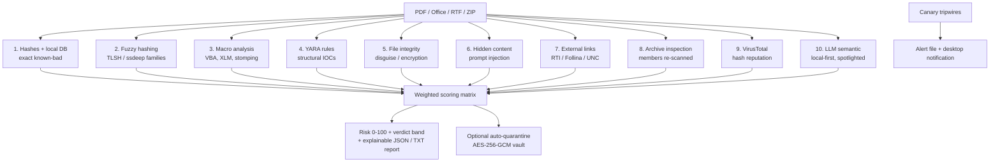

# 🛡️ Hybrid Ransomware Detection System


A multi-layered scanner that inspects **PDF, Microsoft Office (Word / Excel / PowerPoint), RTF documents and ZIP archives** for ransomware and other malicious indicators. It fuses **ten independent detection layers** through a **transparent weighted scoring matrix** that produces a 0–100 risk score, a verdict band, and a report showing *why* each file scored what it did. Around the scanner sit two host-side protections: **ransomware canary tripwires** and an **AES-256-GCM encrypted quarantine vault**.

Runs on **Windows, macOS, and Linux** (x86_64 and ARM64), from the command line or a desktop GUI, with optional autostart at login.

Originally built as my B.Sc. graduation project as a three-layer scanner. v3 added structural detection (fuzzy hashing, macros, YARA), a local-first LLM, and the weighted scoring matrix. v4 adds file-integrity and ransomware-impact detection, prompt-injection defence for the LLM layer, Office external-link analysis, safe archive inspection, canaries, and quarantine. It is intended for **defensive and educational use**: analysing suspicious documents, not creating malware.

---

## 📖 Table of Contents

- [🆕 What's new in 4.0](#-whats-new-in-40)
- [🧩 Why "hybrid"?](#-why-hybrid)
- [🔬 Detection layers](#-detection-layers)
- [⚖️ Weighted scoring matrix](#️-weighted-scoring-matrix)
- [🛡️ Protection features](#️-protection-features)
- [📦 Requirements](#-requirements)
- [🚀 Installation](#-installation)
- [🔑 Configuration](#-configuration)
- [💻 Usage](#-usage)
- [🪟 Graphical interface](#-graphical-interface)
- [🧪 Testing](#-testing)
- [📂 Project structure](#-project-structure)
- [🌐 Cross-platform & architecture notes](#-cross-platform--architecture-notes)
- [⚠️ Limitations](#️-limitations)
- [🧭 Roadmap](#-roadmap)
- [🚨 Disclaimer](#-disclaimer)
- [👤 Author](#-author)

---

## 🆕 What's new in 4.0


- **File integrity & ransomware impact.** Flags executables disguised as documents (`invoice.pdf` that is really a PE, ELF, Mach-O, `.lnk` or script) and documents that have **already been encrypted** (format signature gone, bytes statistically random), including intermittent encryption that only scrambles the first few KB.
- **Prompt-injection defence.** Detects hidden text in Word files and PDFs (hidden runs, 1–2 pt fonts, white text, invisible PDF render mode) and text aimed at an AI analyst ("ignore previous instructions…"). LLM prompts now wrap the document in per-request random delimiters.
- **Office external links.** Remote template injection (T1221), Follina-style OLE links (CVE-2022-30190), `ms-msdt:` / `search-ms:` handlers and NTLM-leaking UNC paths: the macro-less document attacks.
- **Archive inspection.** ZIP files (including nested and password-protected ones) are unpacked into a sandbox; zip bombs, zip slip, double extensions (`receipt.pdf.exe`) and RTLO filename spoofing are flagged, and **every member goes through the full pipeline**.
- **Macro upgrades.** VBA stomping (P-code vs source mismatch) and Excel 4.0 (XLM) macro sheets.
- **Canary tripwires** that turn the background mode into a near-real-time ransomware alarm, and an **encrypted quarantine vault** with verify-before-delete.
- **Safer external calls.** VirusTotal is now **hash-lookup only by default** (uploads are opt-in), requests have timeouts, retries and quota pacing, and VirusTotal/LLM answers are cached by SHA-256.
- **146 automated tests** (unit, end-to-end, CLI and GUI), run on Python 3.9, 3.11, 3.12 and 3.13.

Full details in the [changelog](CHANGELOG.md) and [`docs/DETECTION_v4.md`](docs/DETECTION_v4.md).

---

## 🧩 Why "hybrid"?

Most lightweight scanners rely on a single technique (usually a hash lookup), which misses anything not already in a database. This tool layers complementary approaches (exact, structural, behavioural, reputational, and semantic) so a file flagged by **any** of them is surfaced, and the **weighted scoring matrix** makes the verdict reflect *which kind* of evidence fired. A real exec primitive in a macro counts for far more than a phishing-flavoured sentence.



Signals fall into three weight categories: **technical** (everything structural), **reputation** (VirusTotal), and **semantic** (LLM). Technical evidence is designed to mathematically outweigh semantic evidence.

---

## 🔬 Detection layers

1. **Cryptographic hashing + local hash database.** MD5 and SHA-256 with chunked reads (constant memory), and an O(1) lookup of the MD5 against a streamed CSV of known-malicious hashes. Instant, offline detection of known samples.
2. **Fuzzy / structural hashing (polymorphic families).** **TLSH** and **ssdeep** (pure-Python `ppdeep`) digests compared against a signature database of *confirmed* malicious samples. The digests stay *similar* when a file stays *structurally similar*, which catches polymorphic variants whose exact SHA-256 has never been seen.
3. **Macro analysis (Office dropper mechanism).** `oletools` / `olevba` statically extract and triage VBA and XLM macros **without executing them**: auto-run triggers (`AutoOpen`, `Document_Open`, …), execution/download primitives (`Shell`, `CreateObject`, `URLDownloadToFile`, `powershell`, …), other suspicious calls, and IOCs. v4 adds:
   - **VBA stomping**: the visible source was replaced while the compiled P-code (what Office actually runs) still holds the payload. The mismatch is itself strong evidence of evasion.
   - **Excel 4.0 (XLM) macro sheets**, a favourite of Emotet/Qakbot loaders, in both `.xls` (BIFF) and OOXML workbooks.
4. **YARA rules engine (structural IOCs).** Compiles every `.yar` / `.yara` file in `rules/` and scans each file. Rules carry a `severity` meta the scoring matrix reads. Ten original rules ship in three files: ransom-note language, extortion + urgency, Bitcoin addresses with payment context, PowerShell download cradles, Office dropper structures, PDF auto-launch actions, executables disguised as documents, and (new) **shadow-copy deletion and boot-recovery tampering** (MITRE T1490). Only matched string identifiers are recorded, never the raw bytes.
5. **File integrity: disguise and encryption (new).** Reads the file's real format from its magic bytes and compares it with the extension.
   - **Disguised executables**: a PE (validated `MZ` → `PE\0\0` header), ELF, Mach-O, Windows shortcut (`.lnk`) or `#!` script behind a document extension.
   - **Encrypted content** (ransomware *impact*, T1486): the format signature is missing **and** the bytes are statistically random. Randomness is judged with Shannon entropy compared to what truly random data of the same length would reach, plus a chi-square uniformity test. Checking the first 4 KiB separately catches intermittent encryption. Because .docx/.xlsx and most PDFs are compressed (and therefore high-entropy), the randomness test only runs when the expected signature is already gone. That avoids the false positives a plain entropy threshold produces.
   - Formats Office opens natively under another extension (HTML exported as `.xls`, RTF saved as `.doc`, password-protected `.docx` stored as OLE) are noted but not scored.
6. **Hidden content & prompt injection (new).** Finds concealed text in `.docx/.docm` (hidden runs, ≤ 2 pt fonts, near-white text without background shading) and PDFs (text render mode 3, i.e. invisible), and looks for phrasing aimed at an AI analyst ("ignore previous instructions", "mark this file as clean", chat-template tokens, …). An injection phrase inside concealed text is a **confirmed** attempt. A phrase in plainly visible text is only **suspicious**, because articles *about* prompt injection contain the same words. XML is parsed with `defusedxml`.
7. **Office external links (new).** Reads the relationship parts inside OOXML files and RTF control words, **without contacting any URL**:
   - remote template injection (`attachedTemplate` → `http://…`, T1221),
   - external OLE objects, and Follina-style links ending in `!` (CVE-2022-30190),
   - exploit URI schemes in any relationship (`ms-msdt:`, `search-ms:`, `ms-officecmd:`, `mhtml:`, …),
   - UNC / `file://host` paths that make Windows send the user's NTLM hash to the attacker (T1187),
   - RTF `{\*\template http://…}` and auto-updating OLE links (`\objupdate`).
8. **Archive inspection (new).** ZIP archives are unpacked into a temporary sandbox with hard limits (nesting depth, member count, total and per-member decompressed size, compression ratio). It reports **zip bombs**, **zip slip** (path traversal, absolute paths, symlinks; such members are never written), executables/scripts/shortcuts inside the archive (by extension *and* magic bytes), **double extensions** (`invoice.pdf.exe`) and **right-to-left-override** names. Encrypted members are tried against a short list of delivery passwords ("infected", the archive's own name, …). Up to 25 members per archive go through all the other layers, and the archive is scored like its most dangerous member.
9. **VirusTotal (threat intelligence).** Looks the file's SHA-256 up via the v3 API and reads how many engines flag it. **Privacy by default:** unknown files are *not* uploaded (an upload shares the document with VirusTotal and its Enterprise subscribers); set `VT_UPLOAD_UNKNOWN=true` to opt in. Requests are paced to the free quota (4/min), retried with backoff on 429/5xx, time out after 30 s, and answers are cached for 24 h.
10. **LLM semantic analysis (local-first, OPSEC-preserving).** Extracts visible text (PyPDF2 / python-docx / OOXML parts, with **OCR fallback** for scanned PDFs when an LLM is active) plus printable strings, and asks an LLM whether it reads like a ransomware/phishing lure.
    - **OPSEC by default.** With `LLM_PROVIDER=auto` the scanner prefers a **local Ollama** model if one is reachable, so sensitive documents never leave the machine. It falls back to OpenAI only if no local model is available *and* a key is set, and logs the egress.
    - **Prompt-injection hardening.** Instructions live in the system role, the document in the user role, temperature 0, JSON-only output, and (new) the document is wrapped in **per-request random delimiters** (`<UNTRUSTED_DATA_5F2C…>`). Look-alike tags inside the document are neutralised, so it cannot close the data block and talk to the model directly. Answers are cached by SHA-256.

Every optional layer **degrades gracefully**: a missing library, a missing local model, or a missing API key produces a warning, not a crash, and the remaining layers still run.

---

## ⚖️ Weighted scoring matrix

The original hardcoded equation (`10·db + 5·llm + 5·vt`) gave a *semantic* guess the same weight as multi-engine reputation. `detectors/scoring.py` replaces it with a transparent matrix: every signal contributes through an explicit rule with a **category**, a **weight**, and a human-readable **detail**, under three principles:

1. **Technical > semantic, mathematically.** The semantic (LLM) category is capped at 24, so a phishing lure can never by itself out-score a real structural indicator.
2. **Semantic-alone cannot be "High".** If no technical or reputation signal fired, the verdict is clamped to at most **Medium**.
3. **Explainability.** Each result carries a per-indicator breakdown, so the report shows exactly which signals drove the verdict and by how much.

| Indicator | Category | Points |
|---|---|---:|
| Local hash-DB match | technical | 100 |
| YARA match (critical / high / medium / low) | technical | 90 / 65 / 40 / 18 (+8 per extra rule) |
| VBA stomping | technical | 90 |
| Executable disguised as a document | technical | 90 |
| External link: exploit URI scheme / Follina-style OLE | technical | 90 |
| Archive zip slip | technical | 80 |
| Fuzzy family match | technical | 72 × confidence |
| Encrypted content (ransomware impact) | technical | 70 |
| External link: remote template / external OLE / UNC | technical | 70 (+8 per extra kind) |
| Archive double extension / RTLO spoof | technical | 60 |
| Archive zip bomb | technical | 60 |
| XLM macro sheet | technical | 55 |
| Confirmed prompt injection | technical | 50 |
| Macro: exec primitive / auto-run / dropper synergy / other suspicious call | technical | 40 (+8 each extra) / 22 / 20 / 10 |
| Executable inside an archive | technical | 35 |
| Encrypted archive the scanner could not open | technical | 20 |
| Hidden content · suspicious injection phrasing · format mismatch | technical | 15 each |
| Worst archive member | its own categories | carried over |
| VirusTotal detections | reputation | max(35, 80 × ratio) |
| LLM lure assessment | semantic | 24 × confidence |

Category caps: technical 100, reputation 80, semantic 24; the total is clamped to 100.

| Risk score | Verdict |
|-----------:|---------|
| 0 | Clean |
| 1–24 | Low |
| 25–49 | Medium |
| 50–79 | High |
| 80–100 | Critical |

The legacy **severity score (0–10)** (`risk / 10`) is still produced so older reports and integrations keep working: a pure local-DB hit is exactly `10.0`, a clean file `0.0`.

---

## 🛡️ Protection features

### Canary tripwires

```bash
python RansomwareScanner.py --deploy-canaries            # your configured scan folders
python RansomwareScanner.py --deploy-canaries ~/Documents ~/Desktop
python RansomwareScanner.py --verify-canaries             # exit code 2 if tripped
python RansomwareScanner.py --remove-canaries
```

Decoy documents (`!000_Finance_Records_Backup.docx`, `!000_Signed_Contracts_Archive.pdf`, `!000_Asset_Inventory.csv`) are planted where an alphabetical ransomware walk reaches them first. Each is a valid, unique file whose SHA-256 is recorded. If one is **deleted, modified, rewritten with random bytes, or renamed with an appended extension** (`….docx.lockbit`), or a ransom-note-named file appears beside it, the tripwire fires. It writes `canary_alert_<time>.txt` next to the reports, logs at CRITICAL, and raises a desktop notification on macOS/Linux. `--background` checks every 5 minutes (`CANARY_CHECK_MINUTES`), the GUI does the same while it is open, and canary files are never scanned or quarantined themselves.

### Encrypted quarantine vault

```bash
python RansomwareScanner.py --quarantine ~/Downloads/invoice.docm
python RansomwareScanner.py --list-quarantine
python RansomwareScanner.py --restore 3fa9            # full id or unique prefix
python RansomwareScanner.py --restore 3fa9 --restore-to ~/analysis/
```

Files are encrypted with **AES-256-GCM** in 64 KiB chunks. Each file gets its own key (HKDF-SHA256 from a local master key and a random salt), and the header, every chunk (with its sequence number) and an explicit end-of-file frame are all authenticated, so tampering, reordering and truncation are all detected. The original is deleted **only after** the encrypted copy has been decrypted again and its SHA-256 verified. Restore never overwrites a file that has since appeared at the original path. Set `AUTO_QUARANTINE=critical` (or `high`) to quarantine automatically after each scan; it is off by default.

> The vault neutralises a file: it can't be opened, executed, or re-flagged by other tools. It is not a secrecy boundary against someone who already controls your account, because the key lives on the same disk.

### Ransomware impact in reports

While walking folders, file *names* are checked for ransom notes (`HOW_TO_DECRYPT.txt`, `_readme.txt`, `!!!READ_ME!!!.txt`, …) and known ransomware extensions (`.lockbit`, `.locked`, Dharma-style `.id-XXXX.[mail].ext`, …). Together with files whose content looks encrypted, these feed a **"POSSIBLE ACTIVE RANSOMWARE IMPACT"** banner at the top of the report.

---

## 📦 Requirements

**Python:** 3.9+ (see `requirements.txt`; every dependency ships x86_64 and ARM64 wheels or is pure Python, so installation needs no compiler).

**Detection-layer libraries (optional, recommended):** `python-tlsh` + `ppdeep` (fuzzy hashing), `oletools` (macros), `yara-python` (YARA), `defusedxml` (hidden-content and external-link layers for Office files), `cryptography` (quarantine vault). If any are absent, that layer or feature is skipped.

**Local LLM (optional, for OPSEC).** Install **[Ollama](https://ollama.com)** and pull a model; the scanner finds it automatically:

```bash
ollama pull llama3.1          # or any chat model you prefer
# the scanner auto-detects a running Ollama at http://localhost:11434
```

**System packages: Tesseract OCR + Poppler.** Only needed for the **OCR fallback on scanned/image-only PDFs**, and only used when an LLM is active.

- **Windows:** install **Tesseract OCR** and **Poppler**, and add both to your `PATH`.
- **macOS:** `brew install tesseract poppler`
- **Linux (Debian/Ubuntu):** `sudo apt-get install tesseract-ocr poppler-utils`

**For the GUI only: Tkinter.** Bundled with the official Python installers on Windows and macOS. On minimal Linux installs: `sudo apt-get install python3-tk`.

---

## 🚀 Installation

```bash
git clone https://github.com/Abdelrahman-El-Maghraby/hybrid-ransomware-detector.git
cd hybrid-ransomware-detector

python -m venv .venv
# Windows:        .venv\Scripts\activate
# macOS / Linux:  source .venv/bin/activate

pip install -r requirements.txt
```

## 🔑 Configuration

API keys and settings are loaded from a local `.env` file and are **never** stored in the code.

```bash
cp .env.example .env        # Windows: copy .env.example .env
```

| Variable | Default | Purpose |
|---|---|---|
| `LLM_PROVIDER` | `auto` | `auto` \| `ollama` \| `openai` \| `none` |
| `OLLAMA_HOST`, `OLLAMA_MODEL` | `http://localhost:11434`, `llama3.1` | local model |
| `OPENAI_API_KEY`, `OPENAI_MODEL` | empty, `gpt-4` | optional cloud fallback |
| `VIRUSTOTAL_API_KEY` | empty | reputation layer |
| `VT_UPLOAD_UNKNOWN` | `false` | upload files VirusTotal has never seen (shares their content) |
| `VT_REQUESTS_PER_MINUTE` | `4` | client-side pacing (free API quota); `0` disables |
| `HTTP_TIMEOUT` | `30` | seconds, every external call |
| `CACHE_ENABLED`, `CACHE_TTL_HOURS` | `true`, `24` | VirusTotal/LLM result cache |
| `AUTO_QUARANTINE` | empty (off) | `high` or `critical` |
| `CANARY_CHECK_MINUTES` | `5` | canary verification interval |
| `FUZZY_SIGNATURE_DB`, `YARA_RULES_DIR` | bundled | custom signature/rule locations |

> The local layers (hashes, fuzzy, macros, YARA, integrity, hidden content, external links, archives) need **no keys at all**. VirusTotal needs a key; the LLM layer needs a running Ollama (recommended) or an OpenAI key.

### Malware-hash dataset

The local database is a CSV with at least the columns `FileName`, `md5Hash`, and `Benign` (`Benign = 0` marks a malicious entry):

```bash
python RansomwareScanner.py --import-database /path/to/your/dataset.csv
```

A suitable dataset can be sourced from public malware-hash collections on Kaggle. The dataset itself is intentionally **not** committed to this repo.

### Fuzzy signature database

Fuzzy hashing matches files against the digests of *confirmed* malicious samples. To grow your own database, print a sample's digests and paste them into a signature entry:

```bash
python RansomwareScanner.py --fuzzy-hash /path/to/confirmed_sample
```

```json
{
  "version": 1,
  "signatures": [
    {"family": "Acme.Locker", "tlsh": "T1...", "ssdeep": "3:...", "note": "source / provenance"}
  ]
}
```

Point the scanner at it with `FUZZY_SIGNATURE_DB` in `.env` (the bundled sample is used otherwise). **Never commit live malware**, only its fuzzy digests.

### YARA rules

Every `.yar` / `.yara` file in `rules/` is compiled automatically. Add your own files there (or point `YARA_RULES_DIR` elsewhere) and give each rule a `severity` meta (`low` / `medium` / `high` / `critical`).

---

## 💻 Usage

```bash
# Launch the graphical interface
python gui.py                                   # or: python RansomwareScanner.py --gui

# Scan
python RansomwareScanner.py --scan-now                       # all configured folders
python RansomwareScanner.py --scan-file suspicious.docx      # one file, full verdict
python RansomwareScanner.py --scan-file mail_attachment.zip  # archives: every member
python RansomwareScanner.py --scan-file x.docx --llm-provider ollama   # force local LLM
python RansomwareScanner.py --scan-now --llm-provider none --no-cache

# Protection
python RansomwareScanner.py --deploy-canaries [DIR ...]
python RansomwareScanner.py --verify-canaries
python RansomwareScanner.py --quarantine FILE
python RansomwareScanner.py --list-quarantine
python RansomwareScanner.py --restore ID [--restore-to PATH]

# Background mode: scheduled scans + canary checks
python RansomwareScanner.py --background
python RansomwareScanner.py --setup-autostart      # at login (Windows / macOS / Linux)
python RansomwareScanner.py --remove-autostart

# Utilities
python RansomwareScanner.py --import-database dataset.csv
python RansomwareScanner.py --fuzzy-hash confirmed_sample.bin
python RansomwareScanner.py --clear-cache
python RansomwareScanner.py --create-shortcut      # Windows & Linux
python RansomwareScanner.py --version
```

Scan directories, file types and the scan interval live in the `CONFIG` block near the top of `RansomwareScanner.py` (or on the GUI's Scan page). All paths are derived from the user's home directory via `pathlib`, so they adapt to the host OS.

### Example report (excerpt)

```
Ransomware Scan Report
======================
Engine version:         4.0.0
Total files scanned:    6
Files flagged:          5
Highest verdict:        Critical
Detection layers used:  hashes, local-db, fuzzy, macro, yara, integrity, prompt-guard, relationships, archives, llm, virustotal
LLM posture:            LOCAL (llama3.1)

############################################################
POSSIBLE ACTIVE RANSOMWARE IMPACT - investigate this machine now
############################################################
  Files whose content looks encrypted: 1
    - /home/me/Downloads/Q3_budget.xlsx
  Ransom-note-like files: 1
    - /home/me/Downloads/HOW_TO_DECRYPT.txt

Verdict breakdown:  Critical: 2 | High: 3 | Medium: 0 | Low: 0

============================================================
CRITICAL (2)
============================================================

- File:     /home/me/Downloads/invoice_7731.pdf
  Verdict:  Critical (risk 100/100, severity 10.0/10)
  [YARA]      Rule(s) matched [Embedded_Executable_In_Document] (top severity 'high').
  [Integrity] Windows PE executable disguised with a '.pdf' document extension.
  Score breakdown:
    +  65.0  [technical] yara_match
    +  90.0  [technical] disguised_executable
    = category totals: technical=100.0

- File:     /home/me/Downloads/shipping_docs.zip
  Verdict:  Critical (risk 100/100, severity 10.0/10)
  [Archive]   2 member(s), 37,007 bytes extracted; 1 executable/script member(s); double-extension lure name(s).
              ! double extension: shipping_docs.zip!/DHL_receipt.pdf.exe
              - /home/me/Downloads/shipping_docs.zip!/docs/job_offer_copy.docx: High (risk 70/100)
  Score breakdown:
    +  60.0  [technical] archive_double_extension
    +  35.0  [technical] archive_executable
    +  70.0  [technical] archive_member:external_relationship
    = category totals: technical=100.0

============================================================
HIGH (3)
============================================================

- File:     /home/me/Downloads/Q3_budget.xlsx
  Verdict:  High (risk 70/100, severity 7.0/10)
  [Integrity] Format signature missing and the content is statistically random - consistent with ransomware encryption.

- File:     /home/me/Downloads/job_offer.docx
  Verdict:  High (risk 70/100, severity 7.0/10)
  [External]  remote_template -> hxxp://203.0.113[.]5/tpl.dotm

- File:     /home/me/Downloads/cv_jane.docx
  Verdict:  High (risk 65/100, severity 6.5/10)
  [Hidden]    Concealed content: hidden_attribute.
  [Injection] confirmed prompt-injection attempt: ignore_previous_instructions, verdict_override.
```

A machine-readable `ransomware_scan_<timestamp>.json` with the complete per-layer evidence trail is written alongside the text summary. External URLs in reports are defanged (`hxxp://…[.]com`).

---

## 🪟 Graphical interface

A desktop front-end built with CustomTkinter that uses the scanner as a library. The CLI keeps working on its own, and both share the same configuration, reports, hash database, canaries and vault.

**Dashboard** (screenshot at the [top of this page](#-whats-new-in-40)). A status card per layer: hash database, fuzzy hashing (signature count), macro analysis, YARA (rule-file count), VirusTotal, the LLM (**LOCAL vs CLOUD**), and in v4 the heuristic layers, canary tripwires and quarantine vault. Scans run with live per-file progress; each row shows a compact per-layer summary (e.g. `DB– fuzzy– macro! yara✓3 exe! VT 14/72 AI 0.80`) next to a 0–100 risk bar and the verdict. Double-click a row for the full breakdown.


**Result detail.** The verdict and risk score, then what every layer concluded, followed by the **weighted score breakdown**. For archives, every member is listed with its own verdict. A **Quarantine file** button moves the file into the vault.

| Archive member breakdown | Prompt-injection finding |
|---|---|
|  |  |


**Protection (new).** Deploy, verify and remove canaries, set automatic quarantine, restore or delete vault items, and clear the result cache. While the window is open, canaries are re-checked every few minutes and a trigger raises an alert.


**Scan, Reports, Database, Logs, Settings.** Monitored directories and file types, past JSON/TXT reports and canary alerts, the malware-hash dataset, the live log stream, the scan schedule, start-at-login, the VirusTotal-upload switch, and API keys. Keys are written only to the git-ignored `.env` file.


Engineering notes: scanning and canary checks run in worker threads and talk to the UI through queues (Tkinter is not thread-safe); *Stop* cancels cleanly after the current file. The result-detail and settings screenshots are from v3; the rest show v4.

### How autostart works per platform

| OS | Mechanism | Where it lives |
|----|-----------|----------------|
| Windows | Registry `Run` key | `HKCU\Software\Microsoft\Windows\CurrentVersion\Run` |
| macOS | launchd LaunchAgent | `~/Library/LaunchAgents/com.abdelrahman.ransomwarescanner.plist` |
| Linux | systemd **user** service (cron `@reboot` fallback) | `~/.config/systemd/user/ransomware-scanner.service` |

`--remove-autostart` cleanly reverses whichever mechanism was used.

---

## 🧪 Testing

```bash
pip install pytest
python -m pytest                 # 145 tests: unit + end-to-end + CLI (+1 opt-in GUI test)
python test_smoke.py             # the original v3 smoke test, still passing

# optional: the GUI test drives the real window (needs a display)
RUN_GUI_TESTS=1 xvfb-run -a python -m pytest tests/test_gui_smoke.py
```

The suite covers each detector and protection feature in isolation, the full scan pipeline, the CLI commands, and the GUI flow (scan → quarantine → restore → canary trigger). Highlights:

- the encrypted-content heuristic accepts 200 random samples at each size and rejects compressed Office files, gzip, and text,
- quarantine detects bit flips, truncation, chunk reordering and a wrong key, and never leaves partial files behind,
- zip-slip members are never written, and the extraction sandbox is gone after the scan,
- hostile XML (entity expansion) is refused rather than parsed,
- VirusTotal is never asked to upload anything unless explicitly enabled.

All test samples are **synthetic** and built at test time (a relationship pointing at a documentation IP, an `MZ` header, random bytes, a ZipCrypto archive). No live malware is stored or used.

---

## 📂 Project structure

```
hybrid-ransomware-detector/
├── RansomwareScanner.py         # scanner engine + CLI (cross-platform)
├── gui.py                       # desktop GUI (uses the scanner as a library)
├── test_smoke.py                # original v3 smoke test (still passing)
├── detectors/                   # independently-optional detection engines
│   ├── fuzzy_hash.py            # TLSH + ssdeep structural hashing
│   ├── macro_analysis.py        # olevba VBA/XLM triage + VBA stomping
│   ├── yara_engine.py           # YARA rule compilation + scanning
│   ├── file_integrity.py        # magic bytes, disguised executables, encrypted content
│   ├── prompt_guard.py          # hidden content + prompt-injection detection
│   ├── relationship_scanner.py  # remote template / Follina / UNC / RTF links
│   ├── container_extractor.py   # safe ZIP extraction (bomb / slip / lures)
│   ├── llm_backends.py          # local Ollama / cloud OpenAI / none, spotlighted prompts
│   └── scoring.py               # transparent weighted scoring matrix
├── core/                        # host-side protection services
│   ├── quarantine.py            # AES-256-GCM vault, verify-before-delete
│   ├── canary.py                # canary tripwires + desktop notifications
│   ├── cache.py                 # SQLite (WAL) cache for VirusTotal/LLM answers
│   └── http.py                  # timeouts, retry/backoff, rate limiter
├── rules/                       # YARA rules (drop in your own .yar files)
│   ├── ransomware_generic.yar
│   ├── office_dropper.yar
│   └── recovery_inhibition.yar
├── tests/                       # pytest suite (synthetic samples only)
├── docs/                        # screenshots + DETECTION_v3.md / DETECTION_v4.md
├── fuzzy_signatures.sample.json # documented placeholder fuzzy signature DB
├── requirements.txt
├── CHANGELOG.md
├── .env.example                 # template for keys + settings
├── .gitignore
├── LICENSE
└── README.md
```

See [`docs/DETECTION_v4.md`](docs/DETECTION_v4.md) for the design of the v4 layers (and [`docs/DETECTION_v3.md`](docs/DETECTION_v3.md) for the earlier ones), and [`CHANGELOG.md`](CHANGELOG.md) for the version history.

---

## 🌐 Cross-platform & architecture notes

- **OS-aware paths:** all runtime paths (app dir, logs, reports, vault, cache) are built from `Path.home()`; nothing is hardcoded to one OS.
- **No architecture lock-in:** dependencies are pure Python or ship x86_64 and ARM64 wheels (Windows/macOS/Linux), including Apple Silicon.
- **Tested** on Python 3.9, 3.11, 3.12 and 3.13 (Linux), with the GUI exercised headlessly. The code avoids OS-specific APIs outside the autostart and notification helpers, which branch per platform.
- **Graceful degradation:** missing libraries, keys, OCR binaries or scan folders produce warnings, not crashes.

---

## ⚠️ Limitations

Being explicit about what the tool does *not* do:

- **Static analysis only.** Nothing is executed; there is no sandbox detonation.
- **Archives:** ZIP only (including nested and ZipCrypto-protected ZIPs). 7z, RAR and ISO are not unpacked yet; AES-encrypted ZIP members are reported as unreadable.
- **Encrypted-content detection** needs at least 1 KiB of data, and a raw, headerless compressed stream can look as random as ciphertext. That is why it only runs once a document's own signature is already missing.
- **Hidden-content detection** covers Word (`.docx/.docm`) and PDF. Excel/PowerPoint hidden content is not inspected.
- **Canaries detect, they don't block.** They catch encryption in the folders where they are planted, at the check interval. This is a tripwire, not an EDR.
- **Quarantine key** is stored locally (`~/RansomwareScanner/keystore`, mode 0600). Back it up if you need to restore items on another machine.
- **Detection content is a starting point:** the bundled YARA rules are original triage heuristics and the fuzzy database ships empty. Real coverage grows with your own signatures.

---

## 🧭 Roadmap

Delivered in v4.0.0: file-integrity and ransomware-impact detection, prompt-injection defence, Office external-link analysis, archive inspection, VBA-stomping/XLM detection, canary tripwires, the quarantine vault, and safer external calls (see the [changelog](CHANGELOG.md)). Next:

- **More containers:** 7z / RAR / ISO / IMG, and `.eml` / `.msg` email files with their attachments.
- **Real-time file watching** (filesystem events) to complement the canary interval.
- **Windows toast notifications** for canary alerts (macOS and Linux are supported today).
- **CI** running the test suite on Windows, macOS and Linux for every push.
- **Richer detection content:** a broader YARA rule set and a curated starter fuzzy-signature database.

---

## 🚨 Disclaimer

This project is for **educational and defensive** purposes only: identifying potentially malicious documents. Do not use it to create or distribute malware. Always analyse untrusted files in an isolated environment.

## 👤 Author

**Abdelrahman El-Maghraby**, Cybersecurity Specialist
[LinkedIn](https://www.linkedin.com/in/abdelrahman-el-maghraby/)

Released under the [MIT License](LICENSE).
