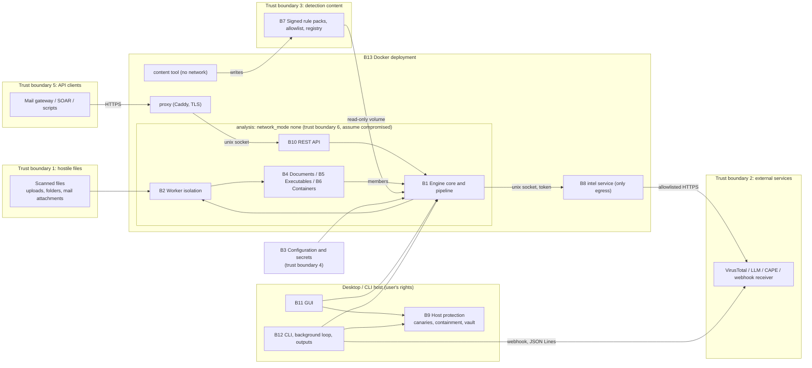

# Project review: Aegis Sentinel (hybrid-ransomware-detector)

Status: **complete review (Stages 1 and 2)**. Remaining limitations are listed
in section 2. Implementation (Stage 3) has not started and needs the owner's
separate approval.

**Plan revision (2026-10-29, after Stage 2):** the owner answered D-A to D-E.
The revised Stage 3 plan, the PR #30 check results and the decisions still open
are in section 24 (proposed, not approved). The owner's answers to the open decisions are in 24.9, and PR #30's status in 24.10. Sections 0-23 are kept as the Stage 1
and Stage 2 record.

Task brief: [tasks/project-review.md](tasks/project-review.md).

## 0. Review baseline

| Item | Value |
|---|---|
| Reviewed branch | `main` (review notes are kept on `review/project-review`) |
| Reviewed commit | `af5e6d2ed72e2525ed8486158adb89e9a069119b` (merge of PR #29, on top of the v4.7.0 release commit `8221fe7`) |
| Working tree at review start | clean on `main`, level with `origin/main`; no uncommitted or untracked changes, so nothing was excluded |
| Code changed by this review | none. The review branch changes only `docs/PROJECT_REVIEW.md`, `docs/tasks/project-review.md` and `docs/HANDOFF.md` |
| Benchmarked code state | `af5e6d2`, unmodified (section 15) |
| Stage 2 baseline check | `origin/main` was still `af5e6d2` when Stage 2 started; no reconciliation of references was needed |
| Review dates | Stage 1 and Stage 2: 2026-10-29 |

All `file:line` references point at `af5e6d2`.

## 1. Executive summary

Aegis Sentinel 4.7.0 is a mature, well-documented static scanner for an active
development project. It already has explicit release criteria, a threat model
with residual risks, a hardened Docker deployment, per-result completeness and
provenance, signed rule packs, and a large test suite. Most of the threat model's
stated mitigations are present in the code.

In this review, locally on macOS with Python 3.14:
- the full suite: 1011 passed, 13 skipped, 0 failed, 91 % coverage of `engine`,
  `detectors`, `core` and `api`;
- ruff, mypy, bandit (no medium or high) and pip-audit (lock): clean.

Overall grade against the section 12 criteria: **B** for the current stage and
**B** for production (section 17). Neither development completion of the target
release nor production readiness is supported yet (section 18).

The main findings, in order of current impact (details in section 10):

1. **PR-01, High, confirmed and reproduced.** The rule-pack installer uses the
   signed manifest's `version` string as a folder name without validation. A
   pack signed by a trusted key with version `../../victim` deleted and replaced
   a directory outside `rulepacks/`. The threat model plans for a compromised
   signing key and expects that to affect only detection content.
2. **PR-02, Medium.** If workers cannot start, isolation fails open: the
   remaining files, API uploads included, are scanned in the main process with
   no time or memory limit, and the result does not say so.
3. **PR-03, Medium.** A single-file scan (CLI `--scan-file`, the GUI's single-file
   scan, or a folder that holds one file) runs in-process with no limits.
4. **PR-04, Medium.** DMG images are unpacked with `7z x` into a folder. This
   relies on the installed 7-Zip's own path and link handling, which the threat
   model says is never used.
5. **PR-05, Medium, test gap.** In all six OS × Python CI jobs, the API, intel,
   HTTP readiness and fuzz tests are skipped because fastapi and hypothesis are
   not installed there. They run only in the Linux / Python 3.12 coverage job.

6. **PR-17, Medium, measured on this Mac.** Isolated folder-scan throughput
   falls as workers are added: 77 → 60 files/s from 1 to 4 workers on small
   files, because each worker is polled in turn with a 50 ms blocking poll. With a
   2 ms poll in an experiment, 4 workers reached 96 files/s.
7. **PR-07, Medium.** One exception in a scheduled job ends the background
   service (scans and canary checks).

**Performance on this Mac** (section 15; benign synthetic set, 163 files,
25.3 MB, every required layer on, no network):
- 25-29 files/s and 3.9-4.5 MB/s per isolated folder scan, including a
  worker start-up of about 1.13 s;
- ordinary documents take 1-90 ms each;
- YARA runs at about 23 MB/s on large inputs.

**Requested capabilities** (section 9):
- **absent:** general folder monitoring with automatic scanning, outbound e-mail
  alerts, and optional cloud storage for logs and reports. Building blocks exist:
  the canary watcher, scheduled scans, isolated workers, JSON Lines and signed
  webhooks;
- **implemented:** quarantine and restore, including from the GUI;
- **partial:** the GUI integration.

**Next steps:** section 22 lists the ten highest-value actions. Section 20 gives
the dependency-ordered implementation sequence, and section 13 the block closure
checklists. Owner decisions D-A to D-E (section 13) gate the feature work.
*Plan revision:* D-A to D-E are answered, and the revised plan is in section 24.

## 2. Scope, methodology and limitations

**Scope.** The whole repository at `af5e6d2`. Following the brief, the security
review prioritises parsers, archive extraction, worker isolation, the analysis /
intel boundary, the API and rule-pack updates, and uses `docs/THREAT_MODEL.md` as
its basis.

**Exclusions (from the brief).** Detection accuracy, detection rates and false
positives are out of scope. Nothing here estimates them, and safe fixtures are
never presented as accuracy evidence. Scoring code is reviewed only for
implementation correctness and consistency. No change to weights or thresholds is
proposed. ML training and model work belongs to a separate contributor. Items
already tracked in `docs/RELEASE_READINESS.md` are referenced by their IDs, not
re-reported (section 11).

**Method.**
1. Read `AGENTS.md`, `CLAUDE.md`, `docs/AI_WORKFLOW.md`, `docs/HANDOFF.md`,
   `docs/RELEASE_READINESS.md`, `docs/THREAT_MODEL.md`, `docs/ARCHITECTURE.md`,
   `docs/RELEASE_SCOPE.md`, `docs/DEPLOYMENT.md`, `docs/OPERATIONS.md`,
   `docs/RUNBOOKS.md`, `docs/RULE_PACKS.md`, `docs/DATA_POLICY.md`,
   `docs/SUPPORT.md`, `docs/RELEASING.md`, `docs/DATASET_PLAN.md`, the first part
   of `docs/THIRD_PARTY.md`, and the latest `CHANGELOG.md` entries (4.7.0, the
   start of 4.6.0). `README.md`, `docs/DETECTION_v3.md` and `docs/DETECTION_v4.md`
   were read by section headings only, plus the sections cited below.
2. Read code block by block (inventory in section 3).
3. Ran the targeted existing tests for each threat-model area (section 7), and
   `ruff check .` with the project configuration.
4. Read the CI configuration and the log of the latest `tests` run on `main`
   (run 40741208642, commit `af5e6d2`) for skip reasons per job.
5. Reproduced one finding (PR-01) with a throw-away script in a temporary folder
   outside the repository.
6. Stage 2:
   - re-checked the baseline;
   - read a parser sample (`detectors/macos_packages.py` readers, the PE parser's
     bounds, the mail / embedded / web limits) and the rest of
     `core/intel_client.py`'s client;
   - checked py7zr's installed source for S-02;
   - ran the full suite with coverage, mypy, bandit and pip-audit;
   - benchmarked with `tools/profile_layers.py` and the isolated folder-scan
     path (section 15).

   Benchmark scripts, the generated dataset and raw results are kept outside the
   repository.

**Environment of the local runs.** macOS 27.0.1 on Apple M1 (8 cores, 8 GB),
Python 3.14.2 in the repository's `.venv` (pytest 9.1.1, ruff 0.17.3, schedule
1.2.2). Helper tools present: `7zz` and `unar` (Homebrew), `bsdtar`, zbar. Docker
was not used in Stage 1.

**Limitations.**
- Python 3.14 is not a supported runtime (RELEASE_SCOPE §4; RELEASE_READINESS B3),
  and this Mac is not the reference Linux host. Local results are observations for
  this Mac only.
- No Windows or Linux host was available. Statements about those platforms come
  from code reading and CI logs, not from local runs.
- `deploy/check-deployment.sh` and `deploy/isolation_check.py` were not run.
  Docker was not used in either stage. The atheris long fuzz runs and the opt-in
  GUI smoke test were not run.
- **Format parsers were sampled, not fully inspected.** Stage 2 checked bounds and
  error handling in the PE, mail, embedded, web and macOS-package parsers. B4
  (document layers), ELF, ML, scoring, `engine/validation.py` and most of the GUI
  were not reviewed line by line. Their status is "insufficient evidence" in
  section 13.
- S-01, S-03, S-04 and H-03 remain unverified (section 10).
- *Plan revision:* the CI runs on PR #30 tested the unchanged `af5e6d2` code.
  They passed the Docker deployment check and the 3.9 / 3.12 matrix on three
  OSes (section 24.7). This adds CI evidence. The local limitations above still
  apply.
- No Python 3.9 or 3.12 interpreter exists on this Mac, so the supported runtimes
  were not exercised locally.
- "Fully inspected" means every file in the declared scope was read. It does not
  mean the review proves the absence of defects.

## 3. Inspection inventory

| Depth | Files |
|---|---|
| **Fully inspected** | `engine/workers.py`, `engine/scanner.py`, `engine/staging.py`, `engine/layers.py`, `engine/containers.py`, `engine/completeness.py`, `engine/readiness.py`, `engine/protection.py`, `detectors/container_extractor.py`, `api/server.py`, `api/limits.py`, `api/intel.py`, `core/http.py`, `core/rulepack.py`, `core/outputs.py`, `core/canary_watch.py`, `Dockerfile`, `docker-compose.yml`, `.github/workflows/{tests,quality,release,docker}.yml`, `pyproject.toml`, `requirements.txt`, `requirements-ml.txt` |
| **Partly read** | `detectors/macos_packages.py` (docstring, 7-Zip helpers 275-344), `core/intel_client.py` (1-80), `engine/config.py` (1-60 and the setting list), `RansomwareScanner.py` (argument parser, 894-999), `aegis_gui/state.py`, `aegis_gui/detail.py` and `aegis_gui/pages/protection.py` (quarantine paths), `requirements.lock` (header, hashes) |
| **Sampled in Stage 2** (bounds, limits, error handling; not every line) | `detectors/macos_packages.py` 60-262 (read fully), `detectors/pe_analysis.py` (limits and `analyze_bytes` 260-281), `detectors/mail_analyzer.py` (limits), `detectors/embedded_content.py` and `detectors/web_content.py` (limits and regexes), `core/intel_client.py` 80-140, `core/cache.py` (structure), `tools/profile_layers.py` (read fully) |
| **Inventory only** (names, sizes, call sites) | the remaining `detectors/` modules, `core/{cache,sandbox,quarantine,canary,containment,response,mailbox,allowlist,tools}.py`, `engine/{validation,secret_store,external,text,report,provenance,capabilities,metrics,logs}.py`, the rest of `aegis_gui/`, `tools/`, `build.py`, `scanner.spec`, `deploy/*`, `fuzz/`, `tests/` (test names, plus the tests executed in section 7) |

**Sampling rationale.** Stage 1 covered the security-critical boundaries the brief
names: workers, archive extraction, the API, intel and rule packs. These hold the
mitigations that stop a hostile file or client from leaving its scan. The
remaining format parsers sit behind the per-layer guard and the worker limits.
Stage 2 sampled them by size and input exposure (row above). `cfb_writer.py` is
a writer used to build Outlook items and test fixtures, not a parser of input,
so it was not sampled. `engine/validation.py`, `engine/report.py`,
`detectors/scoring.py` and most of the GUI remain unreviewed (section 2).

## 4. Development context

- **Release state.** 4.7.0 was released on 2026-10-28 (CHANGELOG `[4.7.0]`;
  RELEASE_READINESS "4.7.0"). The paid edition is an on-prem Docker deployment
  with the REST API as the primary surface. The desktop GUI is a supported analyst
  workstation app on Windows and macOS (D2). Canaries and containment are
  desktop-only and outside paid support (D3). See RELEASE_SCOPE §1-2 and §8.
- **Open release items already tracked:** M1 / X1 (real-sample evaluation), M2
  (throughput and latency on a reference host), O1 (walk-through on a clean Linux
  host), U1 (a real 4.6.0 upgrade), X2 (code signing), D5 (arm64 image), plus the
  backlog items A10-7, A8-2 and A8-3. The legal review of `docs/THIRD_PARTY.md` is
  listed as remaining blocker 2. It has **no ID of its own**: L1 ("list the terms
  for legal review") is `met`, and the review itself is the owner's
  (RELEASE_READINESS, "Remaining blockers").
- **Target release for this review (proposed scope assumption, owner decision
  needed).** The next release after 4.7.0, containing (a) fixes for the confirmed
  defects in this report and (b) the five capabilities the brief requests,
  delivered to the desktop build and, where applicable, the Docker edition. The
  brief does not name a version. RELEASE_SCOPE §5 rules out on-access scanning for
  the Docker edition, so folder monitoring is assumed to be **desktop only** until
  the owner decides otherwise (section 9).
- *Plan revision:* the owner set the target to **4.8.0**, with folder monitoring
  desktop only (D-A, D-B; section 24.1).

## 5. Block inventory and architecture

Blocks follow the repository structure and the work areas A1-A10 in RELEASE_SCOPE §7.

| ID | Block | Main files / entry points | Purpose and connections | Status | Inspection |
|---|---|---|---|---|---|
| B1 | Engine core and pipeline | `engine/scanner.py` (facade `RansomwareScanner`), `staging.py`, `layers.py`, `containers.py`, `completeness.py`, `provenance.py`, `capabilities.py`, `text.py`, `report.py` | Builds the engines, runs the ordered layers on a `ScanContext`, recurses into containers, scores, and adds status and provenance. Every interface (B10-B12) uses the facade | implemented | core files fully read; `report.py`, `text.py`, `provenance.py`, `capabilities.py` inventory only |
| B2 | Worker isolation | `engine/workers.py` | Process per file, time limit, memory limit per OS, temp folders per worker, spare workers for the API | implemented (see PR-02, PR-03) | fully |
| B3 | Configuration and secrets | `engine/config.py`, `validation.py`, `secret_store.py` | Global `CONFIG` dict built from the environment / `.env`; validation at start; secret precedence environment > keyring > `.env` | implemented | partly |
| B4 | Document layers (A2) | `detectors/file_integrity.py`, `macro_analysis.py`, `prompt_guard.py`, `relationship_scanner.py`, `yara_engine.py`, `fuzzy_hash.py`, `tlsh_py.py` | Format checks, macros, hidden content, external links, YARA, similarity | implemented | inventory only |
| B5 | Executable layers (A3) | `detectors/pe_analysis.py`, `elf_analysis.py`, `ml_classifier.py`, `entropy.py` | PE / ELF structure; ML layer in rule-engine mode (no model ships) | implemented (ML model: other contributor) | inventory only |
| B6 | Containers and delivery (A4) | `detectors/container_extractor.py`, `macos_packages.py`, `mail_analyzer.py`, `web_content.py`, `embedded_content.py`, `script_analysis.py`, `qr_scanner.py`, `cfb_writer.py` | Unpack archives, mail, web payloads, OneNote / CHM / MSI; members go back through B1 | implemented (see PR-04) | `container_extractor.py` fully, `macos_packages.py` partly, others inventory |
| B7 | Detection content and scoring (A1, A6) | `rules/`, `detectors/indicators.yaml`, `registry.py`, `signals.py`, `scoring.py`, `core/rulepack.py`, `core/allowlist.py`, `tools/rulepack.py`, `tools/evaluate.py`, `tools/calibrate_weights.py`, `tools/profile_layers.py` | Typed signals, registry-driven weights and caps, signed rule packs, evaluation tools | implemented (see PR-01) | `core/rulepack.py` fully, others inventory |
| B8 | Intelligence and external services (A5) | `api/intel.py`, `core/intel_client.py`, `core/http.py`, `core/cache.py`, `core/sandbox.py`, `detectors/llm_backends.py`, `detectors/emulation.py`, `engine/external.py` | VirusTotal, LLM, CAPE and box-js; in Docker only through the intel service, with an origin allowlist | implemented | `api/intel.py`, `core/http.py` fully; `intel_client.py` partly |
| B9 | Host protection (A8) | `core/canary.py`, `canary_watch.py`, `response.py`, `containment.py`, `quarantine.py`, `engine/protection.py` | Canaries, real-time canary watching, containment, encrypted vault, automatic quarantine | implemented (desktop only, D3) | `canary_watch.py`, `protection.py` fully; others inventory |
| B10 | REST API and operations signals (A9, A10) | `api/server.py`, `api/limits.py`, `api/probe.py`, `api/scan_result.schema.json`, `engine/readiness.py`, `engine/metrics.py`, `engine/logs.py` | `/scan`, `/health`, `/ready`, `/version`, `/schema`, `/metrics`; abuse limits; fresh worker per upload | implemented | `server.py`, `limits.py`, `readiness.py` fully |
| B11 | Desktop GUI (A9) | `gui.py`, `aegis_gui/` (app, pages, detail, state) | Scans, results, provenance, diagnostics, protection page, vault restore, quarantine undo | implemented | partly |
| B12 | CLI, background service and outputs (A9) | `RansomwareScanner.py`, `core/mailbox.py`, `core/outputs.py` | CLI commands, scheduled scans, IMAP triage, JSON Lines, signed webhooks | implemented (see PR-07, PR-08) | `outputs.py` fully, CLI partly |
| B13 | Docker deployment | `Dockerfile`, `docker-compose.yml`, `deploy/` | analysis (no network) / intel (only egress) / proxy (TLS) / content tool | implemented | Dockerfile and compose fully; `deploy/` inventory |
| B14 | Release and CI (A10) | `.github/workflows/`, `build.py`, `scanner.spec`, `requirements*`, `pyproject.toml` | Test matrix, quality gates, Docker check, release builds, SBOM, Sigstore | implemented (see PR-05, PR-06) | workflows and pyproject fully; `build.py` inventory |
| B15 | Tests and fuzzing | `tests/` (82 files), `fuzz/`, `test_smoke.py` | Unit, integration, regression corpus, hypothesis fuzzing, GUI smoke test (opt-in) | implemented | inventory, plus the executed subset |
| B16 | Documentation | `README.md`, `CHANGELOG.md`, `docs/` | Design, threat model, release scope and tracking, operations, policies | implemented (see PR-10) | read as listed in section 2 |



Mermaid validation: section 23.

## 6. Clean code and design review

Conclusions apply only to the files inspected (section 3). Blocks with inventory
only are marked as such. A large file, a mixin or global state is
not counted as a problem unless the code shows a practical effect.

### Per block

**B1 Engine core and pipeline** (inspected)
- *Working well.* Each layer is a small class with one `run()` and a visible order
  (`engine/layers.py:130-144`, `:467-492`). Every layer runs inside a guard that
  turns an exception into `layer_errors` (`engine/staging.py:88-104`). Heavy layers
  run on copies of the context and are merged back in pipeline order
  (`engine/staging.py:131-150`). The completeness rules are documented together with
  their precedence (`engine/completeness.py:1-29`).
- *Coupling.* The facade combines five mixins (`engine/scanner.py:70-71`). They
  depend on attributes declared only as class annotations
  (`engine/staging.py:27-31`, `engine/protection.py:25-31`). The practical effect
  shows in `api/intel.py:91-101`: to reuse the VirusTotal code, the intel service
  builds a stand-in "scanner" by setting `config`, `cache`, `intel`, `http`,
  `http_timeout` and `vt_limiter` by hand. If `ExternalLookupsMixin` starts using a
  new attribute, intel fails at run time. mypy would not catch it, because
  `check_untyped_defs = false` (`pyproject.toml:122`).
- *Error handling.* `ScanContext.start` runs before any layer guard
  (`engine/staging.py:46`; `engine/layers.py:107-123`). If `os.path.getsize` or a
  format sniffer raises, the whole `scan_file` call raises. The in-process path then
  drops that file (PR-09).
- *Duplication.* The top-level result is built in two places: `ScanContext.start`
  (`engine/layers.py:109-118`) and `failure_result` (`engine/workers.py:373-405`). A
  new top-level field has to be added to both. Whether every schema field is in
  both is checked for the schema's required fields (`tests/test_outputs_and_api.py:28`,
  `:36`, run and passed in this review). Fields outside the schema can still drift (RF-7).
- *Readability.* `ScanContext.data()` sits between dataclass fields
  (`engine/layers.py:80-95`). It works, but the fields read as if they ended before
  it. Low impact.
- *Naming.* Legacy names are kept on purpose for compatibility (`chatgpt_analysis`,
  `engine/layers.py:393`; `kaggle_db_path`; `severity_score`). Keep them while the
  result schema stays additive-only (C6).

**B2 Worker isolation** (inspected)
- *Working well.* The per-OS memory limits are cleanly separated
  (`engine/workers.py:50-65`, `:122-145`, `:177-215`). Each worker has its own temp
  folder, which the parent removes (`:227-234`, `:346`, `:357-370`), and folders left
  by a dead scanner are swept (`:315-336`).
- *Design weakness.* The fallback to unisolated scanning is implicit and silent
  (PR-02). The scan loop polls each worker in turn with a 50 ms blocking poll
  (`:428`, `:469-474`, `:522-528`). Whether this adds dispatch latency with several
  workers was measured: it does (PR-17, section 15).
- *Module globals* (`_SCANNER`, `_JOB_HANDLE`, `_SWEPT`, `:46`, `:103`, `:289`) are
  per process and read correctly in their context. No change is suggested.

**B3 Configuration and secrets** (partly inspected)
- `CONFIG` is a global dict (`engine/config.py:139`), but the engine receives it by
  injection (`engine/scanner.py:77-79`). That is testable, and a typed config is not
  justified today (RELEASE_READINESS A7: "Typed config: no fix needed it").
- *Duplicated fallback defaults.* Code outside `engine/config.py` repeats defaults,
  for example `scan_timeout_seconds` 300 (`engine/scanner.py:375`,
  `api/server.py:122`) and `worker_memory_mb` 2048 (`engine/scanner.py:376`,
  `api/server.py:92`). Some copies disagree: `http_timeout` is 30 in
  `engine/scanner.py:230` and 60 in `core/mailbox.py:72`, and `openai_model` is
  `"gpt-4"` in `detectors/llm_backends.py:275` but `"openai"` in
  `aegis_gui/pages/dashboard.py:274`. These fallbacks apply only when a key is
  missing (tests, tools, partial configurations), because `CONFIG` always sets them
  (`engine/config.py:158`, `:209`). Low impact. Fix them when that code is next
  changed.
- `api/server.py:67` reads `AEGIS_API_MAX_UPLOAD_MB` at import time. That goes
  against the "no side effects on import" convention in `engine/config.py:5-10` and
  makes the limit a module constant. Low impact.

**B4 Document layers**: not reviewed (section 2). **B5 Executable layers**: the PE
parser was sampled; its loops and reads are bounded (`detectors/pe_analysis.py:50-54`,
`:314`, `:344`, `:366`, `:386`), and truncated headers become findings
(`:270-276`). ELF and ML were not reviewed.

**B6 Containers and delivery** (`container_extractor.py` inspected)
- *Working well.* Every format goes through shared admission, naming and budget
  helpers (`detectors/container_extractor.py:489-506`, `:538-544`, `:572-588`). The
  sandbox lives only inside a context manager (`:410-429`). The large module is
  organised by format with explanatory docstrings, so its size alone is not a
  problem.
- *Inconsistency.* DMG unpacking is the only path that lets an external tool write
  a directory tree (PR-04). 7z members are size-checked only after `py7zr` has
  extracted them (`:705-739`; suspected S-02).
- *Duplication.* The password-candidate loops appear three times, for ZIP
  (`:619-637`), 7z (`:669-676`, `:706-718`) and RAR (`:752-760`, `:792-825`), each with
  format-specific errors. Merging them is optional. Only do it when one of them
  changes.
- *Complexity.* `_walk_7z` is at 19 with the project's own limit of 19
  (`pyproject.toml:107-108`; measured with ruff in this review).

**B7 Detection content and scoring** (`core/rulepack.py` inspected; scoring not reviewed)
- *Working well.* Verification is complete and ordered: signature, then members,
  then manifest hashes (`core/rulepack.py:156-209`). Monotonic versions, signed
  rollback and signer tracking are small and readable (`:212-279`).
- *Defects.* The signed `version` is used as a path (PR-01). `active.json` is
  written non-atomically, and a damaged one silently falls back to the bundled
  rules (PR-14).

**B8 Intelligence and external services** (`api/intel.py`, `core/http.py` inspected)
- *Working well.* There is a fixed set of operations with exact input validation
  (`api/intel.py:235-270`). Each service has its own allowlisted session, enforced
  in `send()`, so redirects are covered too (`core/http.py:57-72`). Only intel keeps
  a cache, and only from real replies (`api/intel.py:112-119`, `:173-216`).
- *Coupling.* The `_VirusTotal` stand-in (see B1).

**B9 Host protection** (`canary_watch.py`, `engine/protection.py` inspected; the rest inventory)
- *Working well.* Debounced, change-only events (`core/canary_watch.py:43-58`,
  `:133-158`). Alerts are de-duplicated by finding signature
  (`engine/protection.py:85-88`).
- *Gap relevant to the requested alerting.* Canary alerts go only to a file and a
  desktop notification. They never reach the webhook or JSON Lines outputs (PR-08).

**B10 REST API** (inspected)
- *Working well.* Middleware order and responsibilities are clear (body limit,
  per-IP limit, then authentication with lockout, then the per-client quota;
  `api/server.py:220-234`). There is a fresh worker for each upload and spare
  workers ready in advance (`:73-130`).
- *Complexity.* `create_app` is at the cap of 19. Its endpoint closures share
  `service`, `auth` and `slots`. That is readable today, but each new endpoint adds
  to it (RF-9).
- *Weaknesses.* The readiness worker check is frozen at start-up (PR-11). Module
  docstrings are stale (PR-10).

**B11 GUI** (sampled)
- The single-file scan runs in the GUI process without limits
  (`aegis_gui/state.py:107`; PR-03). The vault list and restore exist on the
  Protection page (`aegis_gui/pages/protection.py:84-123`), and quarantine undo
  exists in the result window (`aegis_gui/detail.py:468-518`). The rest of the GUI
  was not reviewed line by line (section 2).

**B12 CLI, background service and outputs** (partly inspected)
- `RansomwareScanner.py` (999 lines) mixes autostart for three OSes
  (`:116-321`), the argument parser (`:533-622`), command handlers (`:625-892`) and
  the scheduler loop (`:894-957`). `_protection_command` reaches complexity 18.
  The practical effects are PR-07, a loop with no exception guard, and a single-file
  path that does not use workers (PR-03).
- `core/outputs.py` is small and correct for one attempt per alert. It has no retry
  or outbox (PR-08).

**B13 Docker deployment** (inspected): the hardening matches DEPLOYMENT §0 and is
checked by `tests/test_deployment.py:17-110`. Gaps: no hash pinning (PR-12); the
analysis service can write its own log volume (proposed threat-model addition
TMA-1).

**B14 Release and CI** (inspected): PR-05, PR-06, PR-13. Coverage is measured
over `engine`, `detectors`, `core` and `api` only (`pyproject.toml:77-79`). The
reported 91 % therefore leaves out `aegis_gui/`, `tools/` and `RansomwareScanner.py`
(observation PR-15).

**B15 Tests**: the suite is broad and named after behaviours. The isolation
fallback is asserted as intended behaviour (`tests/test_workers.py:80`), so fixing
PR-02 means changing a test on purpose. No test covers: the rule-pack version
format, DMG traversal or links, an exception in the background loop, or isolation
of single-file scans.

**B16 Documentation**: thorough and consistent with the code in most places
checked. Exceptions: PR-04 (threat model §2), PR-10 (stale docstrings, a local
file path in a public doc).

### Design patterns in use

| Pattern | Implementation | Fit | Misuse / note |
|---|---|---|---|
| Pipeline | `engine/layers.py:130-144`, `:467-492`; runner `engine/staging.py:34-86` | Good: independent, ordered, testable layers | none found |
| Template Method | `engine/containers.py:51-89` hooks, `:92-139` shared loop; four handlers `:142-311` | Good: one recursion, budget and worst-member rule for four container kinds | none found |
| Facade | `RansomwareScanner`, `engine/scanner.py:70-106` | Good single entry point for CLI, GUI and API | wide, because the mixins add every capability to it |
| Mixins | `engine/scanner.py:70-71` | They split a large class into files | the stand-in in `api/intel.py:91-101` shows implicit coupling (see B1) |
| Bulkhead (process isolation) | `engine/workers.py:339-371`, `:424-573` | Good, with per-OS limits | silent fail-open (PR-02); not used for single files (PR-03) |
| Token bucket / rate limiter | `api/limits.py:108-137`, `AuthGuard` `:159-200`, `core/http.py:99-122` | Good, bounded tables (`max_clients`) | none found |
| Allowlist proxy (egress guard) | `core/http.py:57-72` | Good: covers redirects | none found |
| Context-managed sandbox | `detectors/container_extractor.py:410-429` | Good: removal guaranteed in-process | a killed worker relies on B2's folder removal (present) |
| Registry, Strategy, Null Object | documented in `docs/ARCHITECTURE.md` §8 | not inspected in this review | no conclusion |

**Where a pattern would really simplify** (detailed as RF-3, RF-1 and RF-4 in section 14):
1. A small `VirusTotalClient` service that both the scanner and intel inject,
   instead of the hand-built `_VirusTotal` mixin host (`api/intel.py:91-101`). It
   removes the implicit attribute contract and lets intel use a typed object.
2. An explicit isolation policy for `scan_isolated` (fail closed, or fall back
   in-process with the fallback recorded in the result) instead of a hidden
   fallback (`engine/workers.py:461-462`). This addresses PR-02 without new layers.
3. Reuse the existing bounded writer (`_stream_into`) for DMG members, as RAR
   already does, instead of a separate extract-then-walk path (PR-04).

No other new abstractions are recommended.

## 7. Threat-to-mitigation mapping

Legend: **Doc** = stated in `docs/THREAT_MODEL.md`. **Impl** = found in the code.
**Test** = an automated test exists. **Run** = executed in this review (local,
macOS, Python 3.14). Two local batches, both with `LLM_PROVIDER=none` and
`-p no:cacheprovider`:
- Batch 1: workers, worker limits, archives, RAR, encrypted containers, macOS
  packages, closed limits, fuzz. **145 passed, 3 skipped** (Job Object, `/proc`,
  "libproc exists on macOS").
- Batch 2: API auth, outputs and API, intel, cache integrity, cache keys, rule
  packs, deployment, privilege separation, readiness, scan status, secret store,
  tools path, HTTP, sharing, provenance, metrics. **175 passed**.
- Stage 2: the full suite, which contains both batches: **1011 passed, 13
  skipped, 0 failed** (section 23).

| Area / TM ref | Mitigation | Impl (file:line) | Test (file:line) | Run | Gap |
|---|---|---|---|---|---|
| Parsers §1 | Each layer guarded; an error becomes `layer_errors` | `engine/staging.py:88-104` | `tests/test_fuzz_parsers.py:199`, `:216` | yes, passed | `ScanContext.start` is outside the guard (PR-09). Parser internals not yet inspected (Stage 2). In CI the fuzz suite runs only on Linux / 3.12 (PR-05) |
| Parsers §1 | Fuzzing of every parser | `tests/test_fuzz_parsers.py:117-216`; `fuzz/fuzz_parsers.py` | same | hypothesis suite yes; atheris no | atheris long runs not executed |
| Parsers §10 | Container boundary for a parser exploit | `docker-compose.yml:64-112` | `tests/test_deployment.py:22-62` (compose content); `deploy/isolation_check.py` (live) | compose tests yes; live check no | live isolation not exercised here (CI `docker.yml` runs it) |
| Archives §2 | Generated member names in a fresh sandbox | `detectors/container_extractor.py:410-429`, `:538-544` | `tests/test_container_extractor.py:25` | yes, passed | none |
| Archives §2 | Traversal, absolute paths and links refused and reported | `:333-342`, `:489-506`; pkg `:914-916` | `tests/test_container_extractor.py:50`, `:59`; `tests/test_rar.py:76`; `tests/test_macos_packages.py:111` | yes, passed | DMG: no traversal or link test (PR-04, S-01) |
| Archives §2 | External tools only stream one member to stdout | RAR: `:795-798` through rarfile | `tests/test_rar.py:61-125` | yes, passed | **Not true for DMG**: `7z x -o<dir>` (`detectors/macos_packages.py:331-337`, used at `detectors/container_extractor.py:1008-1014`) (PR-04) |
| Archives §2 | 7z: private folder, only resolved plain files moved | `:705-739` | `tests/test_archive_formats.py:109-149` | yes, passed | size checked after extraction (S-02) |
| Archives §2 | Unpack budget (bytes, members, depth, ratio) | ZIP `:572-588`, ISO `:379-389`, `:869-882`, limits `:525-536`, depth `:436-439` | `tests/test_container_extractor.py:68`, `:74`, `:94`; `tests/test_rar.py:87`; `tests/test_archive_formats.py:141`, `:182`, `:189` | yes, passed | DMG and 7z checked after the write (PR-04, S-02) |
| Archives §2 | Killed worker's temp folder removed | `engine/workers.py:227-234`, `:357-370`, `:315-336` | `tests/test_workers.py:46`; `tests/test_worker_limits.py:360` | yes, passed | none |
| Isolation §1 | Wall-clock limit, scan_failed result | `engine/workers.py:486-500`, `:373-405` | `tests/test_workers.py:32` | yes, passed | none |
| Isolation §1 | Memory: RLIMIT_AS (Linux) | `:59-63` | `tests/test_worker_limits.py:32` | yes (setter only, macOS) | real enforcement only in Linux CI |
| Isolation §1 | Memory: Job Object (Windows) | `:122-145` | `tests/test_worker_limits.py:67-93` | partly (`:93` skipped here) | real cap only in Windows CI (`:93` ran there: not in the Windows skip list of run 40741208642) |
| Isolation §1 | Memory: watchdog (macOS) | `:177-215`, `:503-512` | `tests/test_workers.py:58`; `tests/test_worker_limits.py:121-176` | yes, passed | 0.25 s residual (documented) |
| Isolation §1, §10 | Folder and API scans in a worker; fresh worker per upload | `engine/scanner.py:372-376`; `api/server.py:114-127` | `tests/test_outputs_and_api.py:139`; `tests/test_readiness.py:152` | yes, passed | **fails open** after 3 failed starts (PR-02, asserted by `tests/test_workers.py:80`); single files not isolated (PR-03) |
| Intel §10 | Analysis has no network | `docker-compose.yml:74` | `tests/test_deployment.py:41`, `:62` | yes (static) | live check not run here |
| Intel §10 | Secrets only in intel; production refuses them on the analysis side | `docker-compose.yml:49` vs `:91` | `tests/test_intel_service.py:336` | yes, passed | none |
| Intel §10 | Fixed operations, exact inputs | `api/intel.py:235-270`, `:321-351` | `tests/test_intel_service.py:160`, `:169` | yes, passed | none |
| Intel §10 | Destinations from intel's configuration, redirects refused | `core/http.py:46-72`; `api/intel.py:122-138` | `tests/test_intel_service.py:27`, `:57`, `:184`, `:238` | yes, passed | none |
| Intel §10 | Token (≥ 32 characters) and per-operation rate limit; body cap | `api/intel.py:276-303`, `:286` | `tests/test_intel_service.py:149`, `:224`, `:232` | yes, passed | the worker holds the token (tracked: Phase 2 backlog [A5]) |
| Intel §10 | Cache only in intel, keyed by what intel derives | `engine/scanner.py:233-239`; `api/intel.py:112-119`, `:173-216` | `tests/test_cache_integrity.py:24-109` | yes, passed | none |
| API §7 | Bearer token, constant-time compare, ≥ 16 characters, docs off | `api/server.py:165-168`, `:205-206`, `:218-219` | `tests/test_outputs_and_api.py:101`, `:110`; `tests/test_api_auth.py:158` | yes, passed | none |
| API §7 | Per-IP limit before authentication | `api/limits.py:203-218`; `api/server.py:225-227` | `tests/test_api_auth.py:131` | yes, passed | none |
| API §7 | Lockout per IP, checked before the compare | `api/limits.py:159-200`; `api/server.py:175-194` | `tests/test_api_auth.py:25-126` | yes, passed | none |
| API §7 | Last X-Forwarded-For entry behind a trusted proxy | `api/limits.py:140-149` | `tests/test_api_auth.py:58`, `:63` | yes, passed | docstring says "first" (PR-10) |
| API §7 | Upload refused before parsing; streaming count | `api/limits.py:59-105`; `api/server.py:286-298` | `tests/test_outputs_and_api.py:132` | yes, passed | none |
| API §7 | `/ready` is not a token oracle | `api/server.py:241-255` | `tests/test_api_auth.py:149` | yes, passed | the workers check is frozen at start-up (PR-11) |
| Rule packs §5 | Ed25519 signature from a configured key | `core/rulepack.py:156-179` | `tests/test_rulepack.py:65` | yes, passed | none |
| Rule packs §5 | Manifest lists exactly the files; plain files under `rules/` | `:181-208` | `tests/test_rulepack.py:65`, `:107` | yes, passed | none |
| Rule packs §5 | Only newer versions; no replay; signed rollback | `:244-251`, `:123-135` | `tests/test_rulepack.py:113`, `:127` | yes, passed | **the version string is not validated and becomes a path** (PR-01, reproduced) |
| Rule packs §5 | Signer recorded; distrusted key's pack not used | `:212-231`, `:273-278` | `tests/test_rulepack.py:146`, `:167` | yes, passed | non-atomic `active.json`, silent fallback (PR-14) |
| Rule packs §5 | Rules compile before activation | `:260-270` | `tests/test_rulepack.py:176` | yes, passed | none |
| Rule packs §5 | Read-only content in analysis; reload on change | `docker-compose.yml:97`; `engine/scanner.py:130-170` | `tests/test_deployment.py:53`; `tests/test_cache_keys.py:27` | yes, passed | none |

### Proposed threat-model additions (for the owner; `docs/THREAT_MODEL.md` not changed)

| ID | Proposed addition | Evidence |
|---|---|---|
| TMA-1 | A compromised analysis worker can write the `analysis-state` volume, which holds the local log file and reports. It can therefore delete or edit local log lines. Docker's own container log is outside its reach. §10 "Little to change" lists only the read-only root and content. | `docker-compose.yml:92-93`; DEPLOYMENT §0 "Operations" (the log file is in `analysis-state`) |
| TMA-2 | A pack signed by a compromised key can do more than change detection content: through the unvalidated version string it can delete or replace directories that the installing user can write. §5 and `docs/RULE_PACKS.md` describe the compromise impact as content only. | PR-01 |
| TMA-3 | DMG unpacking depends on the host's 7-Zip for path and link safety. | PR-04 |
| TMA-4 | Isolation can silently fall back to the main process. §1 and §10 state that every folder and API scan is isolated. | PR-02, PR-03 |

These do not widen the attacker's capabilities. The attacker is still a hostile
file, or the owner of a compromised signing key, as §5 already assumes.

## 8. Platform and Python-version coverage

**Configured versus local runtime.**

| Where | Python | OS | Dependencies |
|---|---|---|---|
| `tests.yml` matrix (`.github/workflows/tests.yml:17-21`) | 3.9, 3.12 | ubuntu, windows, macos (latest) | `requirements.txt` and `requirements-ml.txt`, unpinned, installed one by one, a failure only warns (`:41-50`) |
| `quality.yml` lint, types, coverage, regression | 3.12 | ubuntu only | `requirements.lock` (`.github/workflows/quality.yml:32`, `:54`, `:109`) |
| `release.yml` builds | 3.12 | ubuntu, windows, macos | `requirements.lock`, one by one, a failure only warns; `build.py` decides (`.github/workflows/release.yml:45-50`) |
| Docker image | 3.12 (`Dockerfile:7`) | Debian trixie, amd64 in release | `-c requirements.lock` (`Dockerfile:19-21`) |
| mypy target | `python_version = "3.11"` (`pyproject.toml:117`) | n/a | type checks do not target 3.9 or 3.12 |
| This Mac | 3.14.2 | macOS 27.0.1, arm64 | `.venv` (lock not installable on 3.14: B3, tracked) |

`requirements.lock` says it was "resolved for Python 3.13 on Linux"
(`requirements.lock:1-3`). Whether the lock installs on Python 3.9 has not been
established (suspected S-04). The 3.9 jobs test unpinned, current packages, not
the shipped set.

**What CI actually exercises** (log of `tests` run 40741208642 on `af5e6d2`):

| Job | Passed | Skipped | Skipped because fastapi is missing | hypothesis (whole fuzz file) | jsonschema / qrcode | GUI (opt-in) | other (platform / tool) |
|---|---|---|---|---|---|---|---|
| ubuntu 3.9 | 935 | 46 | 36 | 1 | 2 / 2 | 1 | 4 |
| ubuntu 3.12 | 935 | 46 | 36 | 1 | 2 / 2 | 1 | 4 |
| macos 3.9 | 933 | 48 | 36 | 1 | 2 / 2 | 1 | 6 |
| macos 3.12 | 933 | 48 | 36 | 1 | 2 / 2 | 1 | 6 |
| windows 3.9 | 920 | 61 | 33 | 1 | 2 / 2 | 1 | 22 |
| windows 3.12 | 920 | 61 | 33 | 1 | 2 / 2 | 1 | 22 |

The skipped fastapi tests include the API authentication and lockout tests, the
intel service, cache integrity, HTTP readiness and metrics. **These, and the
hypothesis fuzz suite, run only in the Linux / Python 3.12 coverage job, against
the lock.** The GUI smoke test runs only there too, under xvfb (`.github/workflows/quality.yml:57-71`;
verified by the owner from JUnit in RELEASE_READINESS P3.A9).

**Platform-specific code paths (from code; the CI evidence is the skip list above).**

| Path | Code | Exercised by CI | Gap |
|---|---|---|---|
| Linux RLIMIT_AS | `engine/workers.py:59-63` | ubuntu jobs | none |
| Windows Job Object | `engine/workers.py:122-145` | windows jobs (`tests/test_worker_limits.py:93` not skipped there) | none |
| macOS memory watchdog | `engine/workers.py:177-215` | macos jobs; locally | none |
| Windows `_pid_alive` | `engine/workers.py:294-305` | not established (no dedicated test found) | coverage gap; add a Windows test |
| Restart Manager containment | `core/containment.py` | windows (`tests/test_containment.py:228`; skipped on macOS and Linux) | real-process behaviour not reviewed |
| POSIX containment, lsof, `/proc`, signals, modes | `core/containment.py` | ubuntu and macos; skipped on Windows (5 tests) | n/a on Windows |
| Windows toast | `core/canary.py:341-369` | unit test with a fake runner (RELEASE_READINESS P3.A9) | a real toast on Windows was not verified (already recorded there) |
| Autostart per OS | `RansomwareScanner.py:116-321` | tests reference it (`tests/test_pipeline.py`, `tests/test_scanner_integration.py`, `tests/test_v41_integration.py`); depth not checked | not covered by coverage measurement (PR-15) |
| Intel over a Unix socket | `core/intel_client.py:39-68` | skipped on Windows (`tests/test_intel_service.py:285`, `:306`, `:349`); the no-`AF_UNIX` path is tested at `:452` | n/a on Windows for the Docker edition |
| Emulation | `detectors/emulation.py` | POSIX fake tool only; box-js absent on every runner | the real tool is never run (opt-in feature) |

**Compatibility observations.** No supported-version compatibility defect was found
in Stage 1. The 320 targeted tests passed on 3.14 locally, but 3.14 is not
supported, so this says nothing about 3.9 or 3.12.

## 9. Requested capabilities: current status

These are requested product capabilities. They are not defects, and they are not
production prerequisites unless the owner puts them into the target release
(section 4).

| Capability | Status | Evidence | What exists to reuse |
|---|---|---|---|
| Real-time monitoring of selected folders, submitting new / changed files to the scan engine | **absent** | `watchdog` is used only for canary folders, non-recursively (`core/canary_watch.py:87-107`). Folder scans run only on a schedule (`RansomwareScanner.py:926`) or on request | `CanaryWatcher` (debounce, change-only events), `scan_isolated` workers, `scan_directory`, the GUI event bus (`aegis_gui/state.py`) |
| GUI dashboard integration with monitoring, results, alerts, quarantine, reports | **partial** | Results, provenance, diagnostics, reports, vault list / restore / delete (`aegis_gui/pages/protection.py:151-236`), quarantine undo (`aegis_gui/detail.py:468-518`) | the pages exist. Missing: a monitoring view and control, alert-channel settings and delivery status, cloud settings, key backup in the GUI (CLI only: `--export-key` / `--import-key`) |
| Quarantine and restore | **implemented** | Vault quarantine / restore / list / delete (`core/quarantine.py:299`, `:448`, `:490`, `:504`); automatic quarantine (`engine/protection.py:53-67`); audit-logged restore (RELEASE_READINESS P3.A8); GUI as above | Integration work only: automatic quarantine of monitored files, and showing quarantine actions in alerts. Not in the Docker edition by design (OPERATIONS §6) |
| Outbound e-mail alerting | **absent** | No SMTP code in the repository (searched every tracked `*.py` outside `tests/` for `smtp`, `send_mail`, `notify`, `webhook`). IMAP in `core/mailbox.py` is mailbox **inspection**, not alerting | `core/outputs.py` alert payload (metadata only, `:36-47`) and verdict threshold (`:54-62`); `engine/secret_store.py` for credentials |
| Optional cloud storage for logs and reports | **absent** | No storage client in the repository (same search, plus `boto`, `azure`, `s3`) | log rotation (`engine/logs.py`), reports in `scan_reports/`, the data policy (`docs/DATA_POLICY.md`) |

**Distinctions the brief asks for.**
- *Canary monitoring vs folder monitoring.* Canary monitoring watches only the
  folders that hold tripwire files and reacts to a change in them
  (`core/canary_watch.py:124-131`). It never scans the user's files. General folder
  monitoring with automatic scanning does not exist.
- *E-mail inspection vs e-mail alerting.* `--scan-imap` reads a mailbox read-only
  and scans the messages. There is no outbound e-mail.
- *Monitoring is not prevention.* A file can be scanned only after it has been
  written, and ransomware may have encrypted files by then. RELEASE_SCOPE §5
  already excludes on-access scanning and prevention. Any monitoring feature must
  be described as faster detection.

**Requirements and decisions** (tasks: section 13, B9 / B11 / B12; order: section 20).
- *Folder monitoring.* Decision needed: desktop only (proposed) or also Docker
  (conflicts with RELEASE_SCOPE §5). Requirements:
  - recursive watch of the selected folders;
  - wait until a file stops changing before scanning it;
  - de-duplicate by path, size, modification time and hash;
  - a bounded queue with a recorded overflow policy;
  - exclude the scanner's own folders (reports, quarantine, temp);
  - scan with `scan_isolated` (so PR-02 and PR-03 come first);
  - feed results to the GUI and the outputs.

  Platform limits to document: inotify watch limits on Linux, event coalescing in
  FSEvents on macOS, buffer overflow in ReadDirectoryChangesW on Windows, and
  unreliable events on network drives.
- *E-mail alerts.* Requirements:
  - SMTP over TLS only, with certificate verification;
  - credentials through `engine/secret_store.py`;
  - metadata-only content by default, as for webhooks;
  - rate limiting or digests;
  - a persistent outbox with retry (shared with webhooks, PR-08);
  - triggers: a verdict at or above a threshold, a canary trip, a required layer down.

  Decision needed for Docker: the analysis service has no network, so mail would
  go through intel (a new fixed operation) or a separate notifier service.
- *Cloud storage.* Requirements:
  - off by default;
  - logs and reports only, never inspected files;
  - a decision on the provider or protocol;
  - credentials in the secret store;
  - encryption in transit, plus an at-rest expectation;
  - a retention setting;
  - a local spool so uploads resume after a network failure;
  - every upload logged and listed in the data policy.

  Uploads must never come from the analysis service.

## 10. Findings

Scales are defined in section 12. Effort assumes one developer who knows the
codebase, including tests and documentation, but not review or CI waiting time.

### Confirmed

**PR-01: Signed rule-pack `version` is used as a file-system path** (High;
confirmed and reproduced; defect; B7)
- *Evidence.* `core/rulepack.py:244-246` checks only that the version is non-empty.
  `:253-255` builds `staging = root / f".staging-{version}"` and
  `final = root / version`. `:271` runs `shutil.rmtree(final)` and `:272` renames
  the staging folder onto it. Nothing confines the result to `root`.
  `tools/rulepack.py` accepts any `--version` string.
- *Reproduced in this review* (throw-away script in a temporary folder; nothing in
  the repository touched): a pack signed with a freshly generated, trusted key,
  with `version = "../../victim"`, installed to `<tmp>/victim`, outside
  `rulepacks/`. The existing `victim/keep.txt` was deleted, and the folder now held
  only the pack's `rules/`. A first attempt with `1/../../victim` failed with
  `FileNotFoundError` only because an intermediate folder did not exist.
- *Impact.* Anyone holding a trusted signing key can make every install delete or
  replace a directory that the installing user can write. On a desktop that
  includes the user's home folders. In Docker it covers the `content` and
  `analysis-state` volumes the content tool mounts (`docker-compose.yml:146-149`).
  The threat model and `docs/RULE_PACKS.md` plan for a compromised key but
  describe its impact as detection content only. A publishing mistake (an
  unusual version string) would have the same effect.
- *Fix.* Validate `version` (and `rollback_of`) against a strict pattern such as
  `^\d+(\.\d+){0,5}$` in `verify_pack` and in `tools/rulepack.py build`. Resolve
  `final` and `staging` and refuse anything outside `root`. Add tests for
  traversal, absolute and separator-containing versions.
- *Effort:* S. *Dependencies:* none. *Timing:* during current development (before
  the next pack is published).
- *Acceptance.* A signed pack whose version contains `/`, `\`, `..`, a drive or an
  absolute path is refused with `RulePackError`, and nothing outside `rulepacks/`
  changes (test). The existing tests at `tests/test_rulepack.py:45-193` still pass.

**PR-02: Isolation fails open when workers cannot start** (Medium; confirmed by
code and an existing test; design weakness, and a production prerequisite for the
API; B2, B10)
- *Evidence.* After `MAX_FAILED_STARTS` (3) workers die before becoming ready
  (`engine/workers.py:427`, `:542-550`), `run()` scans the remaining files with
  `_scan_in_process` (`:461-462`, `:563-573`). There is no time limit, no memory
  limit, and no marker in the result's provenance. The API uses this same path for
  every upload (`api/server.py:118-124`). `tests/test_workers.py:80` asserts the
  fallback as intended.
- *Impact.* When worker start-up fails (process or memory limits in the container
  such as `pids_limit: 256` at `docker-compose.yml:112`, a broken image, an
  embedded interpreter), uploads are parsed inside the API process. The threat
  model's "fresh worker per API upload" (§10, residual-risk table) then no longer
  holds, a hung parser blocks a scan slot indefinitely, and nobody is told. It
  matters when start-up is failing. It does not happen in normal operation.
- *Fix.* Add an explicit policy. The API and the production profile fail closed:
  the result is `scan_failed` with "isolation unavailable", and `/ready` turns 503.
  The desktop may keep the fallback, but the result must record it in provenance.
- *Effort:* S-M. *Dependencies:* PR-11 (readiness should reflect it).
  *Timing:* before production.
- *Acceptance.* With worker start forced to fail, `/scan` returns a `failed` result
  without calling `scan_file` in the API process, and `/ready` answers 503. Desktop
  results show the fallback.

**PR-03: Single-file scans are not isolated** (Medium; confirmed by code; design
weakness; B1, B11, B12)
- *Evidence.* `_scan_targets` isolates only when `total > 1`
  (`engine/scanner.py:372`), so a folder with one matching file is scanned
  in-process (`:391-404`). CLI `--scan-file` calls `scanner.scan_file` directly
  (`RansomwareScanner.py:897-905`), and so does the GUI's single-file scan
  (`aegis_gui/state.py:107`). Threat model §1 states that folder scans run each file
  in a worker.
- *Impact.* A single hostile file can hang the GUI or CLI process, or exhaust its
  memory, with no timeout and no `scan_failed` result. The desktop GUI is a
  supported surface (D2). Future folder monitoring would mostly scan one file at a
  time, so this gap would grow.
- *Fix.* Send single files through `scan_isolated` too (optionally with a spare
  worker, as the API does, to hide the start-up cost of about 1.4 s), and keep
  in-process scanning for container members only.
- *Effort:* S-M. *Dependencies:* PR-02 (shared policy). *Timing:* during current
  development, before folder monitoring.
- *Acceptance.* A hanging fake parser in a one-file folder, CLI `--scan-file` and
  the GUI single-file scan all return `scan_failed` after `SCAN_TIMEOUT_SECONDS`
  while the process stays responsive (tests in the style of
  `tests/test_workers.py:32`).

**PR-04: DMG unpacking hands path and link handling to the host's 7-Zip**
(Medium; mismatch confirmed, exploitability suspected (S-01); design weakness; B6,
B16)
- *Evidence.* `sevenzip_extract` runs `7z x -y -p -o<dir> <image>`
  (`detectors/macos_packages.py:331-337`). `_sevenzip_image` checks the declared
  listing (`detectors/container_extractor.py:1000-1007`), extracts everything
  (`:1008-1014`), then walks the result and skips links (`:1015-1038`). This
  contradicts threat model §2 (`docs/THREAT_MODEL.md:66`: "External tools ... only
  stream one member to stdout") and the module docstring
  (`detectors/container_extractor.py:46-51`: "RAR is the only format that runs an
  external program"). Tests cover benign, lure, large, encrypted and no-7-Zip
  images (`tests/test_macos_packages.py:155-194`), but not traversal or links.
- *Impact.* On a desktop or source install with 7-Zip (Homebrew `7zz` on this Mac),
  safety against a crafted image relies on that 7-Zip version's own protections.
  Extracted bytes are counted only after the write, against the listing. The
  Docker image ships no 7-Zip (`Dockerfile:34-35`), so there a DMG is reported
  as not unpacked.
- *Fix.* List with `7z l -slt` (as today), then stream each admitted regular file
  with `7z e -so -- <image> <member>` through `_stream_into`, as RAR does. As an
  interim step, correct the threat model and the docstring.
- *Effort:* M. *Dependencies:* S-01 verification informs the urgency.
  *Timing:* during current development.
- *Acceptance.* No 7-Zip process writes outside a stdout pipe. A crafted image with
  a link and a file written through it leaves nothing outside the sandbox (test).
  The byte budget is enforced while streaming.

**PR-05: The primary product surface and the fuzz suite are skipped in the OS ×
Python matrix** (Medium; confirmed from the CI log; design weakness in CI; B14,
B15)
- *Evidence.* `.github/workflows/tests.yml:41-50` installs `requirements.txt`, which has no fastapi,
  uvicorn, python-multipart, httpx, hypothesis, jsonschema or qrcode. In run
  40741208642 every matrix job skipped 33-36 fastapi tests and the whole fuzz file
  (section 8). These tests run only in the Linux / 3.12 coverage job.
- *Impact.* The REST API, intel service, authentication lockout and HTTP readiness
  have no CI evidence on Python 3.9, macOS or Windows, and parser fuzzing has none
  outside Linux / 3.12. The paid edition runs Linux / 3.12 in Docker, so the direct
  risk to the edition is low. The gap matters for the source installs on 3.9 that
  the edition still claims (RELEASE_SCOPE §4, D6), and for any desktop use of the
  API. It is new evidence on S1 ("full suite on 3.9 and 3.12"), not a new
  readiness item.
- *Fix.* Install `.[api]` plus the test extras in the matrix, or turn the
  importorskips into hard failures for jobs that claim the API.
- *Effort:* S. *Timing:* during current development.
- *Acceptance.* In every matrix job, 0 tests are skipped for a missing fastapi or
  hypothesis.

**PR-06: The OS matrix tests unpinned packages; the shipped lock is tested only on
Linux / 3.12** (Low; confirmed; design weakness; B14)
- *Evidence.* `.github/workflows/tests.yml:47-50` installs latest versions one by one and only warns
  on failure. The lock is used by `quality.yml` (Linux) and `release.yml`, whose
  desktop builds run no tests (`.github/workflows/release.yml:45-58`). `requirements.lock:1-3` says it
  was resolved for Python 3.13 on Linux.
- *Impact.* Matrix results describe "the latest packages", not the shipped set. A
  regression specific to the lock on Windows or macOS would be found only by
  `build.py`'s smoke test.
- *Fix.* Run the matrix against the lock where it installs, and keep a separate
  "latest" job if it is wanted. *Effort:* S-M. *Dependencies:* S-04.
  *Timing:* before production.
- *Acceptance.* Each matrix job states which dependency set it tested, and the
  lock-based jobs pass.

**PR-07: The background service has no exception guard around its scheduled jobs**
(Medium; confirmed by code and library behaviour, not exercised; defect; B12)
- *Evidence.* `--background` schedules `scanner.run_scan` and
  `scanner.check_canaries` (`RansomwareScanner.py:926`, `:939`) and loops on
  `schedule.run_pending()` (`:950-953`). The only `except` clause is for
  `KeyboardInterrupt`. schedule 1.2.2 calls `job.run()` without catching anything
  (`schedule/__init__.py:172-175` in the installed package). `run_scan` can raise:
  for example, `deliver` writes JSON Lines with no `try` (`core/outputs.py:25-33`).
  Only the mailbox job has a safe wrapper (`engine/scanner.py:442-448`).
- *Impact.* One error, such as a JSON Lines file on a full or unwritable disk, ends
  scheduled scans and canary checks. The `finally` clause stops the real-time
  watcher (`RansomwareScanner.py:956-957`). The process exits unless a supervisor
  restarts it.
- *Fix.* Wrap each scheduled job like `scan_mailbox_safely`, and count failures in
  `METRICS`. *Effort:* S. *Timing:* during current development (before folder
  monitoring builds on this loop).
- *Acceptance.* A job that raises is logged, the loop keeps running, and the next
  canary check still runs (test with a fake scanner).

**PR-08: Alert delivery is fire-once and canary alerts never reach the outputs**
(Low now, more consequential with e-mail alerting; confirmed; design weakness; B9,
B12)
- *Evidence.* `send_webhook` makes one attempt per alert and only logs a failure
  (`core/outputs.py:54-76`). `_canary_alert` writes a text file and raises a
  desktop notification only (`engine/protection.py:91-117`).
- *Impact.* An alert lost to a short receiver outage is never sent again. A SIEM
  never sees a canary trip. This is the alert-delivery base the requested e-mail
  alerts would build on.
- *Fix.* Add a small persistent outbox (one JSON file per pending alert under the
  data folder), with retry and backoff, shared by webhook and e-mail, and route
  canary alerts through it. *Effort:* M. *Timing:* with the e-mail alerting work.
- *Acceptance.* An alert queued while the receiver is down is delivered once it
  returns, a canary trip produces a webhook alert, and duplicates are suppressed
  by ID.

**PR-09: An in-process scan that raises drops the file from the results** (Low;
confirmed by code; defect; B1)
- *Evidence.* `_scan_in_order` logs the exception and `continue`s without a result
  (`engine/scanner.py:398-402`). The isolated path turns the same exception into a
  `scan_failed` result (`engine/workers.py:260-261`, `:484`). One example: the file
  is removed between the walk and the scan, so `os.path.getsize` in
  `engine/layers.py:113` raises.
- *Impact.* The report and the JSON Lines output leave the file out silently.
- *Fix.* Use `failure_result` there as well. *Effort:* XS.
- *Acceptance.* A file that disappears mid-scan appears as `failed` (test).

**PR-10: Stale or private-looking statements in docs and docstrings** (Low;
confirmed; documentation defect; B10, B16)
- `api/limits.py:11-12` says "the first X-Forwarded-For address is the client",
  but the code uses the last entry (`:140-149`).
- `api/server.py:23-26` describes the limit as "each client (IP + token)", but the
  pre-authentication limit is per IP (`:224-227`).
- `docs/DATASET_PLAN.md:7` refers to `~/Downloads/dataset_plan.csv`, a local path
  that readers of the public repository cannot see.
- *Effort:* XS. *Acceptance:* the text matches the code, and no local path remains.

**PR-11: Readiness and spare workers do not recover or report degradation** (Low;
confirmed by code; design weakness; B10)
- *Evidence.* The `workers` readiness check is the start-up warm-up result, reused
  for every `/ready` call (`api/server.py:211`, `:253`). A spare worker is replaced
  only after one is used (`:120-126`). If a background start fails
  (`:97-100`), that spare slot is gone for good.
- *Impact.* `/ready` stays 200 while worker starts fail (see PR-02), and upload
  latency rises back to the start-up cost without any signal.
- *Fix.* Count worker start failures in `METRICS`, let `/ready` read a recent
  failure rate, and refill spares to their target count. *Effort:* S.
- *Acceptance.* Forced start failures make `/ready` 503 within one probe, and the
  spare count returns to its target.

**PR-12: The lock pins versions but not hashes** (Low-Medium; confirmed;
production prerequisite; B13, B14)
- *Evidence.* `requirements.lock` contains no `--hash` entries (0 found). The image
  installs with `-c requirements.lock` (`Dockerfile:19-21`), and the release
  installs by name (`.github/workflows/release.yml:47-49`). Threat model §9 lists "Pinned lock file".
- *Impact.* A substituted artifact with the same version on the index would not be
  detected at build time. This is a supply-chain hardening gap, not an observed
  compromise.
- *Fix.* Generate with `--generate-hashes` and install with `--require-hashes`, per
  platform where wheels differ. *Effort:* M. *Timing:* before production.
- *Acceptance.* The image and release builds fail on a hash mismatch.

**PR-13: The release workflow does not require green tests for the tagged commit**
(Low; confirmed; production prerequisite; B14)
- *Evidence.* `release.yml` runs on any `v*` tag or a manual dispatch
  (`:16-19`). `publish` needs only `build` and `image` (`:114-116`). Green
  `tests` and `quality` are a manual step in `docs/RELEASING.md` §1.
- *Fix.* Have the release job check the commit's required check runs, or call the
  test workflows. *Effort:* S.
- *Acceptance.* Tagging a commit without green checks publishes nothing.

**PR-14: `active.json` is written non-atomically and failures to read it are
silent** (Low; confirmed by code; defect; B7)
- *Evidence.* `core/rulepack.py:278` uses `write_text`. `active_pack` returns
  `None` on any exception without logging (`:218-223`), which falls back to the
  bundled rules (`engine/scanner.py:113-128`).
- *Impact.* A crash during an install can leave the scanner on the bundled rules
  without a warning. Provenance still shows the rules source, so the effect is
  visible in results.
- *Fix.* Write to a temporary file, then `os.replace`, and log
  `rulepack_unreadable`. *Effort:* XS.

**PR-15: Coverage scope (observation, not a defect)**: the coverage figure excludes
`aegis_gui/`, `tools/` and `RansomwareScanner.py` (`pyproject.toml:77-79`). Report
it with that scope. Do not read it as whole-product coverage.

**PR-16: The analysis side caches intel's capabilities for its lifetime** (Low;
confirmed by code, found in Stage 2; design weakness; B8)
- *Evidence.* `IntelClient.capabilities` stores the first successful answer in
  `self._caps` and never refreshes it (`core/intel_client.py:107-121`). Only a
  failure is retried, after 30 s (`:32`, `:113-115`).
- *Impact.* If intel is restarted with a different configuration (for example,
  VirusTotal switched on), analysis keeps its old layer states and
  `provenance.external_services` until it restarts too. What was actually shared
  is still recorded per call (`provenance.shared`), so data-leak reporting is not
  affected.
- *Fix.* Refresh the capabilities with a TTL, or on intel's start-up identifier.
  *Effort:* S.
- *Timing:* later improvement.
- *Acceptance:* a changed intel configuration shows up within the TTL without
  restarting analysis.

**PR-17: Isolated folder-scan throughput falls as workers are added** (Medium;
confirmed by measurement in Stage 2, formerly H-01; design weakness; B2)
- *Evidence.* Section 15. On 161 small files, steady state was 75.9-77.8 files/s
  with 1 worker, 70.9-71.9 with 2 and 59.2-60.1 with 4. Four is the default on this
  Mac (`engine/workers.py:576-582`). With the poll interval reduced to 2 ms
  (benchmark-process patch only), 2 and 4 workers reached 101.3-102.5 and
  95.3-96.4 files/s. The cause is the sequential 50 ms blocking poll per worker
  (`engine/workers.py:428`, `:455-456`, `:522-528`).
- *Impact.* Folder scans of many small files run slower with the default worker
  count than with one worker. Future folder monitoring would inherit this. Measured
  on this Mac only.
- *Fix.* RF-2. *Effort:* S.
- *Timing:* during current development.
- *Acceptance:* section 14 RF-2.

### Suspected (verification needed): status after Stage 2

| ID | Suspicion | Stage 2 status | Evidence / how to verify |
|---|---|---|---|
| S-01 | A crafted DMG makes `7z x` write through a link or outside the sandbox (PR-04) | **still suspected; not verified** (needs a crafted HFS+ / APFS image; not built in this review) | In a disposable VM: an image with a symlink to `../..` and a file written through it, extracted with the 7-Zip versions users have; check for files outside `img_*` |
| S-02 | A 7z that under-states sizes is extracted beyond the byte budget before the post-check | **closed: not an issue with the pinned py7zr 1.1.4** | `py7zr.py:1503-1557` (installed 1.1.4, also the version in `requirements.lock:124`) writes at most each member's declared size and fails a stream that stops early. Declared totals pass `_limits_ok` first (`detectors/container_extractor.py:690`). The protection depends on that library behaviour; passing py7zr's `max_extract_size` would make it explicit (B6 "can wait") |
| S-03 | Concurrent `check_canaries` calls race on `_last_canary_signature` | **still suspected; not verified** | a unit test with two threads and a slow fake `verify()` (B9 task 2) |
| S-04 | `requirements.lock` does not install on Python 3.9 | **still suspected; not verifiable here** (no Python 3.9 on this Mac) | `pip install -r requirements.lock` on 3.9 in CI (PR-06) |

### Performance hypotheses: outcome (section 15)

| ID | Hypothesis | Outcome |
|---|---|---|
| H-01 | Round-robin polling adds dispatch latency that grows with the worker count | **confirmed; now PR-17** |
| H-02 | `completeness.assess` re-parsing is expensive (`engine/completeness.py:207-255`) | **rejected**: 0.004 s of 5.07 s |
| H-03 | Nested containers keep each level's bytes in memory (`engine/layers.py:80-94`) | **not measured; still unvalidated** |
| H-04 | Web regexes backtrack quadratically (`detectors/web_content.py:72-109`) | **rejected**: linear up to 200 KB |

### Stage 2 reconciliation of Stage 1 findings

All Stage 1 IDs are kept. In Stage 2, no finding was dropped or downgraded:
- PR-01 to PR-15 re-checked against `af5e6d2` (unchanged baseline). No status
  change.
- PR-04: S-02 closed as above. The DMG part of PR-04 is unchanged.
- PR-05: unchanged. The full local suite ran (1011 passed), but that is macOS /
  3.14 and does not affect the CI gap.
- New in Stage 2: PR-16, PR-17 (from H-01).

## 11. Existing release-readiness references and new evidence

| Existing ID | Relevance | New evidence from this review |
|---|---|---|
| M1 / X1 | real-sample evaluation, out of scope | none (not assessed, as the brief requires) |
| M2 | reference-host throughput and latency | section 15 measures this Mac only (25-29 files/s, per-type p50 / p95). This is supporting evidence, **not** the M2 reference host; M2 stays open |
| O1 | clean Linux walk-through | not exercised. `deploy/check-deployment.sh` was not run here |
| U1 | 4.6.0 upgrade on a real install | none |
| X2 | code signing | none |
| D5 | arm64 image | none |
| S1 (`met`) | gates on 3.9 and 3.12 | PR-05: the API, intel and fuzz tests are skipped in every matrix job. S1's "full suite" is green, but part of it never runs there |
| S6 (`met`) | rule packs | PR-01: a gap in a different property (path confinement), not in downgrade or replay |
| S4, S5 (`met`) | analysis isolation | PR-02 and TMA-1 add the fail-open and log-volume aspects |
| S9 (`met`) | supply chain | PR-12 (hash pinning) and PR-13 are distinct from S9's SBOM / SHA-pinned actions / permissions |
| O6 (`met`) | bounded admission, cleanup | PR-07 and PR-11 concern the background loop and readiness, not O6's API shutdown |
| A10-7, A8-2, A8-3 | backlog | unchanged |
| Legal review | blocker 2 | no own ID exists (L1 is the list, `met`); recorded here without inventing one |

## 12. Assessment criteria and scales

**Severity** (used for new findings):
- **Critical.** Exploitable by the main attacker (a hostile file) or an
  unauthenticated API client without further preconditions, with code execution
  outside the analysis boundary, data loss, or a false "Clean (complete)" at scale.
- **High.** Data loss or a security boundary bypass under a threat that the threat
  model explicitly considers (for example a compromised signing key), or a
  supported surface that silently fails in a way that hides results.
- **Medium.** Weakens a stated mitigation, or the reliability of a supported
  surface, under realistic but non-default conditions.
- **Low.** Limited impact: hygiene, documentation, or defence in depth.

Confirmed defects are ranked by current impact. Production prerequisites are
ranked by the risk of deploying without them. The two rankings are labelled
separately in section 19.

**Effort.** XS ≤ 2 h · S ≤ 1 day · M 2-3 days · L about 1 week · XL more than 1 week.

**Grade criteria (applied in section 17).** Each block is assessed on:
1. correctness of the implemented behaviour, with tests;
2. security of untrusted-input handling against the threat model;
3. resource limits, cleanup and recovery;
4. observability and diagnostics;
5. platform and runtime coverage actually exercised;
6. design and maintainability (coupling, duplication, complexity against the
   project's own limits);
7. documentation accuracy;
8. deployment and release readiness.

"A+" will mean: every applicable criterion met with executed evidence, no open
confirmed defect above Low, and every remaining limitation documented. A grade is
an assessment against these criteria, not a claim of perfection.

## 13. Development closure plan: block checklists

*Plan revision:* D-A is settled as 4.8.0, and D-B to D-E are answered (section
24.1). Under D-E the API **and** the desktop fail closed. This supersedes the
desktop fallback recommended below.

**Target release (proposed scope assumption D-A, not settled at Stage 2).** The next
release after 4.7.0 contains:
1. fixes for the confirmed findings marked "current development" or "before
   production" in section 10;
2. the five requested capabilities (section 9), F1-F5, for the desktop build.
   Docker gets only what decisions D-C and D-D place there.

Optional future improvements are section 19 phase 7. Items that are both target
work and production prerequisites (PR-01, PR-02, PR-12, PR-13) are marked
"before production" in section 10.

Effort uses the section 12 scale. "Evidence" separates **inspected** (I),
**existing tests** (T), **tests run in this review** (R) and **future validation**
(F).

**B1 Engine core and pipeline**
- *Expected:* every target yields exactly one result, with status and provenance.
  Single files are isolated through B2.
- *Implemented:* pipeline, guards, completeness, provenance (I; T
  `tests/test_pipeline.py`, `tests/test_scan_status.py`; R full suite).
- *Required:* PR-09 (XS). Adopt RF-1 for single files (owned by B2).
- *Depends on:* B2 (RF-1).
- *Acceptance:* a vanished file gives a `failed` result. A one-file folder is
  scanned in a worker.
- *Evidence still needed:* F tests for PR-09 and PR-03.
- *Can wait:* RF-7 (no defect today).
- *Status:* **requires specified work.**

**B2 Worker isolation**
- *Expected:* every file parsed in a limited worker. If workers cannot start, the
  API and production fail closed. Dispatch scales with workers.
- *Implemented:* per-OS limits, temp cleanup, spares (I; T
  `tests/test_workers.py`, `tests/test_worker_limits.py`; R batch 1 and the full
  suite; Windows Job Object enforcement only in Windows CI).
- *Tasks:*
  1. RF-1 (M; compatibility: additive provenance field, schema minor bump).
  2. RF-2 (S; timing-sensitive).
  3. Worker-start failure metric (XS; feeds PR-11).
- *IDs:* PR-02, PR-03, PR-17.
- *Acceptance:* PR-02, PR-03 and PR-17 criteria. The section 15 benchmark
  re-run, labelled as a new baseline.
- *Evidence still needed:* F runs on Windows and Linux CI. F re-measurement.
- *Can wait:* H-03 measurement.
- *Status:* **requires specified work.**

**B3 Configuration and secrets**
- *Expected:* validated settings, including the new ones for F1, F4 and F5.
  Secrets only from the environment, `NAME_FILE` or the keyring.
- *Implemented:* `check_config`, the secret store (T `tests/test_config_runtime.py`,
  `tests/test_secret_store.py`; R `test_secret_store.py`). `engine/validation.py`
  itself was not inspected.
- *Required:* validation rules for the new settings (with F1, F4, F5). One
  defaults source when touched (Low).
- *Depends on:* F1, F4, F5 designs.
- *Acceptance:* each new setting is rejected out of range with one line, and SMTP
  or cloud credentials never appear in logs (extend the existing secret-leak test,
  RELEASE_READINESS P1.4).
- *Status:* **insufficient evidence** (validation not reviewed). Requires work
  for the new settings.

**B4 Document layers**
- *Expected:* unchanged behaviour. No weight or threshold changes.
- *Implemented:* yes (T `tests/test_file_integrity.py`,
  `tests/test_prompt_guard.py`, `tests/test_relationship_scanner.py`; R fuzz suite,
  full suite). Layer code not inspected.
- *Required:* none identified. Code review of these files (not reached in this
  review).
- *Can wait:* O-4 profiling.
- *Status:* **insufficient evidence to assess.** No blocking item is known.

**B5 Executable layers**
- *Expected:* unchanged. ML integration stays with the other contributor.
- *Implemented:* PE parsing bounded by `_MAX_READ`, `_MAX_SECTIONS`, `_MAX_DLLS`
  and `_MAX_IMPORTS` (`detectors/pe_analysis.py:50-54`, `:314`, `:344`, `:366`,
  `:386`). Truncated headers are reported, not raised (`:270-276`). (I sampled; T
  `tests/test_pe_analysis.py`; R full suite.)
- *Required:* none identified. ELF and ML code not reviewed.
- *Status:* **ready within the reviewed scope (PE)**, with insufficient evidence
  for ELF and ML.

**B6 Containers and delivery**
- *Expected:* every external tool streams one member. Byte budgets are enforced
  while writing.
- *Implemented:*
  - ZIP, ISO, RAR, PKG: bounded (I; T section 7; R batch 1).
  - 7z: bounded by declared sizes, which py7zr 1.1.4 honours (S-02 closed,
    section 10).
  - Mail: message, attachment and nesting limits
    (`detectors/mail_analyzer.py:133`, `:286-291`, `:323`, `:479`).
  - Embedded and web: member and byte caps
    (`detectors/embedded_content.py:62-64`; `detectors/web_content.py:60-63`).
- *Tasks:*
  1. S-01 check in a disposable environment (S).
  2. RF-4 (M; slower DMG scans).
  3. Correct the threat-model or docstring text if anything remains (XS).
- *IDs:* PR-04, S-01.
- *Acceptance:* PR-04 criteria.
- *Evidence still needed:* F a traversal / link DMG test.
- *Can wait:* passing `max_extract_size` to py7zr as defence in depth.
- *Status:* **requires specified work.**

**B7 Detection content and scoring**
- *Expected:* rule-pack installs confined to `rulepacks/` and activated
  atomically. Scoring unchanged.
- *Implemented:* signature, manifest, monotonic version, rollback, signer (I; T
  `tests/test_rulepack.py`; R batch 2).
- *Tasks:* RF-6 (S).
- *IDs:* PR-01, PR-14.
- *Acceptance:* PR-01 criteria. The regression corpus is unchanged (C7).
- *Evidence still needed:* F traversal tests. Scoring code was not reviewed in
  this task (scoped to correctness only, not carried out).
- *Status:* **requires specified work.**

**B8 Intelligence and external services**
- *Expected:* fixed operations. If F4 or F5 use intel in Docker (D-C, D-D), new
  fixed operations with the same validation and allowlisting.
- *Implemented:* yes (I; T section 7; R batch 2).
- *Required:* PR-16 (S, later). RF-3 (M, later). F4 / F5 operations depending on
  the decisions.
- *Depends on:* D-C, D-D.
- *Acceptance:* new operations covered as in `tests/test_intel_service.py:160-238`.
- *Status:* **ready within the reviewed scope.** Blocked by D-C and D-D for new work.

**B9 Host protection (desktop, D3)**
- *Expected:* canary trips reach the alert outputs. Quarantine integrates with
  monitoring results.
- *Implemented:* canaries, watcher, vault, automatic quarantine, GUI restore (I
  partly; T `tests/test_canary*.py`, `tests/test_quarantine.py`,
  `tests/test_key_backup.py`; R full suite).
- *Tasks:*
  1. Route `_canary_alert` through the outbox (with RF-5, S).
  2. S-03 test and a lock if confirmed (S).
  3. F3: automatic quarantine of monitored files, quarantine actions in alerts,
     GUI key export / import (M).
- *IDs:* PR-08, S-03.
- *Acceptance:* I-3. A canary trip produces a webhook / e-mail alert (I-4).
- *Can wait:* A8-2, A8-3 (tracked backlog).
- *Status:* **requires specified work.**

**B10 REST API**
- *Expected:* fails closed without isolation. `/ready` reflects worker health.
  Existing endpoints unchanged.
- *Implemented:* yes (I; T section 7; R batch 2).
- *Tasks:*
  1. Adopt RF-1 (from B2).
  2. PR-11 (S).
  3. PR-10 docstrings (XS).
  4. RF-9 only if endpoints are added.
- *Acceptance:* PR-02 and PR-11 criteria. I-6 passes.
- *Evidence still needed:* F `deploy/check-deployment.sh` (not run here).
- *Status:* **requires specified work.**

**B11 GUI**
- *Expected:* isolated single-file scans; monitoring view and control; alert and
  cloud settings with a test action and delivery status; key backup.
- *Implemented:* results, provenance, diagnostics, vault, undo (I sampled; T
  `tests/test_gui_smoke.py`, run in CI only with xvfb; locally skipped as opt-in).
- *Tasks* (after B12 features):
  1. Adopt RF-1 for single files (S).
  2. Monitoring page (M).
  3. Alert and cloud settings with a test send (M).
  4. Key export / import (S).
- *Depends on:* B2, B12, D-B, D-C, D-D.
- *Acceptance:* I-1, I-3, I-4 and I-5 visible in the GUI. The GUI smoke test is
  extended.
- *Evidence still needed:* F a manual check on Windows and macOS.
- *Status:* **requires specified work.** Blocked by decisions for the new views.

**B12 CLI, background service and outputs**
- *Expected:* a background loop that survives errors; reliable alert delivery;
  folder monitoring (F1); e-mail alerts (F4); optional cloud storage (F5).
- *Implemented:* scheduler, IMAP triage, JSON Lines, signed webhooks (I partly;
  T `tests/test_outputs_and_api.py:45-76`, `tests/test_mailbox.py`; R full suite).
- *Tasks:*
  1. RF-5 part 1 (S).
  2. RF-5 part 2 outbox (M).
  3. F1 (L): watcher, settle, de-duplication, queue, exclusions, isolated scans,
     results to outputs and GUI.
  4. F4 (M-L): SMTP over TLS, secret store, metadata-only, rate limit, outbox.
  5. F5 (L): opt-in uploader for logs and reports, spool and retry, retention.
- *IDs:* PR-07, PR-08.
- *Depends on:* B2, D-B, D-C, D-D.
- *Acceptance:* I-1, I-2, I-4, I-5. PR-07 and PR-08 criteria.
- *Can wait:* RF-8.
- *Status:* **blocked by decisions D-B to D-D** (primary) for F1, F4, F5. Requires
  specified work for PR-07 and PR-08.

**B13 Docker deployment**
- *Expected:* reproducible, hash-verified images. Isolation unchanged.
- *Implemented:* hardening and its checks (I; T `tests/test_deployment.py`; R
  batch 2; live check not run).
- *Required:* PR-12 (M). A TMA-1 decision (owner). Any F4 / F5 service per D-C,
  D-D.
- *Acceptance:* the image build fails on a hash mismatch, and
  `deploy/check-deployment.sh` passes.
- *Evidence still needed:* F tracked O1, D5.
- *Status:* **requires specified work.**

**B14 Release and CI**
- *Expected:* API and fuzz tests on every matrix job; the lock tested where it
  ships; releases only from green commits.
- *Implemented:* matrix, quality, docker and release workflows (I; CI log read).
- *Tasks:*
  1. PR-05 (S).
  2. PR-06 and S-04 (S-M).
  3. PR-13 (S).
  4. PR-12 (shared with B13).
- *Acceptance:* PR-05, PR-06 and PR-13 criteria.
- *Status:* **requires specified work.**

**B15 Tests**
- *Expected:* tests for every fix and capability, including failure paths.
- *Implemented:* 1011 passed locally (R).
- *Required:* new tests named in each finding's acceptance criteria, and I-1 to I-7.
- *Status:* **requires specified work** (follows the fixes).

**B16 Documentation**
- *Expected:* docs match the code. The data policy covers e-mail and cloud.
- *Required:*
  - PR-10 (XS);
  - DATA_POLICY, OPERATIONS and RUNBOOKS updates for F1, F4, F5 (M);
  - threat-model proposals TMA-1 to TMA-4 (owner decision; not changed by this
    review);
  - CHANGELOG.
- *Status:* **requires specified work.**

**Owner decisions needed (Stage 2 record; answered on 2026-10-29, section 24.1;
the points still open are in section 24.8).**
- D-A: the target release's version and scope (section 4 assumption).
- D-B: is folder monitoring desktop only?
- D-C: the e-mail path in Docker: an intel operation or a separate notifier?
- D-D: the cloud provider or protocol, and the retention default.
- D-E: should the desktop keep an in-process fallback (recorded) when workers
  cannot start (PR-02)?

ML integration dependency (separate contributor): no model ships, and the server
image has no scikit-learn (RELEASE_READINESS Phase 2 backlog). No integration
change is needed for the requested capabilities so far.

## 14. Refactoring proposals (incremental)

Every proposal is a small step that preserves behaviour unless the related
finding says otherwise. None changes detection weights, thresholds or inspection
coverage. "Checks" are existing tests unless marked new.

| ID | Problem (evidence) | Benefit | Steps | Depends on | Effort | Risk / compatibility | Checks | Acceptance | Timing |
|---|---|---|---|---|---|---|---|---|---|
| RF-1 Explicit isolation policy | Hidden fallback and no isolation for single files (PR-02 `engine/workers.py:461-462`; PR-03 `engine/scanner.py:372`) | One rule for "where does a file get parsed", visible in the result | 1) add `on_unavailable="fail"\|"in_process"` to `scan_isolated`; 2) API and production profile pass `"fail"`; 3) record `provenance.isolation`; 4) route `total == 1`, `--scan-file` and the GUI single file through it | none | M | additive provenance field (schema minor bump, C6); +~1.1 s first-file latency on the desktop unless a spare is kept | `tests/test_workers.py`, `tests/test_worker_limits.py`; change `tests/test_workers.py:80` on purpose; new tests per PR-02/03 | PR-02 and PR-03 acceptance | during current development |
| RF-2 Event-driven worker loop | Round-robin blocking poll costs throughput (PR-17, measured: section 15) | about +60 % small-file throughput with 4 workers in the experiment | 1) replace the per-worker `poll(0.05)` with `multiprocessing.connection.wait(busy_pipes, timeout)`; 2) keep the timeout / memory checks on a short tick; 3) keep `_step` semantics for ready / dead workers | none | S | timing-sensitive; Windows pipes are supported by `connection.wait` | `tests/test_workers.py`, `tests/test_worker_limits.py:155-176` | same results as today on the regression corpus; the section 15 benchmark shows steady-state files/s with 4 workers ≥ with 1 worker | during current development |
| RF-3 Injected VirusTotal client | Intel builds a stand-in scanner to reuse a mixin (`api/intel.py:91-101`) | removes an implicit attribute contract; typed | 1) move the VirusTotal calls of `engine/external.py` into a `VirusTotalClient(session, cache, limiter, config)`; 2) the mixin delegates to it; 3) intel instantiates it directly | none | M | internal only; result fields unchanged | `tests/test_intel_service.py`, `tests/test_cache_keys.py`, `tests/test_sharing.py` | intel no longer subclasses `ExternalLookupsMixin`; all tests pass | before production (B8 owner) or later |
| RF-4 DMG members streamed | `7z x` into a folder (PR-04) | one extraction model for every external tool | 1) list with `sevenzip_list`; 2) per admitted regular file `7z e -so -- image member` through `_stream_into`; 3) nested FS images through the same path; 4) correct THREAT_MODEL §2 wording if anything remains | S-01 result for urgency | M | slower for images with many files (one process per member); keep the member cap | `tests/test_macos_packages.py:155-194`; new traversal / link test | PR-04 acceptance | during current development |
| RF-5 Guarded background jobs and an alert outbox | Unguarded scheduler (PR-07); fire-once delivery, no canary alerts in outputs (PR-08) | the background service survives errors; one delivery path for webhook and future e-mail | 1) `_safe_job(fn)` wrapper and failure counter; 2) `core/outputs.py`: an outbox folder with one JSON per alert, retry with backoff, de-duplicated by alert id; 3) `_canary_alert` enqueues an alert | none for 1; 2 before the e-mail feature | S + M | outbox files hold metadata only (DATA_POLICY unchanged in content) | `tests/test_outputs_and_api.py:45-76`, `tests/test_canary*.py`; new loop and outbox tests | PR-07 and PR-08 acceptance | during current development (before the new capabilities) |
| RF-6 Rule-pack path confinement | PR-01, PR-14 | closes a High defect | 1) `_VERSION = re.compile(r"^\d+(\.\d+){0,5}$")` checked in `verify_pack`, `rollback_pack` and `tools/rulepack.py build`; 2) `final.resolve()` must be inside `root.resolve()`; 3) atomic `active.json` with `os.replace` and a log line on read failure | none | S | an existing pack with a non-numeric version would be refused; the documented scheme is numeric (`docs/RULE_PACKS.md` "Publishing") | `tests/test_rulepack.py`; new traversal tests | PR-01 and PR-14 acceptance | now |
| RF-7 One result skeleton | Top-level result built twice (`engine/layers.py:109-118`, `engine/workers.py:387-403`) | schema fields cannot drift between normal and failed results | a `result_skeleton(path, display, size)` used by both | none | S | none (same fields) | `tests/test_outputs_and_api.py:28`, `:36` | both paths call it | later improvement |
| RF-8 Split `RansomwareScanner.py` | autostart, parser, handlers and scheduler in one 999-line file (B12) | smaller units; autostart testable alone | move autostart (`:98-369`) to `core/autostart.py`, scheduler to `engine/background.py`; keep the CLI module as the entry point | RF-5 | M | import paths in `scanner.spec` / PyInstaller (`build.py`); keep `RansomwareScanner` module name | full suite; `test_smoke.py`; `build.py` smoke test | entry points unchanged (`pyproject.toml:51-55`) | later improvement |
| RF-9 Thin `create_app` | `create_app` at complexity 19 (cap) | room for new endpoints (monitoring status, alert test) without breaking the C90 gate | move each endpoint group into a function receiving `service`, `auth`, `slots` | none | S | none | `tests/test_api_auth.py`, `tests/test_readiness.py`, `tests/test_outputs_and_api.py` | ruff C90 well under 19 | with the first new API endpoint |

Not proposed: a typed configuration object (no demonstrated defect), replacing the
mixins wholesale (RF-3 handles the one demonstrated coupling), or merging the
password loops in `container_extractor.py` (format-specific errors; no defect).

*Plan revision:* under D-E, RF-1 step 2 becomes "fail closed on every surface".
The `"in_process"` option is kept only as the explicit opt-out of D-E1 (section
24.3 step 2).

## 15. Performance benchmark (this Mac only)

**These are local measurements on the development Mac. They are not reference
Linux server results (M2 stays open) and say nothing about Windows or Linux.**

### Method

| Item | Value |
|---|---|
| Hardware / OS | Apple M1, 8 cores, 8 GB; macOS 27.0.1 |
| Runtime | Python 3.14.2 (`.venv`; 3.14 is not a supported runtime, B3) |
| Libraries | yara-python 4.5.4, py7zr 1.1.4, pypdf 6.21.3, oletools 0.60.2, pyzipper 0.4.0, rarfile 4.5, pycdlib 1.22.0, python-docx 1.2.0, Pillow 13.0.0, pyzbar 0.1.9, numpy 2.5.4, python-tlsh 4.5.0, ppdeep 20260221; tools: 7-Zip 26.05 (`7zz`), unar 1.10.7 |
| Code | `af5e6d2`, unmodified. One environment setting: `DYLD_FALLBACK_LIBRARY_PATH=/opt/homebrew/lib` so pyzbar finds the installed zbar (without it the QR layer is `down` on this Mac, a known item in RELEASE_READINESS "Not blocking") |
| Isolation of the run | `HOME` set to an empty scratch folder (no user configuration, data, rule packs or hash database), `PYTHON_KEYRING_BACKEND=keyring.backends.null.Keyring`, `LLM_PROVIDER=none`, no VirusTotal / OpenAI / sandbox settings, cache off: **no network calls** |
| Layers | every required production layer `up` (hashes, allowlist, fuzzy, local-db, macro, yara, integrity, elf, pe, script, mail, prompt-guard, relationships, qr, archive, web, embedded, ml in rule-engine mode); disabled by configuration: emulation, llm, virustotal, sandbox (the production defaults, RELEASE_SCOPE §3) |
| Settings | defaults: `SCAN_TIMEOUT_SECONDS` 300, `WORKER_MEMORY_MB` 2048, `ARCHIVE_*` defaults, `parallel_heavy_layers` on (isolated runs) / off (`profile_layers.py` sets it off) |
| Dataset | 163 synthetic **benign** files generated by a scratch script from the repository's own test builders (`tests/helpers.py`, `tests/msg_builder.py`, `tests/rar_builder.py`, `tests/macos_builder.py`, `tests/test_mail_analyzer.py:make_eml`), random seed 20261029; total 25,307,181 bytes. Types are known by construction (one folder per type) and confirmed by the integrity layer (162 complete results) |
| Composition (files / bytes) | pdf 20 / 203,410 · docx 20 / 792,644 · zip 10 / 46,876 (5 PDFs + 1 script each) · 7z 5 / 9,911 · rar 3 / 19,453 · iso 3 / 227,328 · eml 15 / 48,638 (8 with a PDF attachment) · msg 5 / 33,280 · html 15 / 1,226,485 · svg 5 / 565 · js, vbs, ps1, bat 10 each / 17,214, 16,247, 19,042, 9,624 · images 10 / 34,247 (5 JPEG, 5 PNG) · exe 10 / 92,160 (PE stubs) · large 2 / 22,510,057 (a 1.5 MB text PDF; a 21 MB ZIP storing 20 MB of random bytes) |
| "Small" subset | the same set without the two large files: 161 files, 2,797,124 bytes |
| Not covered | real-world documents and programs, macro documents, OneNote / CHM / MSI, DMG and PKG, ELF, encrypted archives, very large mailboxes, any malware. **Nothing here is accuracy evidence** |
| Cache / warm-up | OS file cache warm (the dataset was read by the generator and by earlier runs); each measurement is a fresh process; the scanner's result cache off |
| Repetitions | 3 per configuration (isolated scans, `profile_layers.py`), 5 worker starts |
| Commands | `python tools/profile_layers.py <dataset> --out <json>`; scratch driver calling `RansomwareScanner._scan_targets(paths)` with `isolate_scans=True`, `scan_workers=N` (the product's folder-scan path); worker start with `engine.workers.start_worker` until its `ready` message. Scripts and raw results stay outside the repository |

**Metric definitions.**
- *Batch wall*: from `_scan_targets` call to return. It includes worker start-up.
- *Steady-state files/s*: files ÷ (wall − time to the first result). This
  approximates throughput after start-up.
- *Processing time per file*: the result's `scan_duration_ms`, measured inside
  `scan_file` in the worker. It excludes queueing, IPC and worker start.
- *In-process per-file wall*: the per-file time from `profile_layers.py`.
- *Peak memory*: `getrusage` `ru_maxrss` of the parent, and of `RUSAGE_CHILDREN`.
  On macOS the latter is the largest single terminated child, **not** the sum of
  concurrent workers.
- *Layer cost*: `profile_layers.py` sums the time per layer. A container layer's
  time **includes** its members' layers, so the layer totals exceed wall time
  for container-heavy sets.

### Results

**Full mixed set, isolated folder scan** (3 runs each; ranges):

| Workers | Wall (s) | Files/s | MB/s | First result (s) | Parent peak (MB) | Largest worker peak (MB) | Status |
|---|---|---|---|---|---|---|---|
| 1 | 6.42-6.46 | 25.2-25.4 | 3.92-3.94 | 1.15 | 197-198 | 446-492 | 162 complete, 1 partial, 0 failed |
| 2 | 5.63-5.65 | 28.8-28.9 | 4.48-4.49 | 1.22 | 197 | 369-374 | same |
| 4 (default here: `min(4, cpu)`, `engine/workers.py:582`) | 5.85-5.98 | 27.3-27.9 | 4.23-4.33 | 1.34-1.40 | 195-196 | 260-325 | same |

The one partial result is `large/big.zip`. Its 20 MB member is over
`fuzzy_max_bytes` (fuzzy skipped), and its random content has no type-specific
analysis. These are intended gaps (`engine/completeness.py`). There were no
timeouts, crashes or skipped files.

**Small subset, isolated** (3 runs each):

| Workers | Wall (s) | Files/s | Steady-state files/s | Largest worker peak (MB) |
|---|---|---|---|---|
| 1 | 3.22-3.31 | 48.7-50.0 | 75.9-77.8 | 313 |
| 2 | 3.46-3.53 | 45.7-46.5 | 70.9-71.9 | 250-259 |
| 4 | 4.04-4.05 | 39.7-39.9 | 59.2-60.1 | 211-232 |
| in-process (`profile_layers.py`, no isolation) | 1.77 | 91.0 | n/a | n/a |

**Experiment for H-01**: identical runs, with `_IsolatedScan.POLL_SECONDS` set
to 0.002 instead of 0.05 inside the benchmark process only. This was not a code
change:

| Workers | Steady-state files/s (50 ms poll) | Steady-state files/s (2 ms poll) | Change |
|---|---|---|---|
| 1 | 75.9-77.8 | 78.2-78.5 | +1 % |
| 2 | 70.9-71.9 | 101.3-102.5 | +42 % |
| 4 | 59.2-60.1 | 95.3-96.4 | +60 % |

**Worker start-up**: 1.121-1.142 s, median 1.133 s, over 5 starts (process
spawn, imports and scanner build until `ready`). An idle worker's peak is 196 MB.
This agrees with RELEASE_READINESS A7-2 ("about 1.4 s", "idle spare ~193 MB").

**Per-type latency, in-process per-file wall** (`profile_layers.py`, 3 runs pooled;
n = files × 3). The isolated-run processing times (`scan_duration_ms`, 4
workers) match these within a few ms:

| Type | n | p50 (ms) | p95 (ms) | Type | n | p50 (ms) | p95 (ms) |
|---|---|---|---|---|---|---|---|
| pdf | 60 | 10.3 | 14.8 | html | 45 | 42.0 | 88.1 |
| docx | 60 | 14.5 | 15.9 | svg | 15 | 0.8 | 1.9 |
| zip | 30 | 21.7 | 22.0 | js | 30 | 1.8 | 3.1 |
| 7z | 15 | 19.0 | 23.8 | vbs | 30 | 2.0 | 3.0 |
| rar | 9 | 11.5 | 12.0 | ps1 | 30 | 1.9 | 3.7 |
| iso | 9 | 15.7 | 18.0 | bat | 30 | 1.3 | 1.8 |
| eml | 45 | 5.0 | 6.0 | images | 30 | 1.7 | 13.8 |
| msg | 15 | 5.4 | 6.8 | exe | 30 | 4.1 | 4.2 |
| large | 6 | 997.6 | 2237.9 | | | | |

For types with n ≤ 15 (rar, iso, svg, msg, large), p95 is close to the maximum
and has little statistical meaning.

**Per-layer cost** (`profile_layers.py`. The full-set column is run 2 of 3, and the
3 runs took 4.98-5.00 s in total. The small-subset and large-file columns are one
run each):

| Layer | Full set (s) | Small subset (s) | Two large files (s) |
|---|---|---|---|
| yara | 1.99 | 0.13 | 1.85 |
| archive (inclusive of members) | 1.66 | 0.37 | 1.28 |
| prompt-guard | 1.53 | 0.77 | 0.75 |
| qr | 0.38 | 0.13 | 0.26 |
| ml | 0.28 | 0.13 | 0.15 |
| web | 0.23 | 0.23 | 0 |
| integrity | 0.13 | 0.12 | - |
| fuzzy | 0.12 | - | 0.10 |
| every other layer | < 0.12 each | < 0.06 each | - |

**Micro-measurements.**
- YARA with the bundled rules: 0.894-0.900 s on the 21.0 MB ZIP (about 23 MB/s),
  0.064 s on the 1.5 MB PDF (3 runs each).
- `completeness.assess` over all 163 files: 0.004 s of 5.07 s in-process (0.09 %).
- `WebContentAnalyzer` on synthetic pages of 25 / 50 / 100 / 200 KB: normal
  markup 0.005 / 0.009 / 0.018 / 0.038 s; 200 KB of `<` 0.040 s; 200 KB of
  repeated `<form ` 0.037 s.

### Hypotheses resolved

| ID | Hypothesis | Outcome |
|---|---|---|
| H-01 | The round-robin 50 ms poll costs throughput | **Confirmed by experiment.** Now PR-17 |
| H-02 | `assess` re-parsing is expensive | **Rejected:** 0.09 % of scan time |
| H-03 | Nested containers keep each level's bytes in memory | **Not measured** (the dataset has no deep nesting). Stays unvalidated: measure peak worker memory for a 3-level ZIP of 20 MB members |
| H-04 (Stage 2) | Web regexes backtrack quadratically on pathological markup | **Rejected:** time grows linearly up to 200 KB |

## 16. Hotspots and optimisation proposals

| # | Measured hotspot | Evidence | Proposal | Expected gain (basis) | Risk | Coverage-equivalence check |
|---|---|---|---|---|---|---|
| O-1 | Worker dispatch loop: steady-state throughput **falls** as workers are added (77 → 60 files/s from 1 to 4 workers on small files). The default here is 4 | section 15 tables; `engine/workers.py:428`, `:455-456`, `:522-528` | RF-2 (event-driven wait) | +42 % (2 workers) to +60 % (4 workers) in the 2 ms-poll experiment. The real change is unvalidated until implemented and re-measured | low; timing logic | the same results per file (verdict, score, `scan_status`, provenance layers) on the regression corpus and on this dataset, before and after |
| O-2 | Worker start-up 1.13 s, paid once per folder scan and once per API upload unless a spare is ready | section 15 start-up | already mitigated in the API by spares (A7-2). For the desktop (RF-1 / PR-03 and future monitoring), keep one spare worker per slot as the API does | removes about 1.1 s from the first file of each scan (basis: the A7-2 API measurement, p50 1,399 → 257 ms). Unvalidated on the desktop | memory: about 196 MB per idle spare | none (same worker code) |
| O-3 | YARA on large inputs: about 23 MB/s with the bundled rules. A 20 MB stored member is scanned twice (container bytes and member), which is 1.8 s of the file's 2.2 s | section 15 micro and large-file layer table | profile the rules (`yara` per-rule timing, or bisect the rule set) to find the expensive rules. **Do not drop the container-level or member-level scan** | unknown until rule profiling; unvalidated | rule changes are detection content (A1 owner); behaviour must stay identical | the regression corpus and `tests/test_yara_rules.py` unchanged; identical matches on a fixed benign set |
| O-4 | prompt-guard is the largest share for ordinary documents (37.6 % of the small set) | per-layer table | profile `PromptGuard.inspect_hidden_content` and text extraction per format first; no change proposed before that | unknown; unvalidated | detection-relevant code | identical `prompt_guard` result dicts on the corpus |

The benchmark suggests no other optimisation. Per-file times for ordinary
documents are 1-90 ms, and at this scale the throughput limits are the dispatch
loop (O-1) and start-up (O-2).

## 17. Gap analysis to "A+"

Grades use the criteria in section 12 (1 correctness, 2 untrusted input, 3
resources / cleanup, 4 observability, 5 platform coverage exercised, 6 design, 7
docs accuracy, 8 deployment / release). The scale:

- **A+**: every applicable criterion met, with executed evidence.
- **A**: met except Low items.
- **B**: one or more Medium gaps.
- **C**: a High gap, or several Medium ones.
- **n/a**: not assessable within the review scope.

"Current stage" judges fitness for active development. "Production" judges what
remains before deployment.

| Block | Current stage | Production | Main gaps (IDs) | What is missing for A+ |
|---|---|---|---|---|
| B1 Engine core | A | A | PR-09, RF-7 | a result for every file; one result skeleton |
| B2 Worker isolation | B | B | PR-02, PR-03, PR-17 | fail-closed policy, isolated single files, efficient dispatch, metrics for start failures |
| B3 Configuration | A (partly inspected) | n/a | duplicated defaults | one defaults source when touched; `engine/validation.py` not reviewed |
| B4 Document layers | n/a (not inspected) | n/a | O-4 | a review of the layer code; prompt-guard profiling |
| B5 Executable layers | A (PE sampled) | n/a | none found | the rest of B5 (ELF, ML) not reviewed |
| B6 Containers | B | B | PR-04, S-01 | streamed DMG members; a traversal / link test |
| B7 Content and scoring | C | C | PR-01, PR-14 | path confinement and atomic activation; scoring not reviewed |
| B8 Intel | A | A | PR-16, RF-3; Phase 2 backlog [A5] | capability refresh; injected client |
| B9 Host protection | B (partly inspected) | n/a (desktop, outside paid support D3) | PR-08, S-03 | canary alerts to outputs; thread-safe check |
| B10 API | B | B | PR-02, PR-11, PR-10 | fail closed; live readiness for workers |
| B11 GUI | B (sampled) | B | PR-03; requested views | isolated single-file scans; monitoring, alert and cloud views |
| B12 CLI and outputs | B | B | PR-07, PR-08 | guarded jobs, reliable delivery |
| B13 Docker | A | B | PR-12, TMA-1; O1, D5 (tracked) | hash-pinned installs; clean-host walk-through (O1) |
| B14 Release and CI | B | B | PR-05, PR-06, PR-13, S-04 | API and fuzz tests in every matrix job; lock-based matrix; release gated on checks |
| B15 Tests | A | A | missing tests for PR-01/02/03/04/07/09 | those tests |
| B16 Docs | A | A | PR-10; TMA-1..4 (owner) | corrected statements |
| **Project** | **B** | **B** | PR-01 (the only High) plus the Medium set | close PR-01 and the Medium findings; the tracked items M1, M2, O1, U1, X2 and the legal review remain the owner's |

The project's current state is strong for active development. Release
engineering, threat modelling, result completeness and deployment hardening are
above typical for a project of this size. The grade is held at B by one High
defect that needs a trusted signature to trigger (PR-01) and by a cluster of
Medium isolation and CI gaps. It is **not** held there by missing features.

**By dimension (project level).**
- *Production-ready and stable*: PR-02, PR-07, PR-11; tracked O1, U1.
- *Deployment-ready*: PR-12, PR-13; tracked O1, D5, X2.
- *Fast and optimised*: PR-17 / O-1, O-2; tracked M2.
- *Secure in code*: PR-01, PR-04, PR-02, PR-03. Never "100 % secure".
- *Clean and well refactored*: RF-3, RF-7, RF-8, RF-9. Low urgency.
- *A+ architecture*: the boundaries are sound. Make isolation explicit (RF-1).
- *Tested against a defined scope*: PR-05, PR-06, and the missing tests listed for
  B15. Coverage (91 %) is reported for `engine`, `detectors`, `core` and `api`
  only (PR-15) and is not proof of correctness.

## 18. Overall assessment

- **Quality for the current stage: good (B overall, several blocks A).** The
  architecture has clear trust boundaries. Analysis has no network, intel is the
  only egress, content is read-only, and the cache lives only in intel. These are
  implemented, tested, and mostly exercised in this review (section 7). The test
  suite is large and passed in full locally: 1011 passed, 13 skipped, 0 failed.
  ruff, mypy, bandit and pip-audit are clean.
- **Main risks today:**
  - PR-01: a confirmed High defect, behind a trusted signature.
  - Isolation that is not always applied (PR-02, PR-03).
  - DMG unpacking that departs from the stated design (PR-04).
  - CI that does not run the API or fuzz tests outside Linux / 3.12 (PR-05).
- **Performance on this Mac:** ordinary documents take 1-90 ms each. A mixed
  folder scan runs at about 25-29 files/s (4 MB/s) including about 1.1-1.4 s of
  start-up. The dispatch loop is the main measured bottleneck: adding workers
  lowers throughput (PR-17).
- **Development completion of the target release: not supported by the
  evidence.** Three of the five requested capabilities are absent (section 9),
  the GUI integration is partial, and the confirmed findings are open. Remaining:
  sections 19-21.
- **Production deployment readiness: not supported by the evidence.** Remaining:
  - new: PR-01, PR-02 (fail closed), PR-12, PR-13;
  - tracked: M1 / X1, M2, O1, U1, X2, the legal review of `docs/THIRD_PARTY.md`,
    and D5 if arm64 is claimed.

  Completing this review does not complete development.

## 19. Prioritised roadmap

Two rankings, as the brief requires.

**Confirmed defects, by current impact:** PR-01 (High) > PR-07 (Medium) > PR-09,
PR-14, PR-10 (Low).

**Production prerequisites, by risk of deploying without them:**
1. PR-01. Needs only a key compromise or a publishing mistake.
2. PR-02. Silent loss of isolation on the API.
3. PR-12. Unverified artifacts at build time.
4. PR-13. A release from an untested commit.
5. Tracked: M1, O1, U1, X2, the legal review.

**Phases** (each item references section 10 or 14; F = feature):

| Phase | Items | Purpose |
|---|---|---|
| 1. Safety fixes | RF-6 (PR-01, PR-14), PR-09, PR-10 | close the High defect and the quick Low ones |
| 2. Isolation and the dispatch loop | RF-1 (PR-02, PR-03), RF-2 (PR-17), PR-11 | every file isolated, efficient, observable; prerequisite for monitoring |
| 3. Background reliability and delivery | RF-5 (PR-07, PR-08) | prerequisite for alerts and monitoring |
| 4. Extraction and CI | RF-4 (PR-04, after S-01), PR-05, PR-06 (S-04) | design consistency; evidence on every supported runtime |
| 5. Requested capabilities | F3 → F1 → F4 → F5 → F2 (section 13, B9 / B11 / B12) | target-release features, after decisions D-A to D-E |
| 6. Release hardening and docs | PR-12, PR-13, threat-model updates TMA-1 to TMA-4 (owner), DATA_POLICY / OPERATIONS for the new features | production prerequisites |
| 7. Later improvements | RF-3, RF-7, RF-8, RF-9, O-3, O-4, H-03, PR-16 | maintainability and optimisation |

## 20. Dependency-ordered implementation sequence and integration checks

Each shared change is listed once, with its owning block. "→" names the dependent
blocks.

| # | Change | Owner | → Dependents | Prerequisite |
|---|---|---|---|---|
| 1 | RF-6: version validation, path confinement, atomic `active.json` | B7 | B13 (content tool) | none |
| 2 | PR-09, PR-10 | B1, B16 | none | none |
| 3 | RF-1: isolation policy, single files isolated, `provenance.isolation` | B2 | B1, B10, B11, B12 | none |
| 4 | RF-2: event-driven wait | B2 | B10, B12 | 3 (same module; sequence to avoid conflicts) |
| 5 | PR-11: worker-start metrics, live readiness, spare refill | B10 | B13 | 3 |
| 6 | RF-5 part 1: guarded scheduled jobs | B12 | B9 | none |
| 7 | S-01 check, then RF-4: streamed DMG members | B6 | B16 (threat model) | none |
| 8 | PR-05 / PR-06: matrix extras and lock (S-04) | B14 | B15 | none |
| 9 | RF-5 part 2: alert outbox; canary alerts through it | B12 | B9, F4 | 6 |
| 10 | F3: quarantine integration (monitored files, alert content, GUI key backup) | B9 | B11 | 3 |
| 11 | F1: folder monitoring (desktop, D-B) | B12 (service) / B9 (watcher reuse) | B11 | 3, 4, 6, 9, D-B |
| 12 | F4: e-mail alerts | B12 | B11, B13 (if Docker, D-C) | 9, D-C |
| 13 | F5: optional cloud storage for logs and reports | B12 | B11, B13, B16 | D-D; the spool pattern from 9 |
| 14 | F2: GUI views for 11-13 | B11 | none | 11-13 |
| 15 | PR-12, PR-13 | B13, B14 | none | 8 |
| 16 | Docs: DATA_POLICY, OPERATIONS, RUNBOOKS, README, CHANGELOG; threat-model proposals to the owner | B16 | none | 11-13 |
| 17 | Cross-block integration checks I-1 to I-7 | all | none | 1-16 |

**Cross-block integration checks** (some flows do not exist today; marked):

| ID | Flow | Today | Verification |
|---|---|---|---|
| I-1 | Folder event → isolated scan → GUI result, report, outputs | **does not exist** | create, modify and rename files in a watched folder on Windows, macOS and Linux. Each file is scanned once after it settles, appears in the GUI and the report, and own folders are ignored |
| I-2 | Hostile or slow file in a watched folder | does not exist | a hanging fake parser gives `scan_failed` after the timeout; the GUI and the watcher stay responsive (needs RF-1) |
| I-3 | Quarantine and restore from a result (manual and automatic) | exists for scans (`aegis_gui/detail.py:468-518`, `engine/protection.py:53-67`) | the same from a monitoring result: the vault entry, audit lines, restore without overwrite |
| I-4 | Alert delivery with failure and retry | webhook only, single attempt | a verdict ≥ threshold and a canary trip each yield webhook and e-mail alerts. A receiver that is down at first gets the alert later. No duplicates. No content, only metadata |
| I-5 | Optional cloud delivery of logs and reports | **does not exist** | off by default. When on, reports and rotated logs upload. With the network down, the spool fills and drains later. A test asserts that no inspected file is ever uploaded |
| I-6 | Docker API path | exists | after RF-1 / RF-2: `deploy/check-deployment.sh` passes, `/ready` turns 503 when workers cannot start, and results carry `provenance.isolation` |
| I-7 | Rule-pack update → reload → provenance | exists (`tests/test_cache_keys.py:27`) | still passes with RF-6, and a traversal pack is refused |

## 21. Project-level release closure checklist

Status: ☐ open · ☑ met with evidence in this review · ◐ partly. Owner decisions
remain open until answered.

- **Block closure** (section 13): ☐ B2, B6, B7, B9, B10, B11, B12, B13, B14, B15,
  B16 "requires specified work"; ☐ B3, B4, B5, B8 "insufficient evidence"
  (review the uninspected parts); ◐ B1 (PR-09 open).
- **Requested capabilities:** ☐ F1 folder monitoring · ◐ F2 GUI integration · ☑
  F3 quarantine and restore exist (☐ their integration with F1 and F4) · ☐ F4
  e-mail alerts · ☐ F5 cloud storage.
- **Cross-block interfaces, errors, cancellation, cleanup, recovery:** ☐ I-1 to I-7;
  ☐ isolation fail-closed (PR-02); ☐ background loop survives errors (PR-07);
  ☑ temp cleanup after worker kill and scanner crash (tests run:
  `tests/test_workers.py:46`, `tests/test_worker_limits.py:360`); ◐ cancellation
  (folder-scan cancel tested at `tests/test_workers.py:66`; monitoring cancel does
  not exist).
- **Platforms and runtimes:** ◐ CI 3.9 / 3.12 on 3 OSes is green, but the API and
  fuzz tests are skipped there (PR-05); ☐ the lock on each matrix runtime (PR-06,
  S-04); ☐ the new capabilities on Windows, macOS and Linux (I-1); ☐ O1 clean
  Linux host (tracked); ☐ D5 arm64 (tracked).
- **Documentation and operational handover:** ☐ DATA_POLICY for e-mail and cloud
  (what leaves, retention); ☐ OPERATIONS / RUNBOOKS for monitoring, alert-delivery
  failures, cloud spool; ☐ threat model (TMA-1 to TMA-4, owner); ☐ PR-10.
- **ML integration (separate contributor):** no model ships, and the image has no
  scikit-learn. The requested capabilities need no ML change. ☐ When a model
  ships, the contributor's validation (M1) and the image decision (RELEASE_READINESS
  Phase 2 backlog) apply.
- **Tracked prerequisites (existing IDs):** ☐ M1 / X1 · ☐ M2 · ☐ O1 · ☐ U1 · ☐ X2 ·
  ☐ legal review of `docs/THIRD_PARTY.md` (no own ID) · ☐ D5 if arm64 is claimed.
- **External decisions:** ☐ D-A, D-B, D-C, D-D, D-E (section 13). *Plan
  revision:* ☑ D-A to D-E answered (section 24.1). ☐ D-D1, D-D2, D-D3, D-E1, D-F,
  D-G, D-H, D-I (section 24.8). *Second revision:* ☑ D-D1 to D-D3, D-E1, D-F, D-G and D-I answered (24.9); ☐ D-H, merging PR #30 (24.10).

## 22. The 10 highest-value actions

| # | IDs | Change | Why | Severity | Effort | Depends on | Risk | Timing | Acceptance |
|---|---|---|---|---|---|---|---|---|---|
| 1 | PR-01, PR-14 (RF-6) | validate the pack version; confine paths; atomic `active.json` | the only High; data loss with a trusted signature | High | S | none | refuses non-numeric versions | now | traversal packs refused; nothing outside `rulepacks/` changes; existing rule-pack tests pass |
| 2 | PR-02, PR-03 (RF-1) | explicit isolation policy; isolate single files; record isolation | restores the threat model's stated isolation on every path; prerequisite for monitoring | Medium | M | none | provenance field added (schema minor); first-file latency on the desktop | current development | PR-02 and PR-03 acceptance |
| 3 | PR-17 (RF-2) | event-driven worker wait | measured: 4 workers are 22 % slower than 1 today; +60 % in the experiment | Medium | S | 2 | timing logic | current development | identical results; 4-worker steady state ≥ 1-worker steady state on the section 15 set |
| 4 | PR-07 (RF-5 part 1) | guard scheduled jobs | one error ends background scans and canary checks | Medium | S | none | none | current development | a job that raises is logged; the loop continues |
| 5 | PR-05, PR-06, S-04 | API and fuzz extras in the matrix; lock-based jobs | evidence on the supported runtimes | Medium | S-M | none | longer CI | current development | 0 fastapi / hypothesis skips; the lock installs or an explicit exception is recorded |
| 6 | PR-04, S-01 (RF-4) | stream DMG members | one extraction model; removes reliance on 7-Zip's path handling | Medium | M | S-01 check | slower DMG scans | current development | crafted link image leaves nothing outside the sandbox |
| 7 | PR-08 (RF-5 part 2) | alert outbox; canary alerts to outputs | reliable delivery; base for e-mail alerts (F4) | Low (rises with F4) | M | 4 | outbox storage | before F4 | I-4 |
| 8 | PR-11 | worker-start metrics, live readiness, spare refill | degraded isolation becomes visible | Low | S | 2 | none | before production | forced start failures make `/ready` 503; spares recover |
| 9 | PR-12, PR-13 | hash-pinned installs; release gated on checks | supply-chain and release integrity | Low-Medium | M + S | 5 | per-platform hash handling | before production | builds fail on a hash mismatch; untested tags publish nothing |
| 10 | PR-09, PR-10 | a failed result for raising scans; correct docstrings and doc path | complete reports; accurate docs | Low | XS | none | none | current development | a vanished file appears as `failed`; text matches code |

The requested capabilities (F1-F5) are not in this list because they wait on
decisions D-A to D-E. Their order once decided is in section 20 (rows 10-14).
*Plan revision:* they are now steps 7-10 of section 24.3.

## 23. Validation of this report

| Check | Method | Result |
|---|---|---|
| Baseline unchanged | `git fetch`; `origin/main` versus `af5e6d2` at the start of Stage 2 | unchanged; no reference reconciliation needed |
| file:line references | script: every `path:line[-line]` in this report resolved with `git show af5e6d2:<path>` and checked against the file length | 228 references, 0 out of range. Shorthand `:N` after a path and the claims themselves were checked by hand while writing, not by script |
| Third-party source references | `schedule/__init__.py:172-175` (1.2.2) and `py7zr.py:1503-1557` (1.1.4) refer to the installed packages in `.venv`, not the repository | read directly |
| Readiness IDs | script: every existing ID cited (M1, X1, M2, O1, U1, X2, X3, D2, D3, D5, D6, S1, S4, S5, S6, S9, O6, C6, C7, L1, B3, A10-7, A8-2, A8-3, A7-2, P1.4, P3.A8, P3.A9) searched in `docs/RELEASE_READINESS.md` and `docs/RELEASE_SCOPE.md` | all found; no new finding duplicates a tracked item (section 11). The legal review has no own ID and none was invented |
| Benchmark tables against raw results | ranges re-read from the raw JSON of each run | consistent (rounded to the shown precision) |
| Markdown | script: code fences balanced; every table row has its header's column count | fences balanced; 0 inconsistent rows. No Markdown linter is installed here (`markdownlint` not found) |
| Mermaid | no renderer installed (`mmdc` not found; not installed, to avoid adding tools). Structural script check: `flowchart LR`, 7 `subgraph` / 7 `end`, every edge endpoint a defined node | structurally consistent. **Rendering not verified locally**; GitHub renders it in the PR view |
| Scope of changes | `git diff --name-only origin/main...HEAD` | only `docs/PROJECT_REVIEW.md`, `docs/tasks/project-review.md`, `docs/HANDOFF.md` |
| Repository gates (local, macOS arm64, Python 3.14.2) | `python -m pytest -q --cov` · `ruff check .` · `mypy` · `bandit -q -r engine detectors core api aegis_gui tools RansomwareScanner.py -ll` · `pip-audit -r requirements.lock --no-deps --disable-pip` | **1011 passed, 13 skipped, 0 failed** in 137.7 s (skips: 6 QR tests without a loadable zbar, the opt-in GUI test, Restart Manager, a system ELF binary, box-js, Job Object, `/proc`, a non-macOS libproc test); coverage TOTAL 91 % (11,002 statements, 990 missed) · ruff clean · mypy "no issues found in 63 source files" · bandit no medium / high · pip-audit "No known vulnerabilities found" |
| Not run | `deploy/check-deployment.sh`, Docker, atheris, the GUI smoke test (needs a display; opt-in), Python 3.9 / 3.12, Windows, Linux | see section 2. CI evidence for those comes from run 40741208642 (section 8) |
| Formatters / dependency changes | none run; nothing installed or upgraded; lock untouched | as required |
| Plan revision: PR #30 CI | `gh pr checks 30`; `gh run view` logs of runs 40799002315, 40799002369 and 40799002399 | all 11 checks passed on `66e98d6` (section 24.7) |
| Plan revision: new references | `.github/workflows/docker.yml:9-15`, `.github/workflows/quality.yml:68-70`, `engine/config.py:180`, `engine/validation.py:245-246`, `api/__init__.py:6`, `engine/workers.py:373-405` | checked by hand against `af5e6d2`. The reference script, re-run on the whole report: 242 references, 0 out of range; fences balanced; 0 inconsistent table rows |

## 24. Stage 3 implementation plan (revised after the owner's decisions)

**Status: proposed, not approved.** This is a planning revision, written on
2026-10-29 after Stage 2 against the unchanged baseline `af5e6d2`. Stage 3 has not
started, and no application code has changed. Sections 0-23 remain the Stage 1
and Stage 2 record. Where a decision below changes an earlier recommendation, the
earlier text carries a "Plan revision" note that points here. No finding ID,
measurement or historical status was changed.

### 24.1 Owner decisions recorded

| ID | Stage 2 question (section 13) | Owner answer (2026-10-29) | Effect on the plan |
|---|---|---|---|
| D-A | Target release version and scope | **4.8.0**, covering steps 1-12 of 24.3, with release requirements kept apart from optional improvements | 24.2 classifies every item; 24.3 lists the steps |
| D-B | Is folder monitoring desktop only? | **Yes, desktop only** for this release | F1 is part of the desktop app and its background service on Windows, macOS and Linux. The Docker edition and the REST API get no watcher, consistent with RELEASE_SCOPE §5 (no on-access scanning in Docker) |
| D-C | The e-mail path in Docker | **One narrowly scoped e-mail operation on the intel service**, keeping intel as the only service with network access | Analysis never holds SMTP settings or credentials. The desktop sends directly (24.3 step 7) |
| D-D | Cloud provider and retention default | **Optional S3-compatible storage for logs and reports only, off by default.** The 30-day local spool retention is separate from cloud retention. The cleanup behaviour is explained, and a cloud retention policy is proposed for approval | 24.3 step 9; open points D-D1 to D-D3 (24.8) |
| D-E | Desktop in-process fallback when workers cannot start | **Fail closed by default on both the desktop and the API.** Show a clear error instead of scanning in the main process | **Supersedes the Stage 2 recommendation** (section 13 D-E and RF-1's `"in_process"` option for the desktop). Design in 24.3 step 2; open point D-E1 |

### 24.2 4.8.0 release requirements versus optional improvements

| Class | Meaning | Items |
|---|---|---|
| **R: release requirement** | Must be done before 4.8.0 development can be called complete | Steps 1-12 (24.3). Together they close every confirmed defect: PR-01 to PR-14 and PR-17. They also cover F1-F5, the verification of S-01, S-03 and S-04, the integration checks I-1 to I-7, the inspection and validation in 24.5, and green CI on every job with no fastapi or hypothesis skips. The regression corpus must be unchanged (C7), and weights and thresholds stay as they are |
| **P: production prerequisite** | Needed, on top of R, before production readiness can be claimed | PR-01, PR-02, PR-12, PR-13 (also R). The tracked items M1 / X1, M2 (re-measured after step 3), O1, U1 (a 4.7.0 → 4.8.0 upgrade as well as 4.6.0), X2 and the legal review of `docs/THIRD_PARTY.md`; D5 if arm64 is claimed. `deploy/check-deployment.sh` must pass on the release commit, and the threat-model text approved under D-G must be added |
| **O: optional improvement** | Not required for 4.8.0. Done only if approved separately, otherwise in a later release | RF-3, RF-7, RF-8, RF-9 (becomes R only if a REST endpoint is added); O-2, a desktop spare worker (recommended: it offsets the first-file delay that step 2 adds); O-3, O-4, H-03, PR-15 (observation), PR-16; py7zr `max_extract_size` (the S-02 follow-up); a Windows `_pid_alive` test; tidying the coverage-job annotation (24.7); client-side encryption of cloud uploads; F5 in Docker (unless D-D2 says otherwise) |

### 24.3 Revised steps

Each step is one branch and one focused PR. "Builds on" is the code each step
needs before it can start. How the branches combine while their PRs stay unmerged
is described in 24.4. The step numbers are not the same as the section 20 row
numbers. Section 20's order still holds, grouped as shown here.

| # | Branch | IDs | Change | Builds on | Class | Effort |
|---|---|---|---|---|---|---|
| 1 | `fix/rulepack-confinement` | PR-01, PR-14 (RF-6) | numeric version check in verify, rollback and build; resolved path confined to `rulepacks/`; atomic `active.json` and a logged read failure | main | R, P | S |
| 2 | `fix/isolation-fail-closed` | PR-02, PR-03, PR-11 (RF-1) | fail closed everywhere (D-E, below); single files isolated; `provenance.isolation`; worker-start metrics, live `/ready`, spare refill | main | R, P | M |
| 3 | `perf/worker-dispatch` | PR-17 (RF-2) | event-driven wait in place of the round-robin 50 ms poll; re-run the section 15 benchmark | 2 | R | S |
| 4 | `fix/background-reliability` | PR-07, PR-09, PR-10 (RF-5 part 1) | guarded scheduled jobs with a failure counter; a `failed` result instead of a dropped file; corrected docstrings and doc path | main | R | S |
| 5 | `fix/dmg-streaming` | S-01, then PR-04 (RF-4) | an S-01 test on a generated benign image; DMG members streamed one by one through the byte-limited writer | main | R | M |
| 6 | `ci/matrix-coverage` | PR-05, PR-06, S-04, PR-13 | API and test extras in every matrix job; the lock tested where it ships, or an exception recorded; releases only from commits with passing checks | main | R, P | S-M |
| 7 | `feat/alert-outbox-email` | PR-08 (RF-5 part 2), S-03, F4 | an alert outbox with retry; canary alerts routed to the outputs; e-mail alerts (D-C, below) | 4 | R | M-L |
| 8 | `feat/folder-monitoring` | F1, F3 | desktop watched folders (D-B, below) and quarantine integration | 2, 3, 4, 7 | R | L |
| 9 | `feat/cloud-reports` | F5 | optional S3-compatible upload of logs and reports (D-D, below) | 7 (reuses the outbox pattern) | R | L |
| 10 | `feat/gui-integration` | F2 | monitoring view; alert and cloud settings with a test send; delivery and spool status; key export and import; the fail-closed error | 2, 7, 8, 9 | R | M-L |
| 11 | `build/hash-pinned-lock` | PR-12 | lock regenerated with hashes, `--require-hashes` in the image and release builds (a dependency-file change) | 6 (and 9, if it adds the `[cloud]` extra) | R, P | M |
| 12 | `docs/v4.8` | B16 | DATA_POLICY, OPERATIONS, RUNBOOKS, README, CHANGELOG; the threat-model text approved under D-G | 7-11 | R | M |

The detailed acceptance criteria stay in section 10 (per finding), section 13 (per
block) and section 20 (I-1 to I-7). The design points below are new or changed
because of D-B to D-E.

**Step 2: fail closed (D-E).**
- No in-process fallback by default on any surface. After the existing three
  failed worker starts, dispatching stops. Every target that was not scanned gets
  one result with `scan_status: "failed"` and an `isolation_unavailable` reason,
  using the existing failed-result path (`engine/workers.py:373-405`). Reports
  therefore stay complete: one result per target, B1.
- **CLI:** an error line that names the cause, and a non-zero exit.
- **GUI:** an error message saying that isolated workers could not start and
  that no file was scanned in the main process, with a retry action.
- **API:** `/scan` answers 503 with a JSON error. `/ready` answers 503 from a live
  check (PR-11).
- Single-file scans go through a worker: `--scan-file`, the GUI's single file, and
  a folder with one file (PR-03).
- `provenance.isolation` records `worker`, or the explicit configured opt-out
  (D-E1). This is an additive field, so `SCHEMA_VERSION` moves from 1.3 to 1.4
  (`api/__init__.py:6`; C6).
- `tests/test_workers.py:80`, which asserts today's fallback, is changed on
  purpose.
- Cost: the first file of a desktop scan takes about 1.1 s longer (section 15
  start-up). O-2 is the optional mitigation.

**Step 7: e-mail alerts (D-C).**
- **Desktop:**
  - SMTP over implicit TLS (465) or with STARTTLS required (587), with
    certificate verification; no plaintext option;
  - credentials from the secret store; recipients fixed in the settings.
- **Docker: one new intel operation** (for example `POST /v1/alert/email`) with a
  fixed schema:
  - fields: alert id, kind (verdict or canary), verdict, risk band, SHA-256,
    file name (truncated, control characters removed), time, scan id and reason
    codes;
  - no free text, recipients, attachments or file content from analysis;
  - intel holds the host, port, credentials, sender and recipients, and builds
    the message from a fixed template;
  - intel accepts only the configured SMTP host and port. `AllowlistSession`
    covers HTTP only (`core/http.py`), so the SMTP path needs its own check;
  - TLS with verification, a per-operation rate limit and a daily cap, the
    existing body cap, metadata-only logging, and de-duplication by alert id.
- **Outbox:** one JSON file of metadata per alert, with backoff and a maximum age.
  It lives in the app-data folder on the desktop and in `analysis-state` in Docker
  (see TMA-1, 24.6).
- **Tests and checks:** the pattern of `tests/test_intel_service.py:160-238`; the
  deployment check extended with "intel refuses unknown fields" and "analysis
  still has no route"; secret-leak tests for the SMTP credential (P1.4).

**Step 8: folder monitoring (D-B).**
- Reuses the watchdog-based mechanism of `core/canary_watch.py`.
- Each file is scanned once, after it stops changing. De-duplication uses path,
  size, mtime and SHA-256. The queue is bounded with back-pressure.
- The app's own folders are excluded: reports, logs, quarantine, spool and outbox.
  Links are never followed outside a watched root.
- Scans run only in isolated workers. If workers cannot start, monitoring pauses
  with a visible error (D-E) and does not fall back.
- Results go to the GUI, the report and the outputs, and through automatic
  quarantine according to the existing setting (F3).
- I-1 and I-2 run on macOS here. On Windows and Linux they run in CI and in the
  owner's manual check (24.5).

**Step 9: cloud storage for logs and reports (D-D).** *Credentials, keys and redaction are refined by D-D1 and D-D3 in 24.9.*
- **Content:** off by default. It uploads reports and rotated log files only,
  never inspected files, vault contents, keys, the outbox or the cache. A test
  asserts this (I-5).
- **Transport:** S3-compatible PUT over HTTPS with certificate verification, to
  the configured endpoint only. The content checksum is sent and the response is
  checked. Credentials come from the secret store; write-only (PutObject)
  credentials are recommended. The client library goes in an optional `[cloud]`
  extra, which is a new dependency, hash-pinned in step 11.
- **Object keys:** `<prefix>/<install-id>/<reports|logs>/<yyyy>/<mm>/<dd>/<name>`.
- **Local spool: 30 days, separate from cloud retention.**
  - **Where:** a spool folder in app data, owner-only permissions, holding copies
    of the reports and logs. The original local reports and logs are never
    deleted by the spool. They keep their existing local handling.
  - **After a confirmed upload** (2xx and a matching checksum), the item is
    removed from the spool at once.
  - **On failure:** retries use exponential backoff with a capped interval. While
    the network is down, the spool grows.
  - **Cleanup:** runs at service start and then daily. It deletes items that were
    queued more than 30 days ago and never uploaded. A size cap (proposed default
    1 GiB) deletes the oldest items first. Each deletion is logged with the name,
    age and reason, and counted in a metric. The GUI shows "N items expired
    without upload".
  - **Turning cloud off** stops queuing and uploading. Items already in the spool
    stay until they expire or the user clears the spool. Nothing is deleted
    remotely.
- **Proposed cloud retention policy (D-D1, needs your approval):**
  - Retention is enforced by the operator's bucket lifecycle rule, not by the
    client. The client never lists or deletes remote objects, so its credentials
    can be write-only.
  - Recommended default: 90 days for both reports and logs. OPERATIONS documents
    an example lifecycle rule for the prefix; the operator can change it.
  - DATA_POLICY states what leaves the host (paths, file names, hashes, verdicts,
    indicators), that the product cannot check or enforce remote retention, and
    how to delete the data.
  - Alternative, not recommended: the client deletes objects older than N days.
    That needs list and delete permissions, so a leaked credential could wipe or
    enumerate the bucket.

### 24.4 Branch, PR and combined-testing workflow

**Facts this relies on.**
- `tests.yml` and `quality.yml` run on every `pull_request`, whatever its base.
  On push they run only on `main` (`.github/workflows/tests.yml`,
  `.github/workflows/quality.yml`, `on:`).
- `docker.yml` runs on every `pull_request`, and on push to `main`,
  `integration/**`, `fix/**` and `area/**` (`.github/workflows/docker.yml:9-15`).
- So a PR whose base is another unmerged branch still gets the full CI on the
  combined code.

**Prerequisite (D-H).** The owner merges PR #30 first, so that Stage 3 branches
contain the report. If it is not merged, Stage 3 reads the report from
`origin/review/project-review` and does not assume the PR is merged.

**Option A: stacked PRs into `main`. No integration branch, and no merges by
Claude.**
- **Independent steps** (1, 4, 5, 6) branch from updated `main`, with PR base
  `main`.
- **Dependent steps** branch from the parent's branch tip, with PR base set to
  the parent branch. Each PR then shows only its own diff, and its CI tests the
  combined code.
- **A step with two parents.** Step 8 needs 3 and 7. Its branch starts from
  step 7's branch, and step 3's branch is merged into it with a merge commit on
  that feature branch. This combines unmerged branches. It is not a PR merge and
  does not touch `main`, and it is included here explicitly so you can approve or
  refuse it.
- **A fix to a parent** is committed on the parent, then merged forward into each
  child. There is no rebase and no force-push.
- **Combined testing:** the last branch in the chain (step 12) contains every
  step, so its PR's CI is the combined run. The full suite also runs locally at
  each tip.
- **After the owner merges a parent PR,** GitHub moves the child PRs to `main`
  when the parent branch is deleted. Otherwise Claude changes the child PR's base
  (`gh pr edit --base main`) and merges `main` into the child.
- **Cost:** the owner must merge in order. The chain is deep, and it produces many
  merge-forward commits.

**Option B (recommended; the 4.7 workflow): `integration/v4.8`. It needs two
explicit authorisations.**
1. **Claude creates `integration/v4.8`** from updated `main`.
2. **Each step branches from the tip of `integration/v4.8`,** with that branch as
   the PR base. Step PRs reach it in dependency order, through one of:
   - **B1:** the owner merges each step PR into `integration/v4.8`;
   - **B2:** the owner authorises Claude to merge a step PR into
     `integration/v4.8` only after all its checks pass, and only for PRs the
     owner has approved by number or in a blanket rule.

   Nothing is ever merged into `main` by Claude. The final PR,
   `integration/v4.8` → `main`, is the owner's to merge.
- **Combined testing:** a push to `integration/v4.8` runs `docker.yml`. The final
  PR, `integration/v4.8` → `main`, is opened early as a draft, so `tests.yml` and
  `quality.yml` run on every update of the integration branch as well.
- **Handoff:** the active checkpoint lives in `docs/HANDOFF.md` on
  `integration/v4.8`, through small direct checkpoint commits there (never on
  `main`). Step PRs do not edit it, which avoids conflicts. It is reset to idle as
  the last commit before the owner merges the final PR.

*Second revision: the owner chose B1. The workflow that applies is in 24.9 (D-F).*

Under either option, there is no force-push, no merge into `main`, and no
auto-merge. Each step PR states its parent, its IDs and its checks.

### 24.5 Areas not reviewed, and the inspection and validation required before 4.8.0 is declared complete

None of these is an accuracy or detection-rate evaluation, which stays out of
scope.

| Area | Review status | Why it matters for 4.8.0 | Required before "complete" | When |
|---|---|---|---|---|
| B4 document layers (`file_integrity`, `macro_analysis`, `prompt_guard`, `relationship_scanner`, `yara_engine`, `fuzzy_hash`, `tlsh_py`) | inventory only | they parse hostile input; monitoring (F1) runs them on files nobody chose to scan | review bounds and error handling, starting with the most exposed parsers; no new High or Medium left open; atheris runs (below) | a review pass before step 8 |
| B5 ELF (`elf_analysis.py`), `entropy.py` | inventory only (PE sampled) | hostile input | review bounds and error handling | with B4 |
| ML layer (`ml_classifier.py`) | not reviewed | rule-engine mode only; the model belongs to the other contributor | check that it is correct and degrades cleanly when no model is present; no model work | with B4 |
| Scoring (`registry.py`, `signals.py`, `scoring.py`) | not reviewed | the new `isolation_unavailable` failures are scored | correctness and consistency only; regression corpus unchanged; no weight or threshold change | step 2 |
| `engine/validation.py` | not inspected | the F1, F4 and F5 settings are validated here; D-E1 changes it | read fully | before step 2 (D-E1) and step 7 |
| `engine/secret_store.py` | inventory (tests run) | holds the SMTP and S3 credentials | read fully; extend the secret-leak tests | before step 7 |
| `engine/report.py`, `engine/logs.py` | not reviewed | F5 uploads exactly what these write | read fully; decide what is uploaded and redacted (D-D3) | before step 9 |
| `engine/provenance.py`, `engine/metrics.py`, `engine/capabilities.py` | inventory | step 2 adds `provenance.isolation` and worker metrics | read fully | step 2 |
| `core/quarantine.py`, `core/canary.py`, `core/containment.py`, `core/response.py` | inventory or partly read | F3 and canary alerts | read fully; S-03 test | before steps 7 and 8 |
| Most of `aegis_gui/` | sampled | F2 and the fail-closed error | read the pages that are touched; extend the GUI smoke test | step 10 |
| `build.py`, `scanner.spec`, `deploy/*`, `tools/` | inventory | the `[cloud]` extra, the intel e-mail operation, hash-pinned installs | read what each step changes; extend `deploy/check-deployment.sh` for the intel operation | steps 7, 9, 11 |
| `core/mailbox.py`, `core/cache.py`, `core/sandbox.py`, `core/allowlist.py`, `core/tools.py`, `engine/external.py`, `engine/text.py` | inventory | not touched by the plan | none required (O) | later |

**Validation still required** (not possible locally on this Mac, or not yet
existing):
- The Docker deployment check on the final 4.8.0 commit, including the new
  intel checks. It passed on PR #30 for the `af5e6d2` code (24.7).
- Python 3.9 and 3.12 on all three OSes, with 0 fastapi or hypothesis skips
  (step 6). The lock installing on 3.9 (S-04), or an exception recorded.
- The GUI smoke test (CI, xvfb) and a manual GUI check on Windows and macOS
  (owner).
- Folder monitoring (I-1, I-2) on real Windows and Linux desktops (owner or a
  VM), and on macOS here.
- S-01, built from generated benign images only (step 5); S-03 (test).
- atheris long runs on the changed and the B4 parsers (Linux CI or a VM). They
  have never been run in this review.
- E-mail against a local TLS test server, and S3 against a local S3-compatible
  test server. A real provider check is for the owner, with their own account.
- M2 re-measured on the reference host after step 3; U1 (4.7.0 → 4.8.0 and
  4.6.0); O1.

### 24.6 Threat-model proposals TMA-1 to TMA-4, and the new features

`docs/THREAT_MODEL.md` is unchanged. The text is added only in step 12, and only
as the owner approves (D-G).

| ID | What it proposes | After the planned steps | Needed for the new features? |
|---|---|---|---|
| TMA-1 | Record that a compromised analysis worker can write the `analysis-state` volume (the local log file and reports), so it can delete or edit local log lines and reports. Docker's container log is out of reach | unchanged by steps 1-12 | **Required for F5** (both editions): uploaded logs and reports must not be described as tamper-evident, because a compromised worker can alter them before upload. On the desktop the workers run as the same user. **Required for F4 in Docker**: the outbox lives in `analysis-state`, so a compromised worker could suppress or forge queued alerts |
| TMA-2 | A compromised signing key can do more than change content: through the version string it can delete or replace directories | step 1 fixes the defect | not feature-related. After step 1 the threat model records the version check and path confinement, and that the compromise impact is again limited to content |
| TMA-3 | DMG unpacking relies on the host's 7-Zip for path and link safety | step 5 restores the stated design | not feature-related. It is needed as a residual risk only if step 5 is deferred |
| TMA-4 | Isolation can silently fall back to the main process | step 2 (fail closed, D-E) | **Required for F1**: monitoring parses files automatically, so the threat model must state the fail-closed rule and the explicit opt-out (D-E1) |

**New proposals that the features themselves need** (new IDs, for D-G):
- **TMA-5, folder monitoring:**
  - files an attacker can drop are parsed with no user action;
  - event floods and resource exhaustion;
  - escapes from watched roots through links or junctions;
  - rename races;
  - loops through the app's own output folders.

  Mitigations: step 8.
- **TMA-6, e-mail alerts:**
  - a new egress (direct on the desktop, through intel in Docker);
  - the SMTP credential;
  - header injection through file names;
  - alert metadata disclosed to mail providers;
  - alert floods.

  Mitigations: step 7.
- **TMA-7, cloud storage:**
  - data leaves the host (paths, names, hashes, verdicts);
  - the scope of the credential;
  - remote retention outside the product's control;
  - tampering with the spool.

  Mitigations: step 9 and D-D1 to D-D3.

### 24.7 PR #30 checks

All checks finished and passed on head `66e98d6` (`pull_request` event,
2026-10-29 01:12-01:17 UTC). GitHub reports the PR as mergeable (`CLEAN`); it has
no review yet. PR #30 changes documentation only, so the application code under
test is `af5e6d2`'s, and these runs add CI evidence for the reviewed code.

| Workflow (run) | Job | Result |
|---|---|---|
| tests (40799002315) | ubuntu 3.9 · ubuntu 3.12 | pass: 935 passed, 46 skipped (each) |
| | macos 3.9 · macos 3.12 | pass: 933 passed, 48 skipped (each) |
| | windows 3.9 · windows 3.12 | pass: 920 passed, 61 skipped (each) |
| quality (40799002369) | lint-and-types | pass (ruff, mypy, bandit) |
| | coverage | pass: 1020 passed, 5 skipped; TOTAL 11,009 statements, 913 missed, **92 %** (gate 85 %) |
| | dependency-audit | pass |
| | regression-corpus | pass: 19 passed |
| docker (40799002399) | deployment | pass: `== deployment check passed`. Analysis had no route and every probe was blocked. Intel needed the token, refused unknown routes and validated input. Both services ran unprivileged with read-only content. One scan went through TLS. `/ready` returned true with every check ok |

- **The skip counts per job are identical to run 40741208642** (section 8), so
  PR-05 stands unchanged.
- **The coverage figure differs from section 23** (92 % in CI, 91 % locally).
  These are different environments: Linux / 3.12 with the lock and the GUI test,
  against macOS / 3.14.
- **Observation:** the coverage step marks its TOTAL line as an `::error`
  annotation even when the job passes (`.github/workflows/quality.yml:68-70`). It
  is cosmetic, has no ID, and is listed as optional (24.2).

### 24.8 Decisions still open (as of the first plan revision; answered in 24.9 except D-H)

| ID | Question | Recommendation |
|---|---|---|
| D-D1 | Cloud retention policy | enforced by the operator's bucket lifecycle rule; recommended 90 days for reports and logs; the client is write-only and never deletes remotely (24.3 step 9) |
| D-D2 | F5 in the Docker edition for 4.8.0? | **no; desktop only for 4.8.0.** Docker would need a second intel operation that accepts log and report content, which widens intel's input surface, and TMA-1 applies. Docker operators keep the existing log shipping |
| D-D3 | Paths in uploaded reports | replace the user's home folder with `~` by default, with a setting to keep full paths. The e-mail body carries the file name only |
| D-E1 | The existing `ISOLATE_SCANS=0` setting (`engine/config.py:180`) | keep it as an explicit opt-out for development, recorded in every result. **Refuse it at start-up under the production profile** (today it only warns: `engine/validation.py:245-246`) |
| D-F | Branch workflow (24.4) | Option B, `integration/v4.8`. Authorise creating it, and choose B1 (you merge step PRs into it) or B2 (Claude merges green step PRs you approved into it, never into `main`) |
| D-G | Threat-model text | approve TMA-1 to TMA-7 for step 12, with TMA-2 to TMA-4 worded as the fixed design after steps 1, 2 and 5 |
| D-H | PR #30 | merge it before Stage 3 starts, so the step branches carry the report |
| D-I | Contract and dependency changes inside the plan | confirm with the plan approval: schema 1.4 (additive `provenance.isolation`), a new intel operation, an optional `[cloud]` extra and its dependency, CI workflow changes (step 6), and the hash-pinned lock (step 11) |

The owner's tracked prerequisites are unchanged: M1 / X1, M2, O1, U1, X2, the legal
review, and D5 if arm64 is claimed.

### 24.9 Owner answers to the open decisions (second plan revision, 2026-10-29)

Recorded on 2026-10-29, in response to section 24.8. These answers **supersede**
the recommendations in 24.3, 24.4 and 24.8 wherever the two differ. The plan is
still proposed. Stage 3 is to be authorised separately, in a fresh session.

| ID | Owner answer | Effect on the plan |
|---|---|---|
| D-D1 | **90-day cloud retention, set by the bucket's lifecycle configuration.** Least-privilege upload credentials and unique object keys. Do not claim that write-only access alone prevents overwriting or tampering | design below |
| D-D2 | **Cloud uploads are desktop only in 4.8.0** | Docker gets no F5 and no intel operation for uploads |
| D-D3 | **Sensitive file paths and file names are redacted by default** from uploaded reports and logs. Replacing the home folder with `~` is not enough. Document the metadata that remains | design below; replaces the 24.8 recommendation |
| D-E1 | **Disabling isolation stays an explicit opt-out for development only.** It is recorded in the results, rejected under the production profile, and fail closed is the default | step 2: `ISOLATE_SCANS=0` becomes a start-up error under the production profile (today a warning, `engine/validation.py:245-246`); every result records `provenance.isolation` |
| D-F | **Option B1.** Claude may create `integration/v4.8`. The owner reviews and merges the implementation PRs into it. **Claude merges no PR and never merges into `main`** | workflow below; replaces 24.4's direct handoff commits to the integration branch |
| D-G | **TMA-1 to TMA-7 approved** for the threat model. The wording must reflect the final implementation and must separate mitigated defects from accepted residual risks | step 12 writes the text only after steps 1-11 have landed, and checks it against the code |
| D-H | **not answered in this message.** Status of PR #30: see 24.10 | Stage 3 checks PR #30's real state at start-up and does not assume it was merged |
| D-I | **Approved:** schema 1.4 and the scoped contract and dependency changes the agreed plan needs | additive `provenance.isolation`; the intel e-mail operation (Docker); an optional `[cloud]` extra and its client dependency; CI workflow changes (step 6); the hash-pinned lock (step 11). Nothing outside the plan |

**D-D1: cloud retention and credentials (step 9).**
- **Retention:** 90 days, enforced by a lifecycle rule on the bucket. The
  operator configures it, and OPERATIONS documents an example rule for the
  prefix. The app does not delete remote objects, and it cannot check or enforce
  the bucket's retention. DATA_POLICY says so.
- **Least privilege:** the credential is limited to creating objects under this
  installation's prefix. It has no list, read, delete or bucket-configuration
  permission. OPERATIONS documents an example policy.
- **Unique object keys:**
  `<prefix>/<install-id>/<reports|logs>/<yyyy>/<mm>/<dd>/<UTC time>-<128-bit random id>-<sha256 prefix>.json`.
  Where the endpoint supports conditional writes, the upload is create-only
  (`If-None-Match: *`). The content checksum is sent and verified.
- **Limits, stated plainly in OPERATIONS, DATA_POLICY and TMA-7:**
  - Unique keys prevent the app from overwriting its own objects by accident.
    They do not stop a deliberate overwrite.
  - Anyone holding the credential can still upload forged or junk objects under
    the prefix. On endpoints without conditional writes, they can also overwrite
    an existing key.
  - Overwrites and deletions can only be prevented or detected on the bucket
    side: object versioning, or object lock / WORM with a lock period of 90 days
    or less. The operator configures these, and they are recommended.
  - Even with those controls, an uploaded report or log is only as trustworthy as
    the host that produced it (TMA-1, TMA-7). Uploads are not described as
    tamper-evident.

**D-D3: redaction of uploads (step 9).**
- **An allowlisted upload view.** What is uploaded is a separate upload view,
  built from an explicit allowlist of fields. It is not the local report with
  some fields removed, so a new field is not uploaded until someone adds it to the
  allowlist.
- **File identity removed by default:** full paths, folder names and file names
  (scan targets, archive members, attachments, embedded objects), plus user and
  host names. Each file name is replaced by a keyed pseudonym (HMAC-SHA-256,
  truncated). The key is a per-installation secret kept in the secret store and
  never uploaded. The same file therefore correlates across uploads without its
  name being revealed.
- **Free text is not uploaded by default:** log message text, indicator detail
  strings, extracted strings, URLs, e-mail addresses and subjects. Logs are
  uploaded as structured events with allowlisted fields (event type, level, time,
  scan id, code, counts), never as raw log files.
- **Metadata that remains (documented in DATA_POLICY):**
  - file facts: SHA-256 and MD5, size, detected type and extension;
  - scan outcome: verdict, risk and severity scores, signal and rule IDs and
    counts, layer states, `scan_status` and `incomplete_reasons` codes;
  - provenance: engine, schema, registry and rule-pack versions;
  - identifiers: timestamps, scan id, installation id, OS family, app version.

  DATA_POLICY also explains that anyone who already has a file can match it to an
  uploaded hash.
- **Full-detail opt-out:** an unredacted-upload setting, off by default. When
  on, it is marked in every upload's metadata and shown as a warning in the GUI.
- **Test:** files and folders with unique marker names are scanned. No marker
  (path, file name, folder, user name) may appear in any uploaded byte. This
  extends I-5.

**D-F: workflow under B1** (replaces the Option B description in 24.4 where the
two differ).
- **Integration branch:** Claude creates `integration/v4.8` from the up-to-date
  `main`. Claude never commits to it directly. Every change reaches it through a
  step PR that the owner reviews and merges.
- **Where a step branches from:**
  - if the steps it builds on are already merged, from the tip of
    `integration/v4.8`, with that branch as the PR base;
  - if it has one unmerged parent, from that parent's branch, with the parent
    branch as the PR base. Once the owner merges the parent, Claude changes the
    PR's base to `integration/v4.8` (`gh pr edit --base`) and, if needed, merges
    `integration/v4.8` into the step branch. That merge commit lands on Claude's
    own branch and is not a PR merge.
  - if it has two unmerged parents (step 8: steps 3 and 7), it waits until both
    are merged into `integration/v4.8`. It does not combine the parents itself.
- **Combined testing:** the final PR, `integration/v4.8` → `main`, is opened early
  as a draft, so `tests.yml`, `quality.yml` and `docker.yml` run on every merge
  into the integration branch. Each stacked step PR also gets full CI on its
  combined code (24.4 facts). The owner merges the final PR.
- **Handoff:**
  - The active checkpoint lives in `docs/HANDOFF.md` on the step branch being
    worked on, and lists every step PR and its state.
  - Before a step PR is marked ready for the owner, its last commit restores
    `docs/HANDOFF.md` exactly to its content on `integration/v4.8` (idle, with
    the Last Dance reference). Step PRs therefore never conflict on it, and the
    integration branch always holds the idle state.
  - The progress between steps is in the PR descriptions and in the next active
    branch's checkpoint.
- **Never:** force-push, auto-merge, merge any PR, or merge into `main`.

**D-G: threat-model wording (step 12).** Each TMA entry says whether it is:
- **a mitigated defect**, with the fixing commit and the test (TMA-2 after step 1,
  TMA-3 after step 5, TMA-4 after step 2); or
- **an accepted residual risk**, with its conditions (TMA-1; the remaining parts of
  TMA-5 to TMA-7, such as the uploader host's trustworthiness, the operator owning
  remote retention, and alert metadata reaching the mail provider).

The text describes what was actually implemented and is written after steps 1-11.

### 24.10 PR #30 status (checked 2026-10-29)

**Not merged.** It is open, targets `main`, is not a draft and has no review
decision. GitHub reports it as mergeable (`CLEAN`). At head `e1b9cdf` (the first
plan revision), all 11 checks passed (runs: tests 40814970632, quality
40814970637, docker 40814970574). The commit that records 24.9 starts a new CI run. Its result is not
recorded here, because recording it would need yet another commit; see the PR's
checks. The PR changes only the three review files, and
`docs/HANDOFF.md` is idle at its tip. Stage 3 must check the PR's real state again
at start-up.

## 25. Stage 3 implementation record (4.8.0)

This supplements, rather than rewrites, the historical review above. Baseline:
`main` at `bd46fff` (review PR #30 merged); steps 1-11 are merged into
`integration/v4.8` at `c4906ac`. Step 12 is PR #43 (`docs/v4.8` →
`integration/v4.8`). The owner merges all PRs; #39 remains a draft into main.

### Implementation trace

Commits below are implementation commits, verified against local fetched history.
Tests named here describe the implemented acceptance coverage; execution evidence
is recorded separately below, not inferred from the existence of tests.

| Step / IDs | PR | Implementation | Acceptance coverage |
|---|---|---|---|
| 1: PR-01, PR-14; TMA-2 | #31 | `40b690f` | `test_rulepack.py`: invalid versions, confinement, planted links, atomic active state |
| 2: PR-02, PR-03, PR-11; TMA-4 | #32 | `9d1062d` | `test_isolation_policy.py`, `test_workers.py`, `test_readiness.py`: fail closed, single file, provenance, live readiness |
| 3: PR-17 | #36 | `aaf6415` | `test_workers.py`, `test_worker_limits.py`: event-driven dispatch, limits and cleanup; final benchmark pending |
| 4: PR-07, PR-09, PR-10 | #33 | `1e0801a` | `test_background_reliability.py`: guarded jobs, raising scans represented; docstrings corrected |
| 5: PR-04, S-01; TMA-3 | #35 | `600d8bc` | `test_dmg_streaming.py`: generated benign link image, traversal, pipe-only extraction and budgets |
| 6: PR-05, PR-06, PR-13, S-04 | #34 | `056ab85` | matrix API/Hypothesis extras, release gate; Python 3.12 lock, explicit 3.9 exception |
| 7: PR-08, S-03, F4; TMA-6 | #37 | `af8deda` | `test_alerts.py`: channels, canaries, retries, deduplication, real local TLS, caps, intel schema and secrets |
| 8: F1, F3; TMA-5 | #40 | `ecaca34` | `test_folder_monitor.py`: I-1/I-2/I-3, exclusions, overflow, pause, changed-file refusal |
| 9: F5; TMA-7 | #38 | `0209d7b` | `test_cloud.py`: default off, marker redaction, retries, expiry, HTTPS, conditional PUT and checksum mismatch |
| 10: F2 | #42 | `9fcefdc` | `test_gui_integration.py`, `test_gui_smoke.py`: settings, key backup, delivery status and GUI integration |
| 11: PR-12 | #41 | `d64add6` | hash-pinned desktop/server/build locks; required hash installs and audits in CI |
| 12: B16, TMA-1 to TMA-7 | #43 | `9a24a13`, `97aeda3`, subsequent PR commits | data policy, threat model, operating/recovery procedures, README, changelog and version 4.8.0 |

S-01 was not reproduced with 7-Zip 26.05, but streaming removes reliance on its
filesystem extraction. S-03 was not reproduced in 3,000 GIL-enabled trials;
no speculative lock was added. S-04 is the documented Python 3.9 lock exception.
PR-15, PR-16 and the other O items remain outside the approved release scope.
TMA-1 and remaining TMA-5 to TMA-7 risks are accepted residual risks, not claims
that local state or uploads are tamper-evident. TMA commit references were checked.

### Step 12 validation and closure boundary

The version change is limited to engine/package versions and Compose image tag
defaults; no tag or release is created. No weights, thresholds or layer coverage
changed. Existing readiness prerequisites remain open; RELEASE_READINESS has not
been changed to imply closure without new evidence.

- Local quality commands: `.venv/bin/ruff check .`, `.venv/bin/mypy`,
  `.venv/bin/bandit -q -r engine detectors core api aegis_gui tools RansomwareScanner.py -ll`:
  passed (mypy: 67 source files).
- `.venv/bin/pip-audit --no-deps --disable-pip -r <lock> --progress-spinner off`
  for `requirements.lock`, `requirements-server.lock`, `requirements-build.lock`:
  no known vulnerabilities. Initial sandbox DNS denial was rerun outside it.
- Full suite: `DYLD_FALLBACK_LIBRARY_PATH=/opt/homebrew/lib RUN_GUI_TESTS=1
  .venv/bin/python -m pytest -q` on macOS / Python 3.14.2: **1197 passed,
  7 skipped**, one Starlette deprecation warning, 269.09 seconds. The first
  sandbox run was interrupted after 112 passes and a TLS listener bind permission
  failure; the unrestricted rerun above passed.
- CI on `ed3736c`: tests 40866252606, quality 40866252583, docker
  40866252714 all completed successfully. Final documentation checkpoint checks
  are visible on PR #43.
- Documentation: `git diff --check` passed. Threat-model commit ids resolve to
  the expected implementation commits. Application versions agree at 4.8.0. Relative Markdown link targets exist.

Final I-1 to I-7 and the section 15 benchmark must be recorded on the integrated
final code after the owner merges step 12 and the separately requested checksum
follow-up. Existing tests cover I-1/I-2/I-3 on macOS with real watchdog events and
fake benign worker behaviour; GUI routing is tested separately. I-4/I-5 use local
TLS services and controlled failures. I-6 requires Docker CI; I-7 uses rule-pack
and cache-key tests. None substitutes for manual Windows/macOS GUI checks,
real Windows/Linux desktop monitoring or a real SMTP/S3 provider check.

The owner authorised a separate follow-up PR for explicit S3 SHA-256 algorithm
selection and a missing-response-checksum test. Current code sends ChecksumSHA256
and checks a returned value, but accepts a missing response checksum; step 12
records this accurately. The follow-up will update the integrity wording.

Development completion is **not yet established**: final integrated checks,
benchmark and atheris long runs remain. Production readiness is separately
**not established**: M1/X1, M2 on a reference host, O1, U1, X2, legal review of
THIRD_PARTY, D5 if arm64 is claimed, deployment verification on the release
commit and owner manual checks remain. No accuracy inference is made here.


## 26. Final integrated validation and new performance baseline

Application baseline: **`087b460`**, the owner merge of checksum PR #44 into
`integration/v4.8`, after step 12 (#43, `3a35a6f`). The application tree is
identical to #44 head `f4ff8c9`. The validation branch
`docs/v4.8-final-validation` changes documentation only. No weights, thresholds,
inspection coverage, dependencies or application code changed during this pass.
This section supersedes the pending validation statements in section 25; the
historical review and its original measurements remain intact.

### 26.1 I-1 to I-7: evidence and limits

On macOS 27.0.1 / Python 3.14.2, the following command passed **190 tests, no
skips**, one Starlette/httpx deprecation warning, in **126.63 s**:

```sh
DYLD_FALLBACK_LIBRARY_PATH=/opt/homebrew/lib RUN_GUI_TESTS=1 .venv/bin/python -m pytest -q -rs tests/test_folder_monitor.py tests/test_gui_integration.py tests/test_gui_smoke.py tests/test_alerts.py tests/test_cloud.py tests/test_isolation_policy.py tests/test_readiness.py tests/test_rulepack.py tests/test_cache_keys.py tests/test_deployment.py
```

Additional I-3 audit/recovery verification:
`.venv/bin/python -m pytest -q -rs tests/test_key_backup.py tests/test_quarantine.py`:
**23 passed, no skips**, **6.93 s**. Benign fixtures and fake hanging parsers only;
no samples downloaded or executed.

| ID | Exercised evidence | Result and boundary |
|---|---|---|
| I-1 | `test_i1_create_modify_rename_each_scanned_once_into_the_report`; GUI `test_monitoring_alerts_cloud_and_key_backup` | Passed: real watchdog events, isolated worker results, report/JSONL, own-output exclusions; a dropped PDF appears in the live GUI dashboard. Manual Windows/Linux desktop checks remain; OS CI is not a substitute for them |
| I-2 | `test_i2_a_hanging_file_fails_after_the_timeout_and_the_watcher_stays_responsive`; isolation failure/GUI tests | Passed: fake hanging worker times out, subsequent event is queued and scanned; fail-closed pause/retry. GUI responsiveness under every real slow-file scenario is not established |
| I-3 | `test_i3_a_monitored_file_is_quarantined_and_restored_without_overwrite`, changed-file refusal; GUI manual quarantine/undo; key-backup and audit tests | Passed: vault verification, auto-quarantine metadata in alerts, restore without overwrite, manual GUI flow, audit lines and key recovery. Automatic monitor and manual GUI paths are tested separately |
| I-4 | `test_alerts.py` | Passed: verdict/canary routing, per-channel thresholds, persistence/retry/expiry, sent-id deduplication, local TLS, schema/caps/secret checks. Exactly-once delivery across a lost remote acknowledgement is not guaranteed; real SMTP provider not exercised |
| I-5 | `test_cloud.py`, GUI output tests | Passed: default off, marker redaction, reports/structured events only, spool recovery/expiry, HTTPS and conditional PUT; SHA256 request validation with and without a returned checksum. Raw rotated logs are intentionally not uploaded (D-D3). Real bucket policy/lifecycle/provider not exercised |
| I-6 | `test_api_scan_answers_503_and_ready_turns_503_when_workers_cannot_start`, schema/isolation tests; Docker deployment job below | Passed: local controlled worker-start failure returns 503, schema 1.4 isolation; actual hardened Docker deployment, `/ready` 200 and scan through TLS. Failure injection is in the API tests, not injected into the live Docker deployment |
| I-7 | `test_rulepack.py`; `test_rule_change_on_disk_is_used_by_the_next_scan` | Passed: invalid/traversal versions refused, confinement/atomic state, signed install/rollback; next scan sees changed rules and provenance hash. These exercise installer and reload paths through separate tests |

PR #44's full local run (same application tree) was **1199 passed, 7 skipped**
in **272.21 s**, with GUI tests and zbar enabled. The seven skips were Windows
Restart Manager/Job Object; Linux system ELF and `/proc`; a non-macOS fallback;
missing optional box-js and OpenCV. No skip rules were changed. The primary QR
path ran. The focused final run above does not replace a full-suite run: the
unchanged application tree's full local result and final integration CI are
reported separately.

### 26.2 CI on the integration merge

All workflows completed successfully on **`087b460`**. Inspected job results and
logs, not inferred from an older PR head:

| Workflow | Run | Evidence |
|---|---|---|
| tests | 40926556295 | Linux 3.12: 1193 passed / 11 skipped; Linux 3.9: 1190 / 14; macOS 3.12: 1191 / 13; macOS 3.9: 1188 / 16; Windows 3.12: 1180 / 24; Windows 3.9: 1177 / 27. All six missing-API/Hypothesis-package skip gates passed |
| quality | 40926556376 | lint/types, dependency audit, regression corpus and coverage passed; coverage job 1201 passed / 5 skipped; **92%** (12,346 statements, 984 missed) |
| docker | 40926556459 | deployment job 123633511381: build/start/check passed. Log reports no cache files in analysis, destination restrictions, `/ready` 200, authenticated scan through TLS, unauthenticated version request 401 and `deployment check passed` |

Python 3.12 tests the shipped lock; Python 3.9 retains the recorded S-04 latest
compatible dependency exception. GUI coverage runs separately in the coverage
job; ordinary matrix skip counts are not evidence that every GUI path ran there.
Docker was unavailable locally; this is Linux CI evidence, not a clean-host
operator walkthrough or an arm64 deployment claim.

### 26.3 Benchmark method: regenerated benign dataset

**New local baseline, not a direct before/after comparison with section 15.**
The original scratch corpus is unavailable. This regeneration preserves the type
counts and seed **20261029**, but document sizes and archive metadata differ.
No detection-rate or false-positive inference is made. M2 remains open for a
reference-host workload.

- Host: Apple M1, 8 cores, 8 GiB RAM; macOS 27.0.1 arm64. Python 3.14.2,
  outside the 3.9/3.12 CI matrix. Package versions match section 15: yara-python
  4.5.4, py7zr 1.1.4, pypdf 6.21.3, oletools 0.60.2, pyzipper 0.4.0, rarfile
  4.5, pycdlib 1.22.0, python-docx 1.2.0, Pillow 13.0.0, pyzbar 0.1.9,
  numpy 2.5.4, python-tlsh 4.5.0, ppdeep 20260221.
- Code: benchmark launcher recorded `7ee847f` (only the handoff differs from
  `087b460`); a documentation checkpoint was made during the run. No application
  file changed. No tests ran concurrently with benchmark measurements.
- Input generation: `tests/helpers.py` (PDF, DOCX, inert PE stub),
  `tests/msg_builder.py`, `tests/rar_builder.py`,
  `tests/test_mail_analyzer.py:make_eml`, py7zr, pycdlib and Pillow. Scripts only
  print a greeting; PE stubs are never executed. Five PDFs and a greeting script
  per ZIP; a PDF in each 7z/RAR/ISO/MSG; eight EMLs with a PDF attachment.
  Large inputs: about 1.53 MB text PDF and a stored ZIP of 20 MiB seeded random
  bytes. No malware, private documents, deep nesting, macro documents, DMG,
  CHM/MSI/OneNote, ELF or encrypted archives.
- Total: **163 files / 24,681,978 bytes**. Small subset excludes the two large
  files: **161 files / 2,179,756 bytes**. Types are known by construction;
  results confirm 162 complete and one partial, described below.
- Fixed corpus for all runs; warm OS file cache (generation and prior runs).
  Archive timestamps can vary on regeneration. Dataset manifest SHA-256:
  `661a6be59dfb0d2a3808500e23031a0438edd4a4d8b7d0a50e2ef6eb84768696`
  (SHA-256 of sorted relative path, NUL, binary SHA-256 of each file, concatenated).
- Clean scratch state: repository dotenv values ignored, process environment
  limited to PATH/PYTHONPATH/zbar path/null keyring, user-data config paths
  replaced with fresh temporary paths. Bundled rules/signatures only, empty
  hash database, no model; cache off. LLM/VT/sandbox/emulation and all outbound
  delivery off; no external calls. No layer thresholds or budgets tuned.
- Every required layer reported **up**, ML in rule-engine mode, QR through
  pyzbar. Default timeout 300 s, worker memory 2048 MiB, archive budgets unchanged.
  Isolated runs retain parallel heavy layers; `tools/profile_layers.py` turns
  that parallelism off as in section 15.
- Three fresh processes per full/small × 1/2/4-worker configuration; three
  in-process profiles per subset; five fresh worker-start measurements. The
  scratch launcher invoked `_scan_targets` and `tools.profile_layers.profile`;
  startup used `start_worker`/`wait_ready` until the ready message, then stopped
  the worker. Scripts/raw results stay outside Git per the task brief.
- Commands: `PYTHONPATH=. .venv/bin/python /tmp/aegis_benchmark_generate.py`,
  then `.venv/bin/python /tmp/aegis_benchmark_launch.py`. Each child ran
  `/tmp/aegis_benchmark_run.py --mode isolated|profile|startup --subset full|small
  --workers N --out <scratch-json>`. The launcher sets
  `DYLD_FALLBACK_LIBRARY_PATH=/opt/homebrew/lib` for zbar.
- Batch wall includes startup; first-result delay comes from the progress
  callback. Steady-state estimate = files / (wall − first-result delay).
  Profile latency is per-file wall; p50 median, p95 nearest-rank, pooled over
  three runs. MB below is decimal. Peak memory is `getrusage`: parent and largest
  single terminated child, **not summed simultaneous workers**. Layer times
  include recursive member work and cannot be summed into batch wall.

Dataset composition (count / bytes):

| Type | Files | Bytes |
|---|---:|---:|
| 7z | 5 | 2,548 |
| bat | 10 | 180 |
| docx | 20 | 733,610 |
| eml | 15 | 19,438 |
| exe | 10 | 15,360 |
| html | 15 | 1,051,025 |
| images | 10 | 6,231 |
| iso | 3 | 153,600 |
| js | 10 | 280 |
| large | 2 | 22,502,222 |
| msg | 5 | 17,920 |
| pdf | 20 | 151,970 |
| ps1 | 10 | 270 |
| rar | 3 | 3,045 |
| svg | 5 | 440 |
| vbs | 10 | 270 |
| zip | 10 | 23,569 |

### 26.4 Measurements

Full set, three runs per worker count (ranges):

| Workers | Wall s | Files/s | MB/s | First result s | Steady files/s | Parent peak MB | Largest worker peak MB |
|---|---:|---:|---:|---:|---:|---:|---:|
| 1 | 5.90–5.98 | 27.24–27.62 | 4.12–4.18 | 1.13–1.14 | 33.65–34.13 | 205.78–207.27 | 416.73–493.93 |
| 2 | 4.41–4.45 | 36.61–36.92 | 5.54–5.59 | 1.20–1.22 | 50.37–50.91 | 207.08–207.22 | 385.19–387.35 |
| 4 | 4.75–4.91 | 33.21–34.28 | 5.03–5.19 | 1.31–1.36 | 45.81–47.90 | 204.18–206.91 | 290.37–341.64 |

Every isolated full run: **162 complete, 1 partial, 0 failed, 0 unscanned**.
The large ZIP exceeds `fuzzy_max_bytes`; its random member has no type-specific
analysis. The result explicitly reports both gaps. Small runs: **161 complete**.
No timeout/crash or worker-start failure occurred.

Small subset, three runs per worker count:

| Workers | Wall s | Files/s | Steady files/s | Largest worker peak MB |
|---|---:|---:|---:|---:|
| 1 | 2.76–2.81 | 57.35–58.44 | 99.11–100.52 | 318.23–319.62 |
| 2 | 2.40–2.42 | 66.53–67.15 | 135.69–137.12 | 264.60–264.67 |
| 4 | 2.62–2.67 | 60.39–61.55 | 124.27–126.66 | 224.80–237.42 |

In-process profile wall: full **4.58–4.70 s**, small **1.32–1.33 s**.
Worker startup: five successful starts, **1.145–1.178 s**, median **1.147 s**.

Per-type in-process wall latency (three full profiles pooled):

| Type | n | p50 ms | p95 ms |
|---|---:|---:|---:|
| 7z | 15 | 4.5 | 6.5 |
| bat | 30 | 0.8 | 1.0 |
| docx | 60 | 12.4 | 12.9 |
| eml | 45 | 3.8 | 4.6 |
| exe | 30 | 1.1 | 1.3 |
| html | 45 | 37.1 | 37.5 |
| images | 30 | 1.3 | 5.3 |
| iso | 9 | 8.3 | 17.3 |
| js | 30 | 0.8 | 0.9 |
| large | 6 | 1629.0 | 2363.9 |
| msg | 15 | 4.1 | 6.1 |
| pdf | 60 | 8.6 | 9.0 |
| ps1 | 30 | 0.8 | 0.9 |
| rar | 9 | 3.8 | 4.4 |
| svg | 15 | 1.2 | 1.7 |
| vbs | 30 | 0.8 | 0.9 |
| zip | 30 | 14.7 | 16.3 |

Small sample tails (n ≤ 15) are close to maxima and have little statistical
precision. These are synthetic-file latency measurements, not workload SLAs.

Largest inclusive layer costs across full profiles: YARA **1.94–2.07 s**,
archive **1.48–1.50 s**, prompt-guard **1.30–1.32 s**, QR **0.32 s**,
ML **0.24–0.26 s**, web **0.20 s**; every other layer at most **0.12 s**.

Two workers were fastest on both subsets. Four workers add startup/coordination
cost without improving this workload; one worker still spends about 1.1 s
starting. The default was not changed. The data supports workload-specific
measurement, not a general throughput or optimisation claim. Section 15's polling
experiment is historical evidence; it was not repeated with altered settings.

### 26.5 Closure assessment and next gate

**Implementation:** steps 1-12 and the separately authorised checksum follow-up
are merged. The final automated integration pass and regenerated benchmark are
complete within the environments and test boundaries above. PR #45 records this
technical evidence; the owner reviews and merges it into `integration/v4.8`.

**Development release validation is still incomplete** under section 24.5:
atheris long runs on the changed/B4 parsers have not run; manual Windows/macOS
GUI checks and real Windows/Linux desktop monitoring remain; real SMTP/S3
provider checks need owner-controlled accounts. Automated local TLS receivers
and CI do not establish those results. No new High/Medium defect was found in
this validation pass, which is not a new complete code audit.

**Production readiness is not established.** M1/X1, reference-host M2, clean Linux
O1, actual-installation U1 (4.6.0 and 4.7.x upgrades), X2 signing, legal review of
THIRD_PARTY, D5 if arm64 is claimed, and deployment verification on the eventual
release commit remain. This Mac benchmark does not close M2. RELEASE_READINESS
is unchanged because no tracked prerequisite was closed by this pass.

No agent merges, tags or releases. PR #39 remains draft while these release
validation requirements remain unresolved; the final evidence PR being ready
must not be mistaken for approval to publish or a claim of production readiness.

## 27. Remaining validation after PR #45

PR #45 was verified merged at `03089d5e16467d19edf2f718220cb5bab13af8ee`;
its tree equals `cd51cee`. At takeover the working tree was clean and PR #39
was open, draft, at that integration tip. The idle handoff was a completed-PR
reset, not evidence that the remaining section 24.5 requirements had disappeared.
Work continues on `validation/v4.8-remaining`, draft PR #46. No PR was merged by
an agent. Sections 25-26 retain the completed evidence; their successful tests
and benchmark were not repeated just for the documentation merge.

### 27.1 Reconciled inspection and integration evidence

- Integration tip `03089d5`: all six matrix jobs in tests **40932281409**, four
  quality jobs in **40932281540**, and Docker **40932281388** passed. A separate
  deployment run **40932271434** also passed. This checks actual post-merge CI;
  it does not turn CI into manual owner acceptance.
- [PR #40](https://github.com/Abdelrahman-El-Maghraby/hybrid-ransomware-detector/pull/40)
  already records the B4/B5/entropy/ML bounds/error-handling review and its
  5,000-example Hypothesis pass (18 tests, 86 s). It reported no new High/Medium
  finding and explicitly left Atheris unrun. That review was not restarted.
- Local Docker CLI is installed, but the daemon socket is absent. No new local
  deployment result is claimed. Atheris was absent from the local Python 3.14
  environment; Linux CI supplies Python 3.12 and the hash-pinned fuzz tool.

### 27.2 Atheris uncovered a CPIO error-contract defect

The first long-run attempt, **40969502006**, parser job **123782398098**, failed
with exit 77 after **104 inputs**. A mutation of the generated benign CPIO seed
inserted NULs into an odc file-size field. `read_cpio` called `int(field, 8)`,
which raised an uncaught `ValueError`; the direct parser/fuzz contract expects
`FormatError` or `BudgetExceeded`. The failure artifact was retained by CI
(`crash-019c81091380d838741ab1e991c0e0226a79ed2e`). No real sample was used.

Impact is limited by the existing `_pkg_stream` catch in `container_extractor`:
the stream is marked unreadable rather than crashing the whole scan. This is a
confirmed direct-parser error-contract defect, not evidence of a scanner-wide
crash or an accuracy result. The fix **`673acdc`** validates the consumed odc/newc
numeric fields as unsigned octal/hexadecimal digits and raises `FormatError`
for malformed values. Valid format parsing, detection weights, thresholds,
inspection layers, result schema and shipped dependency locks are unchanged.

Verification actually run on macOS / Python 3.14.2:

- New regression cases before the fix: **36 failed**, 18 deselected, **1.96 s**.
  They cover NUL, non-digit and signed values in all three consumed fields of
  odc and both newc magic variants.
- `DYLD_FALLBACK_LIBRARY_PATH=/opt/homebrew/lib .venv/bin/python -m pytest -q
  tests/test_macos_packages.py tests/test_dmg_streaming.py tests/test_fuzz_parsers.py`:
  **87 passed, no skips, 4.78 s** after the fix.
- `.venv/bin/ruff check .`: passed; `.venv/bin/mypy`: passed (67 files);
  `.venv/bin/bandit -q -r engine detectors core api aegis_gui tools RansomwareScanner.py -ll`:
  passed. `git diff --check`: passed.

The fixed-code campaigns in **40974246237** on `673acdc` both subsequently
**failed at the RSS limit**, as did the first attempt's B4 job. See 27.5 for
inspected outcomes and the restricted follow-up boundary. No campaign completed
its requested hour; none is passing evidence. The CPIO regression fix does not
close the separate memory failures.

### 27.3 Fuzz scope and limits

`fuzz/fuzz_parsers.py` adds generated DMG/PKG inputs to the existing parser
entry points and CPIO. `fuzz/fuzz_b4.py` adds format-aware integrity, macro,
hidden-content, relationships, bundled YARA, fuzzy-hash and Python TLSH targets.
Each Linux job requests one hour with seed 20261030, maximum input 1 MiB,
per-input timeout 90 s and process RSS limit 4 GiB. These are validation limits;
product worker limits are unchanged. Expected malformed-input log messages are
suppressed, but exceptions escape and fail the job. Required B4 libraries and
compiled YARA rules are checked at startup.

Before CI, a local seed-driver replay exercised **53 parser seeds and 48 B4
seeds**, all targets returning, with instrumentation replaced by a no-op shim.
That checks fixture/driver wiring only and is explicitly not Atheris evidence.
Native libraries and 7-Zip are not sanitizer-instrumented. The OLE seeds are
benign message containers, not valid VBA/P-code; no valid CHM seed is present.
Entry-point counters do not prove full branch coverage. Logs/corpora/failure
inputs are retained for 14 days by CI; they are not committed to the repository.

Documentation-only follow-up commits do not restart these long campaigns.
The workflow's change gate compares the PR update's before/after commits;
manual dispatch runs them regardless. A skipped matrix is not new successful
fuzz evidence. The report must name the actual tested code commit and run.

### 27.4 Owner actions and draft boundary

The actionable checklist is
[tasks/v4.8-owner-validation.md](tasks/v4.8-owner-validation.md): desktop
walkthroughs and failure/recovery observations; real SMTP and S3 request-checksum,
retry, redaction, permission and lifecycle checks; the existing production IDs
and a sanitised evidence return format.

A scratch macOS GUI was launched with isolated configuration, outbound services
off and no account credentials. The dashboard was visible, but native UI
control did not reliably navigate the window and timed out when closing it;
the process subsequently exited. **No manual GUI acceptance is claimed.** The
visible label still says **4.4 beta**, matching the hardcoded
`aegis_gui/common.py:APP_VERSION`; this existing presentation inconsistency is
recorded for a separate follow-up, not silently changed in parser validation.

Remaining owner development acceptance: Windows/macOS manual GUI, real
Windows/Linux desktop monitoring, and real SMTP/S3 provider checks. The agent
can finish CI/fuzz investigation and review sanitised returned evidence.
Production prerequisites remain separately open: M1/X1, reference-host M2,
clean Linux O1, actual-installation U1, X2, legal review, conditional D5 and
verification on the eventual release commit. Use section 24.2's R/P distinction;
no prerequisite is silently waived or declared complete. PR #39 remains draft.


### 27.5 Resource-limit failures: unresolved; no artifact replay

Checkpoint **`b55c60e3c809f6a123257a0f504e27c2fd3b259e`** was verified against
both local HEAD and the live remote branch, with a clean working tree. Its
handoff's pending-run statements were reconciled against completed job logs:

| Campaign / code | Run / job | Actual outcome |
|---|---|---|
| B4 / `b2e8aea` | 40969502006 / 123782397665 | exit 71, out-of-memory; 13,639 inputs; peak RSS 4,314 in libFuzzer's reported MB units; artifact `oom-07598bbb032f9faaaeef08f618a35502df0699e3` |
| B4 / `673acdc` | 40974246237 / 123798293969 | exit 71, out-of-memory; 2,500 inputs; peak RSS 4,261; artifact `oom-50152c60b007e96f0a4afdbe5ab0051325ceaadf` |
| General parsers / `673acdc` | 40974246237 / 123798293941 | exit 71, out-of-memory; 36,433 inputs; peak RSS 4,628 (failure line: 4,627); artifact `oom-fb07a247962bea213437824a4f5f5d8bc270a725` |

The configured threshold stayed **4096 MB** in all attempts. The general-parser
run progressed beyond the CPIO failure but did not complete long validation.
The generated artifacts remain in GitHub's 14-day CI artifact retention; no OOM
artifact was downloaded or executed in this follow-up. The owner explicitly
prohibited artifact execution, spike reproduction, increasing limits, disabling
checks or calling B4 passed. Those restrictions also preclude restarting the
same unmodified fuzz campaign. Existing completed failure evidence is preserved.

**Attribution supported by source and logs:**

- `fuzz/fuzz_b4.py:TestOneInput` writes one selected input and directly invokes
  its parser callable in the same Python process as Atheris. The general harness
  does likewise. Neither calls `scan_isolated`, `start_worker` or `_worker_main`.
- `-rss_limit_mb=4096` is a libFuzzer process RSS check, not the application's
  worker memory policy. Its aggregate includes interpreter, imported libraries,
  instrumentation/corpus bookkeeping, parser/native-library allocations and any
  retained objects. A `tee` process receives logs separately. The reported RSS
  is not a sum of application scan workers, because none were launched by these
  harnesses. Some archive targets can launch external extraction utilities;
  these logs do not account for their aggregate memory.
- Counters have a fixed number of entries and input files are reused. That does
  not establish the size of other retained allocations or exclude a harness
  contribution. The final OOM logs have no allocation traceback or per-target
  memory attribution. The failing target and precise cause are **unestablished**;
  the last completed-target line is not evidence of the target active at failure.
- A 1 MiB input cap bounds supplied bytes, not decompression, parsed object graphs
  or dependency allocations. Macro analysis delegates to `VBA_Parser` and closes
  successfully constructed parser objects in `finally`. PDF hidden-content
  analysis calls `PdfReader`/content decoding; page count limits are not byte or
  heap limits. OOXML hidden-content/relationship paths check declared member
  sizes. These are concrete distinctions, not identification of an OOM cause.
- In the product, `ScanContext.data` bounds the shared byte buffer at 64 MiB and
  the fuzzy layer uses `fuzzy_max_bytes`; neither is a global cap on all parser
  allocations. `_worker_main` applies `_limit_memory` before scanner creation:
  Linux RLIMIT_AS, Windows Job Object, or the parent-side macOS physical-footprint
  watchdog. Defaults are 2048 MB and 300 seconds. The watchdog polls at 0.25 s;
  an instantaneous allocation bound is not promised. Limit setup can report
  failure; inspecting configured values alone does not prove OS enforcement.
- The worker loop reports an escaping `MemoryError`; the parent turns dead,
  timed-out or over-limit workers into failed results and replaces them. Layer
  guards also record ordinary exceptions. These paths were not exercised by the
  failing direct fuzz harness, so the OOM result neither proves nor disproves
  product worker containment on that input.

**Permitted bounded tests actually run:** seven existing tests, no large
allocation, with injected exceptions, mocked OS limit calls/RSS values and a
benign fake slow worker. Command:

```sh
.venv/bin/python -m pytest -q -rs tests/test_worker_limits.py::test_no_limit_and_platform_choice tests/test_worker_limits.py::test_rlimit_is_set_without_limiting_the_test_run tests/test_worker_limits.py::test_macos_reader_counts_compressed_memory tests/test_worker_limits.py::test_watchdog_only_on_macos tests/test_worker_limits.py::test_over_memory_is_throttled tests/test_worker_limits.py::test_worker_loop_reports_each_outcome tests/test_worker_limits.py::test_watchdog_stops_an_over_limit_worker
```

**7 passed, no skips, 4.77 s** on macOS / Python 3.14.2. This verifies the selected
routing, error reporting and simulated over-limit replacement; it is not a
memory-stress test, Linux enforcement measurement, artifact replay or fuzz pass.
No new resource-handling implementation change is justified by the available
attribution evidence, so no speculative parser cap, limit adjustment or
inspection reduction was introduced. The independently reproduced CPIO fix is
unchanged.

**CI snapshot on `b55c60e`:** tests 40974592287: all six matrix jobs passed; quality 40974592282: all four jobs passed; Docker
40974592263: passed. The change gate in 40974592278 passed and its Atheris job
was **skipped** because this checkpoint changed only documentation. That skip
predates the restricted follow-up and does not override the failed campaigns
above. Ordinary CI success cannot close the unresolved long-fuzz requirement.

**Exact remaining work:** inspect final ordinary CI statuses; continue static
source/configuration review or small benign, bounded regression checks where
there is a concrete hypothesis. Do not replay OOM artifacts or rerun campaigns
likely to reproduce the spike under the current restriction. Attribution needs
additional non-executing evidence or a separately approved investigation plan;
no particular library, parser or harness defect has been established. Any fix
must preserve detection settings and inspection coverage and have a small
benign regression case before claiming closure. After a justified repair, long
validation would still need permission within the then-current constraints and
actual successful evidence. Owner desktop/provider acceptance and the separate
production checklist remain as in 27.4. PRs #46 and #39 stay draft; #46 is not
ready to merge. Keep an active, resumable handoff rather than resetting it idle.

## 28. Production-engineering review of 4.8 (branch `review/production-hardening`)

Read-only review of `3e5a3f2` (PR #46 head) across setup, packaging, CLI/GUI,
engine, detectors, API, configuration, persistence, quarantine, alerts, ML,
performance, CI and documentation. Only small benign inputs were used; no
malware, real samples, fuzz campaigns or OOM-artifact replay. Fixes are made in
stages on a local branch cut from `3e5a3f2`; nothing is pushed or merged
without the owner. Baseline at `3e5a3f2` (macOS arm64, Python 3.14.2): pytest
1,227 passed / 13 skipped; ruff, mypy (67 files) and the CI bandit gate clean.

Status key: **V** verified by reproduction or an unambiguous code path,
**S** suspected. *Fixed (stage n)*, *Open*, or *Owner decision* (changes
`scan_status` or another agreed behaviour, so it waits for the owner).
Items already tracked elsewhere keep their IDs (H-04, B3, B4, §27.5).

### 28.1 Findings register

| ID | Sev | V/S | Problem | Location | Status |
|---|---|---|---|---|---|
| H1 | High | V | FIFO, socket or link to a device in a scanned folder hung the main process (walk admitted it; after the worker timeout, `failure_result` hashed it in the parent). Same hang in the folder monitor's duplicate check and canary hashing | `engine/scanner.py` `_collect_target_files`, `calculate_hashes`; `engine/workers.py` `failure_result`; `core/folder_watch.py`; `core/canary.py` | Fixed (stage 1) |
| H2 | High | V | Polynomial backtracking in mail HTML regexes (links ≈ cubic: 5.2 KB → 2.1 s; display domain, script/style and tag stripping quadratic). ~20 KB reached the worker timeout | `detectors/mail_analyzer.py` `_judge_body` | Fixed (stage 1) |
| H3 | High | V | GUI scans never call `core.outputs.deliver()`: no webhook/e-mail/JSONL for manual or scheduled GUI scans | `aegis_gui/state.py` `ScanController._work` | Fixed (stage 2) |
| H4 | High | V | `.rels` part over 2 MiB skipped silently; result stays checked/clean, hiding remote-template/external links. RTF read capped at 8 MiB without a truncation flag | `detectors/relationship_scanner.py:136-138` | Fixed (stage 4, owner-approved) |
| M1 | Med | V | E-mail alerts dropped permanently while the intel service is unreachable | `core/outbox.py` `senders_for` | Fixed (stage 2) |
| M2 | Med | V | Concurrent outbox flushes duplicate alerts or reset delivered ones to pending (lock per instance) | `core/outbox.py`, `api/server.py` | Fixed (stage 2) |
| M3 | Med | V | `--unlock-folders` deletes the whole containment state, losing the suspended-PID list | `core/containment.py` `unlock_folders` | Fixed (stage 3) |
| M4 | Med | V | `/scan` parses and spools up to 50 MB before the token/lockout check | `api/server.py` | Deferred by owner |
| M5 | Med | V | `.env.example` VT placeholder is treated as a real key (hash lookups, 4/min throttle, every result partial, migrated to keyring) | `.env.example:30`, `engine/secret_store.py` | Fixed (stage 3) |
| M6 | Med | V | Log events raised in isolated workers (`external_share`, `scan_completed`, `layer_error`) never reach the log | `engine/workers.py` | Fixed (stage 2) |
| M7 | Med | V | `--scan-now` without a terminal crashes on `input()` (EOFError, exit 1) instead of exit 3 | `RansomwareScanner.py` | Fixed (stage 3) |
| M8 | Med | V | IMAP advances `last_uid` when workers cannot start; messages never scanned, exit 0 | `core/mailbox.py`, `RansomwareScanner.py` | Fixed (stage 3) |
| M9 | Med | V | Reports written without `encoding=`: non-ASCII names crash on cp1252 Windows and block `deliver()` | `engine/report.py` | Fixed (stage 1) |
| M10 | Med | V | Report names have one-second resolution; a same-second report overwrote the previous one | `engine/report.py` | Fixed (stage 1) |
| M11 | Med | V | Cloud log upload feeds on its own `cloud_uploaded` events | `core/cloud.py` | Fixed (stage 2) |
| M12 | Med | V | Member name `.<RTLO>.` sanitised to `..` (the sandbox); the write failed and later members (e.g. an `.exe`) were never examined. Same class in embedded-content extraction (`..`) | `detectors/container_extractor.py` `_target`; `detectors/embedded_content.py` `_add` | Fixed (stage 1) |
| M13 | Med | V | Any prompt_guard parse error (e.g. OOXML `x="1in"`) drops all hidden-content findings with no error flag | `detectors/prompt_guard.py` | Fixed (stage 4, owner-approved (a)+(b)) |
| M14 | Med | V | `deploy/backup.sh`/`restore.sh` default to the 4.7.0 image; restore stops the stack before failing | `deploy/` | Fixed (stage 3) |
| M15 | Med | V | Wheel/non-editable install ships no `rules/` or sample signatures; YARA silently off. OPERATIONS.md recommends that install | `pyproject.toml`, `docs/OPERATIONS.md` | Docs fixed (stage 3); packaging deferred by owner |
| M16 | Med | V | Release workflow changed since v4.7.0 but never run; no check that tag, `pyproject` version and `ENGINE_VERSION` agree | `.github/workflows/release.yml` | Check added (stage 3); unrun until a tag |
| H-04+ | Med | V | (tracked H-04) web-content regexes quadratic; `visible_text` 7 s at 128 KB with up to 2 MiB passed | `detectors/web_content.py` | Deferred by owner |
| L-GUI | Low | V | GUI header shows `v4.4 beta` (engine 4.8.0) | `aegis_gui/common.py:43` | Fixed (stage 3) |
| L-E1 | Low | V | Heavy-layer parallel merge overwrites `layer_errors` (metrics undercount) | `engine/staging.py` | Open |
| L-E2 | Low | V | NaN passes settings validation; NaN/inf crash some settings at import; fractional MB truncates to 0 (no limit) | `engine/config.py`, `engine/validation.py` | Open |
| L-E3 | Low | V | Migrating a multi-line secret leaves part in `.env` | `engine/secret_store.py` | Open |
| L-E4 | Low | V/S | `.docx` text extraction bypasses its own size bounds (memory impact suspected) | `engine/text.py` | Open |
| L-E5 | Low | S | Helper processes (OCR, 7z) may survive a killed worker; OCR has no timeout | `engine/workers.py`, OCR path | Open |
| L-E6 | Low | S | Windows `_pid_alive` treats access-denied as dead; Job Object docstring misleading | `engine/workers.py` | Open |
| L-E7 | Low | S | Concurrent scans share `scanner.last_not_scanned` | `engine/scanner.py` | Open |
| L-C1 | Low | V | `--import-database` overwrites the CSV before validating; reports success on a bad header | `RansomwareScanner.py` | Open |
| L-C2 | Low | V | Missing file exits 0; exit 2 has three meanings | `RansomwareScanner.py` | Open |
| L-C3 | Low | V | Report "layers used" always lists LLM and VirusTotal | `engine/report.py` | Open |
| L-C4 | Low | V | `tools/evaluate.py` and `calibrate_weights.py` submit to the sandbox when configured | `tools/` | Open |
| L-A1 | Low | V | API archive member names expose the server temp path | `api/server.py` | Open |
| L-A2 | Low | V | `backup.sh` has no `umask 077` | `deploy/backup.sh` | Open (low; needs owner OK) |
| L-A3 | Low | S | Containment state and quarantine key not written atomically / fsynced | `core/containment.py`, `core/quarantine.py` | Open |
| L-D1 | Low | V | XAR TOC offset/length unvalidated (ValueError, `read(-1)`, large preallocation) | `detectors/macos_packages.py` | Open |
| L-D2 | Low | V | `bounded_decompress` ignores `.eof`; CPIO without trailer accepted | `detectors/macos_packages.py` | Open |
| L-D3 | Low | V | Emulation reads the whole file before its size check | `detectors/emulation.py` | Open |
| L-B1 | Low | V | README alternative test-install command fails in hash mode; "no compiler needed" false (python-tlsh sdist) | `README.md` | Fixed (stage 3) |
| L-B2 | Low | V | DEPLOYMENT.md installs the desktop lock on a server; secrets list incomplete | `docs/DEPLOYMENT.md` | Secrets fixed (stage 3); lock choice open |
| L-B3 | Low | V | `test_smoke.py` uses the real HOME | `test_smoke.py` | Open |
| L-B4 | Low | V | `.dockerignore` misses caches and local data folders | `.dockerignore` | Open |
| L-B5 | Low | V | Stale docs: README TOC lacks 4.8, roadmap lists shipped toasts, old sample report/test counts; B3 likely fixed but open | `README.md`, `docs/RELEASE_READINESS.md` | Fixed (stage 3) |
| I-x | Info | V/S | Cache purge only at startup; IMAP fetch failures labelled `skipped_too_large`; intel JSON parsed before auth; dead `send_webhook`; evaluate counts errors as Clean; no scikit-learn version check on pickles (S) | various | Open |
| H4-b | Med | V | Same class as H4 in the hidden-content check: a document/header/slide/sheet XML part over its size limit is only listed as `oversized_xml_part(...)` in `hidden_reasons`; the scan stays complete. Found while implementing H4/M13; not changed without owner approval | `detectors/prompt_guard.py` (`_MAX_XML_BYTES`, `_read_xml`, `_inspect_docx`) | Fixed (stage 5, owner-approved) |
| I-T1 | Info | V | Test isolation: `tools/evaluate.py` `_init_worker` calls `logging.disable(CRITICAL)` and `tests/test_evaluation_tools.py` runs it in-process, so later tests run with logging off unless they use `caplog.set_level` (found when a new stage 2 test failed only in the full run) | `tools/evaluate.py:77`, `tests/test_evaluation_tools.py` | Deferred by owner |
| OOM-H | Info | S | §27.5 hypotheses from reading only: XAR TOC accepts up to 128 MiB XML before member limits; pypdf caches decoded streams. Not executed; restricted | `detectors/macos_packages.py`, PDF path | Restricted |

Checked and sound: API token comparison, X-Forwarded-For handling, outbox and
canary atomic writes, quarantine crypto, rule-pack confinement and atomic
`active.json`, defusedxml use, 7z subprocess arguments, Markdown links, CLI flags
versus README, no tracked build artifacts, no Tk calls from worker threads.

### 28.2 Stage 1: scan reliability (H1, H2, M9, M10, M12)

- **H1.** New `engine/fsutil.py`: `is_regular_file()` (stat, follows links) and
  `open_regular()` (opens with `O_NONBLOCK`, checks the descriptor with `fstat`,
  returns None for non-regular files). The directory walk skips non-regular
  targets with a `skipped_special_file` warning; `calculate_hashes`, the folder
  monitor (`note`, `_new_content`) and canary hashing use them. A canary replaced
  by a FIFO is now a `modified` finding ("not a regular file"). Symlinks to
  regular files are still scanned, as before.
- **H2.** The four mail-body patterns are replaced by linear helpers in
  `detectors/mail_analyzer.py` that return the same results: `_anchors`,
  `_first_domain`, `_strip_script_style`, `_strip_tags`. A seeded comparison of
  300,000 random token strings (including Unicode case variants) against the
  original patterns found no difference; 4 MB of each hostile shape now takes
  at most 0.6 s.
- **M12.** Sanitised member names that are empty or only dots/spaces become
  `member` (container extractor) and only dots become `member` (embedded content).
- **M9/M10.** Reports are written as UTF-8. The JSON report is created with
  exclusive creation; a name already taken gets `_2`, `_3`, ...; the first
  report keeps the historical name and the text report shares the stem.
- No detection weight, threshold, inspection coverage or result-schema change.

### 28.3 Stage 2: alerts and delivery (H3, M1, M2, M6, M11)

- **H3.** `ScanController` calls `core.outputs.deliver()` for every GUI scan
  (file, folder, all folders, scheduled), after the controller is marked idle.
  Results are delivered even when the report cannot be written, and for a
  cancelled scan (what was found is still reported). A delivery error is
  logged and does not turn the scan into an error.
- **M1.** With the intel service unreachable, e-mail alerts are queued with a
  sender that raises `IntelError`, so they are retried with the normal backoff
  and sent once the service answers. When the service answers that e-mail is
  off, nothing is queued for e-mail (unchanged). An alert queued during an
  outage on a deployment whose intel service has e-mail off waits and expires
  after `OUTBOX_MAX_AGE_HOURS` with the usual expiry log line.
- **M2.** A flush holds a per-folder lock shared by all threads of the process
  and a lock file (`.flush.lock`, mode 0600; `flock` on POSIX, `msvcrt.locking`
  on Windows) shared with other processes. A flush that cannot get it within
  30 s returns with the alerts left to the running flush. Enqueueing uses a
  separate short lock, so a slow receiver does not block scans.
- **M6.** Records logged while a worker scans a file are sent to the parent as a
  `("log", [...])` message before the result (at most 200 per file, plus a
  count of dropped ones) and re-emitted through the parent's handlers at the
  parent's level. Building the scanner in a worker stays quiet as before.
- **M11.** The cloud event spool ignores the upload pipeline's own events
  (`cloud_uploaded`, `cloud_upload_retry`, `cloud_spool_expired`,
  `cloud_spool_error`); they stay in the local log.
- Evidence: 15 new tests (H3 6, M1 2, M2 2, M6 4, M11 1), regression cases and guards;
  each targeted fix's tests fail on the old code. Full suite on the stage 2 code:
  1,270 passed, 13 skipped, 1 failed: the new H3 log assertion, which failed
  only in suite order because of I-T1. Fixed by using `caplog.set_level` (which
  lifts `logging.disable`); the same applied to one M6 test; both re-run after
  `test_evaluation_tools.py` and pass. ruff, mypy (68 files), bandit clean.
- No detection weight, threshold, inspection coverage or result-schema change.

### 28.4 Stage 3: CLI and operations (M3, M5, M7, M8, M14, M15 docs, M16, GUI label, docs)

- **M3.** `unlock_folders` removes only `posix_modes` and `windows_denied`; the
  `suspended` record stays, and the file is deleted only when nothing else is
  left, so `--resume-pid` still works after `--unlock-folders`.
- **M5.** `.env.example` leaves `VIRUSTOTAL_API_KEY` blank. A value of the
  template form `your-...-here` from the environment, the keyring or `.env` is
  ignored with a warning (never its value) and is not moved to the keyring, so
  installations that copied the old example get VirusTotal off. A placeholder
  already in a keyring is ignored too; it stays there until replaced.
- **M7.** Interactive pauses (`Press Enter ...`) only happen on a terminal and
  tolerate closed input, so `--scan-now` from cron or a SIEM job reaches exit 3
  when files were not scanned (exit 0 otherwise, as before).
- **M8.** IMAP marks messages as seen only up to the first one that was not
  scanned for lack of a worker; the rest are fetched again. `MailboxRun` gains
  `not_scanned` (an internal type, not the result schema); `--scan-imap` exits 3
  and the event `mailbox_not_scanned` is logged.
- **M14.** `deploy/backup.sh` and `restore.sh` take `AEGIS_VERSION` from the
  environment, then `.env` (as docker compose does), then 4.8.0, and stop
  before doing anything (restore: before `docker compose down`) when the image
  is not present. Exercised in the scratchpad with a stand-in `docker` command;
  not run against a real Docker deployment.
- **M15 (docs).** OPERATIONS.md uses `pip install -e ".[cloud]"` and explains
  that a non-editable install has no `rules/` or sample signatures. Shipping
  them as package data is a packaging change left open.
- **M16.** The release gate checks out the tagged commit and fails when the tag
  (without `v` and any `-suffix`) differs from `pyproject.toml` or
  `ENGINE_VERSION`; the shell logic was checked locally for `v4.8.0`,
  `v4.8.0-rc1` and `v4.7.0`. The workflow itself only runs on a tag push and
  has not run. A test checks that pyproject, engine, docker-compose and the
  deploy-script defaults agree.
- **GUI label** shows `ENGINE_VERSION`.
- Evidence: 26 new tests (23 in `tests/test_operations_fixes.py`, 3 in
  `tests/test_mailbox.py`); 14 of them fail on the old code, the rest guard
  unchanged behaviour (real keys kept, terminal prompt kept, script syntax).
  Full suite: 1,290 passed, 13 skipped (environment-dependent, as in the
  baseline). Two small refinements after that run (Ctrl-C still interrupts the
  terminal pause; one warning per placeholder secret) were re-tested with the
  CLI, secret-store and configuration tests. ruff, mypy (68 files), bandit clean.
- **Docs.** README: 4.8 in the table of contents, the `python-tlsh` compiler
  requirement (it has no binary wheel: `pip download --only-binary=:all:
  python-tlsh==4.5.0` finds none), the hash-mode test install, the CI bandit
  command, the test count, the sample report labelled as 4.6.0 output, and the
  shipped Windows toasts removed from the roadmap. DEPLOYMENT.md: the
  `smtp_password` secret file that docker compose requires and the complete
  list of secret names. RELEASE_READINESS B3 marked fixed (marker added in
  `d64add6`).
- No detection weight, threshold, inspection coverage or result-schema change.

### 28.5 Stage 4: owner-approved `scan_status` changes (H4, M13 (a) and (b))

The owner approved H4 and both parts of M13 on 2026-11-08 and deferred M4,
H-04, the low items, I-T1 and the M15 packaging change.

- **H4.** The size limits are unchanged (2 MiB per `.rels` part, 8 MiB of RTF).
  A skipped part, or RTF content past the limit, is named in a new optional key
  `scan_results.relationships.not_checked`; findings from the parts that were
  read are kept. `engine/completeness.py` turns the key into a `partial` gap on
  the `relationships` layer with that text.
- **M13 (a).** Shape coordinates and the slide size are read with `_coordinate()`:
  a value that is not a plain integer (e.g. `"1in"`) is unknown, and only that
  shape's off-slide check (or, for the slide size, the off-slide check of the
  deck) is skipped, as for a missing value. Other checks are unaffected.
- **M13 (b).** All hidden-content inspectors write into one `_Findings`
  collector. An exception keeps what was collected (PDF pages found so far
  included) and sets `error`; `PromptGuardResult.as_dict()` adds `error` only
  when set. The completeness check adds a `partial` gap
  ("hidden-content check incomplete: ...") only when the content really is a
  PDF, ZIP (OOXML) or OLE file, the same rule as for text extraction, so a
  program named `.pdf` is not reported as partial.
- **Compatibility.** Result schema 1.4 unchanged: `scan_status` values and
  `incomplete_reasons` entries keep their shape, and the two new keys sit
  inside the free-form per-layer `scan_results` (validated against
  `api/scan_result.schema.json` in the tests). Score and verdict do not depend
  on completeness; files with the hidden-content error now keep the findings
  made before it, which can raise their score (the intended detection). Files
  newly reported partial: Office files with a `.rels` part over 2 MiB, RTF over
  8 MiB, and real documents whose hidden-content check raises. They read
  "<verdict> (partial scan)" in the report, CLI, GUI and `verdict_label`, and
  carry `scan_status: partial` in JSON reports, JSON Lines and alert payloads.
- **Evidence.** 19 new tests in `tests/test_partial_evidence.py`; 15 fail on
  the old code, 4 guard unchanged behaviour (no new keys on normal files, a
  program named `.pdf` stays complete, schema validation). They cover the
  detectors, a full scan, the isolated worker, the text and JSON reports, CLI
  output, GUI labels (`verdict_text`, `first_gap`, `gap_rows`), alert payloads
  and JSON Lines. The tests turn the QR layer off: on a machine without a QR
  decoder every Office scan is already partial for that reason.
- New open item H4-b (above), not changed.

### 28.6 Stage 5: owner-approved H4-b (oversized hidden-content XML parts)

The owner approved H4-b on 2026-11-08; the other deferred items stay pending.

- The 20 MiB limit per XML part is unchanged. A part over it is still listed
  as `oversized_xml_part(<name>)` in `hidden_reasons` (as before) and is now
  also named in a new optional key `scan_results.prompt_guard.not_checked`
  ("N XML part(s) over 20 MiB not checked for hidden content: <names>").
  Findings from the parts that were read are kept. `engine/completeness.py`
  adds a `partial` gap on the `prompt-guard` layer with that text. This covers
  Word document/header/footer/note parts, slides, `presentation.xml`, and
  workbook parts; when `xl/workbook.xml` itself is over the limit the workbook
  cannot be checked at all and is reported partial (before: an empty, complete
  result).
- Compatibility: result schema 1.4 unchanged (the key sits inside the
  free-form per-layer `scan_results`; tests validate against
  `api/scan_result.schema.json`). Score and verdict unchanged (a test compares
  a padded and an unpadded copy of the same document). Affected files now read
  "<verdict> (partial scan)" in the report, CLI, GUI and `verdict_label`.
- Evidence: 9 new tests in `tests/test_partial_evidence.py`; 8 fail on the
  previous code, 1 guards normal documents (no new key). They cover the
  inspector (Word at the real 20 MiB limit; slides and workbooks with a lowered
  limit), a full scan, the text report (both the "NOT FULLY INSPECTED" section
  and the gap line under a flagged file), the JSON report, `--scan-file`
  output, the GUI labels, the alert payload and schema validation.

## 29. Evidence-driven production review of the hardening branch (Claude, 2026-11-10)

Review and findings report only: no application code, test, CI, dependency,
configuration or detection change. Only this section and `docs/HANDOFF.md` were
edited. Hostile-input checks used small synthetic benign strings held in memory,
each run under a 30-60 s `timeout`; no malware, real samples, fuzz campaign,
memory-spike reproduction or OOM-artifact replay. The Superpowers skills named in
the request are not installed in this session, so the method below was followed
directly. This is **not** a complete project review: see 29.15.

### 29.1 Baseline

| Item | State |
|---|---|
| Branch | `review/production-hardening`, HEAD `c056e6f` (docs); last implementation commit `33fd895` |
| Working tree | clean except the untracked `.arena/` folder (preserved, not staged) |
| Remote | no upstream configured; `git ls-remote` shows no `review/production-hardening` on origin. Base `3e5a3f2` equals `origin/validation/v4.8-remaining` (draft PR #46). 75 commits ahead of `main` |
| Hardening commits reviewed | `eb62c0b`, `3be37a2`, `3e2eed2`, `b1ce30f`, `33fd895` (`git diff 3e5a3f2..33fd895`: 42 files) with their callers and tests |
| Host | macOS 27.0.1, Darwin arm64 (Apple Silicon); Python 3.14.2 in the project `.venv`; pytest 9.1.1 |

Safe test selection, run once:

```
PYTHONDONTWRITEBYTECODE=1 .venv/bin/python -m pytest -p no:cacheprovider -q -rs -W default tests \
  --ignore=tests/test_fuzz_parsers.py \
  --deselect tests/test_workers.py::test_memory_limit_stops_runaway_allocation
```

Result: **1,299 passed, 13 skipped, 1 deselected, 0 failed, 126 warnings in
272.37 s** (wall 4 min 34 s). This is not a full-suite pass.

- Excluded: `tests/test_fuzz_parsers.py` (14 Hypothesis fuzz tests; also writes a
  `.hypothesis/` database into the working directory);
  `test_memory_limit_stops_runaway_allocation` (allocates 64 MiB blocks, up to
  16 GiB, until the 1 GiB watchdog stops the worker: a memory-spike reproduction);
  `test_smoke.py` (outside `testpaths`; uses the real HOME, L-B3).
- Skipped by the tests themselves (13): GUI smoke (`RUN_GUI_TESTS` not set), Windows
  Restart Manager, system ELF binary, box-js, 6 QR tests (no zbar/OpenCV), Windows
  Job Object, Linux `/proc`, one non-macOS libproc case.
- Warnings: 199 `ResourceWarning: unclosed database` (sqlite result caches of the
  many scanners a test run builds, I-T2), 11 unclosed files, 19 pyparsing
  deprecations from oletools, 1 Starlette TestClient deprecation. `-W default` only
  made them visible.
- Checked for repository writes: no markers, `conftest.py` sets a temporary HOME
  and a null keyring; no coverage plugin is enabled by configuration. `git status
  --porcelain --ignored` was identical before and after the run; no file in the
  tree is newer than the run (only temporary directories outside the repository
  were created).

ID convention: new IDs continue section 28 (M17-M20; Low `L-<area><n>`). Fix
class **SAFE** = a later fix session can do it without changing detection
weights, indicator thresholds, inspection coverage or the result schema; **NEEDS
APPROVAL** = it would change one of those or `scan_status`, or reopen an
owner-deferred item.

### 29.2 Part 1: scan pipeline and isolation workers

`engine/scanner.py` walks folders and hashes; `engine/workers.py` runs each file in
a spawned worker (time and memory limits, fail-closed start, M6 log forwarding);
`engine/fsutil.py` (H1) refuses non-regular files; `engine/staging.py` runs the
layers; `engine/completeness.py` turns gaps into `scan_status`. Results and log
records travel over a `multiprocessing` pipe.

Confirmed:

| ID | Severity | Status | File:line | Trigger and effect | Fix class |
|---|---|---|---|---|---|
| M18 | Medium | CONFIRMED (code) | `engine/workers.py:727` (`w.parent.recv()`), `:304` | Worker replies are unpickled by the parent (`Connection.recv`). A worker compromised by a parser exploit can send a crafted pickle and run code in the parent: the long-lived API process that receives every client's upload. That contradicts the residual in THREAT_MODEL section 10 ("forge the result of the file that exploited it ... not other uploads' results"). Pre-existing; M6 adds a message type on the same channel. Not exploited here | SAFE |
| L-E8 | Low | CONFIRMED (reproduced) | `engine/workers.py:254`, `:279` | At the default INFO level each container member logs `scan_started` and `scan_completed`, so an archive with 100 or more members fills the 200-record buffer. The outer file's own `scan_completed` and `external_share` events are then dropped and only "N log record(s) ... dropped" reaches the parent log, the JSON log and the cloud event spool. In-memory check: 241 records in, 201 out, no record for the outer file. Results are unaffected | SAFE |

Suspected: none new. Still open from section 28: L-E5, L-E6, L-E7, I-T1.

Checked and sound: H1 (walk skips non-regular files; `open_regular` checks the
opened descriptor, so a later swap to a FIFO is refused; the folder monitor and
canary hashing use it); M10 exclusive report names; worker-log replay tolerates
malformed records (each replay is wrapped in `try`); no double counting of the
new `not_checked` gaps (`_ANALYSIS_RESULTS` does not include `prompt_guard`).

### 29.3 Part 2: parsers changed by the hardening commits

Mail HTML link and text helpers (H2), relationships (H4), hidden-content
inspection (M13, H4-b), member-name sanitising (M12). All use `defusedxml` and
bounded reads; dispatch is by extension, with content checks in the integrity
layer.

Confirmed:

| ID | Severity | Status | File:line | Trigger and effect | Fix class |
|---|---|---|---|---|---|
| M19 | Medium | CONFIRMED (reproduced) | `detectors/mail_analyzer.py:161-213` (`_anchors`), `:199` | `<a href="https://login.evil.example/x" href="https://paypal.com/">paypal.com</a>`: the scanner uses the **last** working `href` (as the original regex did, so pre-existing), while HTML parsing keeps the **first** attribute (WHATWG duplicate-attribute rule). The deceptive-link finding (`mail_deceptive_link`, 25 technical points) disappears: `deceptive_links` is `[]` with the second attribute and flagged without it. Mail-client rendering was not tested | NEEDS APPROVAL (changes inspection behaviour) |

Suspected:

| ID | Severity | Status | File:line | Trigger and effect | Fix class |
|---|---|---|---|---|---|
| M20 | Medium | SUSPECTED (Windows only) | `detectors/container_extractor.py:545-550`; `detectors/embedded_content.py:229-231` | Sanitised member names keep Windows device names (`NUL`, `CON`, `AUX`, `COM1`, `NUL.exe`). On Windows, writing `m0001\NUL.exe` can reach the device instead of a file, so the member is never examined and the scan still reads complete (same class as M12). Not run on Windows; behaviour differs between Windows versions | SAFE |

Checked and sound: the H4 and H4-b `not_checked` texts reach `completeness`; M13
keeps findings collected before an error; `_coordinate` rejects non-integer
values; RTF truncation is detected by reading one byte past the limit. Not
re-derived: the linear-time and equivalence claims for H2 (section 28.2 records a
300,000-case comparison; not repeated).

### 29.4 Part 3: alerts, outbox, outputs, cloud and GUI delivery

`core/outputs.deliver()` writes JSON Lines, then queues verdict alerts in the
on-disk outbox (`core/outbox.py`; per-folder thread lock plus a lock file, M2);
the GUI calls it after every scan (H3); cloud uploads are spooled
(`core/cloud.py`, M11).

Confirmed:

| ID | Severity | Status | File:line | Trigger and effect | Fix class |
|---|---|---|---|---|---|
| M17 | Medium | CONFIRMED (reproduced) | `core/outputs.py:111-117`; callers `RansomwareScanner.py:931-934`, `engine/scanner.py:473-474`, `:492-495`, `core/folder_watch.py:370-373` | `deliver()` writes JSON Lines before queuing alerts and does not catch the write error. With `JSONL_PATH` unwritable (a directory, a full disk, a read-only mount) it raises `IsADirectoryError`/`OSError` and **no** webhook or e-mail alert is queued (reproduced in memory). Also, `run_scan`, `--scan-now` and the folder monitor call `generate_report()` first, so a report write error skips `deliver()` as well; H3 fixed exactly this for the GUI only. In `--scan-file` the exception also skips the exit-3 check; in IMAP mode the UIDs are already marked as seen, so those messages are not fetched again | SAFE |

Suspected: none new. Checked: M1 queues e-mail during an intel outage; M2 holds
both locks; M11 excludes all four upload-pipeline events; the GUI delivers after
`running = False` and for cancelled scans.

### 29.5 Part 4: CLI, containment, IMAP, secrets and deploy scripts

Confirmed:

| ID | Severity | Status | File:line | Trigger and effect | Fix class |
|---|---|---|---|---|---|
| L-A4 | Low | CONFIRMED (shell check) | `deploy/backup.sh:15`, `deploy/restore.sh:12` | The M14 `.env` parser handles `AEGIS_VERSION=x` and `"x"` only. `AEGIS_VERSION=4.7.0 # pinned` yields `4.7.0 # pinned` (the image check then fails, so the script stops safely); `export AEGIS_VERSION=4.7.0` and `AEGIS_VERSION = 4.7.0` yield nothing, so the 4.8.0 default is used even if compose would read another value. Compose's own handling of these forms was not verified | SAFE |

Checked and sound: M3 keeps `suspended`; M7 `_pause` returns without a terminal;
M8 marks UIDs as seen only up to the first unscanned one, including after a
UIDVALIDITY change; M5 placeholder handling (a placeholder in the process
environment also hides a keyring key: an edge case, not a finding); the M16 gate
fails closed on a version mismatch and runs only on tags.

### 29.6 Part 5: REST API

No new defect. Still open: M4 (deferred), L-A1, I-x (intel JSON before auth).
Each upload starts an alert thread whose flush now waits up to 30 s for the
folder lock (M2): bounded, but a burst of uploads queues one waiting thread per
alert-worthy result.

### 29.7 Part 6: LLM layer

Data flow: `engine/external.py:89-96` sends `file_content[:3000]` plus
`embedded_strings[:2000]`; `detectors/llm_backends.py` wraps them in
`<UNTRUSTED_DATA_<16 hex>>` delimiters (look-alikes neutralised,
`prompt_guard.py:101-110`), keeps instructions in the system role, temperature 0,
JSON requested (Ollama `format: json`); `_parse_analysis` extracts a JSON object
and clamps confidence to 0-1. Scoring (`detectors/scoring.py:676-685`) adds at
most `W_LLM` = 24 semantic points, only when the model says suspicious. A "not
suspicious" answer removes nothing. **The verdict cannot depend on the LLM alone
beyond Low**: 24 points sit in the Low band, and semantic-only evidence is
clamped to Medium. Timeouts: OpenAI 30 s, Ollama 120 s, intel 180 s; network
errors and HTTP errors return `error`, so the scan is partial. Production refuses
`LLM_PROVIDER=auto`; the image defaults to `none`.

Confirmed:

| ID | Severity | Status | File:line | Trigger and effect | Fix class |
|---|---|---|---|---|---|
| L-L1 | Low | CONFIRMED (reproduced) | `detectors/llm_backends.py:102-128` | An empty reply, prose ("I will not answer.") or a non-object JSON reply returns `analyzed: False` **without** `error`, so `completeness` reports the LLM layer as complete. Content that makes the model abandon the JSON format silently removes the layer's opinion while the scan reads complete. Whether a given model obeys such content is theoretical; the code path is demonstrated | NEEDS APPROVAL (`scan_status`) |
| L-G1 | Low | CONFIRMED (reproduced) | `aegis_gui/formatting.py:218-225`; `aegis_gui/detail.py:367-370` | `llm_skipped()` searches the model's free-text `details` for markers such as "layer skipped" or "not configured". A flagged answer (`is_malicious: True`, confidence 0.95) whose explanation contains one is shown as "Skipped - no LLM backend available" and its result-row token is hidden. Score and report are unaffected. The model output is attacker-influenced; a model echoing such text is theoretical | SAFE |

Theoretical (no finding): content after the first 3,000/2,000 characters is never
shown to the model; the model's `explanation` text is shown verbatim in the GUI
and can be of any JSON type (every consumer applies `str()`); injected text can
make the model add up to 24 points (false positive, bounded by the caps).

### 29.8 Part 7: MCP integrations

The repository has **no MCP integration**: no project-owned server, client, tool,
configuration file or dependency (`git ls-files` and `git grep` for `mcp`,
`modelcontextprotocol`, `fastmcp`, `.mcp.json`; nothing in `pyproject.toml` or the
requirement files). The MCP tools available in this Claude session are external
to the project and were not used to review or change it. No findings.

### 29.9 Part 8: packaging, CI, documentation and tests

| ID | Severity | Status | File:line | Trigger and effect | Fix class |
|---|---|---|---|---|---|
| L-B6 | Low | CONFIRMED (docs vs. evidence) | `README.md:10`, `:14`, `:847` (contradicts `:394`) | The README says the tool runs on x86_64 and ARM64 for Windows, macOS and Linux, and that every dependency ships wheels for both. Line 394 says `python-tlsh` is source-only. CI runs only Linux x64, Windows x64 and macOS arm64 (29.10); the server image is amd64 only (D5) | SAFE |
| I-T2 | Info | CONFIRMED | `core/cache.py:54`; test run above | 199 unclosed sqlite connections per safe run: test scanners are never closed. Production builds one scanner per process, so this is test hygiene | SAFE |

CI note: the five hardening commits have **never run in CI** (the branch is local
only). This includes the Windows-specific `msvcrt.locking` outbox lock (M2), the
UTF-8 report change on a real cp1252 console (M9) and every new test. Still open:
M15 packaging, M16 (release gate unrun), L-B2, L-B3, L-B4.

### 29.10 Platform compatibility evidence

The latest CI is on `3e5a3f2`, the base of this branch, **not** HEAD `c056e6f`.
It does not validate the hardening commits. Runs: tests 40977056829, quality
40977056790, docker 40977056845, parser-fuzz 40977056762 (all `success`, event
`pull_request`, branch `validation/v4.8-remaining`, SHA `3e5a3f2562...`). Runner
images come from the job logs.

| Target | Evidence | Python and native deps | Install and packaging | CLI | GUI | API | FS and process | Isolation | CI |
|---|---|---|---|---|---|---|---|---|---|
| Linux x86_64 | **CI-TESTED ON TARGET** (base only) | 3.9 and 3.12 in CI | Docker image amd64 (docker run 40977056845); desktop build only in release dry-runs of 4.7 | tests jobs "ubuntu-latest · Python 3.12/3.9", label `ubuntu-latest`, image ubuntu-24.04, x64 | GUI tests run under xvfb in the quality "coverage" job (job passed; JUnit for this run not inspected) | TestClient tests in CI | `/proc` reader tested | RLIMIT_AS (tests in CI) | yes, base SHA |
| Linux ARM64 | **UNVERIFIED** | `python-tlsh` needs a compiler; other wheels assumed, not checked | no arm64 image (D5) | - | - | - | statically the same code as x86_64 | RLIMIT_AS, statically assessed | none |
| Windows x86_64 | **CI-TESTED ON TARGET** (base only) | 3.9 and 3.12; `python-tlsh` skipped (built-in port) | release desktop build (4.7 dry-run only) | tests jobs "windows-latest · Python 3.12/3.9", label `windows-latest`, image windows-2025-vs2026, x64 | not tested (GUI tests are Linux/xvfb only; owner check pending) | TestClient tests in CI | M2 `msvcrt` lock, M9 cp1252 and M20 device names not run on Windows | Job Object (real test runs only on Windows, in CI on base) | yes, base SHA |
| Windows ARM64 | **UNVERIFIED** | native wheels (yara-python, cryptography, numpy, pyzbar DLLs) not checked | no build | - | - | - | - | Job Object via ctypes, statically assessed only | none |
| macOS Intel | **UNVERIFIED** | not checked | no build (`macos-latest` is arm64) | - | - | - | statically the same as Apple Silicon | libproc watchdog, statically assessed | none |
| macOS Apple Silicon | **TESTED ON TARGET** (this session, HEAD `c056e6f`, safe selection only) and **CI-TESTED ON TARGET** (base only) | local 3.14.2; CI 3.9 and 3.12 | wheel/sdist not built here; M15 open | CLI subprocess tests passed | GUI smoke not run (opt-in, needs a display); GUI logic tests passed | TestClient tests passed | special-file tests passed locally | watchdog unit tests passed; runaway-memory test excluded here | tests jobs "macos-latest · Python 3.12/3.9", label `macos-latest`, image macos-26-arm64 (CI log: 1,227 passed, 13 skipped) |

Remaining checks: CI on the current HEAD (needs a push, owner decision); a real
Windows desktop run of the GUI, folder monitor, outbox lock and toasts; arm64 CI
runners for Linux and Windows and an Intel macOS runner, or narrower platform
claims (L-B6); a packaged-build smoke test per target; the arm64 image (D5).

### 29.11 Proposed fixes and verification tests (not implemented)

- **M17.** In `deliver()`, queue the alerts first (or wrap `write_jsonl` in its own
  `try`, log `jsonl_error` and continue); in `run_scan`, `--scan-now`, the folder
  monitor and IMAP, call `deliver()` even when `generate_report()` fails, as H3
  does for the GUI. Test: `JSONL_PATH` pointing at a directory and a stub
  `queue_and_send` still receives the alerts; a report directory that cannot be
  written still produces the alerts in each path; `--scan-file` still exits 3 when
  isolation is unavailable.
- **M18.** Send worker replies as bytes (`send_bytes`/`recv_bytes`) with a JSON
  encoding and a strict shape check (results are plain JSON already; the API
  returns them as JSON), or a restricted unpickler that allows only built-in
  containers and scalars. Otherwise, correct the THREAT_MODEL section 10 residual.
  Test: a fake worker that sends a pickle of a class with `__reduce__` is reported
  as a failed worker (`scan_failed`) and nothing executes in the parent;
  round-trip tests for `ok`, `error`, `log`, `ready`.
- **M19.** Use the first `href` of a tag (HTML semantics), or flag tags with more
  than one `href` as deceptive. Test: the duplicate-href sample above is flagged;
  the existing H2 equivalence and timing tests are updated for the new rule.
- **M20.** After sanitising, prefix names whose stem (before the first dot,
  case-insensitive, trailing spaces/dots removed) is a Windows device name (`CON`,
  `PRN`, `AUX`, `NUL`, `COM0-9`, `LPT0-9`, `CONIN$`, `CONOUT$`), e.g. `_NUL.exe`, on
  every OS. Test: a ZIP with `NUL.exe` and `con.txt` members extracts two regular
  files with their content (unit test on any OS; real check on Windows CI).
- **L-E8.** Always forward depth-0 records and event records over the cap (for
  example, cap member-level INFO records separately). Test: an archive with 150
  members, scanned in a worker at INFO, logs the outer file's `scan_completed`.
- **L-L1.** Return `_empty_analysis(..., error=True)` for empty, non-JSON and
  non-object replies, so the scan is partial with "llm failed: ...". Test: each of
  the three replies yields a `partial` gap on the `llm` layer; a valid reply still
  yields complete.
- **L-G1.** Decide "skipped" from `analyzed`/`error` (results without `analyzed`,
  from older reports, fall back to the markers) and never from model text. Test:
  a flagged result whose explanation contains "layer skipped" shows its confidence
  and token.
- **L-A4.** Parse `.env` the way compose does for `export`, spaces and inline
  comments, or ask `docker compose config` for the image. Test: the four sample
  lines in 29.5 give `4.7.0`.
- **L-B6.** State tested targets only (Linux x64, Windows x64, macOS arm64), and
  list ARM64/Intel as untested until CI covers them. Test: docs review; the
  existing `tests/test_ci_workflows.py` could assert the runner list the README
  names.
- **I-T2.** Close scanners (their caches) in test fixtures. Test: the safe run shows
  no `unclosed database` warnings.

### 29.12 Architecture notes tied to findings

- **M18:** the worker pool is described as "not a security boundary", yet the
  residual-risk table relies on one worker per upload to keep a compromised parser
  away from other uploads' results. That only holds if the parent never unpickles
  worker data. The IPC encoding is the obstacle to the boundary, not the pool.
- **M17:** output delivery is called from five places, each with its own ordering
  of report, JSON Lines and alerts (the GUI was fixed in H3; the others were not).
  One helper that runs every output independently would prevent this class from
  recurring.

### 29.13 Top findings so far (reviewed parts only)

1. **M17** (Medium): JSON Lines or report write errors drop webhook and e-mail alerts.
2. **M18** (Medium): pickle IPC lets a compromised worker take over the API parent process.
3. **§27.5 / B4** (tracked): long-fuzz OOM failures unresolved; restricted.
4. **M19** (Medium): a second `href` hides a deceptive link (needs approval).
5. **M4** (tracked, deferred): `/scan` spools up to 50 MB before authentication.
6. **H-04+** (tracked, deferred): quadratic web-content regexes.
7. **M20** (Medium, suspected): Windows device names hide extracted members.
8. **M15** (tracked): wheel install ships no rules; YARA silently off.
9. **Hardening commits not CI-tested** (29.9), including the Windows-only code.
10. **L-L1 / L-G1** (Low): LLM format failures read as complete; GUI "skipped" label from model text.

### 29.14 Open questions for the owner

1. M19 and L-L1 change detection behaviour or `scan_status`: approve, defer or reject.
2. M18: change the worker IPC encoding, or accept the risk and correct THREAT_MODEL section 10?
3. Push the branch (or a copy) so CI runs on HEAD? Nothing has been pushed.
4. Platform claims (L-B6): add arm64 and Intel runners, or narrow the README?
5. The section 28 deferred items (M4, H-04, low items, I-T1, M15 packaging) stay deferred unless you decide otherwise.

### 29.15 Limitations and parts not reviewed

- Reviewed: the five hardening commits and their direct callers; the worker IPC;
  output delivery; the LLM path end to end; the absence of MCP; CI runner coverage.
- Not reviewed in depth (no claim about them): detectors not touched by the
  hardening commits (PE, ELF, macro, YARA, archives other than member naming,
  web content beyond H-04, emulation, sandbox, QR, OCR, ML), the intel service
  (`api/intel.py`) beyond the LLM call, rule packs, quarantine and containment
  beyond the M3 diff, GUI pages other than delivery and the LLM labels,
  `build.py`/`scanner.spec`, Dockerfile and compose, `tools/`, the fuzz harnesses.
- Not run: excluded tests (29.1), GUI on any display, Windows/Linux behaviour,
  Docker, the release workflow, real SMTP/S3/IMAP/LLM services. M20 and every
  Windows statement are static assessments. The H2 equivalence claim was not re-tested.
- The project is not production ready: real-sample evaluation (M1/X1), CI on this
  branch, the owner checks in the handoff and the items above are open.

## 30. Validation of the section 29 review (Claude, 2026-11-10)

Validation and evidence only. No application code, test, CI, configuration,
dependency or lock-file change was made and no finding was fixed. Only this
section and `docs/HANDOFF.md` were edited. Nothing was pushed, so **no CI result
exists for the current HEAD**: every CI result quoted below is historical. No
malware, real sample, OOM artifact, fuzz campaign or memory-spike test was run.
The project is **not** production ready.

Headline results:

- The safe local selection passes in the configuration the last CI matrix used
  on Linux and macOS (no QR decoder): 1,296 passed, 0 failed.
- With a QR decoder present, one test added by the hardening work fails
  (**L-B7**, new). The same condition holds in the CI coverage job and on the
  Windows CI jobs, so CI on this branch is expected to fail there.
- The dependency audit gate fails today on unchanged lock files: the pinned
  `pypdf 6.21.2` has seven published advisories (**M21**, new).
- Every section 29 finding that can be checked on this host was reproduced.
  L-E8 is reproduced only with a different trigger from the one the review
  states. M20 stays SUSPECTED.
- 21 collected tests, the GUI smoke module, the coverage gate, the Docker check,
  the desktop build, the release workflow and the Atheris campaigns were **not
  run** here; 30.11 says where each must run.

### 30.1 Baseline

| Item | State |
|---|---|
| Branch and HEAD | `review/production-hardening` at `bfc58ff`. Last implementation commit `33fd895`; `git diff 33fd895..bfc58ff` touches only `docs/HANDOFF.md` and `docs/PROJECT_REVIEW.md` |
| Working tree | clean except the untracked `.arena/` folder, which was not staged, moved, deleted or modified |
| Remote | no upstream; `git ls-remote` shows no `review/production-hardening` on origin. 76 commits ahead of `origin/main` (`bd46fff`). Base `3e5a3f2` = `origin/validation/v4.8-remaining` (draft PR #46) |
| Concurrent changes | none seen. HEAD, `git status --porcelain --ignored` and a size and modification-time listing of every file outside `.git`, `.venv` and `.arena` were identical before the first check and after each group |
| Host | macOS 27.2.1 (Darwin 27.2.0), arm64 (Apple Silicon), 8 GiB RAM, 8 CPUs |
| Python and tools | CPython 3.14.2 in the project `.venv`; pytest 9.1.1, hypothesis 6.170.12, ruff 0.17.3, mypy 2.4.0, bandit 1.9.4, pip-audit 2.10.1. All were already installed; nothing was installed anywhere. Atheris is not installed (its pin is a Linux, CPython 3.12 wheel) |
| Dependency set | **not the lock.** Of the 83 pins in `requirements.lock`, 71 are installed at the pinned version, 6 at another version (`pypdf` 6.21.3 for 6.21.2, `fastapi` 0.162.0 for 0.158.0, `starlette` 1.10.0 for 1.9.0, `certifi`, `narwhals`, `pycparser`) and 6 are not installed (markers for other platforms or Python versions). OpenCV, box-js and the Tesseract program are not installed |

### 30.2 Isolation used for every local check

- **Validation folder.** A new folder outside the repository (`$VAL`, mode 0700)
  held the redirected home, the temporary folder, tool caches and all logs.
- **Clean environment.** Every command ran through `env -i` with only:
  `HOME` and `USERPROFILE` = `$VAL/home`; `TMPDIR`, `TMP` and `TEMP` = `$VAL/t`;
  `XDG_CACHE_HOME`, `XDG_CONFIG_HOME` and `XDG_DATA_HOME` under `$VAL/home`;
  `PATH=/opt/homebrew/bin:/usr/bin:/bin:/usr/sbin:/sbin`; `LANG` and `LC_ALL` =
  `en_US.UTF-8`; `PYTHONDONTWRITEBYTECODE=1`; `PYTHONIOENCODING=utf-8`;
  `LLM_PROVIDER=none`; an empty `VIRUSTOTAL_API_KEY`;
  `PYTHON_KEYRING_BACKEND=keyring.backends.null.Keyring`;
  `HYPOTHESIS_STORAGE_DIRECTORY=$VAL/hyp`. The shell had none of the
  application's settings and the repository root has no `.env` file.
- **Application paths.** `engine/config.py` builds the data, report, log,
  quarantine and keystore paths from `Path.home()`, so the `HOME` redirect moves
  all of them into `$VAL/home`. Tests that start the CLI set their own temporary
  `HOME` as well.
- **Kernel sandbox** (`sandbox-exec`, around every command): file writes denied
  under `/Users` (the real home, including the repository) and under
  `/private/tmp` except `$VAL`; outbound network denied except loopback. `/bin/ps`
  runs outside the sandbox because a sandboxed process may not start a setuid
  program (read-only process listing; the containment tests call it). A probe
  confirmed it: writes to the repository, the real home and `/tmp` were refused,
  a write to `$VAL` worked, a connection to `192.0.2.1` was refused and a
  loopback connection worked.
- **Watchdog** (outside the sandbox): a wall-time limit and a poll of the
  resident size of the whole process tree every 0.2 s; the process group is
  killed past either limit. Limits: fuzz runs 60 s and 1,024 MB; finding checks
  120 s and 1,024 MB; the test suite 1,500 s and 4,096 MB (it starts several
  scan workers, so 1 GB would stop a healthy run).
- **No repository writes.** pytest ran with `-p no:cacheprovider` and without
  coverage; ruff with `--no-cache`; mypy with `--cache-dir $VAL/mypy`. Active
  pytest plugins: hypothesis (storage redirected; it does write a constants
  cache), pytest-cov (inactive without `--cov`), anyio and platformdirs.
- **Static audit before running** (per test file: home paths, absolute paths,
  network calls, subprocesses, signals, permission changes, deletes):

  | Area | What the tests do | Decision |
  |---|---|---|
  | Home folder | `tests/conftest.py` and each CLI subprocess set a temporary `HOME` | run |
  | Network | loopback listeners on `127.0.0.1:0`, the in-process `TestClient`, and fakes for requests, SMTP, IMAP and S3. No external host | run; the network deny never triggered |
  | Signals | `tests/test_containment.py` stops and resumes only child processes it starts, found through `lsof` and `ps` by their open files inside the test folder; other signal tests use recorders | run |
  | Permissions and deletes | only inside `tmp_path` | run |
  | OS registration | `launchctl` is stubbed (`tests/test_v41_integration.py`); `networksetup`, `nmcli` and PowerShell calls are recorded, never run (`tests/test_response.py`) | run |
  | Hardcoded `/tmp` (fixture) | the `intel_socket` fixture in `tests/test_intel_service.py` creates `/tmp/ai*` for a short Unix-socket path | **NOT RUN** (3 tests): cannot be redirected |
  | Hardcoded `/tmp` (attack strings) | `/tmp/aegis_s01_abs.txt` (`tests/test_dmg_streaming.py`) and `/tmp/victim` (`tests/test_rulepack.py`) name a target that is written only if a defence fails | run under the kernel write-deny. Both tests also assert on content inside the test folder, so a refused write could not turn a failure into a pass. Both passed |
  | Device file | `tests/test_special_files.py` links to `/dev/zero` to prove it is refused; each call has a 10 s deadline | run |
  | Documentation | `tests/test_background_reliability.py` reads `docs/*.md` except this file | run; repeated after the handoff edit |

- **Artifacts.** Everything stayed inside `$VAL`: about 62 MB of pytest and test
  home folders, two `fuzzseeds_*` folders (the Hypothesis file builds its seeds
  when it is imported), the Hypothesis constants cache, a pip-audit cache, an
  exported copy of the tree with a built wheel, JUnit files and logs. Nothing was
  staged. The real `~/RansomwareScanner` folder kept the same recursive size and
  modification-time digest; no application-named entry appeared in the real
  temporary folder or in `/tmp`; no process was left running.

### 30.3 Inventory and where each item can run

Classes: **Mac** = safe on this host under 30.2; **CI** = an existing workflow
already runs it; **VM** = isolated VM only. `tests/` holds 88 test files and
1,330 collected items (`testpaths = ["tests"]`). There are no custom pytest
markers: selection is by `skipif` on platform or missing tools and by the
environment variables `RUN_GUI_TESTS`, `FUZZ_EXAMPLES` and `FUZZ_RANDOM`.

| # | Suite or gate | Class | This session |
|---|---|---|---|
| 1 | `tests/` main selection (1,308 items) | Mac; CI (`tests.yml`: 3 OS x Python 3.9 and 3.12; `quality.yml` coverage job) | run twice (30.4) |
| 2 | `tests/test_fuzz_parsers.py::test_cpio` (Hypothesis, random bytes only) | Mac; CI | run (30.6) |
| 3 | The other 17 tests of `tests/test_fuzz_parsers.py` (11 Hypothesis tests of 40 derandomised examples, 5 full-scanner tests and 1 regression case, all on the campaign seeds) | CI (every `tests.yml` job). Long form `FUZZ_RANDOM=1 FUZZ_EXAMPLES=5000`: VM | NOT RUN: their seeds are the seeds of the failed Atheris campaigns (30.6) |
| 4 | `tests/test_workers.py::test_memory_limit_stops_runaway_allocation` | CI (every `tests.yml` job) | NOT RUN: its fake worker writes 64 MiB blocks (up to 16 GiB) until the watchdog stops it above 1,024 MB. A deliberate memory spike above this session's 1 GB ceiling on an 8 GiB host |
| 5 | Three `intel_socket` tests in `tests/test_intel_service.py` | CI (Linux and macOS; skipped on Windows) | NOT RUN: hardcoded `/tmp` (30.2) |
| 6 | `tests/test_gui_smoke.py` (opt-in, `RUN_GUI_TESTS=1`) | CI (`quality.yml` coverage job under xvfb) | NOT RUN: it opens real windows and needs a display; macOS has no virtual display to redirect it to |
| 7 | `test_smoke.py` (script outside `testpaths`) | Mac with `HOME` redirected; CI (every `tests.yml` job) | run (30.4) |
| 8 | Regression corpus (`tests/test_regression_corpus.py`, `tests/test_registry.py`; 19 tests) | Mac (part of item 1); CI (`quality.yml`) | run: 19 passed in both runs |
| 9 | Coverage gate (`pytest --cov`, fail under 85 %) | CI (`quality.yml`) | NOT RUN: this session writes no coverage output |
| 10 | ruff, mypy, bandit | Mac; CI (`quality.yml` lint-and-types) | run (30.5) |
| 11 | pip-audit on the three lock files | Mac with outbound HTTPS; CI (`quality.yml` dependency-audit) | run as an extra (30.5) |
| 12 | Atheris harnesses `fuzz/fuzz_parsers.py`, `fuzz/fuzz_b4.py` with `fuzz/seed_corpus.py` | CI (`fuzz.yml`), restricted by 27.5; any investigation: VM | harness wiring exercised with synthetic inputs only (30.6); campaigns NOT RUN |
| 13 | Wheel build | Mac, from an exported copy outside the repository | run (30.8, M15) |
| 14 | Desktop build `build.py` (PyInstaller) with its packaged smoke test | CI (`release.yml` build job: tag or manual dispatch) | NOT RUN: it writes `build/` and `dist/` and is not a required check here |
| 15 | Deployment check `deploy/check-deployment.sh` with `deploy/isolation_check.py` | CI (`docker.yml`) | NOT RUN: no Docker daemon is running on this host |
| 16 | Release workflow `release.yml` (gate, builds, image, SBOM, signing, publish) | CI: tag or manual dispatch only | NOT RUN. The tag check of the gate was exercised with stand-in tag names (30.8, M16) |
| 17 | Real-sample evaluation and calibration (`tools/evaluate.py`, `tools/calibrate_weights.py`) | VM | NOT RUN |
| 18 | Other tools (`tools/rulepack.py`, `build_fuzzy_db.py`, `mbox_to_eml.py`, `profile_layers.py`, `splits.py`) | Mac: unit tests in `tests/` on synthetic input | run as part of item 1 |

Not gates: Dependabot (configuration only) and a `debug-order` workflow that
GitHub still lists from another branch (one run, 2026-10-22); its file is not in
this tree.

Commands for the VM-only items (not run; no VM was set up). They assume a
disposable Linux x86_64 environment with Python 3.12 and the repository at the
commit under test:

```sh
python -m pip install --require-hashes -r requirements.lock
python -m pip install pytest hypothesis
# (a) real-sample evaluation (M1/X1): samples stay in the VM, only metadata leaves it
python tools/evaluate.py --malicious <malicious-dir> --benign <benign-dir> \
  --labels <labels.csv> --split test --out <out-dir> --jobs 2 --timeout 180
# (b) long property run
FUZZ_RANDOM=1 FUZZ_EXAMPLES=5000 python -m pytest tests/test_fuzz_parsers.py
# (c) coverage-guided campaigns: restricted by 27.5, owner approval first
python -m pip install --require-hashes -r fuzz/requirements-linux.txt
python fuzz/seed_corpus.py parsers /tmp/aegis-fuzz-parsers
python fuzz/fuzz_parsers.py -max_total_time=3600 -timeout=90 -rss_limit_mb=4096 \
  -max_len=1048576 -seed=20261030 -print_final_stats=1 /tmp/aegis-fuzz-parsers
python fuzz/seed_corpus.py b4 /tmp/aegis-fuzz-b4
python fuzz/fuzz_b4.py -max_total_time=3600 -timeout=90 -rss_limit_mb=4096 \
  -max_len=1048576 -seed=20261030 -print_final_stats=1 /tmp/aegis-fuzz-b4
# (d) memory-limit behaviour where the address-space limit is enforced
python -m pytest -q tests/test_workers.py::test_memory_limit_stops_runaway_allocation \
  tests/test_worker_limits.py
```

### 30.4 Pytest results

Run A, from the repository root, inside the isolation of 30.2:

```sh
env DYLD_FALLBACK_LIBRARY_PATH=/opt/homebrew/lib \
  .venv/bin/python -m pytest -p no:cacheprovider -q -rfEs --tb=short \
  -o faulthandler_timeout=300 --junitxml=$VAL/logs/junit-main.xml \
  --ignore=tests/test_fuzz_parsers.py \
  --deselect tests/test_workers.py::test_memory_limit_stops_runaway_allocation \
  --deselect tests/test_intel_service.py::test_scanner_uses_intel_over_the_socket \
  --deselect tests/test_intel_service.py::test_wrong_token_and_unreachable_intel_are_reported \
  --deselect tests/test_intel_service.py::test_probe_reports_health
```

Run B is the same command without `DYLD_FALLBACK_LIBRARY_PATH`. That variable
only lets `pyzbar` find the Homebrew zbar library (it was used the same way in
27.2). Without it there is no QR decoder, as on the Linux and macOS jobs of the
last CI matrix (30.7).

| Run | QR decoder | Result | Time | Peak resident memory (tree / largest process) |
|---|---|---|---|---|
| A | present | **1 failed**, 1,300 passed, 8 skipped, 4 deselected, 1 warning | 273.3 s | 1,221 MB / 711 MB |
| B | absent | 1,296 passed, 0 failed, 13 skipped, 4 deselected, 1 warning | 268.8 s | 1,459 MB / 776 MB |

- 1,330 items collected; 1,308 selected (18 in the ignored file, 4 deselected).
  The GUI smoke module skips at import and counts as one skip.
- Skips in run A (8): GUI smoke module, Windows Restart Manager, system ELF
  binary, box-js, OpenCV, Windows Job Object, Linux `/proc`, one non-macOS libproc
  case. Run B adds five QR tests.
- The warning: Starlette's deprecation notice for `TestClient` with httpx.
- The largest process is pytest itself. Its size is consistent with I-T2 (test
  scanners are never closed).
- The two `/tmp` attack-string cases of 30.2 passed in both runs.

**The failure (L-B7, new).**
`tests/test_report_files.py::test_reports_with_non_ascii_names_are_utf8`, the M9
regression test added in `eb62c0b`:

```
tests/test_report_files.py:54: in test_reports_with_non_ascii_names_are_utf8
    assert NAME in text
E   AssertionError: assert '<Arabic and CJK name>_<U+202E>exe.pdf' in '\nRansomware Scan Report\n...
```

The test scans a clean PDF and expects its name in the text report. The report
lists a file only when it is flagged or not fully inspected. Without a QR
decoder every PDF scan is partial, so the file appears under NOT FULLY INSPECTED
and the test passes. With a decoder the scan is complete, a clean file is not
listed, and the test fails. A/B with nothing else changed:

```sh
T=tests/test_report_files.py::test_reports_with_non_ascii_names_are_utf8
env DYLD_FALLBACK_LIBRARY_PATH=/opt/homebrew/lib .venv/bin/python -m pytest -p no:cacheprovider -q --tb=line $T
#   QR_AVAILABLE = True  -> 1 failed in 1.17s
.venv/bin/python -m pytest -p no:cacheprovider -q --tb=line $T
#   QR_AVAILABLE = False -> 1 passed in 1.18s
```

This is a test defect, not a product defect: the report behaves as designed.
Its effect on CI is in 30.9.

Other pytest-group results:

| Check | Command | Result |
|---|---|---|
| `test_smoke.py` | `.venv/bin/python test_smoke.py` | PASS: "ALL SMOKE TESTS PASSED" (8.6 s; peak tree 831 MB) |
| CPIO property test | `.venv/bin/python -m pytest -p no:cacheprovider -q -rfEs --tb=short tests/test_fuzz_parsers.py::test_cpio` | PASS: 1 passed in 1.22 s (peak 201 MB) |

### 30.5 Quality tools

All ran from the repository root inside 30.2 with the repository's own
configuration (`pyproject.toml`; there is no bandit configuration, so the CI
command is the reference).

| Tool | Command | Result |
|---|---|---|
| ruff 0.17.3 | `.venv/bin/ruff check --no-cache --extend-exclude .arena .` | PASS: "All checks passed!" on 197 files, exactly the tracked Python files |
| mypy 2.4.0 | `.venv/bin/mypy --cache-dir $VAL/mypy` | PASS: "Success: no issues found in 68 source files"; 3 `annotation-unchecked` notes (`detectors/prompt_guard.py:420-422`) |
| bandit 1.9.4, CI gate | `.venv/bin/bandit -q -r engine detectors core api aegis_gui tools RansomwareScanner.py -ll` | PASS: exit 0, no medium or high result |
| bandit, every severity, same paths | the gate command without `-ll`, with `-f json -o $VAL/logs/bandit-app.json` | 68 low, 0 medium, 0 high in 22,718 lines; no `nosec` |
| bandit, tracked Python outside the gate list | `.venv/bin/bandit -q -r gui.py build.py fuzz deploy -f json -o ...` | 7 low in 603 lines |
| bandit, tests (reported separately) | `.venv/bin/bandit -q -r tests test_smoke.py -f json -o ...` | 2,571 results in 12,747 lines, of which 2,458 are `assert` (B101, not counted) |
| pip-audit 2.10.1 (extra) | `.venv/bin/pip-audit --require-hashes --disable-pip -r <lock> --progress-spinner off` | `requirements.lock`: **FAIL**, 7 advisories in 1 package. `requirements-server.lock`: **FAIL**, the same 7. `requirements-build.lock`: PASS |

Counts by rule:

| Scope | Rule | Count |
|---|---|---|
| ruff, repository configuration | any | 0 |
| bandit, shipped code (all low) | B603 subprocess without shell | 18 |
| | B607 partial program path | 13 |
| | B110 try/except/pass | 12 |
| | B404 `import subprocess` | 8 |
| | B112 try/except/continue | 6 |
| | B105 password-like string | 4 |
| | B101 assert | 3 |
| | B107 password-like default | 3 |
| | B606 process without shell | 1 |
| bandit, outside the gate list (all low) | B101 assert (`fuzz/fuzz_b4.py`) | 4 |
| | B603 (`build.py`) | 2 |
| | B404 (`build.py`) | 1 |
| bandit, tests: high | B613 bidirectional control character | 4 |
| | B324 MD5 (`test_smoke.py:24`) | 1 |
| bandit, tests: medium | B108 `/tmp` string | 5 |
| bandit, tests: low without B101 | B105 22, B603 21, B311 19, B106 18, B404 17, B107 2, B607 2, B406 1, B403 1 | 103 |

Nothing from ruff, mypy or bandit is promoted to a finding:

- The B105 and B107 results are setting names, a regular expression of password
  words and empty-string defaults; no secret is present. B606 is the GUI opening
  a report the user picked. The subprocess results are fixed argument lists
  (section 28 checked the 7-Zip arguments).
- The four B613 results are right-to-left override characters written literally
  in test data (`tests/test_alerts.py:314`, `tests/test_mail_analyzer.py:161`,
  `tests/test_rar.py:64`, `tests/test_report_files.py:21`). The five B108 results
  are the `/tmp` strings audited in 30.2 (a sixth carries `nosec`).
- For proportion only: with the repository's ignore list removed
  (`ruff check --isolated --select E,F,W,I,B,UP,S,PIE,RUF100,C90,G --line-length
  110 --target-version py39` on the shipped paths) ruff reports 1,534 items:
  UP006 964, UP045 234, UP035 196, C901 40 (at the default limit of 10; the
  repository sets 19), E501 33, S603 14, S607 13, S110 12, UP007 7, S112 6, F403
  6, B008 5, S101 3, F401 1. Each is a rule the configuration turns off on
  purpose.

Notes, not findings:

- Plain `ruff check .`, the command in `docs/AI_WORKFLOW.md`, reports 447 items
  on this checkout. All 447 are inside the untracked `.arena/` folder (65 Python
  files); none is in a tracked file. CI has no such folder.
- The CI bandit gate does not list `gui.py`, `build.py`, `fuzz/` or
  `deploy/isolation_check.py`.
- pip-audit skips pins whose marker excludes this interpreter: 77 of the 83 pins
  of `requirements.lock` were audited here. CI audits with Python 3.12 on Linux.
  pip-audit needs the advisory service, so for this one check the sandbox also
  allowed outbound TCP 443; it sends package names and versions only.

**The pip-audit failure (M21, new).** `pypdf==6.21.2` is pinned in
`requirements.lock:1465` and `requirements-server.lock:1490`:

| Advisory | Effect named by the advisory | Fixed in |
|---|---|---|
| CVE-2026-119209 (GHSA-x3rh-gjgm-fmqc) | large memory use when opening a file with cross-reference streams | 6.21.3 |
| CVE-2026-119207 (GHSA-4vqv-7265-gm2w) | large memory use when loading an invalid dictionary | 6.21.3 |
| CVE-2026-119208 (GHSA-62m5-6wh8-28x7) | long run time or large memory use: page count of an encrypted PDF with a wrong `/Count` | 6.21.3 |
| CVE-2026-119206 (GHSA-42gh-23hr-vphw) | long run time when page labels are retrieved | 6.21.3 |
| CVE-2026-119204 (GHSA-cggf-277g-3q54) | large memory use when parsing a page tree with many shared resources | 6.21.4 |
| CVE-2026-119203 (GHSA-5849-834g-hvw5) | infinite loop when opening an incomplete file without a trailer | 6.21.4 |
| CVE-2026-119205 (GHSA-mfr5-77xh-9j7h) | infinite loop when a `DictionaryObject` is cloned | 6.21.4 |

The same gate passed in CI on 2026-10-30 with the same lock files and the same
pip-audit version (30.7), so the advisories were published after that run.

### 30.6 Fuzz harnesses

Reviewed before running:

- `fuzz/fuzz_parsers.py`: the first input byte selects one of 13 parser entry
  points (archive, hidden content, relationships, PDF, mail, web, script, ELF,
  OneNote, integrity, DMG, PKG) or CPIO (`0xFF`). The rest is written to a
  temporary file and parsed in the same process. An escaping exception is a
  failure.
- `fuzz/fuzz_b4.py`: 12 entry points (integrity, macro, hidden content,
  relationships, YARA, fuzzy hash, Python TLSH). It refuses to start when
  oletools, python-tlsh, ppdeep or the compiled rules are missing; all are present
  here.
- `fuzz/seed_corpus.py` builds the campaign corpora from
  `tests.test_fuzz_parsers.SEEDS` plus generated DMG, PKG and CPIO files.
- `tests/test_fuzz_parsers.py`: 12 Hypothesis tests (40 derandomised examples;
  11 take random bytes up to 4,096 or a mutated seed, `test_cpio` takes random
  bytes only), five full-scanner tests on mutated seeds, and one regression case
  built from the ZIP seed.

**Excluded as linked to the known memory failures** (27.5 and B4: runs
40969502006 and 40974246237; OOM-H; and, by shape, L-D1, L-E4 and the M21
advisories):

- the three CI artifacts (`oom-07598bbb...`, `oom-50152c60...`,
  `oom-fb07a247...`) and the corpora CI retained. Nothing was downloaded;
- the campaign seed corpora (`fuzz/seed_corpus.py parsers` and `b4`) and their
  source, `tests.test_fuzz_parsers.SEEDS`. This is why 17 of the 18 tests in the
  Hypothesis file were not run: they feed those seeds, mutated, to the parsers.
  The previous review excluded the file for another reason (it writes
  `.hypothesis/`); that reason is removable with `HYPOTHESIS_STORAGE_DIRECTORY`,
  the seed link is not;
- XAR and UDIF structures, PDF objects with streams or cross-reference streams,
  compressed or large OOXML parts, any input over 1 KiB and any mutation loop.

Only the use of these seeds as fuzz input was excluded. Ordinary unit tests that
build similar small documents with the same helpers ran in 30.4.

What was exercised:

| Harness | How | Inputs | Bounds | Result |
|---|---|---|---|---|
| `fuzz/fuzz_parsers.py` | `TestOneInput` called directly; `atheris` replaced by a no-op stand-in kept outside the repository | 69 inputs written for this session. For every target: one byte, 12 ASCII bytes, 64 x `A`, a 256-byte ramp. Per format: an empty ZIP and a one-member stored ZIP; a three-part OOXML package; a PDF header and a three-object PDF with no stream; two small e-mails; an OLE signature and zeros; a small HTML page; one line of JavaScript; an ELF signature and zeros; a OneNote signature and zeros; 1 KiB of patterned bytes; CPIO garbage and a trailer-only CPIO. DMG and PKG received the generic inputs only | largest payload 1,024 bytes; each input once; 60 s wall; abort above 1,024 MB | all 69 calls returned, 0 exceptions; all 14 entry points reported; slowest call 0.03 s; 2.0 s wall; peak 179 MB |
| `fuzz/fuzz_b4.py` | same | 62 inputs: the generic four per target, the OOXML package, the two PDFs, the OLE signature, `{\rtf1 hello}` and the 1 KiB pattern | same | all 62 calls returned, 0 exceptions; all 12 entry points reported; slowest call 0.02 s; 1.5 s wall; peak 189 MB |
| `tests/test_fuzz_parsers.py::test_cpio` | pytest | 40 derandomised byte strings up to 4,096 bytes; no seed is parsed (importing the file builds the seeds but does not parse them) | 60 s wall; abort above 1,024 MB | 1 passed in 1.22 s; peak 201 MB |

This shows that both harnesses import and that every entry point returns on
trivial input at HEAD. It is **not** Atheris evidence: no instrumentation, no
mutation engine, no coverage. The real campaigns were not run, 27.5 is unchanged
and B4 stays failed and unresolved.

### 30.7 Platform evidence

**No workflow run exists for any commit after the base.** The GitHub API returns
zero runs for each of `eb62c0b`, `3be37a2`, `3e2eed2`, `b1ce30f`, `33fd895`,
`c056e6f` and `bfc58ff`. The newest runs in the repository are the four below.
They are **historical evidence only**: they ran on `3e5a3f2` (pull request,
branch `validation/v4.8-remaining`, 2026-10-30) and do not validate HEAD.

| Run | Job (ID) | Runner label | Image and architecture from the job log | Commit | Result |
|---|---|---|---|---|---|
| tests 40977056829 | ubuntu-latest · Python 3.12 (123807581865) | `ubuntu-latest` | ubuntu-24.04, x64 | `3e5a3f2` | 1,229 passed, 11 skipped |
| | ubuntu-latest · Python 3.9 (123807581878) | `ubuntu-latest` | ubuntu-24.04, x64 | `3e5a3f2` | 1,226 passed, 14 skipped |
| | windows-latest · Python 3.12 (123807581927) | `windows-latest` | windows-2025-vs2026, x64 | `3e5a3f2` | 1,216 passed, 24 skipped |
| | windows-latest · Python 3.9 (123807582054) | `windows-latest` | windows-2025-vs2026, x64 | `3e5a3f2` | 1,213 passed, 27 skipped |
| | macos-latest · Python 3.12 (123807581525) | `macos-latest` | macos-26-arm64, arm64 | `3e5a3f2` | 1,227 passed, 13 skipped |
| | macos-latest · Python 3.9 (123807581833) | `macos-latest` | macos-26-arm64, arm64 | `3e5a3f2` | 1,224 passed, 16 skipped |
| quality 40977056790 | lint-and-types (123807582535) | `ubuntu-latest` | ubuntu-24.04, x64 | `3e5a3f2` | success; mypy: 67 files |
| | coverage (123807582454) | `ubuntu-latest` | ubuntu-24.04, x64 | `3e5a3f2` | 1,237 passed, 5 skipped; `libzbar0` installed; GUI tests enabled |
| | dependency-audit (123807582227) | `ubuntu-latest` | ubuntu-24.04, x64 | `3e5a3f2` | "No known vulnerabilities found" for all three locks |
| | regression-corpus (123807582457) | `ubuntu-latest` | ubuntu-24.04, x64 | `3e5a3f2` | 19 passed |
| docker 40977056845 | deployment (123807581744) | `ubuntu-latest` | ubuntu-24.04 | `3e5a3f2` | success |
| parser-fuzz 40977056762 | changes (123807581295) | `ubuntu-latest` | not read | `3e5a3f2` | success |
| | atheris (123807642354) | `ubuntu-latest` | none | `3e5a3f2` | **skipped** (documentation-only update) |

Older historical runs: the release workflow last ran on tag `v4.7.0` (`8221fe7`,
run 40728338890; `build` on `ubuntu-latest`, `windows-latest` and `macos-latest`,
`image` on `ubuntu-latest`). That run predates the gate job, which has never run.
The last Atheris campaigns are the failures of 27.5 (40969502006 on `b2e8aea`,
40974246237 on `673acdc`).

Two facts from these logs matter for HEAD:

- **QR decoder per job.** The Linux and macOS matrix jobs skipped the QR tests
  ("no QR decoder", "pyzbar not installed"). Both Windows jobs ran them (their
  only QR-related skip is OpenCV), and the coverage job installs `libzbar0`. So
  L-B7 is expected to fail on both Windows jobs and in the coverage job. This is
  a prediction from the local A/B; it is not a CI result.
- **Smoke script.** "ALL SMOKE TESTS PASSED" appears in the Linux, Windows and
  macOS Python 3.12 job logs.

Per platform:

| Target | Evidence at HEAD `bfc58ff` | Historical evidence | Tests still needed on HEAD, and where |
|---|---|---|---|
| Linux x86_64 | none | all four runs above | the whole `tests` matrix (including the 21 tests not run here), `quality` (coverage with the GUI tests, lint, audit, corpus) and `docker`: existing runners, after a push |
| Linux ARM64 | none | none | everything. No workflow uses an ARM64 Linux runner; the server image is amd64 only (D5) |
| Windows x86_64 | none | tests 40977056829, two jobs | the whole suite, in particular the Windows-only paths added by the hardening commits (M2 `msvcrt.locking`, M9 report encoding, M20 device names): existing runners, after a push. A real desktop is still needed for the GUI, toasts and folder monitor |
| Windows ARM64 | none | none | everything. No runner, no build |
| macOS Intel | none | none | everything. `macos-latest` is arm64 and no workflow uses an Intel runner |
| macOS Apple Silicon | this session: 30.4 run B passed, run A has 1 failure (L-B7); ruff, mypy, bandit passed; Python 3.14.2 and not the locked dependency set | tests 40977056829, two jobs | the 21 tests not run here, the suite on Python 3.9 and 3.12 with the lock, the packaged build: existing runners, after a push. GUI smoke: a display |

How to get CI on HEAD (owner decision; nothing was pushed):

- A push alone starts nothing: `tests.yml` and `quality.yml` run on pushes to
  `main`, on pull requests and on manual dispatch; `docker.yml` adds pushes to
  `integration/**`, `fix/**` and `area/**`. `review/**` matches none of them.
- Opening a pull request from this branch, or adding these commits to PR #46,
  also starts `parser-fuzz`. Its change gate would run both one-hour Atheris
  campaigns, because the branch changes `detectors/`, `core/` and `engine/`. That
  conflicts with the 27.5 restriction (no campaign restart).
- The alternative that leaves the campaigns alone: push the branch and dispatch
  the three workflows by hand, for example
  `gh workflow run tests.yml --ref review/production-hardening` (the same for
  `quality.yml` and `docker.yml`).
- Expect `quality` to fail in dependency-audit (M21) and coverage (L-B7), and
  `tests` to fail on Windows (L-B7), until those two items are fixed.

### 30.8 Finding validation

Statuses: **REPRODUCED** (a test or bounded check demonstrates the defect),
**COVERED, PASSES** (an existing test exercises the path and passes; this does
not prove the defect is absent), **NO TEST EXISTS**, **NOT TESTABLE HERE**. No
SUSPECTED finding was upgraded. Unless a command is shown, each snippet below was
run as `.venv/bin/python - <<'EOF' ... EOF` from the repository root inside 30.2,
with only synthetic inputs in temporary folders.

**Section 29 findings**

| ID | Result | Evidence |
|---|---|---|
| M17 | REPRODUCED (both parts) | checks 1 and 2 below. No existing test |
| M18 | REPRODUCED (code path) | check 3 below: a pickled object written to the worker pipe runs code in the receiving process through the product's own `_receive`. Not an exploit of a parser. No existing test (`tests/test_worker_logs.py` only checks that records can be pickled) |
| M19 | REPRODUCED | check 4 below. `tests/test_mail_html_linear.py` pins the "last href" rule on purpose (equivalence with the old pattern) and passes |
| M20 | NOT TESTABLE HERE; stays SUSPECTED | check 5 below shows only the precondition: the sanitiser keeps `NUL.exe`, `con.txt`, `AUX` and `COM1.pdf`. On macOS these are ordinary files. Needs a Windows runner. No existing test |
| L-E8 | REPRODUCED, with a different trigger from the one in 29.2 | check 6 below. A 120-member ZIP and a ZIP of five 25-member ZIPs log 52 records each and lose nothing, because only `archive_scan_members` = 25 members per archive get the full pipeline. A 25 KB ZIP of five e-mails with 25 attachments each logs 262 records, 201 are forwarded and the outer file's `scan_completed` is lost. The result itself is unaffected. `tests/test_worker_logs.py` passes (it tests the cap with a limit of 3) |
| L-L1 | REPRODUCED | check 7 below. `tests/test_prompt_guard.py::test_parse_analysis_is_strict` and `tests/test_coverage_gaps.py` cover the parser and pass; they assert `analyzed is False` and never look at `error`, so they pin the behaviour |
| L-G1 | REPRODUCED | check 8 below. NO TEST EXISTS: no test refers to `llm_skipped` |
| L-A4 | REPRODUCED | check 9 below. `tests/test_operations_fixes.py` checks the default version and the script syntax only, and passes |
| L-B6 | REPRODUCED (documents against evidence) | `README.md:10`, `:14`, `:847` claim x86_64 and ARM64 on three systems; 30.7 shows runners for Linux x64, Windows x64 and macOS arm64 only. NO TEST EXISTS (`tests/test_ci_workflows.py` does not compare the README with the runner list) |
| I-T2 | REPRODUCED BY TEST | `.venv/bin/python -m pytest -p no:cacheprovider -q -W default::ResourceWarning tests/test_scanner_integration.py` gives "18 passed, 15 warnings"; all 15 are `ResourceWarning: unclosed database in <sqlite3.Connection ...>` |

```python
# check 1 (M17): the JSON Lines path is a directory
import tempfile
from core import outbox, outputs
queued = []
outbox.queue_and_send = lambda alerts, config: queued.append(len(list(alerts))) or {}
d = tempfile.mkdtemp()
r = [{"file_path": d + "/a.pdf", "file_name": "a.pdf", "verdict": "High", "risk_score": 80,
      "sha256_hash": "0" * 64, "scan_time": "2026-11-10T00:00:00"}]
try:
    outputs.deliver(r, {"webhook_url": "http://127.0.0.1:9/hook", "jsonl_path": d})  # a directory
except Exception as e:
    print(type(e).__name__, "| alerts queued:", queued)
outputs.deliver(r, {"webhook_url": "http://127.0.0.1:9/hook", "jsonl_path": d + "/ok.jsonl"})
print("control | alerts queued:", queued)
# IsADirectoryError | alerts queued: []
# control | alerts queued: [1]
```

```python
# check 2 (M17): run_scan() with a report folder that became read-only
import tempfile
from pathlib import Path
import core.outputs as outputs
import RansomwareScanner as RS
from tests.helpers import make_pdf
from tests.test_scanner_integration import _config
d = Path(tempfile.mkdtemp())
s = RS.RansomwareScanner(_config(d, isolate_scans=False))
(d / "scan" / "a.pdf").write_bytes(make_pdf("hello"))
calls = []
outputs.deliver = lambda results, config, jsonl_path=None: calls.append(len(results))
Path(s.report_dir).chmod(0o555)
try:
    s.run_scan()
except Exception as e:
    print(type(e).__name__, "| deliver() calls:", calls)
finally:
    Path(s.report_dir).chmod(0o755)
# PermissionError | deliver() calls: []      (with a writable folder: one deliver() call)
```

```python
# check 3 (M18): bytes on the worker pipe are unpickled by the parent
import builtins, multiprocessing as mp, pickle
from engine import workers as W
class Evil:
    def __reduce__(self):
        return (exec, ("import builtins; builtins.RAN_IN_PARENT = True",))
parent, child = mp.Pipe()
child.send_bytes(pickle.dumps(("ok", Evil())))        # bytes a compromised worker can write
w = type("FakeWorker", (), {"parent": parent})()
print(W._IsolatedScan._receive(None, w), "| code ran in the receiver:", getattr(builtins, "RAN_IN_PARENT", False))
# ('ok', None) | code ran in the receiver: True
```

```python
# check 4 (M19): a second href hides the deceptive link
import tempfile
from pathlib import Path
from detectors.mail_analyzer import MailAnalyzer
head = "From: a@b.example\nSubject: s\nMIME-Version: 1.0\nContent-Type: text/html; charset=utf-8\n\n"
two = '<a href="https://login.evil.example/x" href="https://paypal.com/">paypal.com</a>'
for html in (two, two.replace(' href="https://paypal.com/"', "")):
    p = Path(tempfile.mkdtemp()) / "m.eml"
    p.write_text(head + "<html><body>" + html + "</body></html>\n")
    print(MailAnalyzer().analyze(p).deceptive_links)
# []
# ['text shows paypal.com -> link goes to login.evil.example']
```

```python
# check 5 (M20, precondition only): device names survive the sanitiser
import io, tempfile, zipfile
from pathlib import Path
from detectors.container_extractor import ContainerExtractor
b = io.BytesIO()
with zipfile.ZipFile(b, "w") as z:
    for n in ("NUL.exe", "con.txt", "AUX", "COM1.pdf"):
        z.writestr(n, b"hello")
p = Path(tempfile.mkdtemp()) / "m.zip"
p.write_bytes(b.getvalue())
with ContainerExtractor().open(p) as res:
    print([Path(m.path).name for m in res.members if m.path])
# ['NUL.exe', 'con.txt', 'AUX', 'COM1.pdf']
```

```python
# check 6 (L-E8): records one outer file produces at INFO, buffer attached as _worker_main does
import io, logging, tempfile, zipfile
from email.message import EmailMessage
from pathlib import Path
import RansomwareScanner as RS
from engine import workers as W
from tests.test_scanner_integration import _config

def zipped(members):
    b = io.BytesIO()
    with zipfile.ZipFile(b, "w") as z:
        for name, data in members:
            z.writestr(name, data)
    return b.getvalue()

def eml(k):
    m = EmailMessage()
    m["From"], m["Subject"] = "a@b.example", f"note {k}"
    m.set_content("hello")
    for i in range(25):
        m.add_attachment(b"<p>hello</p>", maintype="text", subtype="html", filename=f"a{i:02d}.html")
    return m.as_bytes()

SHAPES = {"flat-120": zipped([(f"m{i:03d}.html", b"<p>hello</p>") for i in range(120)]),
          "zip-of-5-zips": zipped([(f"in{k}.zip", zipped([(f"m{i:02d}.html", b"<p>hello</p>") for i in range(25)]))
                                   for k in range(5)]),
          "zip-of-5-mails": zipped([(f"mail{k}.eml", eml(k)) for k in range(5)])}
log = logging.getLogger("RansomwareScanner")
for shape, data in SHAPES.items():
    d = Path(tempfile.mkdtemp())
    s = RS.RansomwareScanner(_config(d, isolate_scans=False))
    (d / "scan" / "outer.zip").write_bytes(data)
    buf = W._WorkerLogBuffer()
    log.addHandler(buf); log.propagate = False; log.setLevel(logging.INFO)
    s.scan_file(str(d / "scan" / "outer.zip"))
    log.removeHandler(buf); log.setLevel(logging.WARNING)
    logged = len(buf.records) + buf.dropped
    out = buf.take()
    outer = any("outer.zip. Verdict" in str(r["msg"]) for r in out)
    print(f"{shape}: {len(data)} bytes, {logged} records logged, {len(out)} forwarded, outer scan_completed forwarded: {outer}")
# flat-120: 12742 bytes, 52 records logged, 52 forwarded, outer scan_completed forwarded: True
# zip-of-5-zips: 13582 bytes, 52 records logged, 52 forwarded, outer scan_completed forwarded: True
# zip-of-5-mails: 25337 bytes, 262 records logged, 201 forwarded, outer scan_completed forwarded: False
```

```python
# check 7 (L-L1): replies that are not a JSON object carry no error
from detectors.llm_backends import _parse_analysis
for reply in ("", "I will not answer.", "[1, 2]"):
    r = _parse_analysis(reply)
    print("analyzed:", r["analyzed"], "| error key:", "error" in r, "|", r["details"])
# analyzed: False | error key: False | LLM returned an empty response.
# analyzed: False | error key: False | LLM response was not valid JSON.
# analyzed: False | error key: False | LLM response was not a JSON object.
```

`engine/completeness.py` adds an LLM gap only for an `error` key or an `error` or
`timeout` status, so none of these three replies makes the scan partial.

```python
# check 8 (L-G1): a flagged answer is shown as skipped
from aegis_gui.formatting import llm_skipped
print(llm_skipped({"analyzed": True, "is_malicious": True, "confidence": 0.95,
                   "details": "Urgent payment lure; the macro layer skipped nothing and the sender is spoofed."}))
# True
```

```sh
# check 9 (L-A4): the parser line of deploy/backup.sh (restore.sh has the same line)
line="$(grep -m1 'AEGIS_VERSION="$(sed -n' deploy/backup.sh | sed 's/^ *//')"
cd "$(mktemp -d)"
for s in 'AEGIS_VERSION=4.7.0' 'AEGIS_VERSION="4.7.0"' 'AEGIS_VERSION=4.7.0 # pinned' \
         'export AEGIS_VERSION=4.7.0' 'AEGIS_VERSION = 4.7.0'; do
  printf '%s\n' "$s" > .env; AEGIS_VERSION=""; eval "$line"
  echo "$s -> [${AEGIS_VERSION:-4.8.0 (default)}]"
done
# AEGIS_VERSION=4.7.0 -> [4.7.0]
# AEGIS_VERSION="4.7.0" -> [4.7.0]
# AEGIS_VERSION=4.7.0 # pinned -> [4.7.0 # pinned]
# export AEGIS_VERSION=4.7.0 -> [4.8.0 (default)]
# AEGIS_VERSION = 4.7.0 -> [4.8.0 (default)]
```

**Open findings carried from section 28 and earlier**

| ID | Result | Evidence |
|---|---|---|
| M4 (deferred) | REPRODUCED | check 10 below: with a wrong token, all 33 chunks of a 2 MB upload are read before the 401. `tests/test_api_auth.py` passes and does not measure this |
| M15 (packaging deferred) | REPRODUCED | check 11 below: a wheel built from a clean export of `bfc58ff` has no `rules/` entry, no `.yar` file and no `fuzzy_signatures.sample.json`. The wheel itself builds |
| M16 | tag check: COVERED, PASSES. Workflow: NOT TESTABLE HERE | the step's script, taken from `release.yml` and run with `GITHUB_REF_NAME` set by hand: `v4.8.0` and `v4.8.0-rc1` exit 0; `v4.7.0` and `v4.8.1` exit 1 with the release-gate error. `tests/test_operations_fixes.py` passes. The gate job needs a tag push |
| H-04+ (deferred) | REPRODUCED (bounded) | check 12 below: `visible_text` on 8, 16, 32 and 64 KB of `<` takes 0.027, 0.106, 0.425 and 1.793 s: four times longer for twice the input |
| L-E1 | NO TEST EXISTS | read only: `engine/staging.py:145` does `ctx.scan_results.update(sub.scan_results)`, which replaces the whole `layer_errors` entry. Needed: two concurrent heavy layers that both raise, then assert both names in `layer_errors` |
| L-E2 | REPRODUCED | `OUTBOX_MAX_AGE_HOURS=nan WORKER_MEMORY_MB=0.9` gives `outbox_max_age_hours` = `nan`, `worker_memory_mb` = `0` (no limit), an empty `ENV_PROBLEMS` and no message from `validate_config`; `SCAN_TIMEOUT_SECONDS=nan .venv/bin/python -c "import engine.config"` ends with `ValueError: cannot convert float NaN to integer` |
| L-E3 | NO TEST EXISTS | not checked beyond reading (`engine/secret_store.py:182` filters `.env` line by line). `tests/test_secret_store.py` covers one-line values and passes. Needed: migrate a quoted multi-line value and assert nothing of it stays in `.env` |
| L-E4 | NOT TESTABLE HERE | a memory question; large or compressed OOXML parts are excluded on this host (30.6). Needed in the VM: a `.docx` whose text parts exceed the bound, with an assertion on peak memory |
| L-E5 | NO TEST EXISTS (stays suspected) | needs a worker killed while a helper program runs; Tesseract is not installed here |
| L-E6 | NOT TESTABLE HERE (stays suspected) | Windows only |
| L-E7 | NO TEST EXISTS (stays suspected) | needed: two concurrent scans on one scanner, asserting each gets its own not-scanned list |
| L-C1 | REPRODUCED | check 13 below: `import_hash_database` returns `ok: False` only after it has replaced a valid database. The CLI (`.venv/bin/python RansomwareScanner.py --import-database <file with the header name,hash>`) prints "✅ Successfully imported database", then the missing-column warning, and exits 0 |
| L-C2 | REPRODUCED | `.venv/bin/python RansomwareScanner.py --scan-file $VAL/t/does-not-exist.pdf` prints "Error: file not found" and exits 0 |
| L-C3 | REPRODUCED | check 14 below: with `llm_provider` none and no VirusTotal key the report still ends its layer list with `llm, virustotal` |
| L-C4 | NO TEST EXISTS | read only: `tools/evaluate.py` and `tools/calibrate_weights.py` have switches for VirusTotal and the LLM and none for the sandbox. Needed: a fake sandbox client and an assertion that the tools never submit |
| L-A1 | REPRODUCED | check 15 below: a ZIP upload through `TestClient` returns member names that start with the server's temporary work folder |
| L-A2 | NO TEST EXISTS | read only: `deploy/backup.sh` contains no `umask` |
| L-A3 | NO TEST EXISTS (stays suspected) | read only: `core/containment.py:553` and `core/quarantine.py:384` use a plain `write_text` |
| L-D1 | NOT TESTABLE HERE | XAR structures are excluded on this host (30.6). Read only: `detectors/macos_packages.py:244-245` turns the offset, length and size from the table of contents into integers with no range check. Needed in the VM or CI: hostile values must raise `FormatError` |
| L-D2 | REPRODUCED | check 16 below: a one-entry CPIO archive with no `TRAILER!!!` record is accepted, and half of a zlib stream returns 0 of 4,000 bytes with no error |
| L-D3 | NO TEST EXISTS | read only: `detectors/emulation.py:79-80` reads the whole file, then compares its length. The emulation layer is off here (no box-js) |
| L-B2 | NO TEST EXISTS (documentation) | `docs/DEPLOYMENT.md:143` still installs `requirements.lock` on a server |
| L-B3 | REPRODUCED (read only) | `test_smoke.py` has no home-folder handling. It ran here only because the launcher redirected `HOME` |
| L-B4 | REPRODUCED (read only); image content NOT TESTABLE HERE | `.dockerignore` has no entry for the tool caches, `.arena` or local data folders, and the `Dockerfile` uses `COPY . .` and `COPY . /app`. No Docker daemon here |
| I-x | not validated one by one | six separate remarks; none has a dedicated test |
| I-T1 (deferred) | REPRODUCED BY TEST | a one-assert probe file (`assert logging.root.manager.disable == 0`) kept outside the repository passes alone ("1 passed"). `.venv/bin/python -m pytest -p no:cacheprovider -q --tb=line --rootdir . -c pyproject.toml tests/test_evaluation_tools.py <probe-folder>/test_logging_probe.py` gives "1 failed, 7 passed": "logging.disable() left at level 50" |
| 27.5, B4, OOM-H | NOT TESTABLE HERE (restricted) | nothing was replayed or reproduced. New lead that needed no execution: the campaigns installed `requirements.lock`, so they ran `pypdf 6.21.2`, and four of the M21 advisories name large memory use on crafted PDFs in that version. Both harnesses have PDF targets. This does **not** establish the cause: the failing target is still unknown, and 27.5 stays unresolved |

```python
# check 10 (M4): how much of the upload is read before the token is refused
import asyncio, tempfile
from pathlib import Path
from api.server import create_app
from tests.test_scanner_integration import _config
app = create_app(_config(Path(tempfile.mkdtemp())), token="t" * 40, isolate=False)
body = (b'--X\r\nContent-Disposition: form-data; name="file"; filename="a.bin"\r\n\r\n'
        + b"A" * (2 * 1024 * 1024) + b"\r\n--X--\r\n")
chunks = [body[i:i + 65536] for i in range(0, len(body), 65536)]
seen = {"read": 0}
async def receive():
    if seen["read"] < len(chunks):
        seen["read"] += 1
        return {"type": "http.request", "body": chunks[seen["read"] - 1], "more_body": seen["read"] < len(chunks)}
    return {"type": "http.disconnect"}
async def send(msg):
    if msg["type"] == "http.response.start":
        print("status", msg["status"], "| body chunks read before the answer:", seen["read"], "of", len(chunks))
scope = {"type": "http", "asgi": {"version": "3.0"}, "http_version": "1.1", "method": "POST", "path": "/scan",
         "raw_path": b"/scan", "query_string": b"", "root_path": "", "scheme": "http",
         "client": ("127.0.0.1", 50000), "server": ("testserver", 80),
         "headers": [(b"host", b"testserver"), (b"authorization", b"Bearer wrong-token"),
                     (b"content-type", b"multipart/form-data; boundary=X"),
                     (b"content-length", str(len(body)).encode())]}
asyncio.run(app(scope, receive, send))
# status 401 | body chunks read before the answer: 33 of 33
```

```sh
# check 11 (M15): wheel from a clean export, built outside the repository, no network
git archive bfc58ff | tar -x -C $VAL/work/src
.venv/bin/python -m pip wheel --no-deps --no-build-isolation --no-index -w $VAL/work/whl $VAL/work/src
unzip -Z1 $VAL/work/whl/*.whl | grep -cE '^rules/|\.yara?$|fuzzy_signatures'
# Successfully built hybrid-ransomware-detector  (hybrid_ransomware_detector-4.8.0-py3-none-any.whl, 104 entries)
# 0        (the repository tracks five rule files under rules/)
```

```python
# check 12 (H-04+): quadratic time, small inputs only
import time
from detectors.web_content import visible_text
for kb in (8, 16, 32, 64):
    t = time.perf_counter()
    visible_text(b"<" * (kb * 1024))
    print(kb, "KB:", round(time.perf_counter() - t, 3), "s")
# 8 KB: 0.027 s / 16 KB: 0.106 s / 32 KB: 0.425 s / 64 KB: 1.793 s
```

```python
# check 13 (L-C1): the database is replaced before the header is checked
import tempfile
from pathlib import Path
import RansomwareScanner as RS
d = Path(tempfile.mkdtemp())
(d / "db.csv").write_text("FileName,md5Hash,Benign\ngood.docx,ffffffffffffffffffffffffffffffff,1\n")
(d / "bad.csv").write_text("name,hash\nx,y\n")
out = RS.import_hash_database(str(d / "bad.csv"), str(d / "db.csv"))
print("ok:", out["ok"], "| database header now:", (d / "db.csv").read_text().splitlines()[0])
# ok: False | database header now: name,hash
```

```python
# check 14 (L-C3): layers the report names with the LLM and VirusTotal off
import tempfile
from pathlib import Path
import RansomwareScanner as RS
from tests.helpers import make_pdf
from tests.test_scanner_integration import _config
d = Path(tempfile.mkdtemp())
s = RS.RansomwareScanner(_config(d, isolate_scans=False))      # llm_provider none, no VirusTotal key
(d / "scan" / "a.pdf").write_bytes(make_pdf("hello"))
text = s.generate_report([s.scan_file(str(d / "scan" / "a.pdf"))])
print(next(ln for ln in text.splitlines() if ln.startswith("Detection layers used")))
# Detection layers used:  hashes, local-db, fuzzy, macro, yara, integrity, elf, pe, script, prompt-guard,
#   relationships, archives, mail, web, embedded, qr, ml, llm, virustotal        (one line)
```

```python
# check 15 (L-A1): the API result names the server's work folder
import io, tempfile, zipfile
from pathlib import Path
from fastapi.testclient import TestClient
from api.server import create_app
from tests.test_scanner_integration import _config
api = TestClient(create_app(_config(Path(tempfile.mkdtemp())), token="t" * 40, isolate=False))
b = io.BytesIO()
with zipfile.ZipFile(b, "w") as z:
    z.writestr("invoice.pdf.exe", b"MZ" + b"\0" * 300)          # inert stub, as the tests use
r = api.post("/scan", headers={"Authorization": "Bearer " + "t" * 40},
             files={"file": ("upload.zip", b.getvalue(), "application/zip")})
i = r.text.find("aegis_api_")
print(r.status_code, "| work folder in the response:", i != -1, "|", r.text[i:i + 44].replace(r.text[i + 10:i + 18], "<random>"))
# 200 | work folder in the response: True | aegis_api_<random>/upload.zip!/invoice.pdf.e
```

```python
# check 16 (L-D2): no trailer and a cut stream are both accepted
import zlib
from detectors.macos_packages import bounded_decompress, read_cpio
name = b"a.txt\0"
entry = (b"070707" + b"000000" * 2 + b"100644" + b"000000" * 4 + b"00000000000"
         + b"%06o" % len(name) + b"%011o" % 5) + name + b"hello"
print("no trailer:", [(e.name, len(e.data)) for e in read_cpio(entry)])
full = zlib.compress(b"x" * 4000)
print("half a zlib stream:", len(bounded_decompress(full[:len(full) // 2], "zlib", 8192)), "of 4000 bytes, no error")
# no trailer: [('a.txt', 5)]
# half a zlib stream: 0 of 4000 bytes, no error
```

### 30.9 New items found by this validation

IDs continue sections 28 and 29. Nothing here was fixed. Existing items they
touch: M21 breaks the "pip-audit clean (lock)" evidence behind acceptance
criterion S1 in `RELEASE_READINESS.md` and is a lead for OOM-H; L-B7 is the
regression test of M9.

| ID | Severity | Status | Where | What | Fix class |
|---|---|---|---|---|---|
| M21 | Medium (provisional; for the owner to rate) | REPORTED BY TOOL (pip-audit, 30.5) | `requirements.lock:1465`, `requirements-server.lock:1490`; callers `engine/text.py:135`, `engine/completeness.py:228`, `detectors/prompt_guard.py:360`, `detectors/qr_scanner.py:243` | The shipped PDF parser pin, `pypdf 6.21.2`, has seven published advisories: crafted PDFs that exhaust memory, run very long or never end. Hostile PDFs are this product's normal input. In isolated scans (the default) the worker's 300 s and 2,048 MB limits turn such a file into a failed scan; that containment was not tested against these inputs. The `dependency-audit` job now fails on unchanged lock files, and `release.yml` requires a successful `quality` run. Not reproduced: memory and endless-loop inputs are excluded on this host, and which advisories reach the four call sites was judged by reading only | SAFE (dependency update): `pypdf` 6.21.4 or later in both locks with hashes, then the full gates. The local `.venv` already runs 6.21.3, which fixes four of the seven |
| L-B7 | Low (blocks CI) | REPRODUCED BY TEST (30.4) | `tests/test_report_files.py:51-54` | The M9 regression test passes only when the scanned PDF is partial, which today happens only because no QR decoder is installed. With a decoder it fails. Expected to fail in the CI coverage job and on both Windows jobs (30.7). The report itself is correct | SAFE (test only): make the scanned file one the report always lists, or pin the QR layer state in the test |

Corrections to section 29:

- **L-E8.** The defect is real, but "an archive with 100 or more members" does
  not trigger it: with the default `archive_scan_members` of 25, both archive
  shapes tested produced exactly 52 such records. It needs containers inside
  containers of another kind, for example a ZIP of e-mails with attachments. The
  "241 records in, 201 out" figures of 29.2 are what the buffer gives when it is
  fed synthetic records directly (repeated here); they do not come from a real
  archive scan.
- **29.1 host line.** This session read macOS 27.2.1; 29.1 says 27.0.1.
- **29.1 exclusions.** The Hypothesis file can be kept from writing
  `.hypothesis/` (30.6); the reason it stays excluded here is its seeds.
  `test_smoke.py` can run with `HOME` redirected and passed.

### 30.10 Final test matrix

Local commands ran from the repository root inside 30.2; `python` stands for
`.venv/bin/python`. "Run A" and "run B" are the full commands of 30.4.

| Test or platform | Exact command or CI run | Commit SHA | PASS/FAIL/SKIPPED/NOT RUN | Reason for skip or not-run | Failing log excerpt or reproduction steps |
|---|---|---|---|---|---|
| Main selection, QR decoder present | run A | `bfc58ff` | **FAIL**: 1 failed, 1,300 passed, 8 skipped, 4 deselected | 8 skips: tools or platforms not on this host | `tests/test_report_files.py:54 ... assert NAME in text ... AssertionError` (L-B7) |
| Main selection, no QR decoder | run B | `bfc58ff` | PASS: 1,296 passed, 13 skipped, 4 deselected | as above plus five QR tests | - |
| M9 report test alone | `python -m pytest -p no:cacheprovider -q --tb=line tests/test_report_files.py::test_reports_with_non_ascii_names_are_utf8`, with and without `DYLD_FALLBACK_LIBRARY_PATH=/opt/homebrew/lib` | `bfc58ff` | **FAIL** with the decoder, PASS without | - | 30.4 |
| Regression corpus and registry | part of runs A and B | `bfc58ff` | PASS: 19 passed in each run | - | - |
| Smoke script | `python test_smoke.py` | `bfc58ff` | PASS | - | - |
| CPIO property test | `python -m pytest -p no:cacheprovider -q -rfEs --tb=short tests/test_fuzz_parsers.py::test_cpio` | `bfc58ff` | PASS: 1 passed | - | - |
| Other 17 tests of `tests/test_fuzz_parsers.py` | `python -m pytest -q tests/test_fuzz_parsers.py` | `bfc58ff` | NOT RUN | seeds shared with the failed Atheris campaigns (30.6); run in CI | - |
| Runaway-memory test | `python -m pytest -q tests/test_workers.py::test_memory_limit_stops_runaway_allocation` | `bfc58ff` | NOT RUN | deliberate memory spike above 1 GB on an 8 GiB host; run in CI | - |
| Three intel socket tests | `python -m pytest -q tests/test_intel_service.py::test_scanner_uses_intel_over_the_socket tests/test_intel_service.py::test_wrong_token_and_unreachable_intel_are_reported tests/test_intel_service.py::test_probe_reports_health` | `bfc58ff` | NOT RUN | fixture hardcodes `/tmp`; run in CI | - |
| GUI smoke | `RUN_GUI_TESTS=1 xvfb-run -a python -m pytest tests/test_gui_smoke.py` | `bfc58ff` | SKIPPED (opt-in), so NOT RUN | needs a display; run in the CI coverage job | - |
| Coverage gate | `xvfb-run -a python -m pytest -q -rfE --tb=short --cov --cov-report=term --cov-report=xml --junitxml=junit.xml` | `bfc58ff` | NOT RUN | no coverage output in this session; run in CI | expected to fail on L-B7 |
| ruff | `ruff check --no-cache --extend-exclude .arena .` | `bfc58ff` | PASS | - | - |
| mypy | `mypy --cache-dir $VAL/mypy` | `bfc58ff` | PASS: 68 files | - | - |
| bandit, CI gate | `bandit -q -r engine detectors core api aegis_gui tools RansomwareScanner.py -ll` | `bfc58ff` | PASS | - | - |
| pip-audit, `requirements.lock` | `pip-audit --require-hashes --disable-pip -r requirements.lock --progress-spinner off` | `bfc58ff` | **FAIL** | - | `Found 7 known vulnerabilities in 1 package` (`pypdf 6.21.2`, M21) |
| pip-audit, `requirements-server.lock` | same with that file | `bfc58ff` | **FAIL** | - | the same seven advisories |
| pip-audit, `requirements-build.lock` | same with that file | `bfc58ff` | PASS | - | - |
| `fuzz/fuzz_parsers.py`, synthetic inputs | stand-in driver, 69 inputs of at most 1,024 bytes (30.6) | `bfc58ff` | PASS (wiring only) | - | - |
| `fuzz/fuzz_b4.py`, synthetic inputs | stand-in driver, 62 inputs of at most 1,024 bytes (30.6) | `bfc58ff` | PASS (wiring only) | - | - |
| Atheris campaigns | `parser-fuzz` workflow, or 30.3 (c) | `bfc58ff` | NOT RUN | restricted by 27.5; Atheris not installed here | last runs failed: 40969502006, 40974246237 |
| Wheel build | check 11 in 30.8 | `bfc58ff` | PASS (builds); M15 reproduced | - | no `rules/` in the wheel |
| Desktop build | `python build.py --clean` | `bfc58ff` | NOT RUN | writes into the tree; `release.yml` runs it | - |
| Deployment check | `deploy/check-deployment.sh` | `bfc58ff` | NOT RUN | no Docker daemon here; `docker.yml` runs it | - |
| Release gate, tag check | the step's script with `GITHUB_REF_NAME=v4.8.0`, `v4.8.0-rc1`, `v4.7.0`, `v4.8.1` | `bfc58ff` | PASS: exit 0, 0, 1, 1 as intended | - | - |
| Release workflow | `release.yml` | `bfc58ff` | NOT RUN | tag or manual dispatch only | - |
| Real-sample evaluation | 30.3 (a) | `bfc58ff` | NOT RUN | isolated VM only | - |
| Linux x86_64 | tests 40977056829 (two jobs), quality 40977056790, docker 40977056845 | `3e5a3f2` (historical) | PASS on that commit; HEAD NOT RUN | not pushed | - |
| Linux ARM64 | none | - | NOT RUN | no runner in any workflow | - |
| Windows x86_64 | tests 40977056829 (two jobs) | `3e5a3f2` (historical) | PASS on that commit; HEAD NOT RUN | not pushed | L-B7 expected to fail |
| Windows ARM64 | none | - | NOT RUN | no runner in any workflow | - |
| macOS Intel | none | - | NOT RUN | no runner in any workflow | - |
| macOS Apple Silicon | runs A and B above; tests 40977056829 (two jobs) | `bfc58ff` local; `3e5a3f2` (historical) | local: run B PASS, run A FAIL; CI on HEAD NOT RUN | not pushed | L-B7 |
| Atheris job of the last `parser-fuzz` run | 40977056762, job 123807642354 | `3e5a3f2` (historical) | SKIPPED | documentation-only update | - |

### 30.11 What was tested, what remains, where it must run

Tested at `bfc58ff` on this Mac (Apple Silicon, Python 3.14.2, dependencies close
to but not equal to the lock):

- 1,308 of the 1,330 collected tests, in two configurations, plus the smoke
  script and one seed-free property test;
- ruff, mypy and the bandit gate, with full bandit counts for shipped code and,
  separately, for the tests;
- pip-audit on the three lock files;
- that both Atheris harnesses import and every entry point returns on trivial
  input;
- a wheel build from a clean export, and the tag check of the release gate;
- bounded reproductions for the findings of 30.8.

Not tested, and where each must run:

| Item | Where |
|---|---|
| Any CI workflow on HEAD (`tests`, `quality`, `docker`) | existing GitHub runners, after the owner pushes and dispatches (30.7) |
| 17 Hypothesis seed tests, the runaway-memory test, 3 intel socket tests | existing `tests.yml` jobs |
| GUI smoke test, coverage gate | existing `quality.yml` coverage job |
| The suite on Python 3.9 and 3.12 with the hash-pinned lock | existing `tests.yml` jobs |
| Every Windows path, including M2, M9 and M20 | existing `windows-latest` jobs; a real Windows desktop for the GUI |
| Linux ARM64, Windows ARM64, macOS Intel | no runner exists: new runners, or narrower platform claims (L-B6) |
| Docker build and deployment check | `docker.yml`, or a clean Linux host (O1) |
| Desktop builds and the whole release workflow, including the gate (M16) | `release.yml`: tag or manual dispatch |
| Atheris campaigns, any work on 27.5, L-D1, L-E4, and reproduction of the M21 advisories | isolated Linux VM, with owner approval for anything under 27.5 |
| Real-sample evaluation (M1/X1) | isolated VM |
| Real SMTP, S3, IMAP and LLM services; desktop monitoring | owner checks, as in the handoff |

### 30.12 Limitations

- This is a validation of one host and one commit. It is not a full-suite pass:
  21 collected tests and the GUI smoke module were not run, and one of the two
  configurations has a failure.
- The local dependency set is not the lock (30.1) and Python is 3.14.2. CI and
  the release use Python 3.12 with the lock. PDF results in particular ran on
  `pypdf` 6.21.3, not the pinned 6.21.2.
- macOS does not enforce an address-space limit. Runs were bounded by input
  size, count, wall time and a 0.2 s poll of resident memory, so a very fast
  allocation could pass 1 GB before the kill. The highest value seen in a fuzz
  run or finding check was 421 MB; the test suite, under its 4,096 MB safety
  limit, peaked at 1,459 MB.
- The kernel sandbox blocked writes outside `$VAL` and external network, but not
  reads. The containment tests ran `lsof` and `ps` against the host process
  table, as they do on any developer machine.
- The reproductions use synthetic inputs and call internal functions directly.
  M18 shows the unpickling path, not a parser exploit. M21 was reported by a
  tool and not reproduced. The M20, L-E5, L-E6, L-E7 and L-A3 statuses did not
  change.
- CI statements are read from the GitHub API and job logs on 2026-11-10. The
  L-B7 and M21 effects on CI are predictions until a run on HEAD exists.
- Parts section 29.15 lists as not reviewed were not reviewed here either. This
  section validates findings; it does not extend the review.
- The project is not production ready. Open: M21 and L-B7 (new), the section 29
  findings, the deferred section 28 items, 27.5, CI on this branch, real-sample
  evaluation and the owner checks.

## 31. Whole-repository review at `eb1d96f` (Claude, 2026-11-10 to 2026-11-11)

Review and improvement plan only. No application code, test, CI, dependency,
lock-file or detection change was made and no finding was fixed. Only this
section and `docs/HANDOFF.md` were edited. Nothing was pushed, merged, tagged,
released or deployed. No malware, real sample, OOM artifact, fuzz campaign or
memory-spike test was run; no Arena run and no subagent was used. The project
is **not** production ready.

This is **not** a complete review of every file: 31.2 says, component by
component, what was read in full, what in part and what not at all. The parts
that section 29.15 listed as not reviewed were read first.

Headline results:

- Two regular expressions in the script layer let a script of about 165 bytes
  hold a scan worker until the time limit (**H5**), and seven more patterns or
  decoders do the same at a few hundred kilobytes (**M22**).
- Any scan that times out or loses its worker is reported as
  `Medium (failed scan)` with 25 points, whatever the worker had already found.
  That is below the default alert floor (`High`), so one such member inside an
  archive or e-mail removes a `Critical` verdict and its alert (**H6**). A slow
  sandbox report has the same effect with default settings (**M26**).
- Four ways to lose a finding without a trace: a certificate-table entry that
  hides a program appended to a program (**M23**), a trailing dot in a member
  or attachment name (**M24**), a lost canary registry (**M25**) and a rule
  pack whose signing key was removed, or never passed to the Docker services
  (**M27**).
- Eleven low or informational items (31.3) and 37 documentation corrections
  (31.7).
- No workflow run exists for this commit; every platform statement in 31.8 is
  either historical or unverified.

### 31.1 Baseline and method

| Item | State |
|---|---|
| Branch and HEAD | `review/production-hardening` at `eb1d96f`. Last implementation commit `33fd895`; `git diff --stat 33fd895..eb1d96f` lists only `docs/HANDOFF.md` and `docs/PROJECT_REVIEW.md` |
| Working tree at the start | clean except the untracked `.arena/` folder, which was not staged, moved, deleted or modified |
| Remote | no upstream configured. `git ls-remote --heads origin` shows `validation/v4.8-remaining` at `3e5a3f2` (draft PR #46) and no `review/production-hardening`. The branch is 8 commits ahead of that base and 77 ahead of `main` / `origin/main` (`bd46fff`). Nothing on it has been pushed |
| Tracked files | 269, of which 197 are Python (95 under `tests/`) |
| Host | macOS 27.2.1 (Darwin 27.2.0), arm64 (Apple Silicon), 8 GiB RAM; CPython 3.14.2 in the project `.venv`. The installed packages are not the lock (30.1) |
| Test and tool baseline | section 30, at `bfc58ff`. The only difference to `eb1d96f` is documentation, so it was not repeated: no pytest, ruff, mypy, bandit or pip-audit run in this session |

Method: the code was read file by file (31.2), with section 29.15 as the
starting list, then the documentation was compared with the code and the
workflows. A finding was checked with a small synthetic input only where
reading alone did not settle it (31.4). Existing IDs are referenced, not
repeated: H1-H4 and H4-b, M1-M21, the `L-` and `I-` items, PR-01 to PR-17,
S-01 to S-04, H-04, OOM-H, B1-B5 and the RELEASE_READINESS items. New IDs
continue those series: H5, H6, M22-M27, L-A5 to L-A8, L-C5, L-D4 to L-D7,
I-B1, I-B2. Fix class as in section 29: **SAFE** needs no change to detection
weights, thresholds, inspection coverage, `scan_status` or the result schema;
**NEEDS APPROVAL** changes one of them, or a response action.

### 31.2 Components and coverage

REVIEWED = read in full in this session (or from the line given). PARTIALLY
REVIEWED = the stated part only. NOT REVIEWED = not read in this session; an
earlier section may have covered a diff, as noted.

| # | Component | Files | Coverage |
|---|---|---|---|
| 1 | Scan pipeline | `engine/scanner.py`, `staging.py`, `layers.py`, `containers.py`, `completeness.py` | REVIEWED |
| 2 | Isolation workers | `engine/workers.py`; `engine/fsutil.py` | REVIEWED; `fsutil.py` NOT REVIEWED here (H1 diff in 29.2) |
| 3 | Archives and installers | `detectors/container_extractor.py`, `macos_packages.py` | REVIEWED |
| 4 | E-mail | `detectors/mail_analyzer.py`; `cfb_writer.py`; `core/mailbox.py` | REVIEWED; `cfb_writer.py` and `mailbox.py` NOT REVIEWED here (M8 diff in 29.5) |
| 5 | Scripts and web pages | `detectors/script_analysis.py`, `web_content.py` | REVIEWED |
| 6 | Embedded content | `detectors/embedded_content.py` | REVIEWED |
| 7 | Executables | `detectors/pe_analysis.py`, `elf_analysis.py` | REVIEWED |
| 8 | Office and PDF content | `detectors/macro_analysis.py`, `file_integrity.py`, `engine/text.py`; `prompt_guard.py`, `relationship_scanner.py` | REVIEWED; the last two PARTIALLY REVIEWED (patterns and entry points; the inspectors only as diffs in 28 and 29) |
| 9 | YARA and fuzzy hashing | `detectors/yara_engine.py`, `fuzzy_hash.py`; `tlsh_py.py`; `rules/*.yar` | REVIEWED; `tlsh_py.py` NOT REVIEWED; rule content NOT REVIEWED (counted only) |
| 10 | QR, emulation, ML | `detectors/qr_scanner.py`, `emulation.py`, `ml_classifier.py` | REVIEWED |
| 11 | Scoring | `detectors/scoring.py`, `indicators.yaml`, `registry.py`, `entropy.py`; `signals.py` | REVIEWED; `signals.py` NOT REVIEWED |
| 12 | LLM layer | `engine/external.py`; `detectors/llm_backends.py` | REVIEWED; `llm_backends.py` NOT REVIEWED here (covered in 29.7) |
| 13 | Intel service and its clients | `api/intel.py`, `core/intel_client.py`, `core/http.py`, `core/sandbox.py` | REVIEWED |
| 14 | REST API | `api/server.py`, `api/limits.py`; `api/probe.py`, `api/scan_result.schema.json` | REVIEWED; the last two NOT REVIEWED |
| 15 | Containment and response | `core/containment.py`, `core/response.py` | REVIEWED (read only; no process was signalled and no network setting touched) |
| 16 | Canaries | `core/canary.py`, `canary_watch.py`, `engine/protection.py` | REVIEWED |
| 17 | Quarantine | `core/quarantine.py` | REVIEWED |
| 18 | Configuration and state | `engine/config.py`, `validation.py`, `capabilities.py`, `provenance.py`; `secret_store.py`; `readiness.py`, `metrics.py`, `logs.py`, `core/cache.py` | REVIEWED; `secret_store.py` PARTIALLY REVIEWED (names and entry points); the last four NOT REVIEWED |
| 19 | Alerts and outputs | `core/outputs.py`, `core/mailer.py`; `core/outbox.py` | REVIEWED; `outbox.py` PARTIALLY REVIEWED (from line 120) |
| 20 | Cloud upload | `core/cloud.py` | REVIEWED |
| 21 | Folder monitoring | `core/folder_watch.py` | REVIEWED |
| 22 | Rule packs and allowlist | `core/rulepack.py`, `tools/rulepack.py`, `core/allowlist.py`, `core/tools.py` | REVIEWED |
| 23 | Reports | `engine/report.py` | NOT REVIEWED here (M9, M10 diffs in 28 and 29) |
| 24 | CLI | `RansomwareScanner.py` | REVIEWED (from line 60) |
| 25 | GUI | `aegis_gui/` | PARTIALLY REVIEWED: `app.py` (from line 180), `integration.py`, `pages/settings.py` read; `state.py`, `formatting.py`, `detail.py` only as far as 29.4 and 29.7; the other pages and widgets only searched. Never run on a display |
| 26 | Packaging | `pyproject.toml`, `requirements*.txt`, lock headers; `build.py`; `scanner.spec` | REVIEWED; `build.py` PARTIALLY REVIEWED (outline); `scanner.spec` NOT REVIEWED |
| 27 | Deployment | `Dockerfile`, `docker-compose.yml`, `.dockerignore`, `deploy/Caddyfile`, `backup.sh`, `restore.sh`, `check-deployment.sh`; `deploy/isolation_check.py` | REVIEWED (read only; no Docker daemon here); `isolation_check.py` NOT REVIEWED |
| 28 | Tools | `tools/evaluate.py`, `calibrate_weights.py`, `build_fuzzy_db.py`, `mbox_to_eml.py`, `profile_layers.py`, `splits.py` | NOT REVIEWED |
| 29 | Fuzz harnesses | `fuzz/*.py`, `fuzz/README.md` | REVIEWED (read; no campaign run) |
| 30 | Tests | `tests/`, `test_smoke.py` | PARTIALLY REVIEWED: searched for a test of each new finding; helpers read where a check used them; not reviewed test by test |
| 31 | CI | `.github/workflows/*.yml`, `.github/dependabot.yml` | REVIEWED |
| 32 | Documentation | `README.md`, `docs/THREAT_MODEL.md`, `DEPLOYMENT.md`, `OPERATIONS.md`, `RULE_PACKS.md`, `RELEASING.md`, `RELEASE_SCOPE.md`, `ARCHITECTURE.md`, `RELEASE_READINESS.md`, `HANDOFF.md`, `AI_WORKFLOW.md`, `AGENTS.md`, `CLAUDE.md`; `RUNBOOKS.md`, `.env.example`, `CHANGELOG.md`; `DATA_POLICY.md`, `SUPPORT.md`, `THIRD_PARTY.md`, `DATASET_PLAN.md`, `DETECTION_v3.md`, `DETECTION_v4.md`, `docs/tasks/*` | REVIEWED; the second group PARTIALLY REVIEWED (searched; changelog head only); the third group NOT REVIEWED |

### 31.3 New findings

Severity as in sections 28 and 29. CONFIRMED means reproduced by a check in
31.4 or shown by an unambiguous code path (stated); SUSPECTED means not
demonstrated. No existing test covers any of these unless a row says so.

| ID | Severity | Confidence | Finding | Fix class |
|---|---|---|---|---|
| H5 | High | CONFIRMED (check 1) | Script-layer patterns `_PSCHAR_RUN` and `_CHR_RUN` backtrack catastrophically: about 165 bytes reach the worker time limit | SAFE |
| H6 | High | CONFIRMED (check 2) | A worker time-out or death replaces every finding of the file and its members with `Medium (failed scan)`, below the default alert floor | NEEDS APPROVAL |
| M22 | Medium | CONFIRMED (check 3) | Seven more quadratic paths: mail password and display-name patterns, embedded-content type sniffing, Script Encoder and string-literal patterns, a `punycode` body charset | SAFE |
| M23 | Medium | CONFIRMED (check 4) | A security-directory entry over an appended program removes `pe_overlay_executable` and marks the file as signed | NEEDS APPROVAL |
| M24 | Medium | CONFIRMED in the scanner (check 5); SUSPECTED for delivery on Windows | A trailing dot in a member or attachment name removes the executable and double-extension findings and the script layer | NEEDS APPROVAL |
| M25 | Medium | CONFIRMED (check 7) | An overwritten or deleted canary registry reads as "No canaries deployed": no tripwire, no alert | NEEDS APPROVAL (it can start response actions) |
| M26 | Medium | CONFIRMED (check 8) | Default `SANDBOX_WAIT_SECONDS` (600) is above default `SCAN_TIMEOUT_SECONDS` (300): a slow sandbox report turns the static verdict into H6 | SAFE for the start-up check; NEEDS APPROVAL for the wait cap |
| M27 | Medium | CONFIRMED (check 13); the Docker part read from the compose file, not run | Rule-pack trust without a key: the Docker services never receive `RULEPACK_PUBLIC_KEYS`, and removing the only key leaves its pack in use | SAFE for compose; NEEDS APPROVAL for the empty-key rule |
| L-A5 | Low | CONFIRMED (check 9) | `lock_folders` changes permissions before its undo record is saved, and reports success when the record cannot be saved | SAFE |
| L-A6 | Low | CONFIRMED in one process (check 14) | The cloud spool has no lock shared between objects or processes: an item can be uploaded twice | SAFE |
| L-A7 | Low | CONFIRMED (check 15) | A failed webhook delivery writes the URL path into the log and the outbox file | SAFE |
| L-A8 | Low | CONFIRMED (check 19) | The e-mail cap counts attempts, not sent messages | SAFE |
| L-C5 | Low | CONFIRMED (check 20, with a stand-in for `launchctl`) | macOS autostart: the launchd file is built without XML escaping, and success is printed when `launchctl load` fails | SAFE |
| L-D4 | Low | CONFIRMED (check 6) | The OneNote reader adds one `skipped` entry per marker with no cap: a result 2.7 times the input | SAFE |
| L-D5 | Low | CONFIRMED for emulation (check 10); by reading for QR | Emulation failures and the QR layer's limits and errors leave the scan `complete` | NEEDS APPROVAL (`scan_status`) |
| L-D6 | Low | CONFIRMED (check 11) | Two rule files with the same stem: one is dropped, both are counted | SAFE |
| L-D7 | Low | CONFIRMED (code path); not measured | The CHM reader starts a 7-Zip process for every member, also past the member limit | SAFE |
| I-B1 | Info | CONFIRMED (read) | Three different stale versions in the HTTP `User-Agent` | SAFE |
| I-B2 | Info | CONFIRMED (read) | `release.yml` installs the SBOM tool by version, without hashes | SAFE |

**H5. Catastrophic backtracking in script deobfuscation.**
- *Where.* `detectors/script_analysis.py:174` (`_PSCHAR_RUN`), `:170`
  (`_CHR_RUN`), used in `_t_char_codes` (`:221`, `:224`) for the script text
  and for every decoded fragment (`deobfuscate`, `:250-274`), from
  `ScriptAnalyzer.analyze_bytes` (`:355`) and the script layer
  (`engine/layers.py:283-294`).
- *Trigger.* A `.js`, `.jse`, `.vbs`, `.vbe`, `.wsf`, `.wsh`, `.hta`, `.ps1`,
  `.psm1`, `.bat` or `.cmd` file, alone or as an archive member or attachment,
  that contains `[char]65`, a run of spaces, three times, then any other
  character (or the same with `chr(65)`). In each pattern a run of white space
  can be split between two or three adjacent `\s*`, so three repetitions
  followed by a failure try every combination.
- *Effect.* Check 1: 109 bytes take 14.1 s in `analyze_bytes`; the time grows
  with about the sixth power of the run length (`chr()`: fourth power). From
  the curve, about 165 bytes (`chr()`: about 1.2 KB) reach the default 300 s
  limit; this was not run to the limit. The worker is then killed and the file,
  or the whole archive or e-mail it sits in, becomes H6. Each such file holds
  one worker for the full limit: one of the two API scan slots
  (`api/server.py:308`), or the folder monitor's thread, so a file that arrives
  a second later waits (`core/folder_watch.py:364-367`). With
  `ISOLATE_SCANS=0` the process itself hangs.
- *Fix.* Give every white-space run one owner. The same strings are matched by
  `(?:chrw?\s*\(\s*\d{1,5}\s*\)\s*(?:[&+]\s*)?(?:_\s*\r?\n\s*)?){4,}` and
  `(?:\[char\]\s*(?:\(\s*)?\d{1,5}\s*(?:\)\s*)?(?:\+\s*)?){4,}`.
- *Verification.* A timing test in the style of
  `tests/test_mail_html_linear.py`: each shape at 100 KB finishes in under two
  seconds; and a comparison of the old and new patterns on random token strings
  (as H2 did) that finds no difference.

**H6. A failed scan replaces the evidence.**
- *Where.* `engine/workers.py:493-533` (`failure_result` builds the result from
  `scan_failed` alone), `:684-697` (time-out, memory limit or a dead worker),
  `detectors/indicators.yaml:126` (`W_SCAN_FAILED: 25.0`),
  `core/outbox.py:347-360` (`channels_for`) with the default floors in
  `engine/config.py:188` and `:199`, and `engine/protection.py:56-59`
  (automatic quarantine).
- *Trigger.* Anything that makes a worker run past the limit or die while it
  scans a file with findings: H5, M22, M26, H-04+ (deferred), the `pypdf`
  advisories of M21, the memory limit. The worker scans a container and all its
  members before it answers (`_serve`, `:355-377`), so one such member is
  enough.
- *Effect.* Check 2: a ZIP that scores `Critical` (95) with alerts on both
  channels becomes `Medium (failed scan)` (25) with no alert at the default
  `WEBHOOK_MIN_VERDICT` and `ALERT_EMAIL_MIN_VERDICT`. By reading,
  `AUTO_QUARANTINE=high` or `critical` does not act on it either. The documents describe
  `scan_failed` as Medium (THREAT_MODEL section 1, ARCHITECTURE, RUNBOOKS);
  none says that it replaces a higher verdict, and the threat model rates the
  slow-file case Low.
- *Fix (owner decision).* (a) Alerting: send failed scans (other than
  `isolation_unavailable`) to every configured channel whatever the floor, as
  canary alerts are. (b) Evidence: let the worker send its partial result after
  each finished member and layer on the pipe that already carries the log
  records, and let the parent build the failure result from the last one, with
  the higher score and status `failed`. (a) is small; (b) also keeps automatic
  quarantine working.
- *Verification.* A fake scanner (as `tests/worker_fakes.py`) that reports a
  `High` member and then sleeps past the limit: the result keeps at least
  `High`, its status is `failed`, and `channels_for` returns the channels.

**M22. Seven more quadratic paths** (measurements in check 3; six places,
the type guess has two slow patterns).

| Path | File and line | Fix |
|---|---|---|
| "Password: ..." in a mail subject or body | `detectors/mail_analyzer.py:355-357` (`_PASSWORD_RX`), called at `:637` on the subject (no length cap) and the body (200,000 characters, newlines kept, `:636`) | `(?:\s*[:=：\-–])?\s*` in place of `\s*[:=：\-–]?\s*`; cap the subject |
| Domain in the `From:` display name | `:755` (`_DOMAIN_IN_TEXT.search`, the pattern H2 replaced for the body) | use `_first_domain()` |
| Type guess for an embedded block | `detectors/embedded_content.py:80-87`, `:126-133`, called for every OneNote block before the member limit (`:261`) and for MSI streams (`:315-317`) | line-local white space in the `.bat` pattern; linear helpers for the `.js` and `.wsf` patterns |
| Script Encoder block | `detectors/script_analysis.py:134` (`_SE_BLOCK`), also `detectors/emulation.py:84` | find the end marker with `str.find`; stop when none is left |
| Quoted string before `.split(...)` / `.replace(...)` | `:166`, `:179-181` (`_REVERSE_JS`, `_REPLACE_DOT`, `_REPLACE_VB`) | scan string literals once |
| Body charset | `detectors/mail_analyzer.py:711-719` (`_decode_text` passes any charset to `bytes.decode`; `punycode` is quadratic in this Python) | accept text codecs from a list; otherwise UTF-8 with replacement |

Effect and verification as for H5 (then H6), at 165 KB to 2.4 MB instead of
165 bytes. H-04+ (web content, deferred) is the same class and stays tracked
there.

**M23. A certificate-table entry hides an appended program.**
- *Where.* `detectors/pe_analysis.py:402-411`: the security directory counts
  as a signature when its offset and size are non-zero and the offset is in the
  file (`:403`), and its bytes are then removed from the overlay. `:462` and
  `:467-468` also switch off `pe_ransomware_imports` and
  `pe_overlay_encrypted`.
- *Trigger.* A program with another program appended and data-directory entry
  4 set to cover it (eight bytes of header). The loader does not need a valid
  signature to run a program.
- *Effect.* Check 4: `Medium` (25, `pe_overlay_executable`) becomes `Clean`
  (0), reported as "Authenticode signature present (not verified)". The module
  text (`:30-32`) says presence switches off only "the two weakest checks".
- *Fix (owner decision).* Accept the directory as a signature only when it is
  at the end of the file and starts with a plausible `WIN_CERTIFICATE` header
  (length, revision, type, DER sequence byte); search its bytes for a program
  header either way.
- *Verification.* `make_pe(cert=make_pe())` keeps `overlay_executable`; a
  well-formed certificate stub keeps today's result; regression corpus
  unchanged.

**M24. A trailing dot removes the name-based findings.**
- *Where.* `detectors/container_extractor.py:1084-1094` (`_classify_name`
  takes the extension from `PurePosixPath(...).suffixes`, which is empty for a
  name that ends with a dot), `:541-550` (`_target` keeps the dot),
  `detectors/mail_analyzer.py:645-653` (attachments),
  `detectors/script_analysis.py:302-303` (`is_script`), `api/server.py:384`
  (upload extension).
- *Trigger.* A member or attachment named `invoice.pdf.exe.` or
  `invoice.pdf.js.`. Windows removes trailing dots and spaces when a file is
  created through its normal file API, so the saved file is `invoice.pdf.exe`.
- *Effect.* Check 5: no `archive_executable`, `archive_double_extension`,
  `mail_risky_attachment` or `mail_double_extension`, and the script layer does
  not run on the member. Programs are still found by their first bytes in
  archives (`:567-572`); scripts have none. A trailing space is handled.
  Whether a given mail client or archive tool on Windows creates the file this
  way was not tested: SUSPECTED for the delivery, CONFIRMED for the scanner.
- *Fix (owner decision).* Strip trailing dots and spaces before the name is
  classified and before the sandbox name is chosen, in all five places.
- *Verification.* Members and attachments named `invoice.pdf.exe.` and
  `invoice.pdf.js. .` get the findings of `invoice.pdf.exe` and
  `invoice.pdf.js`; a Windows CI job extracts both to regular files.

**M25. A lost canary registry silences the tripwire.**
- *Where.* `core/canary.py:189-198` (`_load` returns an empty list for a
  missing or unreadable registry), `:252-255` (`verify`),
  `engine/scanner.py:490` (the canary check is skipped when there are no
  entries), `core/canary_watch.py:92-98` (the watcher stops itself),
  `aegis_gui/app.py:360`.
- *Trigger.* The registry (`~/RansomwareScanner/data/canaries.json`) is a user
  file like the documents the canaries stand for. Ransomware that encrypts or
  deletes it, before or after a canary, removes the list.
- *Effect.* Check 7: with one canary already overwritten, the next check says
  "No canaries deployed", not triggered. No alert file, notification, webhook,
  e-mail or response action; one error line in the log, none when the file was
  deleted.
- *Fix (owner decision, because it can start `CANARY_RESPONSE` actions).* Treat
  a registry that existed and is now missing or unreadable as a finding of its
  own (`registry`), keep the last good list in memory for the running service
  and watcher, and keep a second copy next to the reports.
- *Verification.* Check 7 as a test: after a deploy, an overwritten or deleted
  registry gives a triggered report; a new installation without a registry
  still gives "No canaries deployed".

**M26. The sandbox wait is longer than the scan limit.**
- *Where.* `engine/config.py:165` (600) and `:182` (300);
  `engine/validation.py:37`, `:42` check each range only;
  `engine/layers.py:414-445` runs the sandbox layer inside the worker;
  `core/sandbox.py:94-109` and `core/intel_client.py:196-218` wait;
  `docker-compose.yml:100` passes `SCAN_TIMEOUT_SECONDS` only.
- *Trigger.* `SANDBOX_URL` set (desktop or the intel service), a file the
  static layers rate Medium or worse (those are the ones submitted), and a
  report that takes longer than the rest of the 300 s.
- *Effect.* Check 8: `Critical` (95) becomes `Medium (failed scan)` (25); see
  H6. An opt-in VirusTotal upload waits in the same budget: up to ten
  15-second pauses plus its requests (`engine/external.py:237-272`).
- *Fix.* SAFE: a start-up warning (an error in the production profile) when a
  sandbox is configured and the wait is not below the scan limit, and the
  setting passed through compose. NEEDS APPROVAL: give the layer a deadline
  from the worker's remaining time, so it ends as `sandbox timeout` (partial)
  with the static verdict kept.
- *Verification.* Check 8 as a test with a stub client and a fake clock.

**M27. Rule-pack trust without a key.**
- *Where.* `core/rulepack.py:252-258` (`keys and signer and ...`: an empty key
  list skips the signer check); `docker-compose.yml:35-59`, `:86-103`,
  `:157-158` (no service receives `RULEPACK_PUBLIC_KEYS`; `.env` is not in the
  image, `.dockerignore`).
- *Trigger and effect.* Check 13. (a) Docker: `--update-rules` in the `content`
  tool is refused ("no trusted public key configured") with every command the
  documents give (`docs/DEPLOYMENT.md:116`, `docs/RUNBOOKS.md:94`,
  `docs/RULE_PACKS.md:8-9`), and the analysis service can never distrust a
  signer. Read from the compose file; not run in a container. (b) Anywhere: an
  installation with one configured key that removes it after a compromise, as
  `docs/RULE_PACKS.md:68-71` and THREAT_MODEL section 5 describe, keeps using
  the pack that key signed.
- *Fix.* SAFE: pass the variable to `content` and `analysis`, document it, and
  install one signed pack in `deploy/check-deployment.sh`. NEEDS APPROVAL: do
  not use a pack with a recorded signer when no key is configured (packs from
  before 4.7 have no signer and stay as they are).
- *Verification.* A deployment test that both services receive the variable;
  check 13 as a unit test.

**Low and informational items.**

| ID | Where | Trigger and effect | Fix | Verification |
|---|---|---|---|---|
| L-A5 | `core/containment.py:447-477` (state saved after `_posix_lock`), `:550-555` (a failed save is only logged), `:481-489` (the walk stops at 50,000 entries without a note) | A crash, a kill or a full disk between the permission change and the save (check 9): files stay read-only, `--unlock-folders` restores nothing and reports no problem | Save the record before the first change and after each folder; return a problem when it cannot be saved or the cap cut the walk | Check 9 as a test: with an unwritable state path nothing is changed |
| L-A6 | `core/cloud.py:213`, `:423-426` (`spool_for` builds a new `Spool`, each with its own lock), `:305-338` | The GUI and the background service, or two threads, upload the same item (check 14); `state.json` updates can be lost. Same class as M2 | The outbox's folder lock and lock file for `add`, `upload_due`, `cleanup` | Check 14 as a test (one upload); a two-process test as in `tests/test_locks.py` |
| L-A7 | `core/outbox.py:298-300`, `core/outputs.py:92-106`; `WEBHOOK_URL` is kept in `.env` (`aegis_gui/integration.py:26`, `:78`), not in the secret store (`engine/secret_store.py:33-37`) | A connection error text carries the URL path (check 15) into the log, the outbox file and the GUI status. For chat-service webhooks the path is the credential | Record the error type and host only; say in the documents that the URL can be a secret | Check 15 as a test: no path in the stored text |
| L-A8 | `core/mailer.py:190` (`_take()` before the connection), `:178-186` | During an SMTP outage every failed attempt counts against the hourly (20) and daily (100) caps (check 19), so alerts stay queued after the server is back although nothing was sent | Count a message after it was sent | 25 failing sends, then a working server: the next alert is sent |
| L-C5 | `RansomwareScanner.py:145-168` (paths pasted into XML), `:170-176` | A home or install path with `&` or `<` gives a file that does not parse, and "Configured to run at macOS login" is printed although `launchctl load` failed (check 20) | `plistlib.dumps`; report the `launchctl` result | A path with `&` parses with `plistlib.loads`; a failing `launchctl` stand-in returns False |
| L-D4 | `detectors/embedded_content.py:256-259`, `:116-123` | One 41-character entry per 16 input bytes (check 6). At that ratio a 50 MB upload would give a result of about 135 MB (not run), which the API returns, the report stores and the GUI loads at start (`aegis_gui/app.py:188-200`) | Cap the list and count the rest | Check 6 as a test with a size bound |
| L-D5 | `detectors/emulation.py:78-81`, `:100-101`, `:119`; `engine/completeness.py:124-132`. QR: `detectors/qr_scanner.py:184-188` with `engine/layers.py:353-354`, limits at `:167-168` | A script that outlasts box-js, or is over 2 MB, reads `complete` (check 10). A QR code on PDF page 11, in the 21st image, or in an image over 8 MiB or 25 megapixels is not decoded and nothing says so. Same class as H4 and L-L1 | A `status` the completeness check already understands; a `not_checked` text for QR | Check 10 as a test; an 11-page PDF names the pages not checked |
| L-D6 | `detectors/yara_engine.py:120` (`p.stem` as namespace; `core/rulepack.py:295` uses `p.name`) | `a.yar` and `a.yara` (check 11): the rules of one file are not loaded, two files are reported | Namespace by file name; report the number of compiled rules | Check 11 as a test: both rules match |
| L-D7 | `detectors/embedded_content.py:277-295` | A help file with thousands of small pages starts that many 7-Zip processes before the member limit applies (where 7-Zip is installed; not in the server image). Not measured | Stop reading after the member limit, as the disk-image path does | A stand-in list of 100 members: at most 25 reads |
| I-B1 | `api/intel.py:146` (`aegis-sentinel/4.7`), `core/sandbox.py:89` (`4.4`), `core/http.py:77` (`hybrid-ransomware-detector/4.0`) | External services see three wrong versions | `ENGINE_VERSION` | An assertion on the session header |
| I-B2 | `.github/workflows/release.yml:112`, `:150` | `cyclonedx-bom==7.5.0` is installed without hashes in the jobs that hold the artifacts before they are signed; everything else in the release is hash-pinned (PR-12) | A small hash-pinned requirements file | `tests/test_ci_workflows.py` checks every install line of the release workflow |

### 31.4 Evidence: checks run in this session

Every check ran from the repository root with `.venv/bin/python -B` (no
bytecode written), a clean environment (`env -i`), `HOME`, `USERPROFILE` and
`TMPDIR` pointing into a scratch folder outside the repository (`$S`),
`LLM_PROVIDER=none`, an empty `VIRUSTOTAL_API_KEY` and the null keyring backend.
Inputs are short ASCII strings, inert stubs from `tests/helpers.py` and files
written under `$S`. Each timing ran in its own child process with a hard limit
of 20 to 25 s, so a runaway call was killed; no check was allowed to reach a
product time limit. `git status --porcelain` showed only `.arena/` and this
document, before and after each batch. Times are from this host (Apple Silicon, Python 3.14.2) and will
differ elsewhere; the growth rates are the evidence.

**Check 1 (H5): two script-deobfuscation patterns backtrack catastrophically.**

```python
import time
from detectors.script_analysis import ScriptAnalyzer, ScriptResult, _CHR_RUN, _PSCHAR_RUN
def shape(token, n):                      # token, n spaces, three times, then a letter
    return (token + " " * n) * 3 + "x"
for n in (16, 20, 24, 28):
    raw = shape("[char]65", n).encode()
    t = time.perf_counter()
    ScriptAnalyzer().analyze_bytes(raw, ScriptResult(is_script=True, language="PowerShell"))
    print(len(raw), "bytes:", round(time.perf_counter() - t, 2), "s")
# 73 bytes: 0.42 s / 85 bytes: 1.67 s / 97 bytes: 5.21 s / 109 bytes: 14.11 s
#   _PSCHAR_RUN.finditer alone: 0.41, 1.62, 5.14, 13.66 s  (about n to the power 6)
#   _CHR_RUN.finditer on shape("chr(65)", n): 172 bytes 0.11 s, 322 bytes 1.69 s,
#   622 bytes killed at the 20 s limit              (about n to the power 4)
```

Projection from the measured curve (not run): about 165 bytes for the
`[char]` shape and about 1.2 KB for the `chr()` shape reach the default 300 s
worker limit.

**Check 2 (H6): a worker time-out replaces the findings of the whole file.**
A ZIP with an inert stub named `invoice.pdf.exe` and a text file, scanned with
`scan_one()` in an isolated worker and `scan_timeout_seconds=6`, then the same
ZIP with the 109-byte file of check 1 added as `notes.ps1`:

```
without the script:        verdict 'Critical (unsupported scan)', risk 95, status unsupported,
                           indicators [archive_double_extension, archive_executable],
                           alert channels at the default floor: [webhook, email]
with a 109-byte notes.ps1: verdict 'Medium (failed scan)', risk 25, status failed,
                           indicators [scan_failed], alert channels at the default floor: []
```

The alert channels are what `core.outbox.channels_for(verdict_alert(result),
{"webhook_url": ...}, email_available=True)` returns with the default
`WEBHOOK_MIN_VERDICT` and `ALERT_EMAIL_MIN_VERDICT` (`High`).

**Check 3 (M22): other patterns with quadratic time on crafted text.**

| Path | Input shape | Measured | Projected size for 300 s |
|---|---|---|---|
| `archive_passwords()` (`_PASSWORD_RX`), mail subject or body | `pw`, n spaces or newlines, `ab` | 4 KB 0.18 s, 8 KB 0.70 s, 16 KB 2.80 s (the same through `MailAnalyzer.analyze` with the shape in `Subject:`) | about 170 KB |
| `_display_name_spoof()` (`_DOMAIN_IN_TEXT.search`), `From:` display name | `a.` repeated, then `1` | 8 KB 0.46 s, 16 KB 1.85 s, 32 KB 7.45 s (the same through `MailAnalyzer.analyze`) | about 200 KB |
| `_guess_text_extension()` (`.bat` pattern), each OneNote or MSI embedded block | newlines only | 8 KB 1.55 s, 16 KB 6.17 s, 32 KB killed at 25 s; a 16 KB `.one` file with one such block: 6.34 s | one 64 KB block about 100 s; three or four blocks |
| the same function, `.js` pattern | `function` repeated | 16 KB 0.20 s, 32 KB 0.80 s, 64 KB 3.18 s per block | many blocks |
| `_SE_BLOCK` (Script Encoder), script text | `#@~^AAAAAA==` repeated, no end marker | 8 KB 0.04 s, 16 KB 0.16 s, 32 KB 0.65 s | about 700 KB |
| `_REVERSE_JS` (and `_REPLACE_DOT`), script text | `"` then `\"` repeated | 4 KB 0.06 s, 8 KB 0.26 s, 16 KB 1.01 s (linear above 40 KB) | about 0.5 to 1 MB |
| `_decode_text()` with `charset=punycode`, mail text part | `a` repeated | 40 KB 0.04 s, 80 KB 0.14 s, 160 KB 0.65 s (the same through `MailAnalyzer.analyze`) | about 2.4 MB (weak projection) |

Checked and linear: the ELF string patterns (1 MB of `curl http://x ` in 0.14 s).

**Check 4 (M23): a certificate-table entry hides an appended program.**

```python
from detectors.pe_analysis import PeAnalyzer
from tests.helpers import make_pe
inner = make_pe()                                    # NOP-only stub
for data in (make_pe(overlay=inner), make_pe(cert=inner)):   # same bytes after the sections
    r = PeAnalyzer().analyze_bytes(data)
    print(r.overlay_executable, r.overlay_size, r.signature_present)
# True 1536 False   -> scored Medium (25, pe_overlay_executable)
# False 0 True      -> scored Clean (0)
```

**Check 5 (M24): a trailing dot removes the name-based findings.**

```
zip member 'invoice.pdf.js':    executable True,  double_extension True,  script layer applies True
zip member 'invoice.pdf.js.':   executable False, double_extension False, script layer applies False
zip member 'invoice.pdf.exe':   executable True,  double_extension True
zip member 'invoice.pdf.exe.':  executable False, double_extension False
zip member 'invoice.pdf.exe ':  executable True,  double_extension True
mail attachment 'invoice.pdf.exe':  executable and double_extension listed
mail attachment 'invoice.pdf.exe.': neither listed
```

From `ContainerExtractor().open()`, `MailAnalyzer().analyze()` and
`script_analysis.is_script()` on the name each member is saved under.

**Check 6 (L-D4): the OneNote result grows without a cap.** A file of the
OneNote signature followed by 4,000 copies of the 16-byte embedded-file marker
(64,052 bytes): `EmbeddedContentAnalyzer().analyze()` returns 4,000 `skipped`
entries and `json.dumps(result.as_dict())` is 172,379 bytes, 2.7 times the
input (1,000 copies: 43,379 bytes, the same ratio).

**Check 7 (M25): losing the canary registry silences the tripwire.** Three
canaries deployed in a scratch folder with a scratch registry
(`CanaryManager(registry).deploy([folder])`), then `verify().summary()`:

```
after deploy:                     3/3 canaries intact.
one canary overwritten:           TRIPWIRE TRIGGERED - 1 finding(s) (encrypted); 2/3 canaries intact.
registry overwritten with noise:  No canaries deployed.   (triggered False; entries() == [])
registry deleted:                 No canaries deployed.   (triggered False)
```

The overwritten canary is still on disk in the last two lines. The only trace
is one `Canary registry unreadable` log line (none when the file is deleted).

**Check 8 (M26): a slow sandbox report replaces the static verdict.** The ZIP of
check 2 (without the script), `scan_one()` in an isolated worker with
`scan_timeout_seconds=8` and the default `sandbox_wait_seconds=600`, against a
stand-in sandbox on loopback that accepts the task and always answers
`running`:

```
sandbox off:                               'Critical (unsupported scan)', risk 95
sandbox on, report slower than the limit:  'Medium (failed scan)', risk 25, "timed out after 8s"
```

The defaults have the same order: `SANDBOX_WAIT_SECONDS=600`,
`SCAN_TIMEOUT_SECONDS=300` (`engine/config.py:165`, `:182`).

**Check 9 (L-A5): the folder lock changes permissions before its undo record
exists.** `lock_folders([folder], state_file, system="Linux")` with a state file
whose parent cannot be created: the file mode goes from 644 to 444, the result
is `locked=1, problems=[]`, no state file exists, and `unlock_folders()` returns
`restored=0, problems=[]` with the file still 444. (The scratch files were
restored by hand.)

**Check 10 (L-D5): a failed emulation leaves the scan complete.** A `.js` file
scanned with a stand-in emulator that returns the three failure results of
`detectors/emulation.py`:

```
'emulation timed out'          -> ran False, scan_status complete, incomplete_reasons []
'box-js produced no results'   -> ran False, scan_status complete, incomplete_reasons []
'script too large to emulate'  -> ran False, scan_status complete, incomplete_reasons []
```

**Check 11 (L-D6): two rule files with the same stem.** A folder with `a.yar`
(rule `first`) and `a.yara` (rule `second`) and a sample that contains both
markers: `YaraEngine` reports 2 rule files loaded and only `second` matches.

**Check 12 (improvement I-1): file types a layer reads but folder scans never
offer it.** Extension sets of the layers compared with
`engine.config.SUPPORTED_EXTENSIONS` (the list folder scans, the folder monitor
and the GUI choose from):

```
macro layer (18 extensions), not listed:  .dot .potm .ppam .ppsm .xlam .xlm .xlsb .xltm
script layer (11), not listed:            .psm1 .wsh
web layer (6), not listed:                .shtml .xhtml
hidden-content layer (17), not listed:    .dotx .potm .potx .ppsm .ppsx .xla .xlt .xltm .xltx
integrity layer (34), not listed:         .dot .dotx .pot .potm .potx .pps .ppsm .ppsx .xlsb .xlt .xltm .xltx
archives (8) and mail (2):                all listed
all layers together, not listed (20):     .dot .dotx .pot .potm .potx .ppam .pps .ppsm .ppsx .psm1
                                          .shtml .wsh .xhtml .xla .xlam .xlm .xlsb .xlt .xltm .xltx
```

**Check 13 (M27): rule-pack trust with no key configured.** A pack built from
the bundled rules, signed with a scratch key and installed into a scratch data
folder (`core.rulepack`), then `active_pack(data_dir, keys)`:

```
keys = [the signing key]      -> pack in use
keys = [another key only]     -> not used (bundled rules), "no longer trusted" logged
keys = []  (the key removed)  -> pack in use
install_pack(..., keys = [])  -> refused: no trusted public key configured (RULEPACK_PUBLIC_KEYS)
docker-compose.yml: RULEPACK_PUBLIC_KEYS is in the environment of none of content, analysis, intel
```

The last line is read from the compose file with a YAML parser; no container
was started (no Docker daemon on this host).

**Check 14 (L-A6): the cloud spool lock is per object.** Two objects from
`core.cloud.spool_for(config)` for one folder, one queued item, and an upload
function that lets the second object run `upload_due()` while the first is in
its own: the item is uploaded twice (`['first run', 'second run']`).

**Check 15 (L-A7): a failed webhook delivery records the URL path.**
`core.outputs.post_alert()` to a closed loopback port with the path
`/services/T000/B000/EXAMPLE-NOT-A-REAL-TOKEN`; the text the outbox stores and
logs (`clean_text(f"{type(e).__name__}: {e}", 200)`) is
`ConnectionError: HTTPConnectionPool(host='127.0.0.1', port=9): Max retries
exceeded with url: /services/T000/B000/EXAMPLE-NOT-A-REAL-TOKEN (Caused by ...`.

**Check 16 (documentation): rule count.** `yara.compile()` over the five files in
`rules/` gives 25 rules (8, 4, 6, 5 and 2 per file). The README says 23 in three
places.

**Check 17 (documentation): outputs of an API scan.** `create_app()` with
`JSONL_PATH`, `WEBHOOK_URL` and the SMTP settings set, one ZIP uploaded through
`TestClient`: `POST /scan` answers 200 with verdict Critical, no JSON Lines file
is written, and the alert is queued for `['email']` only with the webhook URL
removed from the configuration the alert sees (`api/server.py:231`). This check
made one DNS lookup for the reserved name `smtp.example.org` (the stand-in SMTP
host; it did not resolve and no connection was made).

**Check 18 (documentation): setting names.** Every upper-case name with an
underscore in `README.md`, `.env.example` and ten documents under `docs/`
(ARCHITECTURE, THREAT_MODEL, DEPLOYMENT, OPERATIONS, RUNBOOKS, RELEASING,
RULE_PACKS, DATA_POLICY, SUPPORT, RELEASE_SCOPE) was searched for in the tracked
code, deployment files, workflows and tests. Six names are not there: two
Linux capability names, a placeholder, two document names and
`ARCHIVE_MAX_TOTAL_MB` (D16).

**Check 19 (L-A8): the e-mail cap counts failed attempts.** `SmtpMailer` with
the default caps and a stand-in for `smtplib.SMTP_SSL` that refuses every
connection, 22 calls of `send()`: 20 connection attempts, no message sent, then
2 calls refused by the cap (`RateLimited`).

**Check 20 (L-C5): the macOS autostart file.** `setup_macos_autostart()` under
the redirected `HOME`, with `subprocess.run` replaced by a stand-in that answers
like a failing `launchctl`, and an interpreter path that contains `&` and a
script path that contains `<`: the function returns True and prints
"Configured to run at macOS login"; the file it wrote does not parse
(`plistlib.loads` raises `ExpatError`). The real `launchctl` was not called and
the file was removed.

### 31.5 Interactions between components

Each finding above sits where two parts meet. The five that matter most:

1. **Time limit, container recursion and alert floor (H5, M22, M26 into H6).**
   The limit is per top-level file; a container and all its members are one
   unit of work; the failure result is built by the parent from nothing; alerts
   start at `High`. Each rule is reasonable alone. Together, the cheapest
   member decides the verdict of the whole container.
2. **Dispatch by extension, name cleaning and Windows name rules (M24, M20).**
   Which layers run is decided from the extension (`engine/layers.py`,
   `engine/completeness.py:76-96`, `api/server.py:384`), the extension comes
   from an attacker-chosen name, and the cleaned name keeps characters that
   Windows drops or reserves. M12 fixed one case of this; two remain.
3. **Compose environment and rule-pack trust (M27).** The trust decision reads
   a setting that the deployment never passes, and "no key" means "do not
   check". The unit tests pass keys directly, and the deployment check installs
   no pack, so nothing exercises the two together.
4. **Per-object locks and several entry points (L-A6, as M2).** The CLI
   background service and the GUI are separate processes on the same data
   folder. The outbox got a shared lock in stage 2; the cloud spool, written at
   the same time, did not.
5. **Result size and its consumers (L-D4).** A detector's list is returned by
   the worker pipe, the API response, the JSON report, JSON Lines and the GUI's
   start-up load. `ContainerResult.as_dict` and `MailResult.as_dict` cap their
   lists; `EmbeddedResult.as_dict` does not.

Hardening commits, seen from the rest of the code:

- **H2** (linear mail helpers): the same file still applies the old domain
  pattern to the display name and a second quadratic pattern to the subject and
  body (M22).
- **M2** (outbox lock): sound; the same pattern is missing in the cloud spool
  (L-A6).
- **M12** (member names): sound for dots; device names (M20) and trailing dots
  (M24) remain, and the attachment path (`detectors/mail_analyzer.py:656`) has
  its own copy of the rule.
- **H3** (GUI delivery) and **M17**: the API never calls `deliver()` (check
  17), so M17 does not apply there, and API scans have no JSON Lines or webhook
  output at all (31.7, D22).
- **M6** (worker log records): H6 fix (b) would add a message type on the same
  pickle channel, so M18 should be decided first or with it.
- **H1, H4, H4-b, M3, M13**: nothing new found in their callers.

### 31.6 Additions to earlier findings

- **M20** (suspected, Windows only): add `detectors/mail_analyzer.py:656`.
  Attachment names keep device names too, and a name made only of spaces would
  make the write fail on Windows and end the analysis of that message (the M12
  class). Not run on Windows.
- **OOM-H and 27.5** (reading only; nothing was executed, 27.5 stays
  restricted and unresolved). Two leads to check in the VM:
  - `detectors/macos_packages.py:91` creates `lzma.LZMADecompressor()` without
    `memlimit`. An xz stream declares its own dictionary size; the output
    budget does not bound the decoder's memory. The path is reached from
    package payloads (`stream_decompress`, `pbzx_decompress`), which the
    general parser harness feeds (`fuzz/fuzz_parsers.py:57-58`). Check:
    a decoder with `memlimit` raises `LZMAError` on such a stream.
  - `detectors/qr_scanner.py:244-255` calls `list(page.images)`, which decodes
    every image of a PDF page before the 20-image, 8 MiB and 25-megapixel
    limits apply. Not a harness target; a product path.

  Neither is shown to be the cause: the B4 harness has neither target and
  failed as well.
- **Fuzz harness and H5, M22.** `fuzz/fuzz_parsers.py:45-58` includes the
  script, e-mail and OneNote targets and CI runs it with `-timeout=90`. From
  check 3, a 64 KB OneNote block (about 100 s) or a 90 KB subject would stop a
  campaign on a time-out. H5 and M22 should be fixed before any campaign is
  restarted, so that new time-outs do not mix with the open memory failures.
- **M15.** If the packaging change is taken: the wheel installs top-level
  packages named `engine`, `core`, `api`, `tools` and `detectors`
  (`pyproject.toml:65-66`), which any other distribution in the same
  environment can collide with.
- **PR-10 class (stale comments in code).** `engine/config.py:283` (lists
  `critical` and `high`; `medium` and `off` are accepted too), `:304` (lists
  two of five response actions), the CLI banner (`RansomwareScanner.py:709-738`:
  thirteen layers and the earlier product name), and the key warning
  (`:1075-1077`), shown whenever no cloud key is set, also with
  `LLM_PROVIDER=ollama` or `none`.
- **Unchanged:** M4, M17, M18, M19, M21, H-04+, L-B6, L-B7, L-L1, L-G1, L-A4,
  L-E8, I-T1, I-T2 and the open low items of section 28. S-03 and L-E7 matter
  for improvement I-4 below.

### 31.7 Documentation review

Every correction below was checked against the code or a workflow at
`eb1d96f`. Nothing was rewritten in this session.

**README.md**

| # | Line | Now says | Correction |
|---|---|---|---|
| D1 | 203, 249, 813 | 23 YARA rules | 25 (check 16) |
| D2 | 722 | "Every push and pull request runs the suite" | Pull requests, pushes to `main` and manual dispatch (`.github/workflows/tests.yml:3-7`). A push to any other branch starts nothing |
| D3 | 10, 14, 847 (L-B6); `requirements.txt:1-4`; `requirements-ml.txt:5` | wheels for x86_64 and ARM64 on three systems, "no source compilation required" | Contradicts `README.md:394` (`python-tlsh` is source-only). State the tested targets: Linux x64, Windows x64, macOS arm64 |
| D4 | 459 | five secret names | Add `SMTP_PASSWORD`, `CLOUD_SECRET_ACCESS_KEY`, `CLOUD_PSEUDONYM_KEY` (`engine/secret_store.py:33-37`) |
| D5 | 361 | desktop notification "on macOS/Linux" | Windows too since 4.7 (`core/canary.py:366-373`) |
| D6 | 372, 478 | `AUTO_QUARANTINE`: `high` or `critical` | The code also accepts `medium` and `off` (`engine/validation.py:72`); document or remove |
| D7 | 834; `docs/ARCHITECTURE.md:54` | "Folder and API scans run each file in a worker" | Every scan since 4.8, as `README.md:497` says |
| D8 | 762-823 | project tree | Missing: `engine/completeness.py`, `provenance.py`, `capabilities.py`, `readiness.py`, `secret_store.py`, `fsutil.py`; `core/folder_watch.py`, `outbox.py`, `mailer.py`, `cloud.py`, `intel_client.py`; `api/intel.py`; `deploy/`, `Dockerfile`, `docker-compose.yml`; the newer documents |
| D9 | 818 | workflows: tests, quality, release | Add `docker` and `parser-fuzz` |
| D10 | 16, 873 | history ends at 4.7; "delivered" list ends at 4.6 | Add 4.7 and 4.8 |
| D11 | 866; `detectors/pe_analysis.py:30-32` | signature "reported, not verified" | Also say what its presence changes (M23) |
| D12 | 261; `docs/THREAT_MODEL.md:54` | limit on "per-member" decompressed size | There is one total budget and a ratio check; no separate per-member limit |
| D13 | 425 | install from `requirements.txt` | Unpinned. Say that the tested, audited set is `requirements.lock` (Python 3.12 and later), as line 710 does for tests |
| D14 | 6; `docs/OPERATIONS.md:20`, `:28` | version badge 4.8.0, `git checkout v4.8.0`, the 4.8.0 image archive | No such tag or release exists (`git tag -l` ends at `v4.7.0`; the changelog says "pending release"). True only after the release |

**Threat model, architecture and scope**

| # | File and line | Now says | Correction |
|---|---|---|---|
| D15 | `docs/THREAT_MODEL.md:53` | the layer guard is in `engine/scanner.py` | `engine/staging.py` (`_run_layer`) |
| D16 | `docs/THREAT_MODEL.md:91` | budget `ARCHIVE_MAX_TOTAL_MB` | Not a setting: `archive_max_total_mb` is fixed at 100 in `engine/config.py:255`. The only setting name in the reviewed documents that the code does not read |
| D17 | `docs/THREAT_MODEL.md:41`, `:70-71`, `:391` | a hung file is `scan_failed` (Medium); slow-file risk Low | Add that the failure replaces the file's other findings and is below the default alert floor (H6), and rate it again |
| D18 | `docs/THREAT_MODEL.md:176` | four kinds of secret | Add the SMTP password and the cloud keys |
| D19 | `docs/THREAT_MODEL.md:132-134`; `docs/RULE_PACKS.md:68-71` | removing a compromised key stops its pack | Only while another key stays configured, and never in Docker today (M27) |
| D20 | `docs/THREAT_MODEL.md:260-261` | a compromised worker forges only its own file's result | M18 (existing) |
| D21 | `docs/ARCHITECTURE.md:92-101` | interfaces of 4.6 | Add the intel service, folder monitoring, the alert outbox and e-mail, cloud upload |
| D22 | `docs/RELEASE_SCOPE.md:24`; `docs/ARCHITECTURE.md:97` | JSON Lines and signed webhooks are part of the edition | Not for API scans in the Docker edition (check 17; `api/server.py:231`; the analysis service has no network). Change the document or the product (owner) |
| D23 | `docs/RELEASE_SCOPE.md:23`, `:25` against `docs/OPERATIONS.md:162` | quarantine is in the edition / "The server deployment does not quarantine files" | The two contradict each other |
| D24 | `docs/RELEASE_SCOPE.md:62` | "No Dockerfile yet (Phase 2)" | The Dockerfile exists since 4.7 |
| D25 | `docs/RELEASE_SCOPE.md:66-67` | the lock is resolved for Python 3.13; it does not install on 3.14 (B3) | The lock header says 3.12 and later; B3 is fixed; neither version runs in CI |
| D26 | `docs/RELEASE_SCOPE.md:163` (D6) against `pyproject.toml:12`, `.github/workflows/tests.yml:21`, the README badge | "drop it [Python 3.9] in the next release" | 4.8 still declares and tests 3.9. Apply the decision or record a new one (owner) |

**Deployment, operations and release**

| # | File and line | Now says | Correction |
|---|---|---|---|
| D27 | `docs/DEPLOYMENT.md:116`; `docker-compose.yml:108`, `:147` | `--update-rules /import/aegis-rules-2026.11.zip` | A pack is a `.tar.gz` with its `.sig` next to it (`docs/RUNBOOKS.md:94` is right), and the command needs the key (M27) |
| D28 | `docs/DEPLOYMENT.md:99`; `docs/RUNBOOKS.md:54-56` | memory = (scans + spares) x `WORKER_MEMORY_MB` | The defaults do not meet it: (2 + 2) x 2,048 MB against `AEGIS_ANALYSIS_MEMORY` 6g. Give the intended rule (an idle spare is about 200 MB) or change a default |
| D29 | `docs/DEPLOYMENT.md:100`; `docs/OPERATIONS.md:92`; `docker-compose.yml:80-82` | a stop lets scans in progress finish (120 s) | A scan may take 300 s. Say "scans that end within 120 s", or raise `AEGIS_STOP_GRACE` |
| D30 | `docs/DEPLOYMENT.md:71`; `docs/OPERATIONS.md:62` against `deploy/Caddyfile:11` | `AEGIS_API_MAX_UPLOAD_MB` is a setting | The bundled proxy stops at 52 MB whatever the setting |
| D31 | `README.md:486`; `docs/DEPLOYMENT.md:70-75` | sandbox settings | Say that the wait must stay below `SCAN_TIMEOUT_SECONDS` (M26) |
| D32 | `docs/DEPLOYMENT.md:143` | installs the desktop lock on a server | L-B2 (existing) |
| D33 | `docs/OPERATIONS.md:18` | copy in the compose file, the Caddyfile and the archive | Sections 3 and 6 use `deploy/check-deployment.sh`, `isolation_check.py`, `backup.sh` and `restore.sh`, which are in the source tree only |
| D34 | `docs/OPERATIONS.md:133` | copy installed packs with a mount of `.../data/rulepacks` | Installed packs are folders, not signed archives, so `--update-rules` cannot read them; and the 4.6 service kept its data under the service user's home (`docs/DEPLOYMENT.md:276`). Keep "install the current pack" |
| D35 | `docs/OPERATIONS.md:140-141` | rollback "within 4.7" | Nothing about going back from 4.8 (other compose file, a new secret file) |
| D36 | `docs/RELEASING.md:23-24`, `:41-42`, `:48-49`, `:70`; `:14-15`; `:29-34` | examples for 4.7.0; the changelog heading is listed with the versions; the gate row | Use the current version or a placeholder; the gate compares the tag with `pyproject.toml` and `ENGINE_VERSION` only (M16), not the changelog |
| D37 | `docs/RELEASING.md:16` against `docs/RELEASE_READINESS.md:1` | the readiness matrix has no open blocker "for this release" | The matrix is the 4.7 one. The 4.8 state is in sections 24 to 31 of this document and in the handoff |

Contradictions between the README, the handoff, the release criteria and CI:

- README D2 and D9 against the workflows.
- RELEASE_READINESS S1 ("pip-audit clean") against today's audit: M21
  (existing).
- RELEASE_SCOPE D26 (Python 3.9), D22 (outputs) and D23 (quarantine) against
  the code and OPERATIONS.
- RELEASING D37: its release condition points at a matrix that does not cover
  the release being prepared.
- The handoff and this document agree with each other and with `git`.

Checked and correct: the scoring table (`README.md:299-336`) against
`detectors/indicators.yaml`; the configuration table defaults against
`engine/config.py`; the pipeline order in `docs/ARCHITECTURE.md` against
`default_pipeline()`; the CLI flags under Usage; the autostart table; the API
limits table in `docs/DEPLOYMENT.md`; the compose hardening table; the cloud
upload description in `docs/OPERATIONS.md` against `core/cloud.py`; "about 1,300
tests" (1,330 collected in 30.3).

### 31.8 Platform readiness

No target is ready. `eb1d96f` is not on the remote, so no workflow run can
exist for it; the newest runs are on `3e5a3f2` (30.7) and are historical.
Section 30 ran the suite on this Mac at `bfc58ff`, which differs from
`eb1d96f` in documentation only; this session added targeted checks, not a
suite run. "Unverified" means not tested on that target at this commit.

| Target | Evidence at `eb1d96f` | Historical evidence (`3e5a3f2`) | Build and packaging | Target-specific points | State |
|---|---|---|---|---|---|
| Linux x86_64 | none | tests 40977056829 (ubuntu-24.04, x64; Python 3.9 and 3.12), quality 40977056790, docker 40977056845 | desktop build and server image last built at `v4.7.0` (release run 40728338890); none for 4.8 | the only target with a deployment check; M27 and M26 concern the Docker edition; whether box-js starts under the worker's address-space limit is not known; O1 and M2 on a clean host are open | UNVERIFIED at this commit; `quality` is expected to fail (M21, L-B7) |
| Linux ARM64 | none | none | no runner in any workflow; no image (D5); `python-tlsh` needs a compiler | everything | UNVERIFIED |
| Windows x86_64 | none | tests 40977056829 (windows-2025, x64; Python 3.9 and 3.12) | desktop build at `v4.7.0` only | the hardening code for Windows (M2 `msvcrt` lock, M9 encoding) and M20, M24, L-E6, the Job Object limit, toasts, Restart Manager containment and registry autostart have no run at this commit; the GUI was never tested on Windows (owner check) | UNVERIFIED at this commit; `tests` is expected to fail (L-B7) |
| Windows ARM64 | none | none | none | native wheels not checked | UNVERIFIED |
| macOS Intel | none | none | none (`macos-latest` is arm64) | everything | UNVERIFIED |
| macOS Apple Silicon | this session: the checks of 31.4 only. Section 30 at `bfc58ff`: 1,296 passed without a QR decoder, 1 failed with one (L-B7); Python 3.14.2, not the lock | tests 40977056829 (macos-26-arm64; Python 3.9 and 3.12) | desktop build at `v4.7.0`; a wheel builds locally (30.8) | launchd autostart (L-C5), the 0.25 s memory watchdog and `lsof` containment were not exercised; the GUI was not run | PARTLY EXERCISED LOCALLY; not on the lock, not in CI at this commit |

Across targets: the hash-pinned lock installs on Python 3.12 and later only;
the Python 3.9 jobs test the latest releases instead (S-04), and D26 asks
whether 3.9 stays. Python 3.13 and 3.14 run in no workflow. The steps that
would produce evidence are the ones in 30.7 and 30.11: push, manual dispatch of
`tests`, `quality` and `docker`, a Windows desktop session, ARM64 and Intel
runners or narrower claims.

### 31.9 Optional improvements

Not defects. Each is listed with what it would measurably change and what it
costs.

| ID | Improvement | Measurable benefit | Cost and compatibility risk | Class |
|---|---|---|---|---|
| I-1 | Offer folder scans the 20 extensions a layer already reads (check 12), at least the eight macro-capable ones (`.dot`, `.potm`, `.ppam`, `.ppsm`, `.xlam`, `.xlm`, `.xlsb`, `.xltm`) | Those types become reachable by folder scans, the folder monitor and the GUI; today only `--scan-file`, the API and containers reach them | More files per folder (time, VirusTotal look-ups); verdict counts on existing folders change | NEEDS APPROVAL (coverage) |
| I-2 | Give the 25-member deep-scan budget to the risky members first, with the `_priority_name` order that exists for archives over 500 members (`detectors/container_extractor.py:329-332`; `engine/containers.py:101-104`) | An archive with 26 or more members scans its programs, scripts and nested containers wherever they are listed; today the first 25 in archive order are scanned and the rest only named (`partial`) | Scores of large archives can change; member order in reports changes | NEEDS APPROVAL |
| I-3 | Run the `dependency-audit` job on a schedule and open an issue when it fails; add the lock files to `.github/dependabot.yml` or an equivalent job | M21 was found by hand eleven days after the last audit run (2026-10-30); a daily run reports such an advisory within a day | A daily job and its notifications; an automatic update may not regenerate a hash-pinned universal lock, so the update itself can stay manual | SAFE (CI only) |
| I-4 | Run scheduled scans of `--background` on a worker thread (`RansomwareScanner.py:1004`, `:1034-1043`) | Canary interval checks, alert retries, cloud uploads and mailbox checks keep their one- and five-minute cadence during a long scan; today they wait for it (without `watchdog`, that includes the canary check) | Two scans on one scanner object: L-E7 and S-03 must be fixed first | SAFE with those two |
| I-5 | One test that times every compiled pattern of `detectors/` on a small set of hostile shapes (long runs of one class, repeated prefixes, unclosed delimiters) | The class was found by hand three times (H2, H-04, this section); the test makes the fourth a CI failure | A few seconds of test time; the shapes need care when patterns change | SAFE (tests only) |
| I-6 | Pass the worker's remaining time to the slow layers (sandbox, VirusTotal upload wait, LLM) | No external wait can outlast the worker; a slow service costs that layer, not the file (M26 and its relatives) | Touches every external layer; affected results change from `failed` to `partial` | NEEDS APPROVAL (`scan_status`) |

### 31.10 Ranked fix plan

Nothing here was started. Each item needs its regression test and the full
gates afterwards (pytest, ruff, mypy, bandit, pip-audit).

1. **M21 and L-B7** (unchanged from section 30): without them CI fails
   whatever else is on the branch.
2. **H5** (SAFE): two patterns, a timing test and an equivalence test. The
   smallest change with the largest effect.
3. **H6 (a)**, if the owner approves: alerts for failed scans. It removes the
   alerting consequence of every time-out, including the deferred H-04+.
4. **M22** (SAFE): the seven paths, same tests as H5. Before any fuzz campaign
   is restarted.
5. **M27 compose part and M26 start-up check** (SAFE): two deployment settings
   and one validation rule; a signed-pack install in the deployment check.
6. **M17 and M18** (section 29, SAFE), then **H6 (b)** if approved (it uses
   the channel M18 changes).
7. **Owner decisions:** M23, M24, M25, the M26 wait cap, the M27 empty-key
   rule, L-D5, and from section 29 M19 and L-L1.
8. **Low items** (SAFE): L-D4, L-D6, L-D7, L-A5, L-A6, L-A7, L-A8, L-C5, I-B1,
   I-B2, with M20 (now three places), L-E8, L-G1, L-A4, I-T2.
9. **Documentation:** D1 to D37 in one commit, after the code they describe;
   L-B6 with D3.
10. **Evidence:** push and dispatch the three workflows on this branch (30.7);
    the Windows, Docker and VM items of 30.11; improvement I-5 so the regex
    class stays closed.

### 31.11 Questions for the owner

1. H6: alerts for failed scans (a), partial evidence kept (b), or both?
2. M23, M24, M25, the M26 wait cap, the M27 empty-key rule and L-D5 change
   inspection behaviour, `scan_status` or a response: approve, defer or reject
   each.
3. D26: does Python 3.9 stay in 4.8, against decision D6?
4. D22 and D23: should API scans in the Docker edition produce JSON Lines and
   webhooks, and is quarantine part of that edition, or do the scope documents
   change?
5. I-1 and I-2 change inspection coverage: wanted?
6. Unchanged from 29.14 and 30: M19, L-L1, M18, CI on this branch, the platform
   claims (L-B6), and the deferred items of section 28.

### 31.12 Limitations and what remains

- This is not a complete review. Not read in this session: `engine/report.py`,
  `readiness.py`, `metrics.py`, `logs.py`, `fsutil.py`; `core/cache.py`,
  `mailbox.py`; `detectors/signals.py`, `tlsh_py.py`, `cfb_writer.py`,
  `llm_backends.py`; `api/probe.py` and the result schema; `scanner.spec`;
  `deploy/isolation_check.py`; all of `tools/` except `rulepack.py`; most GUI
  pages; the rule content; the tests one by one; and the documents in the last
  group of row 32 in 31.2. Read in part: `prompt_guard.py`,
  `relationship_scanner.py`, `secret_store.py`, `outbox.py`, `build.py`,
  `aegis_gui/app.py`.
- No test suite, linter, type checker or audit ran here; section 30 is the
  baseline. Nothing ran on Linux, Windows, in Docker or on a display.
- The timings are from one host with Python 3.14.2 and packages that are not
  the lock. The sizes "for 300 s" are projections from measured curves; no
  check ran to a product limit. Other Python versions may differ, in
  particular for the `punycode` decoder (the weakest projection).
- M24's delivery step (what a mail client or archive tool on Windows does with
  a trailing dot), M20 and the Docker part of M27 were not run on their
  targets. M23 was shown on a test-helper stub, not against the Windows loader.
- L-A6 was shown with two objects in one process, not two processes. L-C5 was
  shown with a stand-in for `launchctl`. L-D7 and the QR part of L-D5 are from
  reading only.
- The checks used inert stubs, plain text and scratch files outside the
  repository; `git status` showed only this document and `.arena/` afterwards.
  One check made a DNS lookup for a reserved example name (check 17).
- Section 27.5 is unchanged: nothing was replayed, and the two leads in 31.6
  are hypotheses.
- The project is not production ready. Open: the findings above, M21 and L-B7,
  the section 29 findings, the deferred section 28 items, 27.5, CI on this
  branch, real-sample evaluation and the owner checks.
