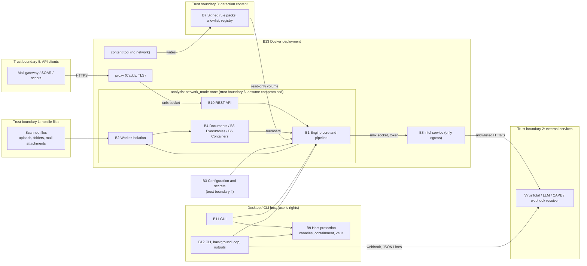

# Project review: Aegis Sentinel (hybrid-ransomware-detector)

Status: **complete review (Stages 1 and 2)**. Remaining limitations are listed
in section 2. Implementation (Stage 3) has not started and needs the owner's
separate approval.

**Plan revision (2026-10-29, after Stage 2):** the owner answered D-A to D-E.
The revised Stage 3 plan, the PR #30 check results and the decisions still open
are in section 24 (proposed, not approved). The owner's answers to the open decisions are in 24.9, and PR #30's status in 24.10. Sections 0-23 are kept as the Stage 1
and Stage 2 record.

Task brief: [tasks/project-review.md](tasks/project-review.md).

## 0. Review baseline

| Item | Value |
|---|---|
| Reviewed branch | `main` (review notes are kept on `review/project-review`) |
| Reviewed commit | `af5e6d2ed72e2525ed8486158adb89e9a069119b` (merge of PR #29, on top of the v4.7.0 release commit `8221fe7`) |
| Working tree at review start | clean on `main`, level with `origin/main`; no uncommitted or untracked changes, so nothing was excluded |
| Code changed by this review | none. The review branch changes only `docs/PROJECT_REVIEW.md`, `docs/tasks/project-review.md` and `docs/HANDOFF.md` |
| Benchmarked code state | `af5e6d2`, unmodified (section 15) |
| Stage 2 baseline check | `origin/main` was still `af5e6d2` when Stage 2 started; no reconciliation of references was needed |
| Review dates | Stage 1 and Stage 2: 2026-10-29 |

All `file:line` references point at `af5e6d2`.

## 1. Executive summary

Aegis Sentinel 4.7.0 is a mature, well-documented static scanner for an active
development project. It already has explicit release criteria, a threat model
with residual risks, a hardened Docker deployment, per-result completeness and
provenance, signed rule packs, and a large test suite. Most of the threat model's
stated mitigations are present in the code.

In this review, locally on macOS with Python 3.14:
- the full suite: 1011 passed, 13 skipped, 0 failed, 91 % coverage of `engine`,
  `detectors`, `core` and `api`;
- ruff, mypy, bandit (no medium or high) and pip-audit (lock): clean.

Overall grade against the section 12 criteria: **B** for the current stage and
**B** for production (section 17). Neither development completion of the target
release nor production readiness is supported yet (section 18).

The main findings, in order of current impact (details in section 10):

1. **PR-01, High, confirmed and reproduced.** The rule-pack installer uses the
   signed manifest's `version` string as a folder name without validation. A
   pack signed by a trusted key with version `../../victim` deleted and replaced
   a directory outside `rulepacks/`. The threat model plans for a compromised
   signing key and expects that to affect only detection content.
2. **PR-02, Medium.** If workers cannot start, isolation fails open: the
   remaining files, API uploads included, are scanned in the main process with
   no time or memory limit, and the result does not say so.
3. **PR-03, Medium.** A single-file scan (CLI `--scan-file`, the GUI's single-file
   scan, or a folder that holds one file) runs in-process with no limits.
4. **PR-04, Medium.** DMG images are unpacked with `7z x` into a folder. This
   relies on the installed 7-Zip's own path and link handling, which the threat
   model says is never used.
5. **PR-05, Medium, test gap.** In all six OS × Python CI jobs, the API, intel,
   HTTP readiness and fuzz tests are skipped because fastapi and hypothesis are
   not installed there. They run only in the Linux / Python 3.12 coverage job.

6. **PR-17, Medium, measured on this Mac.** Isolated folder-scan throughput
   falls as workers are added: 77 → 60 files/s from 1 to 4 workers on small
   files, because each worker is polled in turn with a 50 ms blocking poll. With a
   2 ms poll in an experiment, 4 workers reached 96 files/s.
7. **PR-07, Medium.** One exception in a scheduled job ends the background
   service (scans and canary checks).

**Performance on this Mac** (section 15; benign synthetic set, 163 files,
25.3 MB, every required layer on, no network):
- 25-29 files/s and 3.9-4.5 MB/s per isolated folder scan, including a
  worker start-up of about 1.13 s;
- ordinary documents take 1-90 ms each;
- YARA runs at about 23 MB/s on large inputs.

**Requested capabilities** (section 9):
- **absent:** general folder monitoring with automatic scanning, outbound e-mail
  alerts, and optional cloud storage for logs and reports. Building blocks exist:
  the canary watcher, scheduled scans, isolated workers, JSON Lines and signed
  webhooks;
- **implemented:** quarantine and restore, including from the GUI;
- **partial:** the GUI integration.

**Next steps:** section 22 lists the ten highest-value actions. Section 20 gives
the dependency-ordered implementation sequence, and section 13 the block closure
checklists. Owner decisions D-A to D-E (section 13) gate the feature work.
*Plan revision:* D-A to D-E are answered, and the revised plan is in section 24.

## 2. Scope, methodology and limitations

**Scope.** The whole repository at `af5e6d2`. Following the brief, the security
review prioritises parsers, archive extraction, worker isolation, the analysis /
intel boundary, the API and rule-pack updates, and uses `docs/THREAT_MODEL.md` as
its basis.

**Exclusions (from the brief).** Detection accuracy, detection rates and false
positives are out of scope. Nothing here estimates them, and safe fixtures are
never presented as accuracy evidence. Scoring code is reviewed only for
implementation correctness and consistency. No change to weights or thresholds is
proposed. ML training and model work belongs to a separate contributor. Items
already tracked in `docs/RELEASE_READINESS.md` are referenced by their IDs, not
re-reported (section 11).

**Method.**
1. Read `AGENTS.md`, `CLAUDE.md`, `docs/AI_WORKFLOW.md`, `docs/HANDOFF.md`,
   `docs/RELEASE_READINESS.md`, `docs/THREAT_MODEL.md`, `docs/ARCHITECTURE.md`,
   `docs/RELEASE_SCOPE.md`, `docs/DEPLOYMENT.md`, `docs/OPERATIONS.md`,
   `docs/RUNBOOKS.md`, `docs/RULE_PACKS.md`, `docs/DATA_POLICY.md`,
   `docs/SUPPORT.md`, `docs/RELEASING.md`, `docs/DATASET_PLAN.md`, the first part
   of `docs/THIRD_PARTY.md`, and the latest `CHANGELOG.md` entries (4.7.0, the
   start of 4.6.0). `README.md`, `docs/DETECTION_v3.md` and `docs/DETECTION_v4.md`
   were read by section headings only, plus the sections cited below.
2. Read code block by block (inventory in section 3).
3. Ran the targeted existing tests for each threat-model area (section 7), and
   `ruff check .` with the project configuration.
4. Read the CI configuration and the log of the latest `tests` run on `main`
   (run 40741208642, commit `af5e6d2`) for skip reasons per job.
5. Reproduced one finding (PR-01) with a throw-away script in a temporary folder
   outside the repository.
6. Stage 2:
   - re-checked the baseline;
   - read a parser sample (`detectors/macos_packages.py` readers, the PE parser's
     bounds, the mail / embedded / web limits) and the rest of
     `core/intel_client.py`'s client;
   - checked py7zr's installed source for S-02;
   - ran the full suite with coverage, mypy, bandit and pip-audit;
   - benchmarked with `tools/profile_layers.py` and the isolated folder-scan
     path (section 15).

   Benchmark scripts, the generated dataset and raw results are kept outside the
   repository.

**Environment of the local runs.** macOS 27.0.1 on Apple M1 (8 cores, 8 GB),
Python 3.14.2 in the repository's `.venv` (pytest 9.1.1, ruff 0.17.3, schedule
1.2.2). Helper tools present: `7zz` and `unar` (Homebrew), `bsdtar`, zbar. Docker
was not used in Stage 1.

**Limitations.**
- Python 3.14 is not a supported runtime (RELEASE_SCOPE §4; RELEASE_READINESS B3),
  and this Mac is not the reference Linux host. Local results are observations for
  this Mac only.
- No Windows or Linux host was available. Statements about those platforms come
  from code reading and CI logs, not from local runs.
- `deploy/check-deployment.sh` and `deploy/isolation_check.py` were not run.
  Docker was not used in either stage. The atheris long fuzz runs and the opt-in
  GUI smoke test were not run.
- **Format parsers were sampled, not fully inspected.** Stage 2 checked bounds and
  error handling in the PE, mail, embedded, web and macOS-package parsers. B4
  (document layers), ELF, ML, scoring, `engine/validation.py` and most of the GUI
  were not reviewed line by line. Their status is "insufficient evidence" in
  section 13.
- S-01, S-03, S-04 and H-03 remain unverified (section 10).
- *Plan revision:* the CI runs on PR #30 tested the unchanged `af5e6d2` code.
  They passed the Docker deployment check and the 3.9 / 3.12 matrix on three
  OSes (section 24.7). This adds CI evidence. The local limitations above still
  apply.
- No Python 3.9 or 3.12 interpreter exists on this Mac, so the supported runtimes
  were not exercised locally.
- "Fully inspected" means every file in the declared scope was read. It does not
  mean the review proves the absence of defects.

## 3. Inspection inventory

| Depth | Files |
|---|---|
| **Fully inspected** | `engine/workers.py`, `engine/scanner.py`, `engine/staging.py`, `engine/layers.py`, `engine/containers.py`, `engine/completeness.py`, `engine/readiness.py`, `engine/protection.py`, `detectors/container_extractor.py`, `api/server.py`, `api/limits.py`, `api/intel.py`, `core/http.py`, `core/rulepack.py`, `core/outputs.py`, `core/canary_watch.py`, `Dockerfile`, `docker-compose.yml`, `.github/workflows/{tests,quality,release,docker}.yml`, `pyproject.toml`, `requirements.txt`, `requirements-ml.txt` |
| **Partly read** | `detectors/macos_packages.py` (docstring, 7-Zip helpers 275-344), `core/intel_client.py` (1-80), `engine/config.py` (1-60 and the setting list), `RansomwareScanner.py` (argument parser, 894-999), `aegis_gui/state.py`, `aegis_gui/detail.py` and `aegis_gui/pages/protection.py` (quarantine paths), `requirements.lock` (header, hashes) |
| **Sampled in Stage 2** (bounds, limits, error handling; not every line) | `detectors/macos_packages.py` 60-262 (read fully), `detectors/pe_analysis.py` (limits and `analyze_bytes` 260-281), `detectors/mail_analyzer.py` (limits), `detectors/embedded_content.py` and `detectors/web_content.py` (limits and regexes), `core/intel_client.py` 80-140, `core/cache.py` (structure), `tools/profile_layers.py` (read fully) |
| **Inventory only** (names, sizes, call sites) | the remaining `detectors/` modules, `core/{cache,sandbox,quarantine,canary,containment,response,mailbox,allowlist,tools}.py`, `engine/{validation,secret_store,external,text,report,provenance,capabilities,metrics,logs}.py`, the rest of `aegis_gui/`, `tools/`, `build.py`, `scanner.spec`, `deploy/*`, `fuzz/`, `tests/` (test names, plus the tests executed in section 7) |

**Sampling rationale.** Stage 1 covered the security-critical boundaries the brief
names: workers, archive extraction, the API, intel and rule packs. These hold the
mitigations that stop a hostile file or client from leaving its scan. The
remaining format parsers sit behind the per-layer guard and the worker limits.
Stage 2 sampled them by size and input exposure (row above). `cfb_writer.py` is
a writer used to build Outlook items and test fixtures, not a parser of input,
so it was not sampled. `engine/validation.py`, `engine/report.py`,
`detectors/scoring.py` and most of the GUI remain unreviewed (section 2).

## 4. Development context

- **Release state.** 4.7.0 was released on 2026-10-28 (CHANGELOG `[4.7.0]`;
  RELEASE_READINESS "4.7.0"). The paid edition is an on-prem Docker deployment
  with the REST API as the primary surface. The desktop GUI is a supported analyst
  workstation app on Windows and macOS (D2). Canaries and containment are
  desktop-only and outside paid support (D3). See RELEASE_SCOPE §1-2 and §8.
- **Open release items already tracked:** M1 / X1 (real-sample evaluation), M2
  (throughput and latency on a reference host), O1 (walk-through on a clean Linux
  host), U1 (a real 4.6.0 upgrade), X2 (code signing), D5 (arm64 image), plus the
  backlog items A10-7, A8-2 and A8-3. The legal review of `docs/THIRD_PARTY.md` is
  listed as remaining blocker 2. It has **no ID of its own**: L1 ("list the terms
  for legal review") is `met`, and the review itself is the owner's
  (RELEASE_READINESS, "Remaining blockers").
- **Target release for this review (proposed scope assumption, owner decision
  needed).** The next release after 4.7.0, containing (a) fixes for the confirmed
  defects in this report and (b) the five capabilities the brief requests,
  delivered to the desktop build and, where applicable, the Docker edition. The
  brief does not name a version. RELEASE_SCOPE §5 rules out on-access scanning for
  the Docker edition, so folder monitoring is assumed to be **desktop only** until
  the owner decides otherwise (section 9).
- *Plan revision:* the owner set the target to **4.8.0**, with folder monitoring
  desktop only (D-A, D-B; section 24.1).

## 5. Block inventory and architecture

Blocks follow the repository structure and the work areas A1-A10 in RELEASE_SCOPE §7.

| ID | Block | Main files / entry points | Purpose and connections | Status | Inspection |
|---|---|---|---|---|---|
| B1 | Engine core and pipeline | `engine/scanner.py` (facade `RansomwareScanner`), `staging.py`, `layers.py`, `containers.py`, `completeness.py`, `provenance.py`, `capabilities.py`, `text.py`, `report.py` | Builds the engines, runs the ordered layers on a `ScanContext`, recurses into containers, scores, and adds status and provenance. Every interface (B10-B12) uses the facade | implemented | core files fully read; `report.py`, `text.py`, `provenance.py`, `capabilities.py` inventory only |
| B2 | Worker isolation | `engine/workers.py` | Process per file, time limit, memory limit per OS, temp folders per worker, spare workers for the API | implemented (see PR-02, PR-03) | fully |
| B3 | Configuration and secrets | `engine/config.py`, `validation.py`, `secret_store.py` | Global `CONFIG` dict built from the environment / `.env`; validation at start; secret precedence environment > keyring > `.env` | implemented | partly |
| B4 | Document layers (A2) | `detectors/file_integrity.py`, `macro_analysis.py`, `prompt_guard.py`, `relationship_scanner.py`, `yara_engine.py`, `fuzzy_hash.py`, `tlsh_py.py` | Format checks, macros, hidden content, external links, YARA, similarity | implemented | inventory only |
| B5 | Executable layers (A3) | `detectors/pe_analysis.py`, `elf_analysis.py`, `ml_classifier.py`, `entropy.py` | PE / ELF structure; ML layer in rule-engine mode (no model ships) | implemented (ML model: other contributor) | inventory only |
| B6 | Containers and delivery (A4) | `detectors/container_extractor.py`, `macos_packages.py`, `mail_analyzer.py`, `web_content.py`, `embedded_content.py`, `script_analysis.py`, `qr_scanner.py`, `cfb_writer.py` | Unpack archives, mail, web payloads, OneNote / CHM / MSI; members go back through B1 | implemented (see PR-04) | `container_extractor.py` fully, `macos_packages.py` partly, others inventory |
| B7 | Detection content and scoring (A1, A6) | `rules/`, `detectors/indicators.yaml`, `registry.py`, `signals.py`, `scoring.py`, `core/rulepack.py`, `core/allowlist.py`, `tools/rulepack.py`, `tools/evaluate.py`, `tools/calibrate_weights.py`, `tools/profile_layers.py` | Typed signals, registry-driven weights and caps, signed rule packs, evaluation tools | implemented (see PR-01) | `core/rulepack.py` fully, others inventory |
| B8 | Intelligence and external services (A5) | `api/intel.py`, `core/intel_client.py`, `core/http.py`, `core/cache.py`, `core/sandbox.py`, `detectors/llm_backends.py`, `detectors/emulation.py`, `engine/external.py` | VirusTotal, LLM, CAPE and box-js; in Docker only through the intel service, with an origin allowlist | implemented | `api/intel.py`, `core/http.py` fully; `intel_client.py` partly |
| B9 | Host protection (A8) | `core/canary.py`, `canary_watch.py`, `response.py`, `containment.py`, `quarantine.py`, `engine/protection.py` | Canaries, real-time canary watching, containment, encrypted vault, automatic quarantine | implemented (desktop only, D3) | `canary_watch.py`, `protection.py` fully; others inventory |
| B10 | REST API and operations signals (A9, A10) | `api/server.py`, `api/limits.py`, `api/probe.py`, `api/scan_result.schema.json`, `engine/readiness.py`, `engine/metrics.py`, `engine/logs.py` | `/scan`, `/health`, `/ready`, `/version`, `/schema`, `/metrics`; abuse limits; fresh worker per upload | implemented | `server.py`, `limits.py`, `readiness.py` fully |
| B11 | Desktop GUI (A9) | `gui.py`, `aegis_gui/` (app, pages, detail, state) | Scans, results, provenance, diagnostics, protection page, vault restore, quarantine undo | implemented | partly |
| B12 | CLI, background service and outputs (A9) | `RansomwareScanner.py`, `core/mailbox.py`, `core/outputs.py` | CLI commands, scheduled scans, IMAP triage, JSON Lines, signed webhooks | implemented (see PR-07, PR-08) | `outputs.py` fully, CLI partly |
| B13 | Docker deployment | `Dockerfile`, `docker-compose.yml`, `deploy/` | analysis (no network) / intel (only egress) / proxy (TLS) / content tool | implemented | Dockerfile and compose fully; `deploy/` inventory |
| B14 | Release and CI (A10) | `.github/workflows/`, `build.py`, `scanner.spec`, `requirements*`, `pyproject.toml` | Test matrix, quality gates, Docker check, release builds, SBOM, Sigstore | implemented (see PR-05, PR-06) | workflows and pyproject fully; `build.py` inventory |
| B15 | Tests and fuzzing | `tests/` (82 files), `fuzz/`, `test_smoke.py` | Unit, integration, regression corpus, hypothesis fuzzing, GUI smoke test (opt-in) | implemented | inventory, plus the executed subset |
| B16 | Documentation | `README.md`, `CHANGELOG.md`, `docs/` | Design, threat model, release scope and tracking, operations, policies | implemented (see PR-10) | read as listed in section 2 |



Mermaid validation: section 23.

## 6. Clean code and design review

Conclusions apply only to the files inspected (section 3). Blocks with inventory
only are marked as such. A large file, a mixin or global state is
not counted as a problem unless the code shows a practical effect.

### Per block

**B1 Engine core and pipeline** (inspected)
- *Working well.* Each layer is a small class with one `run()` and a visible order
  (`engine/layers.py:130-144`, `:467-492`). Every layer runs inside a guard that
  turns an exception into `layer_errors` (`engine/staging.py:88-104`). Heavy layers
  run on copies of the context and are merged back in pipeline order
  (`engine/staging.py:131-150`). The completeness rules are documented together with
  their precedence (`engine/completeness.py:1-29`).
- *Coupling.* The facade combines five mixins (`engine/scanner.py:70-71`). They
  depend on attributes declared only as class annotations
  (`engine/staging.py:27-31`, `engine/protection.py:25-31`). The practical effect
  shows in `api/intel.py:91-101`: to reuse the VirusTotal code, the intel service
  builds a stand-in "scanner" by setting `config`, `cache`, `intel`, `http`,
  `http_timeout` and `vt_limiter` by hand. If `ExternalLookupsMixin` starts using a
  new attribute, intel fails at run time. mypy would not catch it, because
  `check_untyped_defs = false` (`pyproject.toml:122`).
- *Error handling.* `ScanContext.start` runs before any layer guard
  (`engine/staging.py:46`; `engine/layers.py:107-123`). If `os.path.getsize` or a
  format sniffer raises, the whole `scan_file` call raises. The in-process path then
  drops that file (PR-09).
- *Duplication.* The top-level result is built in two places: `ScanContext.start`
  (`engine/layers.py:109-118`) and `failure_result` (`engine/workers.py:373-405`). A
  new top-level field has to be added to both. Whether every schema field is in
  both is checked for the schema's required fields (`tests/test_outputs_and_api.py:28`,
  `:36`, run and passed in this review). Fields outside the schema can still drift (RF-7).
- *Readability.* `ScanContext.data()` sits between dataclass fields
  (`engine/layers.py:80-95`). It works, but the fields read as if they ended before
  it. Low impact.
- *Naming.* Legacy names are kept on purpose for compatibility (`chatgpt_analysis`,
  `engine/layers.py:393`; `kaggle_db_path`; `severity_score`). Keep them while the
  result schema stays additive-only (C6).

**B2 Worker isolation** (inspected)
- *Working well.* The per-OS memory limits are cleanly separated
  (`engine/workers.py:50-65`, `:122-145`, `:177-215`). Each worker has its own temp
  folder, which the parent removes (`:227-234`, `:346`, `:357-370`), and folders left
  by a dead scanner are swept (`:315-336`).
- *Design weakness.* The fallback to unisolated scanning is implicit and silent
  (PR-02). The scan loop polls each worker in turn with a 50 ms blocking poll
  (`:428`, `:469-474`, `:522-528`). Whether this adds dispatch latency with several
  workers was measured: it does (PR-17, section 15).
- *Module globals* (`_SCANNER`, `_JOB_HANDLE`, `_SWEPT`, `:46`, `:103`, `:289`) are
  per process and read correctly in their context. No change is suggested.

**B3 Configuration and secrets** (partly inspected)
- `CONFIG` is a global dict (`engine/config.py:139`), but the engine receives it by
  injection (`engine/scanner.py:77-79`). That is testable, and a typed config is not
  justified today (RELEASE_READINESS A7: "Typed config: no fix needed it").
- *Duplicated fallback defaults.* Code outside `engine/config.py` repeats defaults,
  for example `scan_timeout_seconds` 300 (`engine/scanner.py:375`,
  `api/server.py:122`) and `worker_memory_mb` 2048 (`engine/scanner.py:376`,
  `api/server.py:92`). Some copies disagree: `http_timeout` is 30 in
  `engine/scanner.py:230` and 60 in `core/mailbox.py:72`, and `openai_model` is
  `"gpt-4"` in `detectors/llm_backends.py:275` but `"openai"` in
  `aegis_gui/pages/dashboard.py:274`. These fallbacks apply only when a key is
  missing (tests, tools, partial configurations), because `CONFIG` always sets them
  (`engine/config.py:158`, `:209`). Low impact. Fix them when that code is next
  changed.
- `api/server.py:67` reads `AEGIS_API_MAX_UPLOAD_MB` at import time. That goes
  against the "no side effects on import" convention in `engine/config.py:5-10` and
  makes the limit a module constant. Low impact.

**B4 Document layers**: not reviewed (section 2). **B5 Executable layers**: the PE
parser was sampled; its loops and reads are bounded (`detectors/pe_analysis.py:50-54`,
`:314`, `:344`, `:366`, `:386`), and truncated headers become findings
(`:270-276`). ELF and ML were not reviewed.

**B6 Containers and delivery** (`container_extractor.py` inspected)
- *Working well.* Every format goes through shared admission, naming and budget
  helpers (`detectors/container_extractor.py:489-506`, `:538-544`, `:572-588`). The
  sandbox lives only inside a context manager (`:410-429`). The large module is
  organised by format with explanatory docstrings, so its size alone is not a
  problem.
- *Inconsistency.* DMG unpacking is the only path that lets an external tool write
  a directory tree (PR-04). 7z members are size-checked only after `py7zr` has
  extracted them (`:705-739`; suspected S-02).
- *Duplication.* The password-candidate loops appear three times, for ZIP
  (`:619-637`), 7z (`:669-676`, `:706-718`) and RAR (`:752-760`, `:792-825`), each with
  format-specific errors. Merging them is optional. Only do it when one of them
  changes.
- *Complexity.* `_walk_7z` is at 19 with the project's own limit of 19
  (`pyproject.toml:107-108`; measured with ruff in this review).

**B7 Detection content and scoring** (`core/rulepack.py` inspected; scoring not reviewed)
- *Working well.* Verification is complete and ordered: signature, then members,
  then manifest hashes (`core/rulepack.py:156-209`). Monotonic versions, signed
  rollback and signer tracking are small and readable (`:212-279`).
- *Defects.* The signed `version` is used as a path (PR-01). `active.json` is
  written non-atomically, and a damaged one silently falls back to the bundled
  rules (PR-14).

**B8 Intelligence and external services** (`api/intel.py`, `core/http.py` inspected)
- *Working well.* There is a fixed set of operations with exact input validation
  (`api/intel.py:235-270`). Each service has its own allowlisted session, enforced
  in `send()`, so redirects are covered too (`core/http.py:57-72`). Only intel keeps
  a cache, and only from real replies (`api/intel.py:112-119`, `:173-216`).
- *Coupling.* The `_VirusTotal` stand-in (see B1).

**B9 Host protection** (`canary_watch.py`, `engine/protection.py` inspected; the rest inventory)
- *Working well.* Debounced, change-only events (`core/canary_watch.py:43-58`,
  `:133-158`). Alerts are de-duplicated by finding signature
  (`engine/protection.py:85-88`).
- *Gap relevant to the requested alerting.* Canary alerts go only to a file and a
  desktop notification. They never reach the webhook or JSON Lines outputs (PR-08).

**B10 REST API** (inspected)
- *Working well.* Middleware order and responsibilities are clear (body limit,
  per-IP limit, then authentication with lockout, then the per-client quota;
  `api/server.py:220-234`). There is a fresh worker for each upload and spare
  workers ready in advance (`:73-130`).
- *Complexity.* `create_app` is at the cap of 19. Its endpoint closures share
  `service`, `auth` and `slots`. That is readable today, but each new endpoint adds
  to it (RF-9).
- *Weaknesses.* The readiness worker check is frozen at start-up (PR-11). Module
  docstrings are stale (PR-10).

**B11 GUI** (sampled)
- The single-file scan runs in the GUI process without limits
  (`aegis_gui/state.py:107`; PR-03). The vault list and restore exist on the
  Protection page (`aegis_gui/pages/protection.py:84-123`), and quarantine undo
  exists in the result window (`aegis_gui/detail.py:468-518`). The rest of the GUI
  was not reviewed line by line (section 2).

**B12 CLI, background service and outputs** (partly inspected)
- `RansomwareScanner.py` (999 lines) mixes autostart for three OSes
  (`:116-321`), the argument parser (`:533-622`), command handlers (`:625-892`) and
  the scheduler loop (`:894-957`). `_protection_command` reaches complexity 18.
  The practical effects are PR-07, a loop with no exception guard, and a single-file
  path that does not use workers (PR-03).
- `core/outputs.py` is small and correct for one attempt per alert. It has no retry
  or outbox (PR-08).

**B13 Docker deployment** (inspected): the hardening matches DEPLOYMENT §0 and is
checked by `tests/test_deployment.py:17-110`. Gaps: no hash pinning (PR-12); the
analysis service can write its own log volume (proposed threat-model addition
TMA-1).

**B14 Release and CI** (inspected): PR-05, PR-06, PR-13. Coverage is measured
over `engine`, `detectors`, `core` and `api` only (`pyproject.toml:77-79`). The
reported 91 % therefore leaves out `aegis_gui/`, `tools/` and `RansomwareScanner.py`
(observation PR-15).

**B15 Tests**: the suite is broad and named after behaviours. The isolation
fallback is asserted as intended behaviour (`tests/test_workers.py:80`), so fixing
PR-02 means changing a test on purpose. No test covers: the rule-pack version
format, DMG traversal or links, an exception in the background loop, or isolation
of single-file scans.

**B16 Documentation**: thorough and consistent with the code in most places
checked. Exceptions: PR-04 (threat model §2), PR-10 (stale docstrings, a local
file path in a public doc).

### Design patterns in use

| Pattern | Implementation | Fit | Misuse / note |
|---|---|---|---|
| Pipeline | `engine/layers.py:130-144`, `:467-492`; runner `engine/staging.py:34-86` | Good: independent, ordered, testable layers | none found |
| Template Method | `engine/containers.py:51-89` hooks, `:92-139` shared loop; four handlers `:142-311` | Good: one recursion, budget and worst-member rule for four container kinds | none found |
| Facade | `RansomwareScanner`, `engine/scanner.py:70-106` | Good single entry point for CLI, GUI and API | wide, because the mixins add every capability to it |
| Mixins | `engine/scanner.py:70-71` | They split a large class into files | the stand-in in `api/intel.py:91-101` shows implicit coupling (see B1) |
| Bulkhead (process isolation) | `engine/workers.py:339-371`, `:424-573` | Good, with per-OS limits | silent fail-open (PR-02); not used for single files (PR-03) |
| Token bucket / rate limiter | `api/limits.py:108-137`, `AuthGuard` `:159-200`, `core/http.py:99-122` | Good, bounded tables (`max_clients`) | none found |
| Allowlist proxy (egress guard) | `core/http.py:57-72` | Good: covers redirects | none found |
| Context-managed sandbox | `detectors/container_extractor.py:410-429` | Good: removal guaranteed in-process | a killed worker relies on B2's folder removal (present) |
| Registry, Strategy, Null Object | documented in `docs/ARCHITECTURE.md` §8 | not inspected in this review | no conclusion |

**Where a pattern would really simplify** (detailed as RF-3, RF-1 and RF-4 in section 14):
1. A small `VirusTotalClient` service that both the scanner and intel inject,
   instead of the hand-built `_VirusTotal` mixin host (`api/intel.py:91-101`). It
   removes the implicit attribute contract and lets intel use a typed object.
2. An explicit isolation policy for `scan_isolated` (fail closed, or fall back
   in-process with the fallback recorded in the result) instead of a hidden
   fallback (`engine/workers.py:461-462`). This addresses PR-02 without new layers.
3. Reuse the existing bounded writer (`_stream_into`) for DMG members, as RAR
   already does, instead of a separate extract-then-walk path (PR-04).

No other new abstractions are recommended.

## 7. Threat-to-mitigation mapping

Legend: **Doc** = stated in `docs/THREAT_MODEL.md`. **Impl** = found in the code.
**Test** = an automated test exists. **Run** = executed in this review (local,
macOS, Python 3.14). Two local batches, both with `LLM_PROVIDER=none` and
`-p no:cacheprovider`:
- Batch 1: workers, worker limits, archives, RAR, encrypted containers, macOS
  packages, closed limits, fuzz. **145 passed, 3 skipped** (Job Object, `/proc`,
  "libproc exists on macOS").
- Batch 2: API auth, outputs and API, intel, cache integrity, cache keys, rule
  packs, deployment, privilege separation, readiness, scan status, secret store,
  tools path, HTTP, sharing, provenance, metrics. **175 passed**.
- Stage 2: the full suite, which contains both batches: **1011 passed, 13
  skipped, 0 failed** (section 23).

| Area / TM ref | Mitigation | Impl (file:line) | Test (file:line) | Run | Gap |
|---|---|---|---|---|---|
| Parsers §1 | Each layer guarded; an error becomes `layer_errors` | `engine/staging.py:88-104` | `tests/test_fuzz_parsers.py:199`, `:216` | yes, passed | `ScanContext.start` is outside the guard (PR-09). Parser internals not yet inspected (Stage 2). In CI the fuzz suite runs only on Linux / 3.12 (PR-05) |
| Parsers §1 | Fuzzing of every parser | `tests/test_fuzz_parsers.py:117-216`; `fuzz/fuzz_parsers.py` | same | hypothesis suite yes; atheris no | atheris long runs not executed |
| Parsers §10 | Container boundary for a parser exploit | `docker-compose.yml:64-112` | `tests/test_deployment.py:22-62` (compose content); `deploy/isolation_check.py` (live) | compose tests yes; live check no | live isolation not exercised here (CI `docker.yml` runs it) |
| Archives §2 | Generated member names in a fresh sandbox | `detectors/container_extractor.py:410-429`, `:538-544` | `tests/test_container_extractor.py:25` | yes, passed | none |
| Archives §2 | Traversal, absolute paths and links refused and reported | `:333-342`, `:489-506`; pkg `:914-916` | `tests/test_container_extractor.py:50`, `:59`; `tests/test_rar.py:76`; `tests/test_macos_packages.py:111` | yes, passed | DMG: no traversal or link test (PR-04, S-01) |
| Archives §2 | External tools only stream one member to stdout | RAR: `:795-798` through rarfile | `tests/test_rar.py:61-125` | yes, passed | **Not true for DMG**: `7z x -o<dir>` (`detectors/macos_packages.py:331-337`, used at `detectors/container_extractor.py:1008-1014`) (PR-04) |
| Archives §2 | 7z: private folder, only resolved plain files moved | `:705-739` | `tests/test_archive_formats.py:109-149` | yes, passed | size checked after extraction (S-02) |
| Archives §2 | Unpack budget (bytes, members, depth, ratio) | ZIP `:572-588`, ISO `:379-389`, `:869-882`, limits `:525-536`, depth `:436-439` | `tests/test_container_extractor.py:68`, `:74`, `:94`; `tests/test_rar.py:87`; `tests/test_archive_formats.py:141`, `:182`, `:189` | yes, passed | DMG and 7z checked after the write (PR-04, S-02) |
| Archives §2 | Killed worker's temp folder removed | `engine/workers.py:227-234`, `:357-370`, `:315-336` | `tests/test_workers.py:46`; `tests/test_worker_limits.py:360` | yes, passed | none |
| Isolation §1 | Wall-clock limit, scan_failed result | `engine/workers.py:486-500`, `:373-405` | `tests/test_workers.py:32` | yes, passed | none |
| Isolation §1 | Memory: RLIMIT_AS (Linux) | `:59-63` | `tests/test_worker_limits.py:32` | yes (setter only, macOS) | real enforcement only in Linux CI |
| Isolation §1 | Memory: Job Object (Windows) | `:122-145` | `tests/test_worker_limits.py:67-93` | partly (`:93` skipped here) | real cap only in Windows CI (`:93` ran there: not in the Windows skip list of run 40741208642) |
| Isolation §1 | Memory: watchdog (macOS) | `:177-215`, `:503-512` | `tests/test_workers.py:58`; `tests/test_worker_limits.py:121-176` | yes, passed | 0.25 s residual (documented) |
| Isolation §1, §10 | Folder and API scans in a worker; fresh worker per upload | `engine/scanner.py:372-376`; `api/server.py:114-127` | `tests/test_outputs_and_api.py:139`; `tests/test_readiness.py:152` | yes, passed | **fails open** after 3 failed starts (PR-02, asserted by `tests/test_workers.py:80`); single files not isolated (PR-03) |
| Intel §10 | Analysis has no network | `docker-compose.yml:74` | `tests/test_deployment.py:41`, `:62` | yes (static) | live check not run here |
| Intel §10 | Secrets only in intel; production refuses them on the analysis side | `docker-compose.yml:49` vs `:91` | `tests/test_intel_service.py:336` | yes, passed | none |
| Intel §10 | Fixed operations, exact inputs | `api/intel.py:235-270`, `:321-351` | `tests/test_intel_service.py:160`, `:169` | yes, passed | none |
| Intel §10 | Destinations from intel's configuration, redirects refused | `core/http.py:46-72`; `api/intel.py:122-138` | `tests/test_intel_service.py:27`, `:57`, `:184`, `:238` | yes, passed | none |
| Intel §10 | Token (≥ 32 characters) and per-operation rate limit; body cap | `api/intel.py:276-303`, `:286` | `tests/test_intel_service.py:149`, `:224`, `:232` | yes, passed | the worker holds the token (tracked: Phase 2 backlog [A5]) |
| Intel §10 | Cache only in intel, keyed by what intel derives | `engine/scanner.py:233-239`; `api/intel.py:112-119`, `:173-216` | `tests/test_cache_integrity.py:24-109` | yes, passed | none |
| API §7 | Bearer token, constant-time compare, ≥ 16 characters, docs off | `api/server.py:165-168`, `:205-206`, `:218-219` | `tests/test_outputs_and_api.py:101`, `:110`; `tests/test_api_auth.py:158` | yes, passed | none |
| API §7 | Per-IP limit before authentication | `api/limits.py:203-218`; `api/server.py:225-227` | `tests/test_api_auth.py:131` | yes, passed | none |
| API §7 | Lockout per IP, checked before the compare | `api/limits.py:159-200`; `api/server.py:175-194` | `tests/test_api_auth.py:25-126` | yes, passed | none |
| API §7 | Last X-Forwarded-For entry behind a trusted proxy | `api/limits.py:140-149` | `tests/test_api_auth.py:58`, `:63` | yes, passed | docstring says "first" (PR-10) |
| API §7 | Upload refused before parsing; streaming count | `api/limits.py:59-105`; `api/server.py:286-298` | `tests/test_outputs_and_api.py:132` | yes, passed | none |
| API §7 | `/ready` is not a token oracle | `api/server.py:241-255` | `tests/test_api_auth.py:149` | yes, passed | the workers check is frozen at start-up (PR-11) |
| Rule packs §5 | Ed25519 signature from a configured key | `core/rulepack.py:156-179` | `tests/test_rulepack.py:65` | yes, passed | none |
| Rule packs §5 | Manifest lists exactly the files; plain files under `rules/` | `:181-208` | `tests/test_rulepack.py:65`, `:107` | yes, passed | none |
| Rule packs §5 | Only newer versions; no replay; signed rollback | `:244-251`, `:123-135` | `tests/test_rulepack.py:113`, `:127` | yes, passed | **the version string is not validated and becomes a path** (PR-01, reproduced) |
| Rule packs §5 | Signer recorded; distrusted key's pack not used | `:212-231`, `:273-278` | `tests/test_rulepack.py:146`, `:167` | yes, passed | non-atomic `active.json`, silent fallback (PR-14) |
| Rule packs §5 | Rules compile before activation | `:260-270` | `tests/test_rulepack.py:176` | yes, passed | none |
| Rule packs §5 | Read-only content in analysis; reload on change | `docker-compose.yml:97`; `engine/scanner.py:130-170` | `tests/test_deployment.py:53`; `tests/test_cache_keys.py:27` | yes, passed | none |

### Proposed threat-model additions (for the owner; `docs/THREAT_MODEL.md` not changed)

| ID | Proposed addition | Evidence |
|---|---|---|
| TMA-1 | A compromised analysis worker can write the `analysis-state` volume, which holds the local log file and reports. It can therefore delete or edit local log lines. Docker's own container log is outside its reach. §10 "Little to change" lists only the read-only root and content. | `docker-compose.yml:92-93`; DEPLOYMENT §0 "Operations" (the log file is in `analysis-state`) |
| TMA-2 | A pack signed by a compromised key can do more than change detection content: through the unvalidated version string it can delete or replace directories that the installing user can write. §5 and `docs/RULE_PACKS.md` describe the compromise impact as content only. | PR-01 |
| TMA-3 | DMG unpacking depends on the host's 7-Zip for path and link safety. | PR-04 |
| TMA-4 | Isolation can silently fall back to the main process. §1 and §10 state that every folder and API scan is isolated. | PR-02, PR-03 |

These do not widen the attacker's capabilities. The attacker is still a hostile
file, or the owner of a compromised signing key, as §5 already assumes.

## 8. Platform and Python-version coverage

**Configured versus local runtime.**

| Where | Python | OS | Dependencies |
|---|---|---|---|
| `tests.yml` matrix (`.github/workflows/tests.yml:17-21`) | 3.9, 3.12 | ubuntu, windows, macos (latest) | `requirements.txt` and `requirements-ml.txt`, unpinned, installed one by one, a failure only warns (`:41-50`) |
| `quality.yml` lint, types, coverage, regression | 3.12 | ubuntu only | `requirements.lock` (`.github/workflows/quality.yml:32`, `:54`, `:109`) |
| `release.yml` builds | 3.12 | ubuntu, windows, macos | `requirements.lock`, one by one, a failure only warns; `build.py` decides (`.github/workflows/release.yml:45-50`) |
| Docker image | 3.12 (`Dockerfile:7`) | Debian trixie, amd64 in release | `-c requirements.lock` (`Dockerfile:19-21`) |
| mypy target | `python_version = "3.11"` (`pyproject.toml:117`) | n/a | type checks do not target 3.9 or 3.12 |
| This Mac | 3.14.2 | macOS 27.0.1, arm64 | `.venv` (lock not installable on 3.14: B3, tracked) |

`requirements.lock` says it was "resolved for Python 3.13 on Linux"
(`requirements.lock:1-3`). Whether the lock installs on Python 3.9 has not been
established (suspected S-04). The 3.9 jobs test unpinned, current packages, not
the shipped set.

**What CI actually exercises** (log of `tests` run 40741208642 on `af5e6d2`):

| Job | Passed | Skipped | Skipped because fastapi is missing | hypothesis (whole fuzz file) | jsonschema / qrcode | GUI (opt-in) | other (platform / tool) |
|---|---|---|---|---|---|---|---|
| ubuntu 3.9 | 935 | 46 | 36 | 1 | 2 / 2 | 1 | 4 |
| ubuntu 3.12 | 935 | 46 | 36 | 1 | 2 / 2 | 1 | 4 |
| macos 3.9 | 933 | 48 | 36 | 1 | 2 / 2 | 1 | 6 |
| macos 3.12 | 933 | 48 | 36 | 1 | 2 / 2 | 1 | 6 |
| windows 3.9 | 920 | 61 | 33 | 1 | 2 / 2 | 1 | 22 |
| windows 3.12 | 920 | 61 | 33 | 1 | 2 / 2 | 1 | 22 |

The skipped fastapi tests include the API authentication and lockout tests, the
intel service, cache integrity, HTTP readiness and metrics. **These, and the
hypothesis fuzz suite, run only in the Linux / Python 3.12 coverage job, against
the lock.** The GUI smoke test runs only there too, under xvfb (`.github/workflows/quality.yml:57-71`;
verified by the owner from JUnit in RELEASE_READINESS P3.A9).

**Platform-specific code paths (from code; the CI evidence is the skip list above).**

| Path | Code | Exercised by CI | Gap |
|---|---|---|---|
| Linux RLIMIT_AS | `engine/workers.py:59-63` | ubuntu jobs | none |
| Windows Job Object | `engine/workers.py:122-145` | windows jobs (`tests/test_worker_limits.py:93` not skipped there) | none |
| macOS memory watchdog | `engine/workers.py:177-215` | macos jobs; locally | none |
| Windows `_pid_alive` | `engine/workers.py:294-305` | not established (no dedicated test found) | coverage gap; add a Windows test |
| Restart Manager containment | `core/containment.py` | windows (`tests/test_containment.py:228`; skipped on macOS and Linux) | real-process behaviour not reviewed |
| POSIX containment, lsof, `/proc`, signals, modes | `core/containment.py` | ubuntu and macos; skipped on Windows (5 tests) | n/a on Windows |
| Windows toast | `core/canary.py:341-369` | unit test with a fake runner (RELEASE_READINESS P3.A9) | a real toast on Windows was not verified (already recorded there) |
| Autostart per OS | `RansomwareScanner.py:116-321` | tests reference it (`tests/test_pipeline.py`, `tests/test_scanner_integration.py`, `tests/test_v41_integration.py`); depth not checked | not covered by coverage measurement (PR-15) |
| Intel over a Unix socket | `core/intel_client.py:39-68` | skipped on Windows (`tests/test_intel_service.py:285`, `:306`, `:349`); the no-`AF_UNIX` path is tested at `:452` | n/a on Windows for the Docker edition |
| Emulation | `detectors/emulation.py` | POSIX fake tool only; box-js absent on every runner | the real tool is never run (opt-in feature) |

**Compatibility observations.** No supported-version compatibility defect was found
in Stage 1. The 320 targeted tests passed on 3.14 locally, but 3.14 is not
supported, so this says nothing about 3.9 or 3.12.

## 9. Requested capabilities: current status

These are requested product capabilities. They are not defects, and they are not
production prerequisites unless the owner puts them into the target release
(section 4).

| Capability | Status | Evidence | What exists to reuse |
|---|---|---|---|
| Real-time monitoring of selected folders, submitting new / changed files to the scan engine | **absent** | `watchdog` is used only for canary folders, non-recursively (`core/canary_watch.py:87-107`). Folder scans run only on a schedule (`RansomwareScanner.py:926`) or on request | `CanaryWatcher` (debounce, change-only events), `scan_isolated` workers, `scan_directory`, the GUI event bus (`aegis_gui/state.py`) |
| GUI dashboard integration with monitoring, results, alerts, quarantine, reports | **partial** | Results, provenance, diagnostics, reports, vault list / restore / delete (`aegis_gui/pages/protection.py:151-236`), quarantine undo (`aegis_gui/detail.py:468-518`) | the pages exist. Missing: a monitoring view and control, alert-channel settings and delivery status, cloud settings, key backup in the GUI (CLI only: `--export-key` / `--import-key`) |
| Quarantine and restore | **implemented** | Vault quarantine / restore / list / delete (`core/quarantine.py:299`, `:448`, `:490`, `:504`); automatic quarantine (`engine/protection.py:53-67`); audit-logged restore (RELEASE_READINESS P3.A8); GUI as above | Integration work only: automatic quarantine of monitored files, and showing quarantine actions in alerts. Not in the Docker edition by design (OPERATIONS §6) |
| Outbound e-mail alerting | **absent** | No SMTP code in the repository (searched every tracked `*.py` outside `tests/` for `smtp`, `send_mail`, `notify`, `webhook`). IMAP in `core/mailbox.py` is mailbox **inspection**, not alerting | `core/outputs.py` alert payload (metadata only, `:36-47`) and verdict threshold (`:54-62`); `engine/secret_store.py` for credentials |
| Optional cloud storage for logs and reports | **absent** | No storage client in the repository (same search, plus `boto`, `azure`, `s3`) | log rotation (`engine/logs.py`), reports in `scan_reports/`, the data policy (`docs/DATA_POLICY.md`) |

**Distinctions the brief asks for.**
- *Canary monitoring vs folder monitoring.* Canary monitoring watches only the
  folders that hold tripwire files and reacts to a change in them
  (`core/canary_watch.py:124-131`). It never scans the user's files. General folder
  monitoring with automatic scanning does not exist.
- *E-mail inspection vs e-mail alerting.* `--scan-imap` reads a mailbox read-only
  and scans the messages. There is no outbound e-mail.
- *Monitoring is not prevention.* A file can be scanned only after it has been
  written, and ransomware may have encrypted files by then. RELEASE_SCOPE §5
  already excludes on-access scanning and prevention. Any monitoring feature must
  be described as faster detection.

**Requirements and decisions** (tasks: section 13, B9 / B11 / B12; order: section 20).
- *Folder monitoring.* Decision needed: desktop only (proposed) or also Docker
  (conflicts with RELEASE_SCOPE §5). Requirements:
  - recursive watch of the selected folders;
  - wait until a file stops changing before scanning it;
  - de-duplicate by path, size, modification time and hash;
  - a bounded queue with a recorded overflow policy;
  - exclude the scanner's own folders (reports, quarantine, temp);
  - scan with `scan_isolated` (so PR-02 and PR-03 come first);
  - feed results to the GUI and the outputs.

  Platform limits to document: inotify watch limits on Linux, event coalescing in
  FSEvents on macOS, buffer overflow in ReadDirectoryChangesW on Windows, and
  unreliable events on network drives.
- *E-mail alerts.* Requirements:
  - SMTP over TLS only, with certificate verification;
  - credentials through `engine/secret_store.py`;
  - metadata-only content by default, as for webhooks;
  - rate limiting or digests;
  - a persistent outbox with retry (shared with webhooks, PR-08);
  - triggers: a verdict at or above a threshold, a canary trip, a required layer down.

  Decision needed for Docker: the analysis service has no network, so mail would
  go through intel (a new fixed operation) or a separate notifier service.
- *Cloud storage.* Requirements:
  - off by default;
  - logs and reports only, never inspected files;
  - a decision on the provider or protocol;
  - credentials in the secret store;
  - encryption in transit, plus an at-rest expectation;
  - a retention setting;
  - a local spool so uploads resume after a network failure;
  - every upload logged and listed in the data policy.

  Uploads must never come from the analysis service.

## 10. Findings

Scales are defined in section 12. Effort assumes one developer who knows the
codebase, including tests and documentation, but not review or CI waiting time.

### Confirmed

**PR-01: Signed rule-pack `version` is used as a file-system path** (High;
confirmed and reproduced; defect; B7)
- *Evidence.* `core/rulepack.py:244-246` checks only that the version is non-empty.
  `:253-255` builds `staging = root / f".staging-{version}"` and
  `final = root / version`. `:271` runs `shutil.rmtree(final)` and `:272` renames
  the staging folder onto it. Nothing confines the result to `root`.
  `tools/rulepack.py` accepts any `--version` string.
- *Reproduced in this review* (throw-away script in a temporary folder; nothing in
  the repository touched): a pack signed with a freshly generated, trusted key,
  with `version = "../../victim"`, installed to `<tmp>/victim`, outside
  `rulepacks/`. The existing `victim/keep.txt` was deleted, and the folder now held
  only the pack's `rules/`. A first attempt with `1/../../victim` failed with
  `FileNotFoundError` only because an intermediate folder did not exist.
- *Impact.* Anyone holding a trusted signing key can make every install delete or
  replace a directory that the installing user can write. On a desktop that
  includes the user's home folders. In Docker it covers the `content` and
  `analysis-state` volumes the content tool mounts (`docker-compose.yml:146-149`).
  The threat model and `docs/RULE_PACKS.md` plan for a compromised key but
  describe its impact as detection content only. A publishing mistake (an
  unusual version string) would have the same effect.
- *Fix.* Validate `version` (and `rollback_of`) against a strict pattern such as
  `^\d+(\.\d+){0,5}$` in `verify_pack` and in `tools/rulepack.py build`. Resolve
  `final` and `staging` and refuse anything outside `root`. Add tests for
  traversal, absolute and separator-containing versions.
- *Effort:* S. *Dependencies:* none. *Timing:* during current development (before
  the next pack is published).
- *Acceptance.* A signed pack whose version contains `/`, `\`, `..`, a drive or an
  absolute path is refused with `RulePackError`, and nothing outside `rulepacks/`
  changes (test). The existing tests at `tests/test_rulepack.py:45-193` still pass.

**PR-02: Isolation fails open when workers cannot start** (Medium; confirmed by
code and an existing test; design weakness, and a production prerequisite for the
API; B2, B10)
- *Evidence.* After `MAX_FAILED_STARTS` (3) workers die before becoming ready
  (`engine/workers.py:427`, `:542-550`), `run()` scans the remaining files with
  `_scan_in_process` (`:461-462`, `:563-573`). There is no time limit, no memory
  limit, and no marker in the result's provenance. The API uses this same path for
  every upload (`api/server.py:118-124`). `tests/test_workers.py:80` asserts the
  fallback as intended.
- *Impact.* When worker start-up fails (process or memory limits in the container
  such as `pids_limit: 256` at `docker-compose.yml:112`, a broken image, an
  embedded interpreter), uploads are parsed inside the API process. The threat
  model's "fresh worker per API upload" (§10, residual-risk table) then no longer
  holds, a hung parser blocks a scan slot indefinitely, and nobody is told. It
  matters when start-up is failing. It does not happen in normal operation.
- *Fix.* Add an explicit policy. The API and the production profile fail closed:
  the result is `scan_failed` with "isolation unavailable", and `/ready` turns 503.
  The desktop may keep the fallback, but the result must record it in provenance.
- *Effort:* S-M. *Dependencies:* PR-11 (readiness should reflect it).
  *Timing:* before production.
- *Acceptance.* With worker start forced to fail, `/scan` returns a `failed` result
  without calling `scan_file` in the API process, and `/ready` answers 503. Desktop
  results show the fallback.

**PR-03: Single-file scans are not isolated** (Medium; confirmed by code; design
weakness; B1, B11, B12)
- *Evidence.* `_scan_targets` isolates only when `total > 1`
  (`engine/scanner.py:372`), so a folder with one matching file is scanned
  in-process (`:391-404`). CLI `--scan-file` calls `scanner.scan_file` directly
  (`RansomwareScanner.py:897-905`), and so does the GUI's single-file scan
  (`aegis_gui/state.py:107`). Threat model §1 states that folder scans run each file
  in a worker.
- *Impact.* A single hostile file can hang the GUI or CLI process, or exhaust its
  memory, with no timeout and no `scan_failed` result. The desktop GUI is a
  supported surface (D2). Future folder monitoring would mostly scan one file at a
  time, so this gap would grow.
- *Fix.* Send single files through `scan_isolated` too (optionally with a spare
  worker, as the API does, to hide the start-up cost of about 1.4 s), and keep
  in-process scanning for container members only.
- *Effort:* S-M. *Dependencies:* PR-02 (shared policy). *Timing:* during current
  development, before folder monitoring.
- *Acceptance.* A hanging fake parser in a one-file folder, CLI `--scan-file` and
  the GUI single-file scan all return `scan_failed` after `SCAN_TIMEOUT_SECONDS`
  while the process stays responsive (tests in the style of
  `tests/test_workers.py:32`).

**PR-04: DMG unpacking hands path and link handling to the host's 7-Zip**
(Medium; mismatch confirmed, exploitability suspected (S-01); design weakness; B6,
B16)
- *Evidence.* `sevenzip_extract` runs `7z x -y -p -o<dir> <image>`
  (`detectors/macos_packages.py:331-337`). `_sevenzip_image` checks the declared
  listing (`detectors/container_extractor.py:1000-1007`), extracts everything
  (`:1008-1014`), then walks the result and skips links (`:1015-1038`). This
  contradicts threat model §2 (`docs/THREAT_MODEL.md:66`: "External tools ... only
  stream one member to stdout") and the module docstring
  (`detectors/container_extractor.py:46-51`: "RAR is the only format that runs an
  external program"). Tests cover benign, lure, large, encrypted and no-7-Zip
  images (`tests/test_macos_packages.py:155-194`), but not traversal or links.
- *Impact.* On a desktop or source install with 7-Zip (Homebrew `7zz` on this Mac),
  safety against a crafted image relies on that 7-Zip version's own protections.
  Extracted bytes are counted only after the write, against the listing. The
  Docker image ships no 7-Zip (`Dockerfile:34-35`), so there a DMG is reported
  as not unpacked.
- *Fix.* List with `7z l -slt` (as today), then stream each admitted regular file
  with `7z e -so -- <image> <member>` through `_stream_into`, as RAR does. As an
  interim step, correct the threat model and the docstring.
- *Effort:* M. *Dependencies:* S-01 verification informs the urgency.
  *Timing:* during current development.
- *Acceptance.* No 7-Zip process writes outside a stdout pipe. A crafted image with
  a link and a file written through it leaves nothing outside the sandbox (test).
  The byte budget is enforced while streaming.

**PR-05: The primary product surface and the fuzz suite are skipped in the OS ×
Python matrix** (Medium; confirmed from the CI log; design weakness in CI; B14,
B15)
- *Evidence.* `.github/workflows/tests.yml:41-50` installs `requirements.txt`, which has no fastapi,
  uvicorn, python-multipart, httpx, hypothesis, jsonschema or qrcode. In run
  40741208642 every matrix job skipped 33-36 fastapi tests and the whole fuzz file
  (section 8). These tests run only in the Linux / 3.12 coverage job.
- *Impact.* The REST API, intel service, authentication lockout and HTTP readiness
  have no CI evidence on Python 3.9, macOS or Windows, and parser fuzzing has none
  outside Linux / 3.12. The paid edition runs Linux / 3.12 in Docker, so the direct
  risk to the edition is low. The gap matters for the source installs on 3.9 that
  the edition still claims (RELEASE_SCOPE §4, D6), and for any desktop use of the
  API. It is new evidence on S1 ("full suite on 3.9 and 3.12"), not a new
  readiness item.
- *Fix.* Install `.[api]` plus the test extras in the matrix, or turn the
  importorskips into hard failures for jobs that claim the API.
- *Effort:* S. *Timing:* during current development.
- *Acceptance.* In every matrix job, 0 tests are skipped for a missing fastapi or
  hypothesis.

**PR-06: The OS matrix tests unpinned packages; the shipped lock is tested only on
Linux / 3.12** (Low; confirmed; design weakness; B14)
- *Evidence.* `.github/workflows/tests.yml:47-50` installs latest versions one by one and only warns
  on failure. The lock is used by `quality.yml` (Linux) and `release.yml`, whose
  desktop builds run no tests (`.github/workflows/release.yml:45-58`). `requirements.lock:1-3` says it
  was resolved for Python 3.13 on Linux.
- *Impact.* Matrix results describe "the latest packages", not the shipped set. A
  regression specific to the lock on Windows or macOS would be found only by
  `build.py`'s smoke test.
- *Fix.* Run the matrix against the lock where it installs, and keep a separate
  "latest" job if it is wanted. *Effort:* S-M. *Dependencies:* S-04.
  *Timing:* before production.
- *Acceptance.* Each matrix job states which dependency set it tested, and the
  lock-based jobs pass.

**PR-07: The background service has no exception guard around its scheduled jobs**
(Medium; confirmed by code and library behaviour, not exercised; defect; B12)
- *Evidence.* `--background` schedules `scanner.run_scan` and
  `scanner.check_canaries` (`RansomwareScanner.py:926`, `:939`) and loops on
  `schedule.run_pending()` (`:950-953`). The only `except` clause is for
  `KeyboardInterrupt`. schedule 1.2.2 calls `job.run()` without catching anything
  (`schedule/__init__.py:172-175` in the installed package). `run_scan` can raise:
  for example, `deliver` writes JSON Lines with no `try` (`core/outputs.py:25-33`).
  Only the mailbox job has a safe wrapper (`engine/scanner.py:442-448`).
- *Impact.* One error, such as a JSON Lines file on a full or unwritable disk, ends
  scheduled scans and canary checks. The `finally` clause stops the real-time
  watcher (`RansomwareScanner.py:956-957`). The process exits unless a supervisor
  restarts it.
- *Fix.* Wrap each scheduled job like `scan_mailbox_safely`, and count failures in
  `METRICS`. *Effort:* S. *Timing:* during current development (before folder
  monitoring builds on this loop).
- *Acceptance.* A job that raises is logged, the loop keeps running, and the next
  canary check still runs (test with a fake scanner).

**PR-08: Alert delivery is fire-once and canary alerts never reach the outputs**
(Low now, more consequential with e-mail alerting; confirmed; design weakness; B9,
B12)
- *Evidence.* `send_webhook` makes one attempt per alert and only logs a failure
  (`core/outputs.py:54-76`). `_canary_alert` writes a text file and raises a
  desktop notification only (`engine/protection.py:91-117`).
- *Impact.* An alert lost to a short receiver outage is never sent again. A SIEM
  never sees a canary trip. This is the alert-delivery base the requested e-mail
  alerts would build on.
- *Fix.* Add a small persistent outbox (one JSON file per pending alert under the
  data folder), with retry and backoff, shared by webhook and e-mail, and route
  canary alerts through it. *Effort:* M. *Timing:* with the e-mail alerting work.
- *Acceptance.* An alert queued while the receiver is down is delivered once it
  returns, a canary trip produces a webhook alert, and duplicates are suppressed
  by ID.

**PR-09: An in-process scan that raises drops the file from the results** (Low;
confirmed by code; defect; B1)
- *Evidence.* `_scan_in_order` logs the exception and `continue`s without a result
  (`engine/scanner.py:398-402`). The isolated path turns the same exception into a
  `scan_failed` result (`engine/workers.py:260-261`, `:484`). One example: the file
  is removed between the walk and the scan, so `os.path.getsize` in
  `engine/layers.py:113` raises.
- *Impact.* The report and the JSON Lines output leave the file out silently.
- *Fix.* Use `failure_result` there as well. *Effort:* XS.
- *Acceptance.* A file that disappears mid-scan appears as `failed` (test).

**PR-10: Stale or private-looking statements in docs and docstrings** (Low;
confirmed; documentation defect; B10, B16)
- `api/limits.py:11-12` says "the first X-Forwarded-For address is the client",
  but the code uses the last entry (`:140-149`).
- `api/server.py:23-26` describes the limit as "each client (IP + token)", but the
  pre-authentication limit is per IP (`:224-227`).
- `docs/DATASET_PLAN.md:7` refers to `~/Downloads/dataset_plan.csv`, a local path
  that readers of the public repository cannot see.
- *Effort:* XS. *Acceptance:* the text matches the code, and no local path remains.

**PR-11: Readiness and spare workers do not recover or report degradation** (Low;
confirmed by code; design weakness; B10)
- *Evidence.* The `workers` readiness check is the start-up warm-up result, reused
  for every `/ready` call (`api/server.py:211`, `:253`). A spare worker is replaced
  only after one is used (`:120-126`). If a background start fails
  (`:97-100`), that spare slot is gone for good.
- *Impact.* `/ready` stays 200 while worker starts fail (see PR-02), and upload
  latency rises back to the start-up cost without any signal.
- *Fix.* Count worker start failures in `METRICS`, let `/ready` read a recent
  failure rate, and refill spares to their target count. *Effort:* S.
- *Acceptance.* Forced start failures make `/ready` 503 within one probe, and the
  spare count returns to its target.

**PR-12: The lock pins versions but not hashes** (Low-Medium; confirmed;
production prerequisite; B13, B14)
- *Evidence.* `requirements.lock` contains no `--hash` entries (0 found). The image
  installs with `-c requirements.lock` (`Dockerfile:19-21`), and the release
  installs by name (`.github/workflows/release.yml:47-49`). Threat model §9 lists "Pinned lock file".
- *Impact.* A substituted artifact with the same version on the index would not be
  detected at build time. This is a supply-chain hardening gap, not an observed
  compromise.
- *Fix.* Generate with `--generate-hashes` and install with `--require-hashes`, per
  platform where wheels differ. *Effort:* M. *Timing:* before production.
- *Acceptance.* The image and release builds fail on a hash mismatch.

**PR-13: The release workflow does not require green tests for the tagged commit**
(Low; confirmed; production prerequisite; B14)
- *Evidence.* `release.yml` runs on any `v*` tag or a manual dispatch
  (`:16-19`). `publish` needs only `build` and `image` (`:114-116`). Green
  `tests` and `quality` are a manual step in `docs/RELEASING.md` §1.
- *Fix.* Have the release job check the commit's required check runs, or call the
  test workflows. *Effort:* S.
- *Acceptance.* Tagging a commit without green checks publishes nothing.

**PR-14: `active.json` is written non-atomically and failures to read it are
silent** (Low; confirmed by code; defect; B7)
- *Evidence.* `core/rulepack.py:278` uses `write_text`. `active_pack` returns
  `None` on any exception without logging (`:218-223`), which falls back to the
  bundled rules (`engine/scanner.py:113-128`).
- *Impact.* A crash during an install can leave the scanner on the bundled rules
  without a warning. Provenance still shows the rules source, so the effect is
  visible in results.
- *Fix.* Write to a temporary file, then `os.replace`, and log
  `rulepack_unreadable`. *Effort:* XS.

**PR-15: Coverage scope (observation, not a defect)**: the coverage figure excludes
`aegis_gui/`, `tools/` and `RansomwareScanner.py` (`pyproject.toml:77-79`). Report
it with that scope. Do not read it as whole-product coverage.

**PR-16: The analysis side caches intel's capabilities for its lifetime** (Low;
confirmed by code, found in Stage 2; design weakness; B8)
- *Evidence.* `IntelClient.capabilities` stores the first successful answer in
  `self._caps` and never refreshes it (`core/intel_client.py:107-121`). Only a
  failure is retried, after 30 s (`:32`, `:113-115`).
- *Impact.* If intel is restarted with a different configuration (for example,
  VirusTotal switched on), analysis keeps its old layer states and
  `provenance.external_services` until it restarts too. What was actually shared
  is still recorded per call (`provenance.shared`), so data-leak reporting is not
  affected.
- *Fix.* Refresh the capabilities with a TTL, or on intel's start-up identifier.
  *Effort:* S.
- *Timing:* later improvement.
- *Acceptance:* a changed intel configuration shows up within the TTL without
  restarting analysis.

**PR-17: Isolated folder-scan throughput falls as workers are added** (Medium;
confirmed by measurement in Stage 2, formerly H-01; design weakness; B2)
- *Evidence.* Section 15. On 161 small files, steady state was 75.9-77.8 files/s
  with 1 worker, 70.9-71.9 with 2 and 59.2-60.1 with 4. Four is the default on this
  Mac (`engine/workers.py:576-582`). With the poll interval reduced to 2 ms
  (benchmark-process patch only), 2 and 4 workers reached 101.3-102.5 and
  95.3-96.4 files/s. The cause is the sequential 50 ms blocking poll per worker
  (`engine/workers.py:428`, `:455-456`, `:522-528`).
- *Impact.* Folder scans of many small files run slower with the default worker
  count than with one worker. Future folder monitoring would inherit this. Measured
  on this Mac only.
- *Fix.* RF-2. *Effort:* S.
- *Timing:* during current development.
- *Acceptance:* section 14 RF-2.

### Suspected (verification needed): status after Stage 2

| ID | Suspicion | Stage 2 status | Evidence / how to verify |
|---|---|---|---|
| S-01 | A crafted DMG makes `7z x` write through a link or outside the sandbox (PR-04) | **still suspected; not verified** (needs a crafted HFS+ / APFS image; not built in this review) | In a disposable VM: an image with a symlink to `../..` and a file written through it, extracted with the 7-Zip versions users have; check for files outside `img_*` |
| S-02 | A 7z that under-states sizes is extracted beyond the byte budget before the post-check | **closed: not an issue with the pinned py7zr 1.1.4** | `py7zr.py:1503-1557` (installed 1.1.4, also the version in `requirements.lock:124`) writes at most each member's declared size and fails a stream that stops early. Declared totals pass `_limits_ok` first (`detectors/container_extractor.py:690`). The protection depends on that library behaviour; passing py7zr's `max_extract_size` would make it explicit (B6 "can wait") |
| S-03 | Concurrent `check_canaries` calls race on `_last_canary_signature` | **still suspected; not verified** | a unit test with two threads and a slow fake `verify()` (B9 task 2) |
| S-04 | `requirements.lock` does not install on Python 3.9 | **still suspected; not verifiable here** (no Python 3.9 on this Mac) | `pip install -r requirements.lock` on 3.9 in CI (PR-06) |

### Performance hypotheses: outcome (section 15)

| ID | Hypothesis | Outcome |
|---|---|---|
| H-01 | Round-robin polling adds dispatch latency that grows with the worker count | **confirmed; now PR-17** |
| H-02 | `completeness.assess` re-parsing is expensive (`engine/completeness.py:207-255`) | **rejected**: 0.004 s of 5.07 s |
| H-03 | Nested containers keep each level's bytes in memory (`engine/layers.py:80-94`) | **not measured; still unvalidated** |
| H-04 | Web regexes backtrack quadratically (`detectors/web_content.py:72-109`) | **rejected**: linear up to 200 KB |

### Stage 2 reconciliation of Stage 1 findings

All Stage 1 IDs are kept. In Stage 2, no finding was dropped or downgraded:
- PR-01 to PR-15 re-checked against `af5e6d2` (unchanged baseline). No status
  change.
- PR-04: S-02 closed as above. The DMG part of PR-04 is unchanged.
- PR-05: unchanged. The full local suite ran (1011 passed), but that is macOS /
  3.14 and does not affect the CI gap.
- New in Stage 2: PR-16, PR-17 (from H-01).

## 11. Existing release-readiness references and new evidence

| Existing ID | Relevance | New evidence from this review |
|---|---|---|
| M1 / X1 | real-sample evaluation, out of scope | none (not assessed, as the brief requires) |
| M2 | reference-host throughput and latency | section 15 measures this Mac only (25-29 files/s, per-type p50 / p95). This is supporting evidence, **not** the M2 reference host; M2 stays open |
| O1 | clean Linux walk-through | not exercised. `deploy/check-deployment.sh` was not run here |
| U1 | 4.6.0 upgrade on a real install | none |
| X2 | code signing | none |
| D5 | arm64 image | none |
| S1 (`met`) | gates on 3.9 and 3.12 | PR-05: the API, intel and fuzz tests are skipped in every matrix job. S1's "full suite" is green, but part of it never runs there |
| S6 (`met`) | rule packs | PR-01: a gap in a different property (path confinement), not in downgrade or replay |
| S4, S5 (`met`) | analysis isolation | PR-02 and TMA-1 add the fail-open and log-volume aspects |
| S9 (`met`) | supply chain | PR-12 (hash pinning) and PR-13 are distinct from S9's SBOM / SHA-pinned actions / permissions |
| O6 (`met`) | bounded admission, cleanup | PR-07 and PR-11 concern the background loop and readiness, not O6's API shutdown |
| A10-7, A8-2, A8-3 | backlog | unchanged |
| Legal review | blocker 2 | no own ID exists (L1 is the list, `met`); recorded here without inventing one |

## 12. Assessment criteria and scales

**Severity** (used for new findings):
- **Critical.** Exploitable by the main attacker (a hostile file) or an
  unauthenticated API client without further preconditions, with code execution
  outside the analysis boundary, data loss, or a false "Clean (complete)" at scale.
- **High.** Data loss or a security boundary bypass under a threat that the threat
  model explicitly considers (for example a compromised signing key), or a
  supported surface that silently fails in a way that hides results.
- **Medium.** Weakens a stated mitigation, or the reliability of a supported
  surface, under realistic but non-default conditions.
- **Low.** Limited impact: hygiene, documentation, or defence in depth.

Confirmed defects are ranked by current impact. Production prerequisites are
ranked by the risk of deploying without them. The two rankings are labelled
separately in section 19.

**Effort.** XS ≤ 2 h · S ≤ 1 day · M 2-3 days · L about 1 week · XL more than 1 week.

**Grade criteria (applied in section 17).** Each block is assessed on:
1. correctness of the implemented behaviour, with tests;
2. security of untrusted-input handling against the threat model;
3. resource limits, cleanup and recovery;
4. observability and diagnostics;
5. platform and runtime coverage actually exercised;
6. design and maintainability (coupling, duplication, complexity against the
   project's own limits);
7. documentation accuracy;
8. deployment and release readiness.

"A+" will mean: every applicable criterion met with executed evidence, no open
confirmed defect above Low, and every remaining limitation documented. A grade is
an assessment against these criteria, not a claim of perfection.

## 13. Development closure plan: block checklists

*Plan revision:* D-A is settled as 4.8.0, and D-B to D-E are answered (section
24.1). Under D-E the API **and** the desktop fail closed. This supersedes the
desktop fallback recommended below.

**Target release (proposed scope assumption D-A, not settled at Stage 2).** The next
release after 4.7.0 contains:
1. fixes for the confirmed findings marked "current development" or "before
   production" in section 10;
2. the five requested capabilities (section 9), F1-F5, for the desktop build.
   Docker gets only what decisions D-C and D-D place there.

Optional future improvements are section 19 phase 7. Items that are both target
work and production prerequisites (PR-01, PR-02, PR-12, PR-13) are marked
"before production" in section 10.

Effort uses the section 12 scale. "Evidence" separates **inspected** (I),
**existing tests** (T), **tests run in this review** (R) and **future validation**
(F).

**B1 Engine core and pipeline**
- *Expected:* every target yields exactly one result, with status and provenance.
  Single files are isolated through B2.
- *Implemented:* pipeline, guards, completeness, provenance (I; T
  `tests/test_pipeline.py`, `tests/test_scan_status.py`; R full suite).
- *Required:* PR-09 (XS). Adopt RF-1 for single files (owned by B2).
- *Depends on:* B2 (RF-1).
- *Acceptance:* a vanished file gives a `failed` result. A one-file folder is
  scanned in a worker.
- *Evidence still needed:* F tests for PR-09 and PR-03.
- *Can wait:* RF-7 (no defect today).
- *Status:* **requires specified work.**

**B2 Worker isolation**
- *Expected:* every file parsed in a limited worker. If workers cannot start, the
  API and production fail closed. Dispatch scales with workers.
- *Implemented:* per-OS limits, temp cleanup, spares (I; T
  `tests/test_workers.py`, `tests/test_worker_limits.py`; R batch 1 and the full
  suite; Windows Job Object enforcement only in Windows CI).
- *Tasks:*
  1. RF-1 (M; compatibility: additive provenance field, schema minor bump).
  2. RF-2 (S; timing-sensitive).
  3. Worker-start failure metric (XS; feeds PR-11).
- *IDs:* PR-02, PR-03, PR-17.
- *Acceptance:* PR-02, PR-03 and PR-17 criteria. The section 15 benchmark
  re-run, labelled as a new baseline.
- *Evidence still needed:* F runs on Windows and Linux CI. F re-measurement.
- *Can wait:* H-03 measurement.
- *Status:* **requires specified work.**

**B3 Configuration and secrets**
- *Expected:* validated settings, including the new ones for F1, F4 and F5.
  Secrets only from the environment, `NAME_FILE` or the keyring.
- *Implemented:* `check_config`, the secret store (T `tests/test_config_runtime.py`,
  `tests/test_secret_store.py`; R `test_secret_store.py`). `engine/validation.py`
  itself was not inspected.
- *Required:* validation rules for the new settings (with F1, F4, F5). One
  defaults source when touched (Low).
- *Depends on:* F1, F4, F5 designs.
- *Acceptance:* each new setting is rejected out of range with one line, and SMTP
  or cloud credentials never appear in logs (extend the existing secret-leak test,
  RELEASE_READINESS P1.4).
- *Status:* **insufficient evidence** (validation not reviewed). Requires work
  for the new settings.

**B4 Document layers**
- *Expected:* unchanged behaviour. No weight or threshold changes.
- *Implemented:* yes (T `tests/test_file_integrity.py`,
  `tests/test_prompt_guard.py`, `tests/test_relationship_scanner.py`; R fuzz suite,
  full suite). Layer code not inspected.
- *Required:* none identified. Code review of these files (not reached in this
  review).
- *Can wait:* O-4 profiling.
- *Status:* **insufficient evidence to assess.** No blocking item is known.

**B5 Executable layers**
- *Expected:* unchanged. ML integration stays with the other contributor.
- *Implemented:* PE parsing bounded by `_MAX_READ`, `_MAX_SECTIONS`, `_MAX_DLLS`
  and `_MAX_IMPORTS` (`detectors/pe_analysis.py:50-54`, `:314`, `:344`, `:366`,
  `:386`). Truncated headers are reported, not raised (`:270-276`). (I sampled; T
  `tests/test_pe_analysis.py`; R full suite.)
- *Required:* none identified. ELF and ML code not reviewed.
- *Status:* **ready within the reviewed scope (PE)**, with insufficient evidence
  for ELF and ML.

**B6 Containers and delivery**
- *Expected:* every external tool streams one member. Byte budgets are enforced
  while writing.
- *Implemented:*
  - ZIP, ISO, RAR, PKG: bounded (I; T section 7; R batch 1).
  - 7z: bounded by declared sizes, which py7zr 1.1.4 honours (S-02 closed,
    section 10).
  - Mail: message, attachment and nesting limits
    (`detectors/mail_analyzer.py:133`, `:286-291`, `:323`, `:479`).
  - Embedded and web: member and byte caps
    (`detectors/embedded_content.py:62-64`; `detectors/web_content.py:60-63`).
- *Tasks:*
  1. S-01 check in a disposable environment (S).
  2. RF-4 (M; slower DMG scans).
  3. Correct the threat-model or docstring text if anything remains (XS).
- *IDs:* PR-04, S-01.
- *Acceptance:* PR-04 criteria.
- *Evidence still needed:* F a traversal / link DMG test.
- *Can wait:* passing `max_extract_size` to py7zr as defence in depth.
- *Status:* **requires specified work.**

**B7 Detection content and scoring**
- *Expected:* rule-pack installs confined to `rulepacks/` and activated
  atomically. Scoring unchanged.
- *Implemented:* signature, manifest, monotonic version, rollback, signer (I; T
  `tests/test_rulepack.py`; R batch 2).
- *Tasks:* RF-6 (S).
- *IDs:* PR-01, PR-14.
- *Acceptance:* PR-01 criteria. The regression corpus is unchanged (C7).
- *Evidence still needed:* F traversal tests. Scoring code was not reviewed in
  this task (scoped to correctness only, not carried out).
- *Status:* **requires specified work.**

**B8 Intelligence and external services**
- *Expected:* fixed operations. If F4 or F5 use intel in Docker (D-C, D-D), new
  fixed operations with the same validation and allowlisting.
- *Implemented:* yes (I; T section 7; R batch 2).
- *Required:* PR-16 (S, later). RF-3 (M, later). F4 / F5 operations depending on
  the decisions.
- *Depends on:* D-C, D-D.
- *Acceptance:* new operations covered as in `tests/test_intel_service.py:160-238`.
- *Status:* **ready within the reviewed scope.** Blocked by D-C and D-D for new work.

**B9 Host protection (desktop, D3)**
- *Expected:* canary trips reach the alert outputs. Quarantine integrates with
  monitoring results.
- *Implemented:* canaries, watcher, vault, automatic quarantine, GUI restore (I
  partly; T `tests/test_canary*.py`, `tests/test_quarantine.py`,
  `tests/test_key_backup.py`; R full suite).
- *Tasks:*
  1. Route `_canary_alert` through the outbox (with RF-5, S).
  2. S-03 test and a lock if confirmed (S).
  3. F3: automatic quarantine of monitored files, quarantine actions in alerts,
     GUI key export / import (M).
- *IDs:* PR-08, S-03.
- *Acceptance:* I-3. A canary trip produces a webhook / e-mail alert (I-4).
- *Can wait:* A8-2, A8-3 (tracked backlog).
- *Status:* **requires specified work.**

**B10 REST API**
- *Expected:* fails closed without isolation. `/ready` reflects worker health.
  Existing endpoints unchanged.
- *Implemented:* yes (I; T section 7; R batch 2).
- *Tasks:*
  1. Adopt RF-1 (from B2).
  2. PR-11 (S).
  3. PR-10 docstrings (XS).
  4. RF-9 only if endpoints are added.
- *Acceptance:* PR-02 and PR-11 criteria. I-6 passes.
- *Evidence still needed:* F `deploy/check-deployment.sh` (not run here).
- *Status:* **requires specified work.**

**B11 GUI**
- *Expected:* isolated single-file scans; monitoring view and control; alert and
  cloud settings with a test action and delivery status; key backup.
- *Implemented:* results, provenance, diagnostics, vault, undo (I sampled; T
  `tests/test_gui_smoke.py`, run in CI only with xvfb; locally skipped as opt-in).
- *Tasks* (after B12 features):
  1. Adopt RF-1 for single files (S).
  2. Monitoring page (M).
  3. Alert and cloud settings with a test send (M).
  4. Key export / import (S).
- *Depends on:* B2, B12, D-B, D-C, D-D.
- *Acceptance:* I-1, I-3, I-4 and I-5 visible in the GUI. The GUI smoke test is
  extended.
- *Evidence still needed:* F a manual check on Windows and macOS.
- *Status:* **requires specified work.** Blocked by decisions for the new views.

**B12 CLI, background service and outputs**
- *Expected:* a background loop that survives errors; reliable alert delivery;
  folder monitoring (F1); e-mail alerts (F4); optional cloud storage (F5).
- *Implemented:* scheduler, IMAP triage, JSON Lines, signed webhooks (I partly;
  T `tests/test_outputs_and_api.py:45-76`, `tests/test_mailbox.py`; R full suite).
- *Tasks:*
  1. RF-5 part 1 (S).
  2. RF-5 part 2 outbox (M).
  3. F1 (L): watcher, settle, de-duplication, queue, exclusions, isolated scans,
     results to outputs and GUI.
  4. F4 (M-L): SMTP over TLS, secret store, metadata-only, rate limit, outbox.
  5. F5 (L): opt-in uploader for logs and reports, spool and retry, retention.
- *IDs:* PR-07, PR-08.
- *Depends on:* B2, D-B, D-C, D-D.
- *Acceptance:* I-1, I-2, I-4, I-5. PR-07 and PR-08 criteria.
- *Can wait:* RF-8.
- *Status:* **blocked by decisions D-B to D-D** (primary) for F1, F4, F5. Requires
  specified work for PR-07 and PR-08.

**B13 Docker deployment**
- *Expected:* reproducible, hash-verified images. Isolation unchanged.
- *Implemented:* hardening and its checks (I; T `tests/test_deployment.py`; R
  batch 2; live check not run).
- *Required:* PR-12 (M). A TMA-1 decision (owner). Any F4 / F5 service per D-C,
  D-D.
- *Acceptance:* the image build fails on a hash mismatch, and
  `deploy/check-deployment.sh` passes.
- *Evidence still needed:* F tracked O1, D5.
- *Status:* **requires specified work.**

**B14 Release and CI**
- *Expected:* API and fuzz tests on every matrix job; the lock tested where it
  ships; releases only from green commits.
- *Implemented:* matrix, quality, docker and release workflows (I; CI log read).
- *Tasks:*
  1. PR-05 (S).
  2. PR-06 and S-04 (S-M).
  3. PR-13 (S).
  4. PR-12 (shared with B13).
- *Acceptance:* PR-05, PR-06 and PR-13 criteria.
- *Status:* **requires specified work.**

**B15 Tests**
- *Expected:* tests for every fix and capability, including failure paths.
- *Implemented:* 1011 passed locally (R).
- *Required:* new tests named in each finding's acceptance criteria, and I-1 to I-7.
- *Status:* **requires specified work** (follows the fixes).

**B16 Documentation**
- *Expected:* docs match the code. The data policy covers e-mail and cloud.
- *Required:*
  - PR-10 (XS);
  - DATA_POLICY, OPERATIONS and RUNBOOKS updates for F1, F4, F5 (M);
  - threat-model proposals TMA-1 to TMA-4 (owner decision; not changed by this
    review);
  - CHANGELOG.
- *Status:* **requires specified work.**

**Owner decisions needed (Stage 2 record; answered on 2026-10-29, section 24.1;
the points still open are in section 24.8).**
- D-A: the target release's version and scope (section 4 assumption).
- D-B: is folder monitoring desktop only?
- D-C: the e-mail path in Docker: an intel operation or a separate notifier?
- D-D: the cloud provider or protocol, and the retention default.
- D-E: should the desktop keep an in-process fallback (recorded) when workers
  cannot start (PR-02)?

ML integration dependency (separate contributor): no model ships, and the server
image has no scikit-learn (RELEASE_READINESS Phase 2 backlog). No integration
change is needed for the requested capabilities so far.

## 14. Refactoring proposals (incremental)

Every proposal is a small step that preserves behaviour unless the related
finding says otherwise. None changes detection weights, thresholds or inspection
coverage. "Checks" are existing tests unless marked new.

| ID | Problem (evidence) | Benefit | Steps | Depends on | Effort | Risk / compatibility | Checks | Acceptance | Timing |
|---|---|---|---|---|---|---|---|---|---|
| RF-1 Explicit isolation policy | Hidden fallback and no isolation for single files (PR-02 `engine/workers.py:461-462`; PR-03 `engine/scanner.py:372`) | One rule for "where does a file get parsed", visible in the result | 1) add `on_unavailable="fail"\|"in_process"` to `scan_isolated`; 2) API and production profile pass `"fail"`; 3) record `provenance.isolation`; 4) route `total == 1`, `--scan-file` and the GUI single file through it | none | M | additive provenance field (schema minor bump, C6); +~1.1 s first-file latency on the desktop unless a spare is kept | `tests/test_workers.py`, `tests/test_worker_limits.py`; change `tests/test_workers.py:80` on purpose; new tests per PR-02/03 | PR-02 and PR-03 acceptance | during current development |
| RF-2 Event-driven worker loop | Round-robin blocking poll costs throughput (PR-17, measured: section 15) | about +60 % small-file throughput with 4 workers in the experiment | 1) replace the per-worker `poll(0.05)` with `multiprocessing.connection.wait(busy_pipes, timeout)`; 2) keep the timeout / memory checks on a short tick; 3) keep `_step` semantics for ready / dead workers | none | S | timing-sensitive; Windows pipes are supported by `connection.wait` | `tests/test_workers.py`, `tests/test_worker_limits.py:155-176` | same results as today on the regression corpus; the section 15 benchmark shows steady-state files/s with 4 workers ≥ with 1 worker | during current development |
| RF-3 Injected VirusTotal client | Intel builds a stand-in scanner to reuse a mixin (`api/intel.py:91-101`) | removes an implicit attribute contract; typed | 1) move the VirusTotal calls of `engine/external.py` into a `VirusTotalClient(session, cache, limiter, config)`; 2) the mixin delegates to it; 3) intel instantiates it directly | none | M | internal only; result fields unchanged | `tests/test_intel_service.py`, `tests/test_cache_keys.py`, `tests/test_sharing.py` | intel no longer subclasses `ExternalLookupsMixin`; all tests pass | before production (B8 owner) or later |
| RF-4 DMG members streamed | `7z x` into a folder (PR-04) | one extraction model for every external tool | 1) list with `sevenzip_list`; 2) per admitted regular file `7z e -so -- image member` through `_stream_into`; 3) nested FS images through the same path; 4) correct THREAT_MODEL §2 wording if anything remains | S-01 result for urgency | M | slower for images with many files (one process per member); keep the member cap | `tests/test_macos_packages.py:155-194`; new traversal / link test | PR-04 acceptance | during current development |
| RF-5 Guarded background jobs and an alert outbox | Unguarded scheduler (PR-07); fire-once delivery, no canary alerts in outputs (PR-08) | the background service survives errors; one delivery path for webhook and future e-mail | 1) `_safe_job(fn)` wrapper and failure counter; 2) `core/outputs.py`: an outbox folder with one JSON per alert, retry with backoff, de-duplicated by alert id; 3) `_canary_alert` enqueues an alert | none for 1; 2 before the e-mail feature | S + M | outbox files hold metadata only (DATA_POLICY unchanged in content) | `tests/test_outputs_and_api.py:45-76`, `tests/test_canary*.py`; new loop and outbox tests | PR-07 and PR-08 acceptance | during current development (before the new capabilities) |
| RF-6 Rule-pack path confinement | PR-01, PR-14 | closes a High defect | 1) `_VERSION = re.compile(r"^\d+(\.\d+){0,5}$")` checked in `verify_pack`, `rollback_pack` and `tools/rulepack.py build`; 2) `final.resolve()` must be inside `root.resolve()`; 3) atomic `active.json` with `os.replace` and a log line on read failure | none | S | an existing pack with a non-numeric version would be refused; the documented scheme is numeric (`docs/RULE_PACKS.md` "Publishing") | `tests/test_rulepack.py`; new traversal tests | PR-01 and PR-14 acceptance | now |
| RF-7 One result skeleton | Top-level result built twice (`engine/layers.py:109-118`, `engine/workers.py:387-403`) | schema fields cannot drift between normal and failed results | a `result_skeleton(path, display, size)` used by both | none | S | none (same fields) | `tests/test_outputs_and_api.py:28`, `:36` | both paths call it | later improvement |
| RF-8 Split `RansomwareScanner.py` | autostart, parser, handlers and scheduler in one 999-line file (B12) | smaller units; autostart testable alone | move autostart (`:98-369`) to `core/autostart.py`, scheduler to `engine/background.py`; keep the CLI module as the entry point | RF-5 | M | import paths in `scanner.spec` / PyInstaller (`build.py`); keep `RansomwareScanner` module name | full suite; `test_smoke.py`; `build.py` smoke test | entry points unchanged (`pyproject.toml:51-55`) | later improvement |
| RF-9 Thin `create_app` | `create_app` at complexity 19 (cap) | room for new endpoints (monitoring status, alert test) without breaking the C90 gate | move each endpoint group into a function receiving `service`, `auth`, `slots` | none | S | none | `tests/test_api_auth.py`, `tests/test_readiness.py`, `tests/test_outputs_and_api.py` | ruff C90 well under 19 | with the first new API endpoint |

Not proposed: a typed configuration object (no demonstrated defect), replacing the
mixins wholesale (RF-3 handles the one demonstrated coupling), or merging the
password loops in `container_extractor.py` (format-specific errors; no defect).

*Plan revision:* under D-E, RF-1 step 2 becomes "fail closed on every surface".
The `"in_process"` option is kept only as the explicit opt-out of D-E1 (section
24.3 step 2).

## 15. Performance benchmark (this Mac only)

**These are local measurements on the development Mac. They are not reference
Linux server results (M2 stays open) and say nothing about Windows or Linux.**

### Method

| Item | Value |
|---|---|
| Hardware / OS | Apple M1, 8 cores, 8 GB; macOS 27.0.1 |
| Runtime | Python 3.14.2 (`.venv`; 3.14 is not a supported runtime, B3) |
| Libraries | yara-python 4.5.4, py7zr 1.1.4, pypdf 6.21.3, oletools 0.60.2, pyzipper 0.4.0, rarfile 4.5, pycdlib 1.22.0, python-docx 1.2.0, Pillow 13.0.0, pyzbar 0.1.9, numpy 2.5.4, python-tlsh 4.5.0, ppdeep 20260221; tools: 7-Zip 26.05 (`7zz`), unar 1.10.7 |
| Code | `af5e6d2`, unmodified. One environment setting: `DYLD_FALLBACK_LIBRARY_PATH=/opt/homebrew/lib` so pyzbar finds the installed zbar (without it the QR layer is `down` on this Mac, a known item in RELEASE_READINESS "Not blocking") |
| Isolation of the run | `HOME` set to an empty scratch folder (no user configuration, data, rule packs or hash database), `PYTHON_KEYRING_BACKEND=keyring.backends.null.Keyring`, `LLM_PROVIDER=none`, no VirusTotal / OpenAI / sandbox settings, cache off: **no network calls** |
| Layers | every required production layer `up` (hashes, allowlist, fuzzy, local-db, macro, yara, integrity, elf, pe, script, mail, prompt-guard, relationships, qr, archive, web, embedded, ml in rule-engine mode); disabled by configuration: emulation, llm, virustotal, sandbox (the production defaults, RELEASE_SCOPE §3) |
| Settings | defaults: `SCAN_TIMEOUT_SECONDS` 300, `WORKER_MEMORY_MB` 2048, `ARCHIVE_*` defaults, `parallel_heavy_layers` on (isolated runs) / off (`profile_layers.py` sets it off) |
| Dataset | 163 synthetic **benign** files generated by a scratch script from the repository's own test builders (`tests/helpers.py`, `tests/msg_builder.py`, `tests/rar_builder.py`, `tests/macos_builder.py`, `tests/test_mail_analyzer.py:make_eml`), random seed 20261029; total 25,307,181 bytes. Types are known by construction (one folder per type) and confirmed by the integrity layer (162 complete results) |
| Composition (files / bytes) | pdf 20 / 203,410 · docx 20 / 792,644 · zip 10 / 46,876 (5 PDFs + 1 script each) · 7z 5 / 9,911 · rar 3 / 19,453 · iso 3 / 227,328 · eml 15 / 48,638 (8 with a PDF attachment) · msg 5 / 33,280 · html 15 / 1,226,485 · svg 5 / 565 · js, vbs, ps1, bat 10 each / 17,214, 16,247, 19,042, 9,624 · images 10 / 34,247 (5 JPEG, 5 PNG) · exe 10 / 92,160 (PE stubs) · large 2 / 22,510,057 (a 1.5 MB text PDF; a 21 MB ZIP storing 20 MB of random bytes) |
| "Small" subset | the same set without the two large files: 161 files, 2,797,124 bytes |
| Not covered | real-world documents and programs, macro documents, OneNote / CHM / MSI, DMG and PKG, ELF, encrypted archives, very large mailboxes, any malware. **Nothing here is accuracy evidence** |
| Cache / warm-up | OS file cache warm (the dataset was read by the generator and by earlier runs); each measurement is a fresh process; the scanner's result cache off |
| Repetitions | 3 per configuration (isolated scans, `profile_layers.py`), 5 worker starts |
| Commands | `python tools/profile_layers.py <dataset> --out <json>`; scratch driver calling `RansomwareScanner._scan_targets(paths)` with `isolate_scans=True`, `scan_workers=N` (the product's folder-scan path); worker start with `engine.workers.start_worker` until its `ready` message. Scripts and raw results stay outside the repository |

**Metric definitions.**
- *Batch wall*: from `_scan_targets` call to return. It includes worker start-up.
- *Steady-state files/s*: files ÷ (wall − time to the first result). This
  approximates throughput after start-up.
- *Processing time per file*: the result's `scan_duration_ms`, measured inside
  `scan_file` in the worker. It excludes queueing, IPC and worker start.
- *In-process per-file wall*: the per-file time from `profile_layers.py`.
- *Peak memory*: `getrusage` `ru_maxrss` of the parent, and of `RUSAGE_CHILDREN`.
  On macOS the latter is the largest single terminated child, **not** the sum of
  concurrent workers.
- *Layer cost*: `profile_layers.py` sums the time per layer. A container layer's
  time **includes** its members' layers, so the layer totals exceed wall time
  for container-heavy sets.

### Results

**Full mixed set, isolated folder scan** (3 runs each; ranges):

| Workers | Wall (s) | Files/s | MB/s | First result (s) | Parent peak (MB) | Largest worker peak (MB) | Status |
|---|---|---|---|---|---|---|---|
| 1 | 6.42-6.46 | 25.2-25.4 | 3.92-3.94 | 1.15 | 197-198 | 446-492 | 162 complete, 1 partial, 0 failed |
| 2 | 5.63-5.65 | 28.8-28.9 | 4.48-4.49 | 1.22 | 197 | 369-374 | same |
| 4 (default here: `min(4, cpu)`, `engine/workers.py:582`) | 5.85-5.98 | 27.3-27.9 | 4.23-4.33 | 1.34-1.40 | 195-196 | 260-325 | same |

The one partial result is `large/big.zip`. Its 20 MB member is over
`fuzzy_max_bytes` (fuzzy skipped), and its random content has no type-specific
analysis. These are intended gaps (`engine/completeness.py`). There were no
timeouts, crashes or skipped files.

**Small subset, isolated** (3 runs each):

| Workers | Wall (s) | Files/s | Steady-state files/s | Largest worker peak (MB) |
|---|---|---|---|---|
| 1 | 3.22-3.31 | 48.7-50.0 | 75.9-77.8 | 313 |
| 2 | 3.46-3.53 | 45.7-46.5 | 70.9-71.9 | 250-259 |
| 4 | 4.04-4.05 | 39.7-39.9 | 59.2-60.1 | 211-232 |
| in-process (`profile_layers.py`, no isolation) | 1.77 | 91.0 | n/a | n/a |

**Experiment for H-01**: identical runs, with `_IsolatedScan.POLL_SECONDS` set
to 0.002 instead of 0.05 inside the benchmark process only. This was not a code
change:

| Workers | Steady-state files/s (50 ms poll) | Steady-state files/s (2 ms poll) | Change |
|---|---|---|---|
| 1 | 75.9-77.8 | 78.2-78.5 | +1 % |
| 2 | 70.9-71.9 | 101.3-102.5 | +42 % |
| 4 | 59.2-60.1 | 95.3-96.4 | +60 % |

**Worker start-up**: 1.121-1.142 s, median 1.133 s, over 5 starts (process
spawn, imports and scanner build until `ready`). An idle worker's peak is 196 MB.
This agrees with RELEASE_READINESS A7-2 ("about 1.4 s", "idle spare ~193 MB").

**Per-type latency, in-process per-file wall** (`profile_layers.py`, 3 runs pooled;
n = files × 3). The isolated-run processing times (`scan_duration_ms`, 4
workers) match these within a few ms:

| Type | n | p50 (ms) | p95 (ms) | Type | n | p50 (ms) | p95 (ms) |
|---|---|---|---|---|---|---|---|
| pdf | 60 | 10.3 | 14.8 | html | 45 | 42.0 | 88.1 |
| docx | 60 | 14.5 | 15.9 | svg | 15 | 0.8 | 1.9 |
| zip | 30 | 21.7 | 22.0 | js | 30 | 1.8 | 3.1 |
| 7z | 15 | 19.0 | 23.8 | vbs | 30 | 2.0 | 3.0 |
| rar | 9 | 11.5 | 12.0 | ps1 | 30 | 1.9 | 3.7 |
| iso | 9 | 15.7 | 18.0 | bat | 30 | 1.3 | 1.8 |
| eml | 45 | 5.0 | 6.0 | images | 30 | 1.7 | 13.8 |
| msg | 15 | 5.4 | 6.8 | exe | 30 | 4.1 | 4.2 |
| large | 6 | 997.6 | 2237.9 | | | | |

For types with n ≤ 15 (rar, iso, svg, msg, large), p95 is close to the maximum
and has little statistical meaning.

**Per-layer cost** (`profile_layers.py`. The full-set column is run 2 of 3, and the
3 runs took 4.98-5.00 s in total. The small-subset and large-file columns are one
run each):

| Layer | Full set (s) | Small subset (s) | Two large files (s) |
|---|---|---|---|
| yara | 1.99 | 0.13 | 1.85 |
| archive (inclusive of members) | 1.66 | 0.37 | 1.28 |
| prompt-guard | 1.53 | 0.77 | 0.75 |
| qr | 0.38 | 0.13 | 0.26 |
| ml | 0.28 | 0.13 | 0.15 |
| web | 0.23 | 0.23 | 0 |
| integrity | 0.13 | 0.12 | - |
| fuzzy | 0.12 | - | 0.10 |
| every other layer | < 0.12 each | < 0.06 each | - |

**Micro-measurements.**
- YARA with the bundled rules: 0.894-0.900 s on the 21.0 MB ZIP (about 23 MB/s),
  0.064 s on the 1.5 MB PDF (3 runs each).
- `completeness.assess` over all 163 files: 0.004 s of 5.07 s in-process (0.09 %).
- `WebContentAnalyzer` on synthetic pages of 25 / 50 / 100 / 200 KB: normal
  markup 0.005 / 0.009 / 0.018 / 0.038 s; 200 KB of `<` 0.040 s; 200 KB of
  repeated `<form ` 0.037 s.

### Hypotheses resolved

| ID | Hypothesis | Outcome |
|---|---|---|
| H-01 | The round-robin 50 ms poll costs throughput | **Confirmed by experiment.** Now PR-17 |
| H-02 | `assess` re-parsing is expensive | **Rejected:** 0.09 % of scan time |
| H-03 | Nested containers keep each level's bytes in memory | **Not measured** (the dataset has no deep nesting). Stays unvalidated: measure peak worker memory for a 3-level ZIP of 20 MB members |
| H-04 (Stage 2) | Web regexes backtrack quadratically on pathological markup | **Rejected:** time grows linearly up to 200 KB |

## 16. Hotspots and optimisation proposals

| # | Measured hotspot | Evidence | Proposal | Expected gain (basis) | Risk | Coverage-equivalence check |
|---|---|---|---|---|---|---|
| O-1 | Worker dispatch loop: steady-state throughput **falls** as workers are added (77 → 60 files/s from 1 to 4 workers on small files). The default here is 4 | section 15 tables; `engine/workers.py:428`, `:455-456`, `:522-528` | RF-2 (event-driven wait) | +42 % (2 workers) to +60 % (4 workers) in the 2 ms-poll experiment. The real change is unvalidated until implemented and re-measured | low; timing logic | the same results per file (verdict, score, `scan_status`, provenance layers) on the regression corpus and on this dataset, before and after |
| O-2 | Worker start-up 1.13 s, paid once per folder scan and once per API upload unless a spare is ready | section 15 start-up | already mitigated in the API by spares (A7-2). For the desktop (RF-1 / PR-03 and future monitoring), keep one spare worker per slot as the API does | removes about 1.1 s from the first file of each scan (basis: the A7-2 API measurement, p50 1,399 → 257 ms). Unvalidated on the desktop | memory: about 196 MB per idle spare | none (same worker code) |
| O-3 | YARA on large inputs: about 23 MB/s with the bundled rules. A 20 MB stored member is scanned twice (container bytes and member), which is 1.8 s of the file's 2.2 s | section 15 micro and large-file layer table | profile the rules (`yara` per-rule timing, or bisect the rule set) to find the expensive rules. **Do not drop the container-level or member-level scan** | unknown until rule profiling; unvalidated | rule changes are detection content (A1 owner); behaviour must stay identical | the regression corpus and `tests/test_yara_rules.py` unchanged; identical matches on a fixed benign set |
| O-4 | prompt-guard is the largest share for ordinary documents (37.6 % of the small set) | per-layer table | profile `PromptGuard.inspect_hidden_content` and text extraction per format first; no change proposed before that | unknown; unvalidated | detection-relevant code | identical `prompt_guard` result dicts on the corpus |

The benchmark suggests no other optimisation. Per-file times for ordinary
documents are 1-90 ms, and at this scale the throughput limits are the dispatch
loop (O-1) and start-up (O-2).

## 17. Gap analysis to "A+"

Grades use the criteria in section 12 (1 correctness, 2 untrusted input, 3
resources / cleanup, 4 observability, 5 platform coverage exercised, 6 design, 7
docs accuracy, 8 deployment / release). The scale:

- **A+**: every applicable criterion met, with executed evidence.
- **A**: met except Low items.
- **B**: one or more Medium gaps.
- **C**: a High gap, or several Medium ones.
- **n/a**: not assessable within the review scope.

"Current stage" judges fitness for active development. "Production" judges what
remains before deployment.

| Block | Current stage | Production | Main gaps (IDs) | What is missing for A+ |
|---|---|---|---|---|
| B1 Engine core | A | A | PR-09, RF-7 | a result for every file; one result skeleton |
| B2 Worker isolation | B | B | PR-02, PR-03, PR-17 | fail-closed policy, isolated single files, efficient dispatch, metrics for start failures |
| B3 Configuration | A (partly inspected) | n/a | duplicated defaults | one defaults source when touched; `engine/validation.py` not reviewed |
| B4 Document layers | n/a (not inspected) | n/a | O-4 | a review of the layer code; prompt-guard profiling |
| B5 Executable layers | A (PE sampled) | n/a | none found | the rest of B5 (ELF, ML) not reviewed |
| B6 Containers | B | B | PR-04, S-01 | streamed DMG members; a traversal / link test |
| B7 Content and scoring | C | C | PR-01, PR-14 | path confinement and atomic activation; scoring not reviewed |
| B8 Intel | A | A | PR-16, RF-3; Phase 2 backlog [A5] | capability refresh; injected client |
| B9 Host protection | B (partly inspected) | n/a (desktop, outside paid support D3) | PR-08, S-03 | canary alerts to outputs; thread-safe check |
| B10 API | B | B | PR-02, PR-11, PR-10 | fail closed; live readiness for workers |
| B11 GUI | B (sampled) | B | PR-03; requested views | isolated single-file scans; monitoring, alert and cloud views |
| B12 CLI and outputs | B | B | PR-07, PR-08 | guarded jobs, reliable delivery |
| B13 Docker | A | B | PR-12, TMA-1; O1, D5 (tracked) | hash-pinned installs; clean-host walk-through (O1) |
| B14 Release and CI | B | B | PR-05, PR-06, PR-13, S-04 | API and fuzz tests in every matrix job; lock-based matrix; release gated on checks |
| B15 Tests | A | A | missing tests for PR-01/02/03/04/07/09 | those tests |
| B16 Docs | A | A | PR-10; TMA-1..4 (owner) | corrected statements |
| **Project** | **B** | **B** | PR-01 (the only High) plus the Medium set | close PR-01 and the Medium findings; the tracked items M1, M2, O1, U1, X2 and the legal review remain the owner's |

The project's current state is strong for active development. Release
engineering, threat modelling, result completeness and deployment hardening are
above typical for a project of this size. The grade is held at B by one High
defect that needs a trusted signature to trigger (PR-01) and by a cluster of
Medium isolation and CI gaps. It is **not** held there by missing features.

**By dimension (project level).**
- *Production-ready and stable*: PR-02, PR-07, PR-11; tracked O1, U1.
- *Deployment-ready*: PR-12, PR-13; tracked O1, D5, X2.
- *Fast and optimised*: PR-17 / O-1, O-2; tracked M2.
- *Secure in code*: PR-01, PR-04, PR-02, PR-03. Never "100 % secure".
- *Clean and well refactored*: RF-3, RF-7, RF-8, RF-9. Low urgency.
- *A+ architecture*: the boundaries are sound. Make isolation explicit (RF-1).
- *Tested against a defined scope*: PR-05, PR-06, and the missing tests listed for
  B15. Coverage (91 %) is reported for `engine`, `detectors`, `core` and `api`
  only (PR-15) and is not proof of correctness.

## 18. Overall assessment

- **Quality for the current stage: good (B overall, several blocks A).** The
  architecture has clear trust boundaries. Analysis has no network, intel is the
  only egress, content is read-only, and the cache lives only in intel. These are
  implemented, tested, and mostly exercised in this review (section 7). The test
  suite is large and passed in full locally: 1011 passed, 13 skipped, 0 failed.
  ruff, mypy, bandit and pip-audit are clean.
- **Main risks today:**
  - PR-01: a confirmed High defect, behind a trusted signature.
  - Isolation that is not always applied (PR-02, PR-03).
  - DMG unpacking that departs from the stated design (PR-04).
  - CI that does not run the API or fuzz tests outside Linux / 3.12 (PR-05).
- **Performance on this Mac:** ordinary documents take 1-90 ms each. A mixed
  folder scan runs at about 25-29 files/s (4 MB/s) including about 1.1-1.4 s of
  start-up. The dispatch loop is the main measured bottleneck: adding workers
  lowers throughput (PR-17).
- **Development completion of the target release: not supported by the
  evidence.** Three of the five requested capabilities are absent (section 9),
  the GUI integration is partial, and the confirmed findings are open. Remaining:
  sections 19-21.
- **Production deployment readiness: not supported by the evidence.** Remaining:
  - new: PR-01, PR-02 (fail closed), PR-12, PR-13;
  - tracked: M1 / X1, M2, O1, U1, X2, the legal review of `docs/THIRD_PARTY.md`,
    and D5 if arm64 is claimed.

  Completing this review does not complete development.

## 19. Prioritised roadmap

Two rankings, as the brief requires.

**Confirmed defects, by current impact:** PR-01 (High) > PR-07 (Medium) > PR-09,
PR-14, PR-10 (Low).

**Production prerequisites, by risk of deploying without them:**
1. PR-01. Needs only a key compromise or a publishing mistake.
2. PR-02. Silent loss of isolation on the API.
3. PR-12. Unverified artifacts at build time.
4. PR-13. A release from an untested commit.
5. Tracked: M1, O1, U1, X2, the legal review.

**Phases** (each item references section 10 or 14; F = feature):

| Phase | Items | Purpose |
|---|---|---|
| 1. Safety fixes | RF-6 (PR-01, PR-14), PR-09, PR-10 | close the High defect and the quick Low ones |
| 2. Isolation and the dispatch loop | RF-1 (PR-02, PR-03), RF-2 (PR-17), PR-11 | every file isolated, efficient, observable; prerequisite for monitoring |
| 3. Background reliability and delivery | RF-5 (PR-07, PR-08) | prerequisite for alerts and monitoring |
| 4. Extraction and CI | RF-4 (PR-04, after S-01), PR-05, PR-06 (S-04) | design consistency; evidence on every supported runtime |
| 5. Requested capabilities | F3 → F1 → F4 → F5 → F2 (section 13, B9 / B11 / B12) | target-release features, after decisions D-A to D-E |
| 6. Release hardening and docs | PR-12, PR-13, threat-model updates TMA-1 to TMA-4 (owner), DATA_POLICY / OPERATIONS for the new features | production prerequisites |
| 7. Later improvements | RF-3, RF-7, RF-8, RF-9, O-3, O-4, H-03, PR-16 | maintainability and optimisation |

## 20. Dependency-ordered implementation sequence and integration checks

Each shared change is listed once, with its owning block. "→" names the dependent
blocks.

| # | Change | Owner | → Dependents | Prerequisite |
|---|---|---|---|---|
| 1 | RF-6: version validation, path confinement, atomic `active.json` | B7 | B13 (content tool) | none |
| 2 | PR-09, PR-10 | B1, B16 | none | none |
| 3 | RF-1: isolation policy, single files isolated, `provenance.isolation` | B2 | B1, B10, B11, B12 | none |
| 4 | RF-2: event-driven wait | B2 | B10, B12 | 3 (same module; sequence to avoid conflicts) |
| 5 | PR-11: worker-start metrics, live readiness, spare refill | B10 | B13 | 3 |
| 6 | RF-5 part 1: guarded scheduled jobs | B12 | B9 | none |
| 7 | S-01 check, then RF-4: streamed DMG members | B6 | B16 (threat model) | none |
| 8 | PR-05 / PR-06: matrix extras and lock (S-04) | B14 | B15 | none |
| 9 | RF-5 part 2: alert outbox; canary alerts through it | B12 | B9, F4 | 6 |
| 10 | F3: quarantine integration (monitored files, alert content, GUI key backup) | B9 | B11 | 3 |
| 11 | F1: folder monitoring (desktop, D-B) | B12 (service) / B9 (watcher reuse) | B11 | 3, 4, 6, 9, D-B |
| 12 | F4: e-mail alerts | B12 | B11, B13 (if Docker, D-C) | 9, D-C |
| 13 | F5: optional cloud storage for logs and reports | B12 | B11, B13, B16 | D-D; the spool pattern from 9 |
| 14 | F2: GUI views for 11-13 | B11 | none | 11-13 |
| 15 | PR-12, PR-13 | B13, B14 | none | 8 |
| 16 | Docs: DATA_POLICY, OPERATIONS, RUNBOOKS, README, CHANGELOG; threat-model proposals to the owner | B16 | none | 11-13 |
| 17 | Cross-block integration checks I-1 to I-7 | all | none | 1-16 |

**Cross-block integration checks** (some flows do not exist today; marked):

| ID | Flow | Today | Verification |
|---|---|---|---|
| I-1 | Folder event → isolated scan → GUI result, report, outputs | **does not exist** | create, modify and rename files in a watched folder on Windows, macOS and Linux. Each file is scanned once after it settles, appears in the GUI and the report, and own folders are ignored |
| I-2 | Hostile or slow file in a watched folder | does not exist | a hanging fake parser gives `scan_failed` after the timeout; the GUI and the watcher stay responsive (needs RF-1) |
| I-3 | Quarantine and restore from a result (manual and automatic) | exists for scans (`aegis_gui/detail.py:468-518`, `engine/protection.py:53-67`) | the same from a monitoring result: the vault entry, audit lines, restore without overwrite |
| I-4 | Alert delivery with failure and retry | webhook only, single attempt | a verdict ≥ threshold and a canary trip each yield webhook and e-mail alerts. A receiver that is down at first gets the alert later. No duplicates. No content, only metadata |
| I-5 | Optional cloud delivery of logs and reports | **does not exist** | off by default. When on, reports and rotated logs upload. With the network down, the spool fills and drains later. A test asserts that no inspected file is ever uploaded |
| I-6 | Docker API path | exists | after RF-1 / RF-2: `deploy/check-deployment.sh` passes, `/ready` turns 503 when workers cannot start, and results carry `provenance.isolation` |
| I-7 | Rule-pack update → reload → provenance | exists (`tests/test_cache_keys.py:27`) | still passes with RF-6, and a traversal pack is refused |

## 21. Project-level release closure checklist

Status: ☐ open · ☑ met with evidence in this review · ◐ partly. Owner decisions
remain open until answered.

- **Block closure** (section 13): ☐ B2, B6, B7, B9, B10, B11, B12, B13, B14, B15,
  B16 "requires specified work"; ☐ B3, B4, B5, B8 "insufficient evidence"
  (review the uninspected parts); ◐ B1 (PR-09 open).
- **Requested capabilities:** ☐ F1 folder monitoring · ◐ F2 GUI integration · ☑
  F3 quarantine and restore exist (☐ their integration with F1 and F4) · ☐ F4
  e-mail alerts · ☐ F5 cloud storage.
- **Cross-block interfaces, errors, cancellation, cleanup, recovery:** ☐ I-1 to I-7;
  ☐ isolation fail-closed (PR-02); ☐ background loop survives errors (PR-07);
  ☑ temp cleanup after worker kill and scanner crash (tests run:
  `tests/test_workers.py:46`, `tests/test_worker_limits.py:360`); ◐ cancellation
  (folder-scan cancel tested at `tests/test_workers.py:66`; monitoring cancel does
  not exist).
- **Platforms and runtimes:** ◐ CI 3.9 / 3.12 on 3 OSes is green, but the API and
  fuzz tests are skipped there (PR-05); ☐ the lock on each matrix runtime (PR-06,
  S-04); ☐ the new capabilities on Windows, macOS and Linux (I-1); ☐ O1 clean
  Linux host (tracked); ☐ D5 arm64 (tracked).
- **Documentation and operational handover:** ☐ DATA_POLICY for e-mail and cloud
  (what leaves, retention); ☐ OPERATIONS / RUNBOOKS for monitoring, alert-delivery
  failures, cloud spool; ☐ threat model (TMA-1 to TMA-4, owner); ☐ PR-10.
- **ML integration (separate contributor):** no model ships, and the image has no
  scikit-learn. The requested capabilities need no ML change. ☐ When a model
  ships, the contributor's validation (M1) and the image decision (RELEASE_READINESS
  Phase 2 backlog) apply.
- **Tracked prerequisites (existing IDs):** ☐ M1 / X1 · ☐ M2 · ☐ O1 · ☐ U1 · ☐ X2 ·
  ☐ legal review of `docs/THIRD_PARTY.md` (no own ID) · ☐ D5 if arm64 is claimed.
- **External decisions:** ☐ D-A, D-B, D-C, D-D, D-E (section 13). *Plan
  revision:* ☑ D-A to D-E answered (section 24.1). ☐ D-D1, D-D2, D-D3, D-E1, D-F,
  D-G, D-H, D-I (section 24.8). *Second revision:* ☑ D-D1 to D-D3, D-E1, D-F, D-G and D-I answered (24.9); ☐ D-H, merging PR #30 (24.10).

## 22. The 10 highest-value actions

| # | IDs | Change | Why | Severity | Effort | Depends on | Risk | Timing | Acceptance |
|---|---|---|---|---|---|---|---|---|---|
| 1 | PR-01, PR-14 (RF-6) | validate the pack version; confine paths; atomic `active.json` | the only High; data loss with a trusted signature | High | S | none | refuses non-numeric versions | now | traversal packs refused; nothing outside `rulepacks/` changes; existing rule-pack tests pass |
| 2 | PR-02, PR-03 (RF-1) | explicit isolation policy; isolate single files; record isolation | restores the threat model's stated isolation on every path; prerequisite for monitoring | Medium | M | none | provenance field added (schema minor); first-file latency on the desktop | current development | PR-02 and PR-03 acceptance |
| 3 | PR-17 (RF-2) | event-driven worker wait | measured: 4 workers are 22 % slower than 1 today; +60 % in the experiment | Medium | S | 2 | timing logic | current development | identical results; 4-worker steady state ≥ 1-worker steady state on the section 15 set |
| 4 | PR-07 (RF-5 part 1) | guard scheduled jobs | one error ends background scans and canary checks | Medium | S | none | none | current development | a job that raises is logged; the loop continues |
| 5 | PR-05, PR-06, S-04 | API and fuzz extras in the matrix; lock-based jobs | evidence on the supported runtimes | Medium | S-M | none | longer CI | current development | 0 fastapi / hypothesis skips; the lock installs or an explicit exception is recorded |
| 6 | PR-04, S-01 (RF-4) | stream DMG members | one extraction model; removes reliance on 7-Zip's path handling | Medium | M | S-01 check | slower DMG scans | current development | crafted link image leaves nothing outside the sandbox |
| 7 | PR-08 (RF-5 part 2) | alert outbox; canary alerts to outputs | reliable delivery; base for e-mail alerts (F4) | Low (rises with F4) | M | 4 | outbox storage | before F4 | I-4 |
| 8 | PR-11 | worker-start metrics, live readiness, spare refill | degraded isolation becomes visible | Low | S | 2 | none | before production | forced start failures make `/ready` 503; spares recover |
| 9 | PR-12, PR-13 | hash-pinned installs; release gated on checks | supply-chain and release integrity | Low-Medium | M + S | 5 | per-platform hash handling | before production | builds fail on a hash mismatch; untested tags publish nothing |
| 10 | PR-09, PR-10 | a failed result for raising scans; correct docstrings and doc path | complete reports; accurate docs | Low | XS | none | none | current development | a vanished file appears as `failed`; text matches code |

The requested capabilities (F1-F5) are not in this list because they wait on
decisions D-A to D-E. Their order once decided is in section 20 (rows 10-14).
*Plan revision:* they are now steps 7-10 of section 24.3.

## 23. Validation of this report

| Check | Method | Result |
|---|---|---|
| Baseline unchanged | `git fetch`; `origin/main` versus `af5e6d2` at the start of Stage 2 | unchanged; no reference reconciliation needed |
| file:line references | script: every `path:line[-line]` in this report resolved with `git show af5e6d2:<path>` and checked against the file length | 228 references, 0 out of range. Shorthand `:N` after a path and the claims themselves were checked by hand while writing, not by script |
| Third-party source references | `schedule/__init__.py:172-175` (1.2.2) and `py7zr.py:1503-1557` (1.1.4) refer to the installed packages in `.venv`, not the repository | read directly |
| Readiness IDs | script: every existing ID cited (M1, X1, M2, O1, U1, X2, X3, D2, D3, D5, D6, S1, S4, S5, S6, S9, O6, C6, C7, L1, B3, A10-7, A8-2, A8-3, A7-2, P1.4, P3.A8, P3.A9) searched in `docs/RELEASE_READINESS.md` and `docs/RELEASE_SCOPE.md` | all found; no new finding duplicates a tracked item (section 11). The legal review has no own ID and none was invented |
| Benchmark tables against raw results | ranges re-read from the raw JSON of each run | consistent (rounded to the shown precision) |
| Markdown | script: code fences balanced; every table row has its header's column count | fences balanced; 0 inconsistent rows. No Markdown linter is installed here (`markdownlint` not found) |
| Mermaid | no renderer installed (`mmdc` not found; not installed, to avoid adding tools). Structural script check: `flowchart LR`, 7 `subgraph` / 7 `end`, every edge endpoint a defined node | structurally consistent. **Rendering not verified locally**; GitHub renders it in the PR view |
| Scope of changes | `git diff --name-only origin/main...HEAD` | only `docs/PROJECT_REVIEW.md`, `docs/tasks/project-review.md`, `docs/HANDOFF.md` |
| Repository gates (local, macOS arm64, Python 3.14.2) | `python -m pytest -q --cov` · `ruff check .` · `mypy` · `bandit -q -r engine detectors core api aegis_gui tools RansomwareScanner.py -ll` · `pip-audit -r requirements.lock --no-deps --disable-pip` | **1011 passed, 13 skipped, 0 failed** in 137.7 s (skips: 6 QR tests without a loadable zbar, the opt-in GUI test, Restart Manager, a system ELF binary, box-js, Job Object, `/proc`, a non-macOS libproc test); coverage TOTAL 91 % (11,002 statements, 990 missed) · ruff clean · mypy "no issues found in 63 source files" · bandit no medium / high · pip-audit "No known vulnerabilities found" |
| Not run | `deploy/check-deployment.sh`, Docker, atheris, the GUI smoke test (needs a display; opt-in), Python 3.9 / 3.12, Windows, Linux | see section 2. CI evidence for those comes from run 40741208642 (section 8) |
| Formatters / dependency changes | none run; nothing installed or upgraded; lock untouched | as required |
| Plan revision: PR #30 CI | `gh pr checks 30`; `gh run view` logs of runs 40799002315, 40799002369 and 40799002399 | all 11 checks passed on `66e98d6` (section 24.7) |
| Plan revision: new references | `.github/workflows/docker.yml:9-15`, `.github/workflows/quality.yml:68-70`, `engine/config.py:180`, `engine/validation.py:245-246`, `api/__init__.py:6`, `engine/workers.py:373-405` | checked by hand against `af5e6d2`. The reference script, re-run on the whole report: 242 references, 0 out of range; fences balanced; 0 inconsistent table rows |

## 24. Stage 3 implementation plan (revised after the owner's decisions)

**Status: proposed, not approved.** This is a planning revision, written on
2026-10-29 after Stage 2 against the unchanged baseline `af5e6d2`. Stage 3 has not
started, and no application code has changed. Sections 0-23 remain the Stage 1
and Stage 2 record. Where a decision below changes an earlier recommendation, the
earlier text carries a "Plan revision" note that points here. No finding ID,
measurement or historical status was changed.

### 24.1 Owner decisions recorded

| ID | Stage 2 question (section 13) | Owner answer (2026-10-29) | Effect on the plan |
|---|---|---|---|
| D-A | Target release version and scope | **4.8.0**, covering steps 1-12 of 24.3, with release requirements kept apart from optional improvements | 24.2 classifies every item; 24.3 lists the steps |
| D-B | Is folder monitoring desktop only? | **Yes, desktop only** for this release | F1 is part of the desktop app and its background service on Windows, macOS and Linux. The Docker edition and the REST API get no watcher, consistent with RELEASE_SCOPE §5 (no on-access scanning in Docker) |
| D-C | The e-mail path in Docker | **One narrowly scoped e-mail operation on the intel service**, keeping intel as the only service with network access | Analysis never holds SMTP settings or credentials. The desktop sends directly (24.3 step 7) |
| D-D | Cloud provider and retention default | **Optional S3-compatible storage for logs and reports only, off by default.** The 30-day local spool retention is separate from cloud retention. The cleanup behaviour is explained, and a cloud retention policy is proposed for approval | 24.3 step 9; open points D-D1 to D-D3 (24.8) |
| D-E | Desktop in-process fallback when workers cannot start | **Fail closed by default on both the desktop and the API.** Show a clear error instead of scanning in the main process | **Supersedes the Stage 2 recommendation** (section 13 D-E and RF-1's `"in_process"` option for the desktop). Design in 24.3 step 2; open point D-E1 |

### 24.2 4.8.0 release requirements versus optional improvements

| Class | Meaning | Items |
|---|---|---|
| **R: release requirement** | Must be done before 4.8.0 development can be called complete | Steps 1-12 (24.3). Together they close every confirmed defect: PR-01 to PR-14 and PR-17. They also cover F1-F5, the verification of S-01, S-03 and S-04, the integration checks I-1 to I-7, the inspection and validation in 24.5, and green CI on every job with no fastapi or hypothesis skips. The regression corpus must be unchanged (C7), and weights and thresholds stay as they are |
| **P: production prerequisite** | Needed, on top of R, before production readiness can be claimed | PR-01, PR-02, PR-12, PR-13 (also R). The tracked items M1 / X1, M2 (re-measured after step 3), O1, U1 (a 4.7.0 → 4.8.0 upgrade as well as 4.6.0), X2 and the legal review of `docs/THIRD_PARTY.md`; D5 if arm64 is claimed. `deploy/check-deployment.sh` must pass on the release commit, and the threat-model text approved under D-G must be added |
| **O: optional improvement** | Not required for 4.8.0. Done only if approved separately, otherwise in a later release | RF-3, RF-7, RF-8, RF-9 (becomes R only if a REST endpoint is added); O-2, a desktop spare worker (recommended: it offsets the first-file delay that step 2 adds); O-3, O-4, H-03, PR-15 (observation), PR-16; py7zr `max_extract_size` (the S-02 follow-up); a Windows `_pid_alive` test; tidying the coverage-job annotation (24.7); client-side encryption of cloud uploads; F5 in Docker (unless D-D2 says otherwise) |

### 24.3 Revised steps

Each step is one branch and one focused PR. "Builds on" is the code each step
needs before it can start. How the branches combine while their PRs stay unmerged
is described in 24.4. The step numbers are not the same as the section 20 row
numbers. Section 20's order still holds, grouped as shown here.

| # | Branch | IDs | Change | Builds on | Class | Effort |
|---|---|---|---|---|---|---|
| 1 | `fix/rulepack-confinement` | PR-01, PR-14 (RF-6) | numeric version check in verify, rollback and build; resolved path confined to `rulepacks/`; atomic `active.json` and a logged read failure | main | R, P | S |
| 2 | `fix/isolation-fail-closed` | PR-02, PR-03, PR-11 (RF-1) | fail closed everywhere (D-E, below); single files isolated; `provenance.isolation`; worker-start metrics, live `/ready`, spare refill | main | R, P | M |
| 3 | `perf/worker-dispatch` | PR-17 (RF-2) | event-driven wait in place of the round-robin 50 ms poll; re-run the section 15 benchmark | 2 | R | S |
| 4 | `fix/background-reliability` | PR-07, PR-09, PR-10 (RF-5 part 1) | guarded scheduled jobs with a failure counter; a `failed` result instead of a dropped file; corrected docstrings and doc path | main | R | S |
| 5 | `fix/dmg-streaming` | S-01, then PR-04 (RF-4) | an S-01 test on a generated benign image; DMG members streamed one by one through the byte-limited writer | main | R | M |
| 6 | `ci/matrix-coverage` | PR-05, PR-06, S-04, PR-13 | API and test extras in every matrix job; the lock tested where it ships, or an exception recorded; releases only from commits with passing checks | main | R, P | S-M |
| 7 | `feat/alert-outbox-email` | PR-08 (RF-5 part 2), S-03, F4 | an alert outbox with retry; canary alerts routed to the outputs; e-mail alerts (D-C, below) | 4 | R | M-L |
| 8 | `feat/folder-monitoring` | F1, F3 | desktop watched folders (D-B, below) and quarantine integration | 2, 3, 4, 7 | R | L |
| 9 | `feat/cloud-reports` | F5 | optional S3-compatible upload of logs and reports (D-D, below) | 7 (reuses the outbox pattern) | R | L |
| 10 | `feat/gui-integration` | F2 | monitoring view; alert and cloud settings with a test send; delivery and spool status; key export and import; the fail-closed error | 2, 7, 8, 9 | R | M-L |
| 11 | `build/hash-pinned-lock` | PR-12 | lock regenerated with hashes, `--require-hashes` in the image and release builds (a dependency-file change) | 6 (and 9, if it adds the `[cloud]` extra) | R, P | M |
| 12 | `docs/v4.8` | B16 | DATA_POLICY, OPERATIONS, RUNBOOKS, README, CHANGELOG; the threat-model text approved under D-G | 7-11 | R | M |

The detailed acceptance criteria stay in section 10 (per finding), section 13 (per
block) and section 20 (I-1 to I-7). The design points below are new or changed
because of D-B to D-E.

**Step 2: fail closed (D-E).**
- No in-process fallback by default on any surface. After the existing three
  failed worker starts, dispatching stops. Every target that was not scanned gets
  one result with `scan_status: "failed"` and an `isolation_unavailable` reason,
  using the existing failed-result path (`engine/workers.py:373-405`). Reports
  therefore stay complete: one result per target, B1.
- **CLI:** an error line that names the cause, and a non-zero exit.
- **GUI:** an error message saying that isolated workers could not start and
  that no file was scanned in the main process, with a retry action.
- **API:** `/scan` answers 503 with a JSON error. `/ready` answers 503 from a live
  check (PR-11).
- Single-file scans go through a worker: `--scan-file`, the GUI's single file, and
  a folder with one file (PR-03).
- `provenance.isolation` records `worker`, or the explicit configured opt-out
  (D-E1). This is an additive field, so `SCHEMA_VERSION` moves from 1.3 to 1.4
  (`api/__init__.py:6`; C6).
- `tests/test_workers.py:80`, which asserts today's fallback, is changed on
  purpose.
- Cost: the first file of a desktop scan takes about 1.1 s longer (section 15
  start-up). O-2 is the optional mitigation.

**Step 7: e-mail alerts (D-C).**
- **Desktop:**
  - SMTP over implicit TLS (465) or with STARTTLS required (587), with
    certificate verification; no plaintext option;
  - credentials from the secret store; recipients fixed in the settings.
- **Docker: one new intel operation** (for example `POST /v1/alert/email`) with a
  fixed schema:
  - fields: alert id, kind (verdict or canary), verdict, risk band, SHA-256,
    file name (truncated, control characters removed), time, scan id and reason
    codes;
  - no free text, recipients, attachments or file content from analysis;
  - intel holds the host, port, credentials, sender and recipients, and builds
    the message from a fixed template;
  - intel accepts only the configured SMTP host and port. `AllowlistSession`
    covers HTTP only (`core/http.py`), so the SMTP path needs its own check;
  - TLS with verification, a per-operation rate limit and a daily cap, the
    existing body cap, metadata-only logging, and de-duplication by alert id.
- **Outbox:** one JSON file of metadata per alert, with backoff and a maximum age.
  It lives in the app-data folder on the desktop and in `analysis-state` in Docker
  (see TMA-1, 24.6).
- **Tests and checks:** the pattern of `tests/test_intel_service.py:160-238`; the
  deployment check extended with "intel refuses unknown fields" and "analysis
  still has no route"; secret-leak tests for the SMTP credential (P1.4).

**Step 8: folder monitoring (D-B).**
- Reuses the watchdog-based mechanism of `core/canary_watch.py`.
- Each file is scanned once, after it stops changing. De-duplication uses path,
  size, mtime and SHA-256. The queue is bounded with back-pressure.
- The app's own folders are excluded: reports, logs, quarantine, spool and outbox.
  Links are never followed outside a watched root.
- Scans run only in isolated workers. If workers cannot start, monitoring pauses
  with a visible error (D-E) and does not fall back.
- Results go to the GUI, the report and the outputs, and through automatic
  quarantine according to the existing setting (F3).
- I-1 and I-2 run on macOS here. On Windows and Linux they run in CI and in the
  owner's manual check (24.5).

**Step 9: cloud storage for logs and reports (D-D).** *Credentials, keys and redaction are refined by D-D1 and D-D3 in 24.9.*
- **Content:** off by default. It uploads reports and rotated log files only,
  never inspected files, vault contents, keys, the outbox or the cache. A test
  asserts this (I-5).
- **Transport:** S3-compatible PUT over HTTPS with certificate verification, to
  the configured endpoint only. The content checksum is sent and the response is
  checked. Credentials come from the secret store; write-only (PutObject)
  credentials are recommended. The client library goes in an optional `[cloud]`
  extra, which is a new dependency, hash-pinned in step 11.
- **Object keys:** `<prefix>/<install-id>/<reports|logs>/<yyyy>/<mm>/<dd>/<name>`.
- **Local spool: 30 days, separate from cloud retention.**
  - **Where:** a spool folder in app data, owner-only permissions, holding copies
    of the reports and logs. The original local reports and logs are never
    deleted by the spool. They keep their existing local handling.
  - **After a confirmed upload** (2xx and a matching checksum), the item is
    removed from the spool at once.
  - **On failure:** retries use exponential backoff with a capped interval. While
    the network is down, the spool grows.
  - **Cleanup:** runs at service start and then daily. It deletes items that were
    queued more than 30 days ago and never uploaded. A size cap (proposed default
    1 GiB) deletes the oldest items first. Each deletion is logged with the name,
    age and reason, and counted in a metric. The GUI shows "N items expired
    without upload".
  - **Turning cloud off** stops queuing and uploading. Items already in the spool
    stay until they expire or the user clears the spool. Nothing is deleted
    remotely.
- **Proposed cloud retention policy (D-D1, needs your approval):**
  - Retention is enforced by the operator's bucket lifecycle rule, not by the
    client. The client never lists or deletes remote objects, so its credentials
    can be write-only.
  - Recommended default: 90 days for both reports and logs. OPERATIONS documents
    an example lifecycle rule for the prefix; the operator can change it.
  - DATA_POLICY states what leaves the host (paths, file names, hashes, verdicts,
    indicators), that the product cannot check or enforce remote retention, and
    how to delete the data.
  - Alternative, not recommended: the client deletes objects older than N days.
    That needs list and delete permissions, so a leaked credential could wipe or
    enumerate the bucket.

### 24.4 Branch, PR and combined-testing workflow

**Facts this relies on.**
- `tests.yml` and `quality.yml` run on every `pull_request`, whatever its base.
  On push they run only on `main` (`.github/workflows/tests.yml`,
  `.github/workflows/quality.yml`, `on:`).
- `docker.yml` runs on every `pull_request`, and on push to `main`,
  `integration/**`, `fix/**` and `area/**` (`.github/workflows/docker.yml:9-15`).
- So a PR whose base is another unmerged branch still gets the full CI on the
  combined code.

**Prerequisite (D-H).** The owner merges PR #30 first, so that Stage 3 branches
contain the report. If it is not merged, Stage 3 reads the report from
`origin/review/project-review` and does not assume the PR is merged.

**Option A: stacked PRs into `main`. No integration branch, and no merges by
Claude.**
- **Independent steps** (1, 4, 5, 6) branch from updated `main`, with PR base
  `main`.
- **Dependent steps** branch from the parent's branch tip, with PR base set to
  the parent branch. Each PR then shows only its own diff, and its CI tests the
  combined code.
- **A step with two parents.** Step 8 needs 3 and 7. Its branch starts from
  step 7's branch, and step 3's branch is merged into it with a merge commit on
  that feature branch. This combines unmerged branches. It is not a PR merge and
  does not touch `main`, and it is included here explicitly so you can approve or
  refuse it.
- **A fix to a parent** is committed on the parent, then merged forward into each
  child. There is no rebase and no force-push.
- **Combined testing:** the last branch in the chain (step 12) contains every
  step, so its PR's CI is the combined run. The full suite also runs locally at
  each tip.
- **After the owner merges a parent PR,** GitHub moves the child PRs to `main`
  when the parent branch is deleted. Otherwise Claude changes the child PR's base
  (`gh pr edit --base main`) and merges `main` into the child.
- **Cost:** the owner must merge in order. The chain is deep, and it produces many
  merge-forward commits.

**Option B (recommended; the 4.7 workflow): `integration/v4.8`. It needs two
explicit authorisations.**
1. **Claude creates `integration/v4.8`** from updated `main`.
2. **Each step branches from the tip of `integration/v4.8`,** with that branch as
   the PR base. Step PRs reach it in dependency order, through one of:
   - **B1:** the owner merges each step PR into `integration/v4.8`;
   - **B2:** the owner authorises Claude to merge a step PR into
     `integration/v4.8` only after all its checks pass, and only for PRs the
     owner has approved by number or in a blanket rule.

   Nothing is ever merged into `main` by Claude. The final PR,
   `integration/v4.8` → `main`, is the owner's to merge.
- **Combined testing:** a push to `integration/v4.8` runs `docker.yml`. The final
  PR, `integration/v4.8` → `main`, is opened early as a draft, so `tests.yml` and
  `quality.yml` run on every update of the integration branch as well.
- **Handoff:** the active checkpoint lives in `docs/HANDOFF.md` on
  `integration/v4.8`, through small direct checkpoint commits there (never on
  `main`). Step PRs do not edit it, which avoids conflicts. It is reset to idle as
  the last commit before the owner merges the final PR.

*Second revision: the owner chose B1. The workflow that applies is in 24.9 (D-F).*

Under either option, there is no force-push, no merge into `main`, and no
auto-merge. Each step PR states its parent, its IDs and its checks.

### 24.5 Areas not reviewed, and the inspection and validation required before 4.8.0 is declared complete

None of these is an accuracy or detection-rate evaluation, which stays out of
scope.

| Area | Review status | Why it matters for 4.8.0 | Required before "complete" | When |
|---|---|---|---|---|
| B4 document layers (`file_integrity`, `macro_analysis`, `prompt_guard`, `relationship_scanner`, `yara_engine`, `fuzzy_hash`, `tlsh_py`) | inventory only | they parse hostile input; monitoring (F1) runs them on files nobody chose to scan | review bounds and error handling, starting with the most exposed parsers; no new High or Medium left open; atheris runs (below) | a review pass before step 8 |
| B5 ELF (`elf_analysis.py`), `entropy.py` | inventory only (PE sampled) | hostile input | review bounds and error handling | with B4 |
| ML layer (`ml_classifier.py`) | not reviewed | rule-engine mode only; the model belongs to the other contributor | check that it is correct and degrades cleanly when no model is present; no model work | with B4 |
| Scoring (`registry.py`, `signals.py`, `scoring.py`) | not reviewed | the new `isolation_unavailable` failures are scored | correctness and consistency only; regression corpus unchanged; no weight or threshold change | step 2 |
| `engine/validation.py` | not inspected | the F1, F4 and F5 settings are validated here; D-E1 changes it | read fully | before step 2 (D-E1) and step 7 |
| `engine/secret_store.py` | inventory (tests run) | holds the SMTP and S3 credentials | read fully; extend the secret-leak tests | before step 7 |
| `engine/report.py`, `engine/logs.py` | not reviewed | F5 uploads exactly what these write | read fully; decide what is uploaded and redacted (D-D3) | before step 9 |
| `engine/provenance.py`, `engine/metrics.py`, `engine/capabilities.py` | inventory | step 2 adds `provenance.isolation` and worker metrics | read fully | step 2 |
| `core/quarantine.py`, `core/canary.py`, `core/containment.py`, `core/response.py` | inventory or partly read | F3 and canary alerts | read fully; S-03 test | before steps 7 and 8 |
| Most of `aegis_gui/` | sampled | F2 and the fail-closed error | read the pages that are touched; extend the GUI smoke test | step 10 |
| `build.py`, `scanner.spec`, `deploy/*`, `tools/` | inventory | the `[cloud]` extra, the intel e-mail operation, hash-pinned installs | read what each step changes; extend `deploy/check-deployment.sh` for the intel operation | steps 7, 9, 11 |
| `core/mailbox.py`, `core/cache.py`, `core/sandbox.py`, `core/allowlist.py`, `core/tools.py`, `engine/external.py`, `engine/text.py` | inventory | not touched by the plan | none required (O) | later |

**Validation still required** (not possible locally on this Mac, or not yet
existing):
- The Docker deployment check on the final 4.8.0 commit, including the new
  intel checks. It passed on PR #30 for the `af5e6d2` code (24.7).
- Python 3.9 and 3.12 on all three OSes, with 0 fastapi or hypothesis skips
  (step 6). The lock installing on 3.9 (S-04), or an exception recorded.
- The GUI smoke test (CI, xvfb) and a manual GUI check on Windows and macOS
  (owner).
- Folder monitoring (I-1, I-2) on real Windows and Linux desktops (owner or a
  VM), and on macOS here.
- S-01, built from generated benign images only (step 5); S-03 (test).
- atheris long runs on the changed and the B4 parsers (Linux CI or a VM). They
  have never been run in this review.
- E-mail against a local TLS test server, and S3 against a local S3-compatible
  test server. A real provider check is for the owner, with their own account.
- M2 re-measured on the reference host after step 3; U1 (4.7.0 → 4.8.0 and
  4.6.0); O1.

### 24.6 Threat-model proposals TMA-1 to TMA-4, and the new features

`docs/THREAT_MODEL.md` is unchanged. The text is added only in step 12, and only
as the owner approves (D-G).

| ID | What it proposes | After the planned steps | Needed for the new features? |
|---|---|---|---|
| TMA-1 | Record that a compromised analysis worker can write the `analysis-state` volume (the local log file and reports), so it can delete or edit local log lines and reports. Docker's container log is out of reach | unchanged by steps 1-12 | **Required for F5** (both editions): uploaded logs and reports must not be described as tamper-evident, because a compromised worker can alter them before upload. On the desktop the workers run as the same user. **Required for F4 in Docker**: the outbox lives in `analysis-state`, so a compromised worker could suppress or forge queued alerts |
| TMA-2 | A compromised signing key can do more than change content: through the version string it can delete or replace directories | step 1 fixes the defect | not feature-related. After step 1 the threat model records the version check and path confinement, and that the compromise impact is again limited to content |
| TMA-3 | DMG unpacking relies on the host's 7-Zip for path and link safety | step 5 restores the stated design | not feature-related. It is needed as a residual risk only if step 5 is deferred |
| TMA-4 | Isolation can silently fall back to the main process | step 2 (fail closed, D-E) | **Required for F1**: monitoring parses files automatically, so the threat model must state the fail-closed rule and the explicit opt-out (D-E1) |

**New proposals that the features themselves need** (new IDs, for D-G):
- **TMA-5, folder monitoring:**
  - files an attacker can drop are parsed with no user action;
  - event floods and resource exhaustion;
  - escapes from watched roots through links or junctions;
  - rename races;
  - loops through the app's own output folders.

  Mitigations: step 8.
- **TMA-6, e-mail alerts:**
  - a new egress (direct on the desktop, through intel in Docker);
  - the SMTP credential;
  - header injection through file names;
  - alert metadata disclosed to mail providers;
  - alert floods.

  Mitigations: step 7.
- **TMA-7, cloud storage:**
  - data leaves the host (paths, names, hashes, verdicts);
  - the scope of the credential;
  - remote retention outside the product's control;
  - tampering with the spool.

  Mitigations: step 9 and D-D1 to D-D3.

### 24.7 PR #30 checks

All checks finished and passed on head `66e98d6` (`pull_request` event,
2026-10-29 01:12-01:17 UTC). GitHub reports the PR as mergeable (`CLEAN`); it has
no review yet. PR #30 changes documentation only, so the application code under
test is `af5e6d2`'s, and these runs add CI evidence for the reviewed code.

| Workflow (run) | Job | Result |
|---|---|---|
| tests (40799002315) | ubuntu 3.9 · ubuntu 3.12 | pass: 935 passed, 46 skipped (each) |
| | macos 3.9 · macos 3.12 | pass: 933 passed, 48 skipped (each) |
| | windows 3.9 · windows 3.12 | pass: 920 passed, 61 skipped (each) |
| quality (40799002369) | lint-and-types | pass (ruff, mypy, bandit) |
| | coverage | pass: 1020 passed, 5 skipped; TOTAL 11,009 statements, 913 missed, **92 %** (gate 85 %) |
| | dependency-audit | pass |
| | regression-corpus | pass: 19 passed |
| docker (40799002399) | deployment | pass: `== deployment check passed`. Analysis had no route and every probe was blocked. Intel needed the token, refused unknown routes and validated input. Both services ran unprivileged with read-only content. One scan went through TLS. `/ready` returned true with every check ok |

- **The skip counts per job are identical to run 40741208642** (section 8), so
  PR-05 stands unchanged.
- **The coverage figure differs from section 23** (92 % in CI, 91 % locally).
  These are different environments: Linux / 3.12 with the lock and the GUI test,
  against macOS / 3.14.
- **Observation:** the coverage step marks its TOTAL line as an `::error`
  annotation even when the job passes (`.github/workflows/quality.yml:68-70`). It
  is cosmetic, has no ID, and is listed as optional (24.2).

### 24.8 Decisions still open (as of the first plan revision; answered in 24.9 except D-H)

| ID | Question | Recommendation |
|---|---|---|
| D-D1 | Cloud retention policy | enforced by the operator's bucket lifecycle rule; recommended 90 days for reports and logs; the client is write-only and never deletes remotely (24.3 step 9) |
| D-D2 | F5 in the Docker edition for 4.8.0? | **no; desktop only for 4.8.0.** Docker would need a second intel operation that accepts log and report content, which widens intel's input surface, and TMA-1 applies. Docker operators keep the existing log shipping |
| D-D3 | Paths in uploaded reports | replace the user's home folder with `~` by default, with a setting to keep full paths. The e-mail body carries the file name only |
| D-E1 | The existing `ISOLATE_SCANS=0` setting (`engine/config.py:180`) | keep it as an explicit opt-out for development, recorded in every result. **Refuse it at start-up under the production profile** (today it only warns: `engine/validation.py:245-246`) |
| D-F | Branch workflow (24.4) | Option B, `integration/v4.8`. Authorise creating it, and choose B1 (you merge step PRs into it) or B2 (Claude merges green step PRs you approved into it, never into `main`) |
| D-G | Threat-model text | approve TMA-1 to TMA-7 for step 12, with TMA-2 to TMA-4 worded as the fixed design after steps 1, 2 and 5 |
| D-H | PR #30 | merge it before Stage 3 starts, so the step branches carry the report |
| D-I | Contract and dependency changes inside the plan | confirm with the plan approval: schema 1.4 (additive `provenance.isolation`), a new intel operation, an optional `[cloud]` extra and its dependency, CI workflow changes (step 6), and the hash-pinned lock (step 11) |

The owner's tracked prerequisites are unchanged: M1 / X1, M2, O1, U1, X2, the legal
review, and D5 if arm64 is claimed.

### 24.9 Owner answers to the open decisions (second plan revision, 2026-10-29)

Recorded on 2026-10-29, in response to section 24.8. These answers **supersede**
the recommendations in 24.3, 24.4 and 24.8 wherever the two differ. The plan is
still proposed. Stage 3 is to be authorised separately, in a fresh session.

| ID | Owner answer | Effect on the plan |
|---|---|---|
| D-D1 | **90-day cloud retention, set by the bucket's lifecycle configuration.** Least-privilege upload credentials and unique object keys. Do not claim that write-only access alone prevents overwriting or tampering | design below |
| D-D2 | **Cloud uploads are desktop only in 4.8.0** | Docker gets no F5 and no intel operation for uploads |
| D-D3 | **Sensitive file paths and file names are redacted by default** from uploaded reports and logs. Replacing the home folder with `~` is not enough. Document the metadata that remains | design below; replaces the 24.8 recommendation |
| D-E1 | **Disabling isolation stays an explicit opt-out for development only.** It is recorded in the results, rejected under the production profile, and fail closed is the default | step 2: `ISOLATE_SCANS=0` becomes a start-up error under the production profile (today a warning, `engine/validation.py:245-246`); every result records `provenance.isolation` |
| D-F | **Option B1.** Claude may create `integration/v4.8`. The owner reviews and merges the implementation PRs into it. **Claude merges no PR and never merges into `main`** | workflow below; replaces 24.4's direct handoff commits to the integration branch |
| D-G | **TMA-1 to TMA-7 approved** for the threat model. The wording must reflect the final implementation and must separate mitigated defects from accepted residual risks | step 12 writes the text only after steps 1-11 have landed, and checks it against the code |
| D-H | **not answered in this message.** Status of PR #30: see 24.10 | Stage 3 checks PR #30's real state at start-up and does not assume it was merged |
| D-I | **Approved:** schema 1.4 and the scoped contract and dependency changes the agreed plan needs | additive `provenance.isolation`; the intel e-mail operation (Docker); an optional `[cloud]` extra and its client dependency; CI workflow changes (step 6); the hash-pinned lock (step 11). Nothing outside the plan |

**D-D1: cloud retention and credentials (step 9).**
- **Retention:** 90 days, enforced by a lifecycle rule on the bucket. The
  operator configures it, and OPERATIONS documents an example rule for the
  prefix. The app does not delete remote objects, and it cannot check or enforce
  the bucket's retention. DATA_POLICY says so.
- **Least privilege:** the credential is limited to creating objects under this
  installation's prefix. It has no list, read, delete or bucket-configuration
  permission. OPERATIONS documents an example policy.
- **Unique object keys:**
  `<prefix>/<install-id>/<reports|logs>/<yyyy>/<mm>/<dd>/<UTC time>-<128-bit random id>-<sha256 prefix>.json`.
  Where the endpoint supports conditional writes, the upload is create-only
  (`If-None-Match: *`). The content checksum is sent and verified.
- **Limits, stated plainly in OPERATIONS, DATA_POLICY and TMA-7:**
  - Unique keys prevent the app from overwriting its own objects by accident.
    They do not stop a deliberate overwrite.
  - Anyone holding the credential can still upload forged or junk objects under
    the prefix. On endpoints without conditional writes, they can also overwrite
    an existing key.
  - Overwrites and deletions can only be prevented or detected on the bucket
    side: object versioning, or object lock / WORM with a lock period of 90 days
    or less. The operator configures these, and they are recommended.
  - Even with those controls, an uploaded report or log is only as trustworthy as
    the host that produced it (TMA-1, TMA-7). Uploads are not described as
    tamper-evident.

**D-D3: redaction of uploads (step 9).**
- **An allowlisted upload view.** What is uploaded is a separate upload view,
  built from an explicit allowlist of fields. It is not the local report with
  some fields removed, so a new field is not uploaded until someone adds it to the
  allowlist.
- **File identity removed by default:** full paths, folder names and file names
  (scan targets, archive members, attachments, embedded objects), plus user and
  host names. Each file name is replaced by a keyed pseudonym (HMAC-SHA-256,
  truncated). The key is a per-installation secret kept in the secret store and
  never uploaded. The same file therefore correlates across uploads without its
  name being revealed.
- **Free text is not uploaded by default:** log message text, indicator detail
  strings, extracted strings, URLs, e-mail addresses and subjects. Logs are
  uploaded as structured events with allowlisted fields (event type, level, time,
  scan id, code, counts), never as raw log files.
- **Metadata that remains (documented in DATA_POLICY):**
  - file facts: SHA-256 and MD5, size, detected type and extension;
  - scan outcome: verdict, risk and severity scores, signal and rule IDs and
    counts, layer states, `scan_status` and `incomplete_reasons` codes;
  - provenance: engine, schema, registry and rule-pack versions;
  - identifiers: timestamps, scan id, installation id, OS family, app version.

  DATA_POLICY also explains that anyone who already has a file can match it to an
  uploaded hash.
- **Full-detail opt-out:** an unredacted-upload setting, off by default. When
  on, it is marked in every upload's metadata and shown as a warning in the GUI.
- **Test:** files and folders with unique marker names are scanned. No marker
  (path, file name, folder, user name) may appear in any uploaded byte. This
  extends I-5.

**D-F: workflow under B1** (replaces the Option B description in 24.4 where the
two differ).
- **Integration branch:** Claude creates `integration/v4.8` from the up-to-date
  `main`. Claude never commits to it directly. Every change reaches it through a
  step PR that the owner reviews and merges.
- **Where a step branches from:**
  - if the steps it builds on are already merged, from the tip of
    `integration/v4.8`, with that branch as the PR base;
  - if it has one unmerged parent, from that parent's branch, with the parent
    branch as the PR base. Once the owner merges the parent, Claude changes the
    PR's base to `integration/v4.8` (`gh pr edit --base`) and, if needed, merges
    `integration/v4.8` into the step branch. That merge commit lands on Claude's
    own branch and is not a PR merge.
  - if it has two unmerged parents (step 8: steps 3 and 7), it waits until both
    are merged into `integration/v4.8`. It does not combine the parents itself.
- **Combined testing:** the final PR, `integration/v4.8` → `main`, is opened early
  as a draft, so `tests.yml`, `quality.yml` and `docker.yml` run on every merge
  into the integration branch. Each stacked step PR also gets full CI on its
  combined code (24.4 facts). The owner merges the final PR.
- **Handoff:**
  - The active checkpoint lives in `docs/HANDOFF.md` on the step branch being
    worked on, and lists every step PR and its state.
  - Before a step PR is marked ready for the owner, its last commit restores
    `docs/HANDOFF.md` exactly to its content on `integration/v4.8` (idle, with
    the Last Dance reference). Step PRs therefore never conflict on it, and the
    integration branch always holds the idle state.
  - The progress between steps is in the PR descriptions and in the next active
    branch's checkpoint.
- **Never:** force-push, auto-merge, merge any PR, or merge into `main`.

**D-G: threat-model wording (step 12).** Each TMA entry says whether it is:
- **a mitigated defect**, with the fixing commit and the test (TMA-2 after step 1,
  TMA-3 after step 5, TMA-4 after step 2); or
- **an accepted residual risk**, with its conditions (TMA-1; the remaining parts of
  TMA-5 to TMA-7, such as the uploader host's trustworthiness, the operator owning
  remote retention, and alert metadata reaching the mail provider).

The text describes what was actually implemented and is written after steps 1-11.

### 24.10 PR #30 status (checked 2026-10-29)

**Not merged.** It is open, targets `main`, is not a draft and has no review
decision. GitHub reports it as mergeable (`CLEAN`). At head `e1b9cdf` (the first
plan revision), all 11 checks passed (runs: tests 40814970632, quality
40814970637, docker 40814970574). The commit that records 24.9 starts a new CI run. Its result is not
recorded here, because recording it would need yet another commit; see the PR's
checks. The PR changes only the three review files, and
`docs/HANDOFF.md` is idle at its tip. Stage 3 must check the PR's real state again
at start-up.

## 25. Stage 3 implementation record (4.8.0)

This supplements, rather than rewrites, the historical review above. Baseline:
`main` at `bd46fff` (review PR #30 merged); steps 1-11 are merged into
`integration/v4.8` at `c4906ac`. Step 12 is PR #43 (`docs/v4.8` →
`integration/v4.8`). The owner merges all PRs; #39 remains a draft into main.

### Implementation trace

Commits below are implementation commits, verified against local fetched history.
Tests named here describe the implemented acceptance coverage; execution evidence
is recorded separately below, not inferred from the existence of tests.

| Step / IDs | PR | Implementation | Acceptance coverage |
|---|---|---|---|
| 1: PR-01, PR-14; TMA-2 | #31 | `40b690f` | `test_rulepack.py`: invalid versions, confinement, planted links, atomic active state |
| 2: PR-02, PR-03, PR-11; TMA-4 | #32 | `9d1062d` | `test_isolation_policy.py`, `test_workers.py`, `test_readiness.py`: fail closed, single file, provenance, live readiness |
| 3: PR-17 | #36 | `aaf6415` | `test_workers.py`, `test_worker_limits.py`: event-driven dispatch, limits and cleanup; final benchmark pending |
| 4: PR-07, PR-09, PR-10 | #33 | `1e0801a` | `test_background_reliability.py`: guarded jobs, raising scans represented; docstrings corrected |
| 5: PR-04, S-01; TMA-3 | #35 | `600d8bc` | `test_dmg_streaming.py`: generated benign link image, traversal, pipe-only extraction and budgets |
| 6: PR-05, PR-06, PR-13, S-04 | #34 | `056ab85` | matrix API/Hypothesis extras, release gate; Python 3.12 lock, explicit 3.9 exception |
| 7: PR-08, S-03, F4; TMA-6 | #37 | `af8deda` | `test_alerts.py`: channels, canaries, retries, deduplication, real local TLS, caps, intel schema and secrets |
| 8: F1, F3; TMA-5 | #40 | `ecaca34` | `test_folder_monitor.py`: I-1/I-2/I-3, exclusions, overflow, pause, changed-file refusal |
| 9: F5; TMA-7 | #38 | `0209d7b` | `test_cloud.py`: default off, marker redaction, retries, expiry, HTTPS, conditional PUT and checksum mismatch |
| 10: F2 | #42 | `9fcefdc` | `test_gui_integration.py`, `test_gui_smoke.py`: settings, key backup, delivery status and GUI integration |
| 11: PR-12 | #41 | `d64add6` | hash-pinned desktop/server/build locks; required hash installs and audits in CI |
| 12: B16, TMA-1 to TMA-7 | #43 | `9a24a13`, `97aeda3`, subsequent PR commits | data policy, threat model, operating/recovery procedures, README, changelog and version 4.8.0 |

S-01 was not reproduced with 7-Zip 26.05, but streaming removes reliance on its
filesystem extraction. S-03 was not reproduced in 3,000 GIL-enabled trials;
no speculative lock was added. S-04 is the documented Python 3.9 lock exception.
PR-15, PR-16 and the other O items remain outside the approved release scope.
TMA-1 and remaining TMA-5 to TMA-7 risks are accepted residual risks, not claims
that local state or uploads are tamper-evident. TMA commit references were checked.

### Step 12 validation and closure boundary

The version change is limited to engine/package versions and Compose image tag
defaults; no tag or release is created. No weights, thresholds or layer coverage
changed. Existing readiness prerequisites remain open; RELEASE_READINESS has not
been changed to imply closure without new evidence.

- Local quality commands: `.venv/bin/ruff check .`, `.venv/bin/mypy`,
  `.venv/bin/bandit -q -r engine detectors core api aegis_gui tools RansomwareScanner.py -ll`:
  passed (mypy: 67 source files).
- `.venv/bin/pip-audit --no-deps --disable-pip -r <lock> --progress-spinner off`
  for `requirements.lock`, `requirements-server.lock`, `requirements-build.lock`:
  no known vulnerabilities. Initial sandbox DNS denial was rerun outside it.
- Full suite: `DYLD_FALLBACK_LIBRARY_PATH=/opt/homebrew/lib RUN_GUI_TESTS=1
  .venv/bin/python -m pytest -q` on macOS / Python 3.14.2: **1197 passed,
  7 skipped**, one Starlette deprecation warning, 269.09 seconds. The first
  sandbox run was interrupted after 112 passes and a TLS listener bind permission
  failure; the unrestricted rerun above passed.
- CI on `ed3736c`: tests 40866252606, quality 40866252583, docker
  40866252714 all completed successfully. Final documentation checkpoint checks
  are visible on PR #43.
- Documentation: `git diff --check` passed. Threat-model commit ids resolve to
  the expected implementation commits. Application versions agree at 4.8.0. Relative Markdown link targets exist.

Final I-1 to I-7 and the section 15 benchmark must be recorded on the integrated
final code after the owner merges step 12 and the separately requested checksum
follow-up. Existing tests cover I-1/I-2/I-3 on macOS with real watchdog events and
fake benign worker behaviour; GUI routing is tested separately. I-4/I-5 use local
TLS services and controlled failures. I-6 requires Docker CI; I-7 uses rule-pack
and cache-key tests. None substitutes for manual Windows/macOS GUI checks,
real Windows/Linux desktop monitoring or a real SMTP/S3 provider check.

The owner authorised a separate follow-up PR for explicit S3 SHA-256 algorithm
selection and a missing-response-checksum test. Current code sends ChecksumSHA256
and checks a returned value, but accepts a missing response checksum; step 12
records this accurately. The follow-up will update the integrity wording.

Development completion is **not yet established**: final integrated checks,
benchmark and atheris long runs remain. Production readiness is separately
**not established**: M1/X1, M2 on a reference host, O1, U1, X2, legal review of
THIRD_PARTY, D5 if arm64 is claimed, deployment verification on the release
commit and owner manual checks remain. No accuracy inference is made here.


## 26. Final integrated validation and new performance baseline

Application baseline: **`087b460`**, the owner merge of checksum PR #44 into
`integration/v4.8`, after step 12 (#43, `3a35a6f`). The application tree is
identical to #44 head `f4ff8c9`. The validation branch
`docs/v4.8-final-validation` changes documentation only. No weights, thresholds,
inspection coverage, dependencies or application code changed during this pass.
This section supersedes the pending validation statements in section 25; the
historical review and its original measurements remain intact.

### 26.1 I-1 to I-7: evidence and limits

On macOS 27.0.1 / Python 3.14.2, the following command passed **190 tests, no
skips**, one Starlette/httpx deprecation warning, in **126.63 s**:

```sh
DYLD_FALLBACK_LIBRARY_PATH=/opt/homebrew/lib RUN_GUI_TESTS=1 .venv/bin/python -m pytest -q -rs tests/test_folder_monitor.py tests/test_gui_integration.py tests/test_gui_smoke.py tests/test_alerts.py tests/test_cloud.py tests/test_isolation_policy.py tests/test_readiness.py tests/test_rulepack.py tests/test_cache_keys.py tests/test_deployment.py
```

Additional I-3 audit/recovery verification:
`.venv/bin/python -m pytest -q -rs tests/test_key_backup.py tests/test_quarantine.py`:
**23 passed, no skips**, **6.93 s**. Benign fixtures and fake hanging parsers only;
no samples downloaded or executed.

| ID | Exercised evidence | Result and boundary |
|---|---|---|
| I-1 | `test_i1_create_modify_rename_each_scanned_once_into_the_report`; GUI `test_monitoring_alerts_cloud_and_key_backup` | Passed: real watchdog events, isolated worker results, report/JSONL, own-output exclusions; a dropped PDF appears in the live GUI dashboard. Manual Windows/Linux desktop checks remain; OS CI is not a substitute for them |
| I-2 | `test_i2_a_hanging_file_fails_after_the_timeout_and_the_watcher_stays_responsive`; isolation failure/GUI tests | Passed: fake hanging worker times out, subsequent event is queued and scanned; fail-closed pause/retry. GUI responsiveness under every real slow-file scenario is not established |
| I-3 | `test_i3_a_monitored_file_is_quarantined_and_restored_without_overwrite`, changed-file refusal; GUI manual quarantine/undo; key-backup and audit tests | Passed: vault verification, auto-quarantine metadata in alerts, restore without overwrite, manual GUI flow, audit lines and key recovery. Automatic monitor and manual GUI paths are tested separately |
| I-4 | `test_alerts.py` | Passed: verdict/canary routing, per-channel thresholds, persistence/retry/expiry, sent-id deduplication, local TLS, schema/caps/secret checks. Exactly-once delivery across a lost remote acknowledgement is not guaranteed; real SMTP provider not exercised |
| I-5 | `test_cloud.py`, GUI output tests | Passed: default off, marker redaction, reports/structured events only, spool recovery/expiry, HTTPS and conditional PUT; SHA256 request validation with and without a returned checksum. Raw rotated logs are intentionally not uploaded (D-D3). Real bucket policy/lifecycle/provider not exercised |
| I-6 | `test_api_scan_answers_503_and_ready_turns_503_when_workers_cannot_start`, schema/isolation tests; Docker deployment job below | Passed: local controlled worker-start failure returns 503, schema 1.4 isolation; actual hardened Docker deployment, `/ready` 200 and scan through TLS. Failure injection is in the API tests, not injected into the live Docker deployment |
| I-7 | `test_rulepack.py`; `test_rule_change_on_disk_is_used_by_the_next_scan` | Passed: invalid/traversal versions refused, confinement/atomic state, signed install/rollback; next scan sees changed rules and provenance hash. These exercise installer and reload paths through separate tests |

PR #44's full local run (same application tree) was **1199 passed, 7 skipped**
in **272.21 s**, with GUI tests and zbar enabled. The seven skips were Windows
Restart Manager/Job Object; Linux system ELF and `/proc`; a non-macOS fallback;
missing optional box-js and OpenCV. No skip rules were changed. The primary QR
path ran. The focused final run above does not replace a full-suite run: the
unchanged application tree's full local result and final integration CI are
reported separately.

### 26.2 CI on the integration merge

All workflows completed successfully on **`087b460`**. Inspected job results and
logs, not inferred from an older PR head:

| Workflow | Run | Evidence |
|---|---|---|
| tests | 40926556295 | Linux 3.12: 1193 passed / 11 skipped; Linux 3.9: 1190 / 14; macOS 3.12: 1191 / 13; macOS 3.9: 1188 / 16; Windows 3.12: 1180 / 24; Windows 3.9: 1177 / 27. All six missing-API/Hypothesis-package skip gates passed |
| quality | 40926556376 | lint/types, dependency audit, regression corpus and coverage passed; coverage job 1201 passed / 5 skipped; **92%** (12,346 statements, 984 missed) |
| docker | 40926556459 | deployment job 123633511381: build/start/check passed. Log reports no cache files in analysis, destination restrictions, `/ready` 200, authenticated scan through TLS, unauthenticated version request 401 and `deployment check passed` |

Python 3.12 tests the shipped lock; Python 3.9 retains the recorded S-04 latest
compatible dependency exception. GUI coverage runs separately in the coverage
job; ordinary matrix skip counts are not evidence that every GUI path ran there.
Docker was unavailable locally; this is Linux CI evidence, not a clean-host
operator walkthrough or an arm64 deployment claim.

### 26.3 Benchmark method: regenerated benign dataset

**New local baseline, not a direct before/after comparison with section 15.**
The original scratch corpus is unavailable. This regeneration preserves the type
counts and seed **20261029**, but document sizes and archive metadata differ.
No detection-rate or false-positive inference is made. M2 remains open for a
reference-host workload.

- Host: Apple M1, 8 cores, 8 GiB RAM; macOS 27.0.1 arm64. Python 3.14.2,
  outside the 3.9/3.12 CI matrix. Package versions match section 15: yara-python
  4.5.4, py7zr 1.1.4, pypdf 6.21.3, oletools 0.60.2, pyzipper 0.4.0, rarfile
  4.5, pycdlib 1.22.0, python-docx 1.2.0, Pillow 13.0.0, pyzbar 0.1.9,
  numpy 2.5.4, python-tlsh 4.5.0, ppdeep 20260221.
- Code: benchmark launcher recorded `7ee847f` (only the handoff differs from
  `087b460`); a documentation checkpoint was made during the run. No application
  file changed. No tests ran concurrently with benchmark measurements.
- Input generation: `tests/helpers.py` (PDF, DOCX, inert PE stub),
  `tests/msg_builder.py`, `tests/rar_builder.py`,
  `tests/test_mail_analyzer.py:make_eml`, py7zr, pycdlib and Pillow. Scripts only
  print a greeting; PE stubs are never executed. Five PDFs and a greeting script
  per ZIP; a PDF in each 7z/RAR/ISO/MSG; eight EMLs with a PDF attachment.
  Large inputs: about 1.53 MB text PDF and a stored ZIP of 20 MiB seeded random
  bytes. No malware, private documents, deep nesting, macro documents, DMG,
  CHM/MSI/OneNote, ELF or encrypted archives.
- Total: **163 files / 24,681,978 bytes**. Small subset excludes the two large
  files: **161 files / 2,179,756 bytes**. Types are known by construction;
  results confirm 162 complete and one partial, described below.
- Fixed corpus for all runs; warm OS file cache (generation and prior runs).
  Archive timestamps can vary on regeneration. Dataset manifest SHA-256:
  `661a6be59dfb0d2a3808500e23031a0438edd4a4d8b7d0a50e2ef6eb84768696`
  (SHA-256 of sorted relative path, NUL, binary SHA-256 of each file, concatenated).
- Clean scratch state: repository dotenv values ignored, process environment
  limited to PATH/PYTHONPATH/zbar path/null keyring, user-data config paths
  replaced with fresh temporary paths. Bundled rules/signatures only, empty
  hash database, no model; cache off. LLM/VT/sandbox/emulation and all outbound
  delivery off; no external calls. No layer thresholds or budgets tuned.
- Every required layer reported **up**, ML in rule-engine mode, QR through
  pyzbar. Default timeout 300 s, worker memory 2048 MiB, archive budgets unchanged.
  Isolated runs retain parallel heavy layers; `tools/profile_layers.py` turns
  that parallelism off as in section 15.
- Three fresh processes per full/small × 1/2/4-worker configuration; three
  in-process profiles per subset; five fresh worker-start measurements. The
  scratch launcher invoked `_scan_targets` and `tools.profile_layers.profile`;
  startup used `start_worker`/`wait_ready` until the ready message, then stopped
  the worker. Scripts/raw results stay outside Git per the task brief.
- Commands: `PYTHONPATH=. .venv/bin/python /tmp/aegis_benchmark_generate.py`,
  then `.venv/bin/python /tmp/aegis_benchmark_launch.py`. Each child ran
  `/tmp/aegis_benchmark_run.py --mode isolated|profile|startup --subset full|small
  --workers N --out <scratch-json>`. The launcher sets
  `DYLD_FALLBACK_LIBRARY_PATH=/opt/homebrew/lib` for zbar.
- Batch wall includes startup; first-result delay comes from the progress
  callback. Steady-state estimate = files / (wall − first-result delay).
  Profile latency is per-file wall; p50 median, p95 nearest-rank, pooled over
  three runs. MB below is decimal. Peak memory is `getrusage`: parent and largest
  single terminated child, **not summed simultaneous workers**. Layer times
  include recursive member work and cannot be summed into batch wall.

Dataset composition (count / bytes):

| Type | Files | Bytes |
|---|---:|---:|
| 7z | 5 | 2,548 |
| bat | 10 | 180 |
| docx | 20 | 733,610 |
| eml | 15 | 19,438 |
| exe | 10 | 15,360 |
| html | 15 | 1,051,025 |
| images | 10 | 6,231 |
| iso | 3 | 153,600 |
| js | 10 | 280 |
| large | 2 | 22,502,222 |
| msg | 5 | 17,920 |
| pdf | 20 | 151,970 |
| ps1 | 10 | 270 |
| rar | 3 | 3,045 |
| svg | 5 | 440 |
| vbs | 10 | 270 |
| zip | 10 | 23,569 |

### 26.4 Measurements

Full set, three runs per worker count (ranges):

| Workers | Wall s | Files/s | MB/s | First result s | Steady files/s | Parent peak MB | Largest worker peak MB |
|---|---:|---:|---:|---:|---:|---:|---:|
| 1 | 5.90–5.98 | 27.24–27.62 | 4.12–4.18 | 1.13–1.14 | 33.65–34.13 | 205.78–207.27 | 416.73–493.93 |
| 2 | 4.41–4.45 | 36.61–36.92 | 5.54–5.59 | 1.20–1.22 | 50.37–50.91 | 207.08–207.22 | 385.19–387.35 |
| 4 | 4.75–4.91 | 33.21–34.28 | 5.03–5.19 | 1.31–1.36 | 45.81–47.90 | 204.18–206.91 | 290.37–341.64 |

Every isolated full run: **162 complete, 1 partial, 0 failed, 0 unscanned**.
The large ZIP exceeds `fuzzy_max_bytes`; its random member has no type-specific
analysis. The result explicitly reports both gaps. Small runs: **161 complete**.
No timeout/crash or worker-start failure occurred.

Small subset, three runs per worker count:

| Workers | Wall s | Files/s | Steady files/s | Largest worker peak MB |
|---|---:|---:|---:|---:|
| 1 | 2.76–2.81 | 57.35–58.44 | 99.11–100.52 | 318.23–319.62 |
| 2 | 2.40–2.42 | 66.53–67.15 | 135.69–137.12 | 264.60–264.67 |
| 4 | 2.62–2.67 | 60.39–61.55 | 124.27–126.66 | 224.80–237.42 |

In-process profile wall: full **4.58–4.70 s**, small **1.32–1.33 s**.
Worker startup: five successful starts, **1.145–1.178 s**, median **1.147 s**.

Per-type in-process wall latency (three full profiles pooled):

| Type | n | p50 ms | p95 ms |
|---|---:|---:|---:|
| 7z | 15 | 4.5 | 6.5 |
| bat | 30 | 0.8 | 1.0 |
| docx | 60 | 12.4 | 12.9 |
| eml | 45 | 3.8 | 4.6 |
| exe | 30 | 1.1 | 1.3 |
| html | 45 | 37.1 | 37.5 |
| images | 30 | 1.3 | 5.3 |
| iso | 9 | 8.3 | 17.3 |
| js | 30 | 0.8 | 0.9 |
| large | 6 | 1629.0 | 2363.9 |
| msg | 15 | 4.1 | 6.1 |
| pdf | 60 | 8.6 | 9.0 |
| ps1 | 30 | 0.8 | 0.9 |
| rar | 9 | 3.8 | 4.4 |
| svg | 15 | 1.2 | 1.7 |
| vbs | 30 | 0.8 | 0.9 |
| zip | 30 | 14.7 | 16.3 |

Small sample tails (n ≤ 15) are close to maxima and have little statistical
precision. These are synthetic-file latency measurements, not workload SLAs.

Largest inclusive layer costs across full profiles: YARA **1.94–2.07 s**,
archive **1.48–1.50 s**, prompt-guard **1.30–1.32 s**, QR **0.32 s**,
ML **0.24–0.26 s**, web **0.20 s**; every other layer at most **0.12 s**.

Two workers were fastest on both subsets. Four workers add startup/coordination
cost without improving this workload; one worker still spends about 1.1 s
starting. The default was not changed. The data supports workload-specific
measurement, not a general throughput or optimisation claim. Section 15's polling
experiment is historical evidence; it was not repeated with altered settings.

### 26.5 Closure assessment and next gate

**Implementation:** steps 1-12 and the separately authorised checksum follow-up
are merged. The final automated integration pass and regenerated benchmark are
complete within the environments and test boundaries above. PR #45 records this
technical evidence; the owner reviews and merges it into `integration/v4.8`.

**Development release validation is still incomplete** under section 24.5:
atheris long runs on the changed/B4 parsers have not run; manual Windows/macOS
GUI checks and real Windows/Linux desktop monitoring remain; real SMTP/S3
provider checks need owner-controlled accounts. Automated local TLS receivers
and CI do not establish those results. No new High/Medium defect was found in
this validation pass, which is not a new complete code audit.

**Production readiness is not established.** M1/X1, reference-host M2, clean Linux
O1, actual-installation U1 (4.6.0 and 4.7.x upgrades), X2 signing, legal review of
THIRD_PARTY, D5 if arm64 is claimed, and deployment verification on the eventual
release commit remain. This Mac benchmark does not close M2. RELEASE_READINESS
is unchanged because no tracked prerequisite was closed by this pass.

No agent merges, tags or releases. PR #39 remains draft while these release
validation requirements remain unresolved; the final evidence PR being ready
must not be mistaken for approval to publish or a claim of production readiness.

## 27. Remaining validation after PR #45

PR #45 was verified merged at `03089d5e16467d19edf2f718220cb5bab13af8ee`;
its tree equals `cd51cee`. At takeover the working tree was clean and PR #39
was open, draft, at that integration tip. The idle handoff was a completed-PR
reset, not evidence that the remaining section 24.5 requirements had disappeared.
Work continues on `validation/v4.8-remaining`, draft PR #46. No PR was merged by
an agent. Sections 25-26 retain the completed evidence; their successful tests
and benchmark were not repeated just for the documentation merge.

### 27.1 Reconciled inspection and integration evidence

- Integration tip `03089d5`: all six matrix jobs in tests **40932281409**, four
  quality jobs in **40932281540**, and Docker **40932281388** passed. A separate
  deployment run **40932271434** also passed. This checks actual post-merge CI;
  it does not turn CI into manual owner acceptance.
- [PR #40](https://github.com/Abdelrahman-El-Maghraby/hybrid-ransomware-detector/pull/40)
  already records the B4/B5/entropy/ML bounds/error-handling review and its
  5,000-example Hypothesis pass (18 tests, 86 s). It reported no new High/Medium
  finding and explicitly left Atheris unrun. That review was not restarted.
- Local Docker CLI is installed, but the daemon socket is absent. No new local
  deployment result is claimed. Atheris was absent from the local Python 3.14
  environment; Linux CI supplies Python 3.12 and the hash-pinned fuzz tool.

### 27.2 Atheris uncovered a CPIO error-contract defect

The first long-run attempt, **40969502006**, parser job **123782398098**, failed
with exit 77 after **104 inputs**. A mutation of the generated benign CPIO seed
inserted NULs into an odc file-size field. `read_cpio` called `int(field, 8)`,
which raised an uncaught `ValueError`; the direct parser/fuzz contract expects
`FormatError` or `BudgetExceeded`. The failure artifact was retained by CI
(`crash-019c81091380d838741ab1e991c0e0226a79ed2e`). No real sample was used.

Impact is limited by the existing `_pkg_stream` catch in `container_extractor`:
the stream is marked unreadable rather than crashing the whole scan. This is a
confirmed direct-parser error-contract defect, not evidence of a scanner-wide
crash or an accuracy result. The fix **`673acdc`** validates the consumed odc/newc
numeric fields as unsigned octal/hexadecimal digits and raises `FormatError`
for malformed values. Valid format parsing, detection weights, thresholds,
inspection layers, result schema and shipped dependency locks are unchanged.

Verification actually run on macOS / Python 3.14.2:

- New regression cases before the fix: **36 failed**, 18 deselected, **1.96 s**.
  They cover NUL, non-digit and signed values in all three consumed fields of
  odc and both newc magic variants.
- `DYLD_FALLBACK_LIBRARY_PATH=/opt/homebrew/lib .venv/bin/python -m pytest -q
  tests/test_macos_packages.py tests/test_dmg_streaming.py tests/test_fuzz_parsers.py`:
  **87 passed, no skips, 4.78 s** after the fix.
- `.venv/bin/ruff check .`: passed; `.venv/bin/mypy`: passed (67 files);
  `.venv/bin/bandit -q -r engine detectors core api aegis_gui tools RansomwareScanner.py -ll`:
  passed. `git diff --check`: passed.

The fixed-code campaigns are **pending**, run **40974246237** on `673acdc`.
The first attempt's B4 job is also pending as of this checkpoint. Neither is
called a pass until its completion and logs are inspected. The initial failed
run remains failure evidence even if a later run succeeds.

### 27.3 Fuzz scope and limits

`fuzz/fuzz_parsers.py` adds generated DMG/PKG inputs to the existing parser
entry points and CPIO. `fuzz/fuzz_b4.py` adds format-aware integrity, macro,
hidden-content, relationships, bundled YARA, fuzzy-hash and Python TLSH targets.
Each Linux job requests one hour with seed 20261030, maximum input 1 MiB,
per-input timeout 90 s and process RSS limit 4 GiB. These are validation limits;
product worker limits are unchanged. Expected malformed-input log messages are
suppressed, but exceptions escape and fail the job. Required B4 libraries and
compiled YARA rules are checked at startup.

Before CI, a local seed-driver replay exercised **53 parser seeds and 48 B4
seeds**, all targets returning, with instrumentation replaced by a no-op shim.
That checks fixture/driver wiring only and is explicitly not Atheris evidence.
Native libraries and 7-Zip are not sanitizer-instrumented. The OLE seeds are
benign message containers, not valid VBA/P-code; no valid CHM seed is present.
Entry-point counters do not prove full branch coverage. Logs/corpora/failure
inputs are retained for 14 days by CI; they are not committed to the repository.

Documentation-only follow-up commits do not restart these long campaigns.
The workflow's change gate compares the PR update's before/after commits;
manual dispatch runs them regardless. A skipped matrix is not new successful
fuzz evidence. The report must name the actual tested code commit and run.

### 27.4 Owner actions and draft boundary

The actionable checklist is
[tasks/v4.8-owner-validation.md](tasks/v4.8-owner-validation.md): desktop
walkthroughs and failure/recovery observations; real SMTP and S3 request-checksum,
retry, redaction, permission and lifecycle checks; the existing production IDs
and a sanitised evidence return format.

A scratch macOS GUI was launched with isolated configuration, outbound services
off and no account credentials. The dashboard was visible, but native UI
control did not reliably navigate the window and timed out when closing it;
the process subsequently exited. **No manual GUI acceptance is claimed.** The
visible label still says **4.4 beta**, matching the hardcoded
`aegis_gui/common.py:APP_VERSION`; this existing presentation inconsistency is
recorded for a separate follow-up, not silently changed in parser validation.

Remaining owner development acceptance: Windows/macOS manual GUI, real
Windows/Linux desktop monitoring, and real SMTP/S3 provider checks. The agent
can finish CI/fuzz investigation and review sanitised returned evidence.
Production prerequisites remain separately open: M1/X1, reference-host M2,
clean Linux O1, actual-installation U1, X2, legal review, conditional D5 and
verification on the eventual release commit. Use section 24.2's R/P distinction;
no prerequisite is silently waived or declared complete. PR #39 remains draft.
