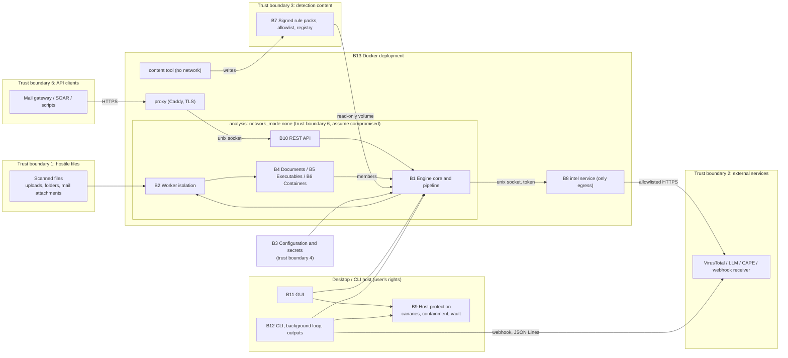

# Project review: Aegis Sentinel (hybrid-ransomware-detector)

> **INCOMPLETE DRAFT: Stage 1 of 2.** This report is unfinished. Sections marked
> **PENDING (Stage 2)** have not been carried out: no performance benchmark has
> been run, no gap grades have been assigned, and the roadmap, block closure plan
> and priority actions are preliminary. Finding IDs are preliminary and may be
> merged or re-ranked in Stage 2. Do not use this draft as a release decision.

Task brief: [tasks/project-review.md](tasks/project-review.md).

## 0. Review baseline

| Item | Value |
|---|---|
| Reviewed branch | `main` (review notes are kept on `review/project-review`) |
| Reviewed commit | `af5e6d2ed72e2525ed8486158adb89e9a069119b` (merge of PR #29, on top of the v4.7.0 release commit `8221fe7`) |
| Working tree at review start | clean on `main`, level with `origin/main`; no uncommitted or untracked changes, so nothing was excluded |
| Code changed by this review | none. The review branch changes only `docs/PROJECT_REVIEW.md`, `docs/tasks/project-review.md` and `docs/HANDOFF.md` |
| Benchmarked code state | not applicable yet (benchmarks are Stage 2) |
| Review date | 2026-10-29 |

All `file:line` references point at `af5e6d2`.

## 1. Executive summary (preliminary)

Aegis Sentinel 4.7.0 is a mature, well-documented static scanner for an active
development project. It already has explicit release criteria, a threat model
with residual risks, a hardened Docker deployment, per-result completeness and
provenance, signed rule packs, and a large test suite. Most of the threat model's
stated mitigations are present in the code, and the targeted tests for them passed
in this review (320 passed, 3 platform skips).

Stage 1 found these issues, in order of current impact (details in section 10):

1. **PR-01, High, confirmed and reproduced.** The rule-pack installer uses the
   signed manifest's `version` string as a folder name without validation. A
   pack signed by a trusted key with version `../../victim` deleted and replaced
   a directory outside `rulepacks/`. The threat model plans for a compromised
   signing key and expects that to affect only detection content.
2. **PR-02, Medium.** If workers cannot start, isolation fails open: the
   remaining files, API uploads included, are scanned in the main process with
   no time or memory limit, and the result does not say so.
3. **PR-03, Medium.** A single-file scan (CLI `--scan-file`, the GUI's single-file
   scan, or a folder that holds one file) runs in-process with no limits.
4. **PR-04, Medium.** DMG images are unpacked with `7z x` into a folder. This
   relies on the installed 7-Zip's own path and link handling, which the threat
   model says is never used.
5. **PR-05, Medium, test gap.** In all six OS × Python CI jobs, the API, intel,
   HTTP readiness and fuzz tests are skipped because fastapi and hypothesis are
   not installed there. They run only in the Linux / Python 3.12 coverage job.

The requested product capabilities are at different stages. General folder
monitoring with automatic scanning, outbound e-mail alerts, and optional cloud
storage for logs and reports are **absent**. The building blocks exist: the canary
watcher, scheduled scans, isolated workers, the JSON Lines output and signed
webhooks. Quarantine and restore are **implemented**, including from the GUI
(section 9).

Pending for Stage 2: refactoring proposals, the performance benchmark (on this Mac
only), the gap analysis and grades, the roadmap, the final block closure plan, and
the ten priority actions.

## 2. Scope, methodology and limitations

**Scope.** The whole repository at `af5e6d2`. Following the brief, the security
review prioritises parsers, archive extraction, worker isolation, the analysis /
intel boundary, the API and rule-pack updates, and uses `docs/THREAT_MODEL.md` as
its basis.

**Exclusions (from the brief).** Detection accuracy, detection rates and false
positives are out of scope. Nothing here estimates them, and safe fixtures are
never presented as accuracy evidence. Scoring code is reviewed only for
implementation correctness and consistency. No change to weights or thresholds is
proposed. ML training and model work belongs to a separate contributor. Items
already tracked in `docs/RELEASE_READINESS.md` are referenced by their IDs, not
re-reported (section 11).

**Method.**
1. Read `AGENTS.md`, `CLAUDE.md`, `docs/AI_WORKFLOW.md`, `docs/HANDOFF.md`,
   `docs/RELEASE_READINESS.md`, `docs/THREAT_MODEL.md`, `docs/ARCHITECTURE.md`,
   `docs/RELEASE_SCOPE.md`, `docs/DEPLOYMENT.md`, `docs/OPERATIONS.md`,
   `docs/RUNBOOKS.md`, `docs/RULE_PACKS.md`, `docs/DATA_POLICY.md`,
   `docs/SUPPORT.md`, `docs/RELEASING.md`, `docs/DATASET_PLAN.md`, the first part
   of `docs/THIRD_PARTY.md`, and the latest `CHANGELOG.md` entries (4.7.0, the
   start of 4.6.0). `README.md`, `docs/DETECTION_v3.md` and `docs/DETECTION_v4.md`
   were read by section headings only, plus the sections cited below.
2. Read code block by block (inventory in section 3).
3. Ran the targeted existing tests for each threat-model area (section 7), and
   `ruff check .` with the project configuration.
4. Read the CI configuration and the log of the latest `tests` run on `main`
   (run 40741208642, commit `af5e6d2`) for skip reasons per job.
5. Reproduced one finding (PR-01) with a throw-away script in a temporary folder
   outside the repository.

**Environment of the local runs.** macOS 27.0.1 on Apple M1 (8 cores, 8 GB),
Python 3.14.2 in the repository's `.venv` (pytest 9.1.1, ruff 0.17.3, schedule
1.2.2). Helper tools present: `7zz` and `unar` (Homebrew), `bsdtar`, zbar. Docker
was not used in Stage 1.

**Limitations.**
- Python 3.14 is not a supported runtime (RELEASE_SCOPE §4; RELEASE_READINESS B3),
  and this Mac is not the reference Linux host. Local results are observations for
  this Mac only.
- No Windows or Linux host was available. Statements about those platforms come
  from code reading and CI logs, not from local runs.
- `deploy/check-deployment.sh` and `deploy/isolation_check.py` were not run.
- Format parsers other than archive extraction were not read in Stage 1
  (section 3). Their mitigations are mapped through the pipeline guards, limits
  and fuzzing only.
- "Fully inspected" means every file in the declared scope was read. It does not
  mean the review proves the absence of defects.

## 3. Inspection inventory

| Depth | Files |
|---|---|
| **Fully inspected** | `engine/workers.py`, `engine/scanner.py`, `engine/staging.py`, `engine/layers.py`, `engine/containers.py`, `engine/completeness.py`, `engine/readiness.py`, `engine/protection.py`, `detectors/container_extractor.py`, `api/server.py`, `api/limits.py`, `api/intel.py`, `core/http.py`, `core/rulepack.py`, `core/outputs.py`, `core/canary_watch.py`, `Dockerfile`, `docker-compose.yml`, `.github/workflows/{tests,quality,release,docker}.yml`, `pyproject.toml`, `requirements.txt`, `requirements-ml.txt` |
| **Partly read** | `detectors/macos_packages.py` (docstring, 7-Zip helpers 275-344), `core/intel_client.py` (1-80), `engine/config.py` (1-60 and the setting list), `RansomwareScanner.py` (argument parser, 894-999), `aegis_gui/state.py`, `aegis_gui/detail.py` and `aegis_gui/pages/protection.py` (quarantine paths), `requirements.lock` (header, hashes) |
| **Inventory only** (names, sizes, call sites) | the remaining `detectors/` modules, `core/{cache,sandbox,quarantine,canary,containment,response,mailbox,allowlist,tools}.py`, `engine/{validation,secret_store,external,text,report,provenance,capabilities,metrics,logs}.py`, the rest of `aegis_gui/`, `tools/`, `build.py`, `scanner.spec`, `deploy/*`, `fuzz/`, `tests/` (test names, plus the tests executed in section 7) |

**Sampling rationale.** Stage 1 covered the security-critical boundaries the brief
names: workers, archive extraction, the API, intel and rule packs. These hold the
mitigations that stop a hostile file or client from leaving its scan. The
remaining format parsers sit behind the per-layer guard and the worker limits.
They are planned as a Stage 2 sample: `pe_analysis.py`, `mail_analyzer.py`,
`embedded_content.py` with `cfb_writer.py`, the rest of `macos_packages.py`, and
`web_content.py`, chosen by size and input exposure. Stage 2 also covers the
modules that the clean-code and refactoring review needs (`engine/config.py`,
`engine/validation.py`, `engine/report.py`, `detectors/scoring.py`, the GUI).

## 4. Development context

- **Release state.** 4.7.0 was released on 2026-10-28 (CHANGELOG `[4.7.0]`;
  RELEASE_READINESS "4.7.0"). The paid edition is an on-prem Docker deployment
  with the REST API as the primary surface. The desktop GUI is a supported analyst
  workstation app on Windows and macOS (D2). Canaries and containment are
  desktop-only and outside paid support (D3). See RELEASE_SCOPE §1-2 and §8.
- **Open release items already tracked:** M1 / X1 (real-sample evaluation), M2
  (throughput and latency on a reference host), O1 (walk-through on a clean Linux
  host), U1 (a real 4.6.0 upgrade), X2 (code signing), D5 (arm64 image), plus the
  backlog items A10-7, A8-2 and A8-3. The legal review of `docs/THIRD_PARTY.md` is
  listed as remaining blocker 2. It has **no ID of its own**: L1 ("list the terms
  for legal review") is `met`, and the review itself is the owner's
  (RELEASE_READINESS, "Remaining blockers").
- **Target release for this review (proposed scope assumption, owner decision
  needed).** The next release after 4.7.0, containing (a) fixes for the confirmed
  defects in this report and (b) the five capabilities the brief requests,
  delivered to the desktop build and, where applicable, the Docker edition. The
  brief does not name a version. RELEASE_SCOPE §5 rules out on-access scanning for
  the Docker edition, so folder monitoring is assumed to be **desktop only** until
  the owner decides otherwise (section 9).

## 5. Block inventory and architecture

Blocks follow the repository structure and the work areas A1-A10 in RELEASE_SCOPE §7.

| ID | Block | Main files / entry points | Purpose and connections | Status | Inspection |
|---|---|---|---|---|---|
| B1 | Engine core and pipeline | `engine/scanner.py` (facade `RansomwareScanner`), `staging.py`, `layers.py`, `containers.py`, `completeness.py`, `provenance.py`, `capabilities.py`, `text.py`, `report.py` | Builds the engines, runs the ordered layers on a `ScanContext`, recurses into containers, scores, and adds status and provenance. Every interface (B10-B12) uses the facade | implemented | core files fully read; `report.py`, `text.py`, `provenance.py`, `capabilities.py` inventory only |
| B2 | Worker isolation | `engine/workers.py` | Process per file, time limit, memory limit per OS, temp folders per worker, spare workers for the API | implemented (see PR-02, PR-03) | fully |
| B3 | Configuration and secrets | `engine/config.py`, `validation.py`, `secret_store.py` | Global `CONFIG` dict built from the environment / `.env`; validation at start; secret precedence environment > keyring > `.env` | implemented | partly |
| B4 | Document layers (A2) | `detectors/file_integrity.py`, `macro_analysis.py`, `prompt_guard.py`, `relationship_scanner.py`, `yara_engine.py`, `fuzzy_hash.py`, `tlsh_py.py` | Format checks, macros, hidden content, external links, YARA, similarity | implemented | inventory only |
| B5 | Executable layers (A3) | `detectors/pe_analysis.py`, `elf_analysis.py`, `ml_classifier.py`, `entropy.py` | PE / ELF structure; ML layer in rule-engine mode (no model ships) | implemented (ML model: other contributor) | inventory only |
| B6 | Containers and delivery (A4) | `detectors/container_extractor.py`, `macos_packages.py`, `mail_analyzer.py`, `web_content.py`, `embedded_content.py`, `script_analysis.py`, `qr_scanner.py`, `cfb_writer.py` | Unpack archives, mail, web payloads, OneNote / CHM / MSI; members go back through B1 | implemented (see PR-04) | `container_extractor.py` fully, `macos_packages.py` partly, others inventory |
| B7 | Detection content and scoring (A1, A6) | `rules/`, `detectors/indicators.yaml`, `registry.py`, `signals.py`, `scoring.py`, `core/rulepack.py`, `core/allowlist.py`, `tools/rulepack.py`, `tools/evaluate.py`, `tools/calibrate_weights.py`, `tools/profile_layers.py` | Typed signals, registry-driven weights and caps, signed rule packs, evaluation tools | implemented (see PR-01) | `core/rulepack.py` fully, others inventory |
| B8 | Intelligence and external services (A5) | `api/intel.py`, `core/intel_client.py`, `core/http.py`, `core/cache.py`, `core/sandbox.py`, `detectors/llm_backends.py`, `detectors/emulation.py`, `engine/external.py` | VirusTotal, LLM, CAPE and box-js; in Docker only through the intel service, with an origin allowlist | implemented | `api/intel.py`, `core/http.py` fully; `intel_client.py` partly |
| B9 | Host protection (A8) | `core/canary.py`, `canary_watch.py`, `response.py`, `containment.py`, `quarantine.py`, `engine/protection.py` | Canaries, real-time canary watching, containment, encrypted vault, automatic quarantine | implemented (desktop only, D3) | `canary_watch.py`, `protection.py` fully; others inventory |
| B10 | REST API and operations signals (A9, A10) | `api/server.py`, `api/limits.py`, `api/probe.py`, `api/scan_result.schema.json`, `engine/readiness.py`, `engine/metrics.py`, `engine/logs.py` | `/scan`, `/health`, `/ready`, `/version`, `/schema`, `/metrics`; abuse limits; fresh worker per upload | implemented | `server.py`, `limits.py`, `readiness.py` fully |
| B11 | Desktop GUI (A9) | `gui.py`, `aegis_gui/` (app, pages, detail, state) | Scans, results, provenance, diagnostics, protection page, vault restore, quarantine undo | implemented | partly |
| B12 | CLI, background service and outputs (A9) | `RansomwareScanner.py`, `core/mailbox.py`, `core/outputs.py` | CLI commands, scheduled scans, IMAP triage, JSON Lines, signed webhooks | implemented (see PR-07, PR-08) | `outputs.py` fully, CLI partly |
| B13 | Docker deployment | `Dockerfile`, `docker-compose.yml`, `deploy/` | analysis (no network) / intel (only egress) / proxy (TLS) / content tool | implemented | Dockerfile and compose fully; `deploy/` inventory |
| B14 | Release and CI (A10) | `.github/workflows/`, `build.py`, `scanner.spec`, `requirements*`, `pyproject.toml` | Test matrix, quality gates, Docker check, release builds, SBOM, Sigstore | implemented (see PR-05, PR-06) | workflows and pyproject fully; `build.py` inventory |
| B15 | Tests and fuzzing | `tests/` (82 files), `fuzz/`, `test_smoke.py` | Unit, integration, regression corpus, hypothesis fuzzing, GUI smoke test (opt-in) | implemented | inventory, plus the executed subset |
| B16 | Documentation | `README.md`, `CHANGELOG.md`, `docs/` | Design, threat model, release scope and tracking, operations, policies | implemented (see PR-10) | read as listed in section 2 |

The Mermaid source was not checked with a renderer in Stage 1 (validation is
Stage 2).

## 6. Clean code and design review

Conclusions apply only to the files inspected (section 3). Blocks with inventory
only are marked; their review is Stage 2. A large file, a mixin or global state is
not counted as a problem unless the code shows a practical effect.

### Per block

**B1 Engine core and pipeline** (inspected)
- *Working well.* Each layer is a small class with one `run()` and a visible order
  (`engine/layers.py:130-144`, `:467-492`). Every layer runs inside a guard that
  turns an exception into `layer_errors` (`engine/staging.py:88-104`). Heavy layers
  run on copies of the context and are merged back in pipeline order
  (`engine/staging.py:131-150`). The completeness rules are documented together with
  their precedence (`engine/completeness.py:1-29`).
- *Coupling.* The facade combines five mixins (`engine/scanner.py:70-71`). They
  depend on attributes declared only as class annotations
  (`engine/staging.py:27-31`, `engine/protection.py:25-31`). The practical effect
  shows in `api/intel.py:91-101`: to reuse the VirusTotal code, the intel service
  builds a stand-in "scanner" by setting `config`, `cache`, `intel`, `http`,
  `http_timeout` and `vt_limiter` by hand. If `ExternalLookupsMixin` starts using a
  new attribute, intel fails at run time. mypy would not catch it, because
  `check_untyped_defs = false` (`pyproject.toml:122`).
- *Error handling.* `ScanContext.start` runs before any layer guard
  (`engine/staging.py:46`; `engine/layers.py:107-123`). If `os.path.getsize` or a
  format sniffer raises, the whole `scan_file` call raises. The in-process path then
  drops that file (PR-09).
- *Duplication.* The top-level result is built in two places: `ScanContext.start`
  (`engine/layers.py:109-118`) and `failure_result` (`engine/workers.py:373-405`). A
  new top-level field has to be added to both. Whether every schema field is in
  both was not checked in Stage 1 (Stage 2: compare against
  `api/scan_result.schema.json`; `tests/test_outputs_and_api.py:36` checks failure
  results against the schema).
- *Readability.* `ScanContext.data()` sits between dataclass fields
  (`engine/layers.py:80-95`). It works, but the fields read as if they ended before
  it. Low impact.
- *Naming.* Legacy names are kept on purpose for compatibility (`chatgpt_analysis`,
  `engine/layers.py:393`; `kaggle_db_path`; `severity_score`). Keep them while the
  result schema stays additive-only (C6).

**B2 Worker isolation** (inspected)
- *Working well.* The per-OS memory limits are cleanly separated
  (`engine/workers.py:50-65`, `:122-145`, `:177-215`). Each worker has its own temp
  folder, which the parent removes (`:227-234`, `:346`, `:357-370`), and folders left
  by a dead scanner are swept (`:315-336`).
- *Design weakness.* The fallback to unisolated scanning is implicit and silent
  (PR-02). The scan loop polls each worker in turn with a 50 ms blocking poll
  (`:428`, `:469-474`, `:522-528`). Whether this adds dispatch latency with several
  workers is the hypothesis H-01, to be measured in Stage 2.
- *Module globals* (`_SCANNER`, `_JOB_HANDLE`, `_SWEPT`, `:46`, `:103`, `:289`) are
  per process and read correctly in their context. No change is suggested.

**B3 Configuration and secrets** (partly inspected)
- `CONFIG` is a global dict (`engine/config.py:139`), but the engine receives it by
  injection (`engine/scanner.py:77-79`). That is testable, and a typed config is not
  justified today (RELEASE_READINESS A7: "Typed config: no fix needed it").
- *Duplicated fallback defaults.* Code outside `engine/config.py` repeats defaults,
  for example `scan_timeout_seconds` 300 (`engine/scanner.py:375`,
  `api/server.py:122`) and `worker_memory_mb` 2048 (`engine/scanner.py:376`,
  `api/server.py:92`). Some copies disagree: `http_timeout` is 30 in
  `engine/scanner.py:230` and 60 in `core/mailbox.py:72`, and `openai_model` is
  `"gpt-4"` in `detectors/llm_backends.py:275` but `"openai"` in
  `aegis_gui/pages/dashboard.py:274`. These fallbacks apply only when a key is
  missing (tests, tools, partial configurations), because `CONFIG` always sets them
  (`engine/config.py:158`, `:209`). Low impact. Fix them when that code is next
  changed.
- `api/server.py:67` reads `AEGIS_API_MAX_UPLOAD_MB` at import time. That goes
  against the "no side effects on import" convention in `engine/config.py:5-10` and
  makes the limit a module constant. Low impact.

**B4 Document layers, B5 Executable layers**: inventory only. Review pending (Stage 2 sample).

**B6 Containers and delivery** (`container_extractor.py` inspected)
- *Working well.* Every format goes through shared admission, naming and budget
  helpers (`detectors/container_extractor.py:489-506`, `:538-544`, `:572-588`). The
  sandbox lives only inside a context manager (`:410-429`). The large module is
  organised by format with explanatory docstrings, so its size alone is not a
  problem.
- *Inconsistency.* DMG unpacking is the only path that lets an external tool write
  a directory tree (PR-04). 7z members are size-checked only after `py7zr` has
  extracted them (`:705-739`; suspected S-02).
- *Duplication.* The password-candidate loops appear three times, for ZIP
  (`:619-637`), 7z (`:669-676`, `:706-718`) and RAR (`:752-760`, `:792-825`), each with
  format-specific errors. Merging them is optional. Only do it when one of them
  changes.
- *Complexity.* `_walk_7z` is at 19 with the project's own limit of 19
  (`pyproject.toml:107-108`; measured with ruff in this review).

**B7 Detection content and scoring** (`core/rulepack.py` inspected; scoring pending)
- *Working well.* Verification is complete and ordered: signature, then members,
  then manifest hashes (`core/rulepack.py:156-209`). Monotonic versions, signed
  rollback and signer tracking are small and readable (`:212-279`).
- *Defects.* The signed `version` is used as a path (PR-01). `active.json` is
  written non-atomically, and a damaged one silently falls back to the bundled
  rules (PR-14).

**B8 Intelligence and external services** (`api/intel.py`, `core/http.py` inspected)
- *Working well.* There is a fixed set of operations with exact input validation
  (`api/intel.py:235-270`). Each service has its own allowlisted session, enforced
  in `send()`, so redirects are covered too (`core/http.py:57-72`). Only intel keeps
  a cache, and only from real replies (`api/intel.py:112-119`, `:173-216`).
- *Coupling.* The `_VirusTotal` stand-in (see B1).

**B9 Host protection** (`canary_watch.py`, `engine/protection.py` inspected; the rest inventory)
- *Working well.* Debounced, change-only events (`core/canary_watch.py:43-58`,
  `:133-158`). Alerts are de-duplicated by finding signature
  (`engine/protection.py:85-88`).
- *Gap relevant to the requested alerting.* Canary alerts go only to a file and a
  desktop notification. They never reach the webhook or JSON Lines outputs (PR-08).

**B10 REST API** (inspected)
- *Working well.* Middleware order and responsibilities are clear (body limit,
  per-IP limit, then authentication with lockout, then the per-client quota;
  `api/server.py:220-234`). There is a fresh worker for each upload and spare
  workers ready in advance (`:73-130`).
- *Complexity.* `create_app` is at the cap of 19. Its endpoint closures share
  `service`, `auth` and `slots`. That is readable today, but each new endpoint adds
  to it (refactoring proposal pending in Stage 2).
- *Weaknesses.* The readiness worker check is frozen at start-up (PR-11). Module
  docstrings are stale (PR-10).

**B11 GUI** (sampled)
- The single-file scan runs in the GUI process without limits
  (`aegis_gui/state.py:107`; PR-03). The vault list and restore exist on the
  Protection page (`aegis_gui/pages/protection.py:84-123`), and quarantine undo
  exists in the result window (`aegis_gui/detail.py:468-518`). The rest of the GUI is
  reviewed in Stage 2.

**B12 CLI, background service and outputs** (partly inspected)
- `RansomwareScanner.py` (999 lines) mixes autostart for three OSes
  (`:116-321`), the argument parser (`:533-622`), command handlers (`:625-892`) and
  the scheduler loop (`:894-957`). `_protection_command` reaches complexity 18.
  The practical effects are PR-07, a loop with no exception guard, and a single-file
  path that does not use workers (PR-03).
- `core/outputs.py` is small and correct for one attempt per alert. It has no retry
  or outbox (PR-08).

**B13 Docker deployment** (inspected): the hardening matches DEPLOYMENT §0 and is
checked by `tests/test_deployment.py:17-110`. Gaps: no hash pinning (PR-12); the
analysis service can write its own log volume (proposed threat-model addition
TMA-1).

**B14 Release and CI** (inspected): PR-05, PR-06, PR-13. Coverage is measured
over `engine`, `detectors`, `core` and `api` only (`pyproject.toml:77-79`). The
reported 91 % therefore leaves out `aegis_gui/`, `tools/` and `RansomwareScanner.py`
(observation PR-15).

**B15 Tests**: the suite is broad and named after behaviours. The isolation
fallback is asserted as intended behaviour (`tests/test_workers.py:80`), so fixing
PR-02 means changing a test on purpose. No test covers: the rule-pack version
format, DMG traversal or links, an exception in the background loop, or isolation
of single-file scans.

**B16 Documentation**: thorough and consistent with the code in most places
checked. Exceptions: PR-04 (threat model §2), PR-10 (stale docstrings, a local
file path in a public doc).

### Design patterns in use

| Pattern | Implementation | Fit | Misuse / note |
|---|---|---|---|
| Pipeline | `engine/layers.py:130-144`, `:467-492`; runner `engine/staging.py:34-86` | Good: independent, ordered, testable layers | none found |
| Template Method | `engine/containers.py:51-89` hooks, `:92-139` shared loop; four handlers `:142-311` | Good: one recursion, budget and worst-member rule for four container kinds | none found |
| Facade | `RansomwareScanner`, `engine/scanner.py:70-106` | Good single entry point for CLI, GUI and API | wide, because the mixins add every capability to it |
| Mixins | `engine/scanner.py:70-71` | They split a large class into files | the stand-in in `api/intel.py:91-101` shows implicit coupling (see B1) |
| Bulkhead (process isolation) | `engine/workers.py:339-371`, `:424-573` | Good, with per-OS limits | silent fail-open (PR-02); not used for single files (PR-03) |
| Token bucket / rate limiter | `api/limits.py:108-137`, `AuthGuard` `:159-200`, `core/http.py:99-122` | Good, bounded tables (`max_clients`) | none found |
| Allowlist proxy (egress guard) | `core/http.py:57-72` | Good: covers redirects | none found |
| Context-managed sandbox | `detectors/container_extractor.py:410-429` | Good: removal guaranteed in-process | a killed worker relies on B2's folder removal (present) |
| Registry, Strategy, Null Object | documented in `docs/ARCHITECTURE.md` §8 | not inspected in Stage 1 | Stage 2 |

**Where a pattern would really simplify** (proposals, detailed in Stage 2):
1. A small `VirusTotalClient` service that both the scanner and intel inject,
   instead of the hand-built `_VirusTotal` mixin host (`api/intel.py:91-101`). It
   removes the implicit attribute contract and lets intel use a typed object.
2. An explicit isolation policy for `scan_isolated` (fail closed, or fall back
   in-process with the fallback recorded in the result) instead of a hidden
   fallback (`engine/workers.py:461-462`). This addresses PR-02 without new layers.
3. Reuse the existing bounded writer (`_stream_into`) for DMG members, as RAR
   already does, instead of a separate extract-then-walk path (PR-04).

No other new abstractions are recommended.

## 7. Threat-to-mitigation mapping

Legend: **Doc** = stated in `docs/THREAT_MODEL.md`. **Impl** = found in the code.
**Test** = an automated test exists. **Run** = executed in this review (local,
macOS, Python 3.14). Two local batches, both with `LLM_PROVIDER=none` and
`-p no:cacheprovider`:
- Batch 1: workers, worker limits, archives, RAR, encrypted containers, macOS
  packages, closed limits, fuzz. **145 passed, 3 skipped** (Job Object, `/proc`,
  "libproc exists on macOS").
- Batch 2: API auth, outputs and API, intel, cache integrity, cache keys, rule
  packs, deployment, privilege separation, readiness, scan status, secret store,
  tools path, HTTP, sharing, provenance, metrics. **175 passed**.

| Area / TM ref | Mitigation | Impl (file:line) | Test (file:line) | Run | Gap |
|---|---|---|---|---|---|
| Parsers §1 | Each layer guarded; an error becomes `layer_errors` | `engine/staging.py:88-104` | `tests/test_fuzz_parsers.py:199`, `:216` | yes, passed | `ScanContext.start` is outside the guard (PR-09). Parser internals not yet inspected (Stage 2). In CI the fuzz suite runs only on Linux / 3.12 (PR-05) |
| Parsers §1 | Fuzzing of every parser | `tests/test_fuzz_parsers.py:117-216`; `fuzz/fuzz_parsers.py` | same | hypothesis suite yes; atheris no | atheris long runs not executed |
| Parsers §10 | Container boundary for a parser exploit | `docker-compose.yml:64-112` | `tests/test_deployment.py:22-62` (compose content); `deploy/isolation_check.py` (live) | compose tests yes; live check no | live isolation not exercised here (CI `docker.yml` runs it) |
| Archives §2 | Generated member names in a fresh sandbox | `detectors/container_extractor.py:410-429`, `:538-544` | `tests/test_container_extractor.py:25` | yes, passed | none |
| Archives §2 | Traversal, absolute paths and links refused and reported | `:333-342`, `:489-506`; pkg `:914-916` | `tests/test_container_extractor.py:50`, `:59`; `tests/test_rar.py:76`; `tests/test_macos_packages.py:111` | yes, passed | DMG: no traversal or link test (PR-04, S-01) |
| Archives §2 | External tools only stream one member to stdout | RAR: `:795-798` through rarfile | `tests/test_rar.py:61-125` | yes, passed | **Not true for DMG**: `7z x -o<dir>` (`detectors/macos_packages.py:331-337`, used at `container_extractor.py:1008-1014`) (PR-04) |
| Archives §2 | 7z: private folder, only resolved plain files moved | `:705-739` | `tests/test_archive_formats.py:109-149` | yes, passed | size checked after extraction (S-02) |
| Archives §2 | Unpack budget (bytes, members, depth, ratio) | ZIP `:572-588`, ISO `:379-389`, `:869-882`, limits `:525-536`, depth `:436-439` | `tests/test_container_extractor.py:68`, `:74`, `:94`; `tests/test_rar.py:87`; `tests/test_archive_formats.py:141`, `:182`, `:189` | yes, passed | DMG and 7z checked after the write (PR-04, S-02) |
| Archives §2 | Killed worker's temp folder removed | `engine/workers.py:227-234`, `:357-370`, `:315-336` | `tests/test_workers.py:46`; `tests/test_worker_limits.py:360` | yes, passed | none |
| Isolation §1 | Wall-clock limit, scan_failed result | `engine/workers.py:486-500`, `:373-405` | `tests/test_workers.py:32` | yes, passed | none |
| Isolation §1 | Memory: RLIMIT_AS (Linux) | `:59-63` | `tests/test_worker_limits.py:32` | yes (setter only, macOS) | real enforcement only in Linux CI |
| Isolation §1 | Memory: Job Object (Windows) | `:122-145` | `tests/test_worker_limits.py:67-93` | partly (`:93` skipped here) | real cap only in Windows CI (`:93` ran there: not in the Windows skip list of run 40741208642) |
| Isolation §1 | Memory: watchdog (macOS) | `:177-215`, `:503-512` | `tests/test_workers.py:58`; `tests/test_worker_limits.py:121-176` | yes, passed | 0.25 s residual (documented) |
| Isolation §1, §10 | Folder and API scans in a worker; fresh worker per upload | `engine/scanner.py:372-376`; `api/server.py:114-127` | `tests/test_outputs_and_api.py:139`; `tests/test_readiness.py:152` | yes, passed | **fails open** after 3 failed starts (PR-02, asserted by `tests/test_workers.py:80`); single files not isolated (PR-03) |
| Intel §10 | Analysis has no network | `docker-compose.yml:74` | `tests/test_deployment.py:41`, `:62` | yes (static) | live check not run here |
| Intel §10 | Secrets only in intel; production refuses them on the analysis side | `docker-compose.yml:49` vs `:91` | `tests/test_intel_service.py:336` | yes, passed | none |
| Intel §10 | Fixed operations, exact inputs | `api/intel.py:235-270`, `:321-351` | `tests/test_intel_service.py:160`, `:169` | yes, passed | none |
| Intel §10 | Destinations from intel's configuration, redirects refused | `core/http.py:46-72`; `api/intel.py:122-138` | `tests/test_intel_service.py:27`, `:57`, `:184`, `:238` | yes, passed | none |
| Intel §10 | Token (≥ 32 characters) and per-operation rate limit; body cap | `api/intel.py:276-303`, `:286` | `tests/test_intel_service.py:149`, `:224`, `:232` | yes, passed | the worker holds the token (tracked: Phase 2 backlog [A5]) |
| Intel §10 | Cache only in intel, keyed by what intel derives | `engine/scanner.py:233-239`; `api/intel.py:112-119`, `:173-216` | `tests/test_cache_integrity.py:24-109` | yes, passed | none |
| API §7 | Bearer token, constant-time compare, ≥ 16 characters, docs off | `api/server.py:165-168`, `:205-206`, `:218-219` | `tests/test_outputs_and_api.py:101`, `:110`; `tests/test_api_auth.py:158` | yes, passed | none |
| API §7 | Per-IP limit before authentication | `api/limits.py:203-218`; `api/server.py:225-227` | `tests/test_api_auth.py:131` | yes, passed | none |
| API §7 | Lockout per IP, checked before the compare | `api/limits.py:159-200`; `api/server.py:175-194` | `tests/test_api_auth.py:25-126` | yes, passed | none |
| API §7 | Last X-Forwarded-For entry behind a trusted proxy | `api/limits.py:140-149` | `tests/test_api_auth.py:58`, `:63` | yes, passed | docstring says "first" (PR-10) |
| API §7 | Upload refused before parsing; streaming count | `api/limits.py:59-105`; `api/server.py:286-298` | `tests/test_outputs_and_api.py:132` | yes, passed | none |
| API §7 | `/ready` is not a token oracle | `api/server.py:241-255` | `tests/test_api_auth.py:149` | yes, passed | the workers check is frozen at start-up (PR-11) |
| Rule packs §5 | Ed25519 signature from a configured key | `core/rulepack.py:156-179` | `tests/test_rulepack.py:65` | yes, passed | none |
| Rule packs §5 | Manifest lists exactly the files; plain files under `rules/` | `:181-208` | `tests/test_rulepack.py:65`, `:107` | yes, passed | none |
| Rule packs §5 | Only newer versions; no replay; signed rollback | `:244-251`, `:123-135` | `tests/test_rulepack.py:113`, `:127` | yes, passed | **the version string is not validated and becomes a path** (PR-01, reproduced) |
| Rule packs §5 | Signer recorded; distrusted key's pack not used | `:212-231`, `:273-278` | `tests/test_rulepack.py:146`, `:167` | yes, passed | non-atomic `active.json`, silent fallback (PR-14) |
| Rule packs §5 | Rules compile before activation | `:260-270` | `tests/test_rulepack.py:176` | yes, passed | none |
| Rule packs §5 | Read-only content in analysis; reload on change | `docker-compose.yml:97`; `engine/scanner.py:130-170` | `tests/test_deployment.py:53`; `tests/test_cache_keys.py:27` | yes, passed | none |

### Proposed threat-model additions (for the owner; `docs/THREAT_MODEL.md` not changed)

| ID | Proposed addition | Evidence |
|---|---|---|
| TMA-1 | A compromised analysis worker can write the `analysis-state` volume, which holds the local log file and reports. It can therefore delete or edit local log lines. Docker's own container log is outside its reach. §10 "Little to change" lists only the read-only root and content. | `docker-compose.yml:92-93`; DEPLOYMENT §0 "Operations" (the log file is in `analysis-state`) |
| TMA-2 | A pack signed by a compromised key can do more than change detection content: through the unvalidated version string it can delete or replace directories that the installing user can write. §5 and `docs/RULE_PACKS.md` describe the compromise impact as content only. | PR-01 |
| TMA-3 | DMG unpacking depends on the host's 7-Zip for path and link safety. | PR-04 |
| TMA-4 | Isolation can silently fall back to the main process. §1 and §10 state that every folder and API scan is isolated. | PR-02, PR-03 |

These do not widen the attacker's capabilities. The attacker is still a hostile
file, or the owner of a compromised signing key, as §5 already assumes.

## 8. Platform and Python-version coverage

**Configured versus local runtime.**

| Where | Python | OS | Dependencies |
|---|---|---|---|
| `tests.yml` matrix (`.github/workflows/tests.yml:17-21`) | 3.9, 3.12 | ubuntu, windows, macos (latest) | `requirements.txt` and `requirements-ml.txt`, unpinned, installed one by one, a failure only warns (`:41-50`) |
| `quality.yml` lint, types, coverage, regression | 3.12 | ubuntu only | `requirements.lock` (`quality.yml:32`, `:54`, `:109`) |
| `release.yml` builds | 3.12 | ubuntu, windows, macos | `requirements.lock`, one by one, a failure only warns; `build.py` decides (`release.yml:45-50`) |
| Docker image | 3.12 (`Dockerfile:7`) | Debian trixie, amd64 in release | `-c requirements.lock` (`Dockerfile:19-21`) |
| mypy target | `python_version = "3.11"` (`pyproject.toml:117`) | n/a | type checks do not target 3.9 or 3.12 |
| This Mac | 3.14.2 | macOS 27.0.1, arm64 | `.venv` (lock not installable on 3.14: B3, tracked) |

`requirements.lock` says it was "resolved for Python 3.13 on Linux"
(`requirements.lock:1-3`). Whether the lock installs on Python 3.9 has not been
established (suspected S-04). The 3.9 jobs test unpinned, current packages, not
the shipped set.

**What CI actually exercises** (log of `tests` run 40741208642 on `af5e6d2`):

| Job | Passed | Skipped | Skipped because fastapi is missing | hypothesis (whole fuzz file) | jsonschema / qrcode | GUI (opt-in) | other (platform / tool) |
|---|---|---|---|---|---|---|---|
| ubuntu 3.9 | 935 | 46 | 36 | 1 | 2 / 2 | 1 | 4 |
| ubuntu 3.12 | 935 | 46 | 36 | 1 | 2 / 2 | 1 | 4 |
| macos 3.9 | 933 | 48 | 36 | 1 | 2 / 2 | 1 | 6 |
| macos 3.12 | 933 | 48 | 36 | 1 | 2 / 2 | 1 | 6 |
| windows 3.9 | 920 | 61 | 33 | 1 | 2 / 2 | 1 | 22 |
| windows 3.12 | 920 | 61 | 33 | 1 | 2 / 2 | 1 | 22 |

The skipped fastapi tests include the API authentication and lockout tests, the
intel service, cache integrity, HTTP readiness and metrics. **These, and the
hypothesis fuzz suite, run only in the Linux / Python 3.12 coverage job, against
the lock.** The GUI smoke test runs only there too, under xvfb (`quality.yml:57-71`;
verified by the owner from JUnit in RELEASE_READINESS P3.A9).

**Platform-specific code paths (from code; the CI evidence is the skip list above).**

| Path | Code | Exercised by CI | Gap |
|---|---|---|---|
| Linux RLIMIT_AS | `engine/workers.py:59-63` | ubuntu jobs | none |
| Windows Job Object | `engine/workers.py:122-145` | windows jobs (`test_worker_limits.py:93` not skipped there) | none |
| macOS memory watchdog | `engine/workers.py:177-215` | macos jobs; locally | none |
| Windows `_pid_alive` | `engine/workers.py:294-305` | not established (no dedicated test found in Stage 1) | verify in Stage 2 |
| Restart Manager containment | `core/containment.py` | windows (`tests/test_containment.py:228`) | Stage 2 |
| POSIX containment, lsof, `/proc`, signals, modes | `core/containment.py` | ubuntu and macos; skipped on Windows (5 tests) | n/a on Windows |
| Windows toast | `core/canary.py:341-369` | unit test with a fake runner (RELEASE_READINESS P3.A9) | a real toast on Windows was not verified (already recorded there) |
| Autostart per OS | `RansomwareScanner.py:116-321` | tests reference it (`tests/test_pipeline.py`, `tests/test_scanner_integration.py`, `tests/test_v41_integration.py`); depth not checked | not covered by coverage measurement (PR-15) |
| Intel over a Unix socket | `core/intel_client.py:39-68` | skipped on Windows (`tests/test_intel_service.py:285`, `:306`, `:349`); the no-`AF_UNIX` path is tested at `:452` | n/a on Windows for the Docker edition |
| Emulation | `detectors/emulation.py` | POSIX fake tool only; box-js absent on every runner | the real tool is never run (opt-in feature) |

**Compatibility observations.** No supported-version compatibility defect was found
in Stage 1. The 320 targeted tests passed on 3.14 locally, but 3.14 is not
supported, so this says nothing about 3.9 or 3.12.
