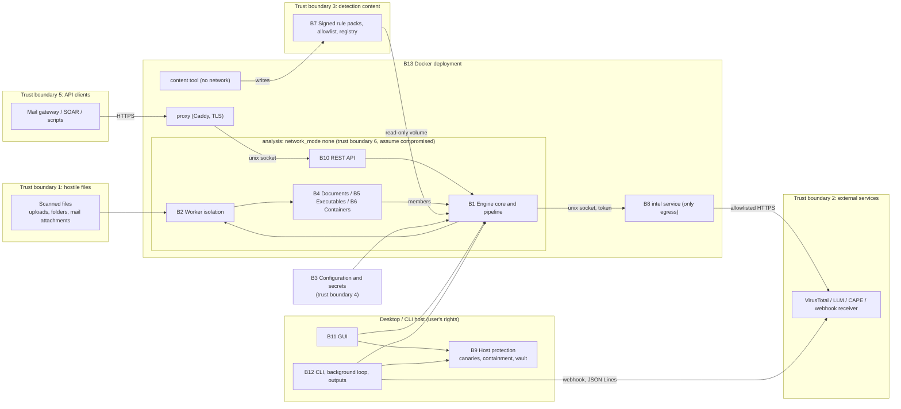

# Project review: Aegis Sentinel (hybrid-ransomware-detector)

> **INCOMPLETE DRAFT: Stage 1 of 2.** This report is unfinished. Sections marked
> **PENDING (Stage 2)** have not been carried out: no performance benchmark has
> been run, no gap grades have been assigned, and the roadmap, block closure plan
> and priority actions are preliminary. Finding IDs are preliminary and may be
> merged or re-ranked in Stage 2. Do not use this draft as a release decision.

Task brief: [tasks/project-review.md](tasks/project-review.md).

## 0. Review baseline

| Item | Value |
|---|---|
| Reviewed branch | `main` (review notes are kept on `review/project-review`) |
| Reviewed commit | `af5e6d2ed72e2525ed8486158adb89e9a069119b` (merge of PR #29, on top of the v4.7.0 release commit `8221fe7`) |
| Working tree at review start | clean on `main`, level with `origin/main`; no uncommitted or untracked changes, so nothing was excluded |
| Code changed by this review | none. The review branch changes only `docs/PROJECT_REVIEW.md`, `docs/tasks/project-review.md` and `docs/HANDOFF.md` |
| Benchmarked code state | not applicable yet (benchmarks are Stage 2) |
| Review date | 2026-10-29 |

All `file:line` references point at `af5e6d2`.

## 1. Executive summary (preliminary)

Aegis Sentinel 4.7.0 is a mature, well-documented static scanner for an active
development project. It already has explicit release criteria, a threat model
with residual risks, a hardened Docker deployment, per-result completeness and
provenance, signed rule packs, and a large test suite. Most of the threat model's
stated mitigations are present in the code, and the targeted tests for them passed
in this review (320 passed, 3 platform skips).

Stage 1 found these issues, in order of current impact (details in section 10):

1. **PR-01, High, confirmed and reproduced.** The rule-pack installer uses the
   signed manifest's `version` string as a folder name without validation. A
   pack signed by a trusted key with version `../../victim` deleted and replaced
   a directory outside `rulepacks/`. The threat model plans for a compromised
   signing key and expects that to affect only detection content.
2. **PR-02, Medium.** If workers cannot start, isolation fails open: the
   remaining files, API uploads included, are scanned in the main process with
   no time or memory limit, and the result does not say so.
3. **PR-03, Medium.** A single-file scan (CLI `--scan-file`, the GUI's single-file
   scan, or a folder that holds one file) runs in-process with no limits.
4. **PR-04, Medium.** DMG images are unpacked with `7z x` into a folder. This
   relies on the installed 7-Zip's own path and link handling, which the threat
   model says is never used.
5. **PR-05, Medium, test gap.** In all six OS × Python CI jobs, the API, intel,
   HTTP readiness and fuzz tests are skipped because fastapi and hypothesis are
   not installed there. They run only in the Linux / Python 3.12 coverage job.

The requested product capabilities are at different stages. General folder
monitoring with automatic scanning, outbound e-mail alerts, and optional cloud
storage for logs and reports are **absent**. The building blocks exist: the canary
watcher, scheduled scans, isolated workers, the JSON Lines output and signed
webhooks. Quarantine and restore are **implemented**, including from the GUI
(section 9).

Pending for Stage 2: refactoring proposals, the performance benchmark (on this Mac
only), the gap analysis and grades, the roadmap, the final block closure plan, and
the ten priority actions.

## 2. Scope, methodology and limitations

**Scope.** The whole repository at `af5e6d2`. Following the brief, the security
review prioritises parsers, archive extraction, worker isolation, the analysis /
intel boundary, the API and rule-pack updates, and uses `docs/THREAT_MODEL.md` as
its basis.

**Exclusions (from the brief).** Detection accuracy, detection rates and false
positives are out of scope. Nothing here estimates them, and safe fixtures are
never presented as accuracy evidence. Scoring code is reviewed only for
implementation correctness and consistency. No change to weights or thresholds is
proposed. ML training and model work belongs to a separate contributor. Items
already tracked in `docs/RELEASE_READINESS.md` are referenced by their IDs, not
re-reported (section 11).

**Method.**
1. Read `AGENTS.md`, `CLAUDE.md`, `docs/AI_WORKFLOW.md`, `docs/HANDOFF.md`,
   `docs/RELEASE_READINESS.md`, `docs/THREAT_MODEL.md`, `docs/ARCHITECTURE.md`,
   `docs/RELEASE_SCOPE.md`, `docs/DEPLOYMENT.md`, `docs/OPERATIONS.md`,
   `docs/RUNBOOKS.md`, `docs/RULE_PACKS.md`, `docs/DATA_POLICY.md`,
   `docs/SUPPORT.md`, `docs/RELEASING.md`, `docs/DATASET_PLAN.md`, the first part
   of `docs/THIRD_PARTY.md`, and the latest `CHANGELOG.md` entries (4.7.0, the
   start of 4.6.0). `README.md`, `docs/DETECTION_v3.md` and `docs/DETECTION_v4.md`
   were read by section headings only, plus the sections cited below.
2. Read code block by block (inventory in section 3).
3. Ran the targeted existing tests for each threat-model area (section 7), and
   `ruff check .` with the project configuration.
4. Read the CI configuration and the log of the latest `tests` run on `main`
   (run 40741208642, commit `af5e6d2`) for skip reasons per job.
5. Reproduced one finding (PR-01) with a throw-away script in a temporary folder
   outside the repository.

**Environment of the local runs.** macOS 27.0.1 on Apple M1 (8 cores, 8 GB),
Python 3.14.2 in the repository's `.venv` (pytest 9.1.1, ruff 0.17.3, schedule
1.2.2). Helper tools present: `7zz` and `unar` (Homebrew), `bsdtar`, zbar. Docker
was not used in Stage 1.

**Limitations.**
- Python 3.14 is not a supported runtime (RELEASE_SCOPE §4; RELEASE_READINESS B3),
  and this Mac is not the reference Linux host. Local results are observations for
  this Mac only.
- No Windows or Linux host was available. Statements about those platforms come
  from code reading and CI logs, not from local runs.
- `deploy/check-deployment.sh` and `deploy/isolation_check.py` were not run.
- Format parsers other than archive extraction were not read in Stage 1
  (section 3). Their mitigations are mapped through the pipeline guards, limits
  and fuzzing only.
- "Fully inspected" means every file in the declared scope was read. It does not
  mean the review proves the absence of defects.

## 3. Inspection inventory

| Depth | Files |
|---|---|
| **Fully inspected** | `engine/workers.py`, `engine/scanner.py`, `engine/staging.py`, `engine/layers.py`, `engine/containers.py`, `engine/completeness.py`, `engine/readiness.py`, `engine/protection.py`, `detectors/container_extractor.py`, `api/server.py`, `api/limits.py`, `api/intel.py`, `core/http.py`, `core/rulepack.py`, `core/outputs.py`, `core/canary_watch.py`, `Dockerfile`, `docker-compose.yml`, `.github/workflows/{tests,quality,release,docker}.yml`, `pyproject.toml`, `requirements.txt`, `requirements-ml.txt` |
| **Partly read** | `detectors/macos_packages.py` (docstring, 7-Zip helpers 275-344), `core/intel_client.py` (1-80), `engine/config.py` (1-60 and the setting list), `RansomwareScanner.py` (argument parser, 894-999), `aegis_gui/state.py`, `aegis_gui/detail.py` and `aegis_gui/pages/protection.py` (quarantine paths), `requirements.lock` (header, hashes) |
| **Inventory only** (names, sizes, call sites) | the remaining `detectors/` modules, `core/{cache,sandbox,quarantine,canary,containment,response,mailbox,allowlist,tools}.py`, `engine/{validation,secret_store,external,text,report,provenance,capabilities,metrics,logs}.py`, the rest of `aegis_gui/`, `tools/`, `build.py`, `scanner.spec`, `deploy/*`, `fuzz/`, `tests/` (test names, plus the tests executed in section 7) |

**Sampling rationale.** Stage 1 covered the security-critical boundaries the brief
names: workers, archive extraction, the API, intel and rule packs. These hold the
mitigations that stop a hostile file or client from leaving its scan. The
remaining format parsers sit behind the per-layer guard and the worker limits.
They are planned as a Stage 2 sample: `pe_analysis.py`, `mail_analyzer.py`,
`embedded_content.py` with `cfb_writer.py`, the rest of `macos_packages.py`, and
`web_content.py`, chosen by size and input exposure. Stage 2 also covers the
modules that the clean-code and refactoring review needs (`engine/config.py`,
`engine/validation.py`, `engine/report.py`, `detectors/scoring.py`, the GUI).

## 4. Development context

- **Release state.** 4.7.0 was released on 2026-10-28 (CHANGELOG `[4.7.0]`;
  RELEASE_READINESS "4.7.0"). The paid edition is an on-prem Docker deployment
  with the REST API as the primary surface. The desktop GUI is a supported analyst
  workstation app on Windows and macOS (D2). Canaries and containment are
  desktop-only and outside paid support (D3). See RELEASE_SCOPE §1-2 and §8.
- **Open release items already tracked:** M1 / X1 (real-sample evaluation), M2
  (throughput and latency on a reference host), O1 (walk-through on a clean Linux
  host), U1 (a real 4.6.0 upgrade), X2 (code signing), D5 (arm64 image), plus the
  backlog items A10-7, A8-2 and A8-3. The legal review of `docs/THIRD_PARTY.md` is
  listed as remaining blocker 2. It has **no ID of its own**: L1 ("list the terms
  for legal review") is `met`, and the review itself is the owner's
  (RELEASE_READINESS, "Remaining blockers").
- **Target release for this review (proposed scope assumption, owner decision
  needed).** The next release after 4.7.0, containing (a) fixes for the confirmed
  defects in this report and (b) the five capabilities the brief requests,
  delivered to the desktop build and, where applicable, the Docker edition. The
  brief does not name a version. RELEASE_SCOPE §5 rules out on-access scanning for
  the Docker edition, so folder monitoring is assumed to be **desktop only** until
  the owner decides otherwise (section 9).

## 5. Block inventory and architecture

Blocks follow the repository structure and the work areas A1-A10 in RELEASE_SCOPE §7.

| ID | Block | Main files / entry points | Purpose and connections | Status | Inspection |
|---|---|---|---|---|---|
| B1 | Engine core and pipeline | `engine/scanner.py` (facade `RansomwareScanner`), `staging.py`, `layers.py`, `containers.py`, `completeness.py`, `provenance.py`, `capabilities.py`, `text.py`, `report.py` | Builds the engines, runs the ordered layers on a `ScanContext`, recurses into containers, scores, and adds status and provenance. Every interface (B10-B12) uses the facade | implemented | core files fully read; `report.py`, `text.py`, `provenance.py`, `capabilities.py` inventory only |
| B2 | Worker isolation | `engine/workers.py` | Process per file, time limit, memory limit per OS, temp folders per worker, spare workers for the API | implemented (see PR-02, PR-03) | fully |
| B3 | Configuration and secrets | `engine/config.py`, `validation.py`, `secret_store.py` | Global `CONFIG` dict built from the environment / `.env`; validation at start; secret precedence environment > keyring > `.env` | implemented | partly |
| B4 | Document layers (A2) | `detectors/file_integrity.py`, `macro_analysis.py`, `prompt_guard.py`, `relationship_scanner.py`, `yara_engine.py`, `fuzzy_hash.py`, `tlsh_py.py` | Format checks, macros, hidden content, external links, YARA, similarity | implemented | inventory only |
| B5 | Executable layers (A3) | `detectors/pe_analysis.py`, `elf_analysis.py`, `ml_classifier.py`, `entropy.py` | PE / ELF structure; ML layer in rule-engine mode (no model ships) | implemented (ML model: other contributor) | inventory only |
| B6 | Containers and delivery (A4) | `detectors/container_extractor.py`, `macos_packages.py`, `mail_analyzer.py`, `web_content.py`, `embedded_content.py`, `script_analysis.py`, `qr_scanner.py`, `cfb_writer.py` | Unpack archives, mail, web payloads, OneNote / CHM / MSI; members go back through B1 | implemented (see PR-04) | `container_extractor.py` fully, `macos_packages.py` partly, others inventory |
| B7 | Detection content and scoring (A1, A6) | `rules/`, `detectors/indicators.yaml`, `registry.py`, `signals.py`, `scoring.py`, `core/rulepack.py`, `core/allowlist.py`, `tools/rulepack.py`, `tools/evaluate.py`, `tools/calibrate_weights.py`, `tools/profile_layers.py` | Typed signals, registry-driven weights and caps, signed rule packs, evaluation tools | implemented (see PR-01) | `core/rulepack.py` fully, others inventory |
| B8 | Intelligence and external services (A5) | `api/intel.py`, `core/intel_client.py`, `core/http.py`, `core/cache.py`, `core/sandbox.py`, `detectors/llm_backends.py`, `detectors/emulation.py`, `engine/external.py` | VirusTotal, LLM, CAPE and box-js; in Docker only through the intel service, with an origin allowlist | implemented | `api/intel.py`, `core/http.py` fully; `intel_client.py` partly |
| B9 | Host protection (A8) | `core/canary.py`, `canary_watch.py`, `response.py`, `containment.py`, `quarantine.py`, `engine/protection.py` | Canaries, real-time canary watching, containment, encrypted vault, automatic quarantine | implemented (desktop only, D3) | `canary_watch.py`, `protection.py` fully; others inventory |
| B10 | REST API and operations signals (A9, A10) | `api/server.py`, `api/limits.py`, `api/probe.py`, `api/scan_result.schema.json`, `engine/readiness.py`, `engine/metrics.py`, `engine/logs.py` | `/scan`, `/health`, `/ready`, `/version`, `/schema`, `/metrics`; abuse limits; fresh worker per upload | implemented | `server.py`, `limits.py`, `readiness.py` fully |
| B11 | Desktop GUI (A9) | `gui.py`, `aegis_gui/` (app, pages, detail, state) | Scans, results, provenance, diagnostics, protection page, vault restore, quarantine undo | implemented | partly |
| B12 | CLI, background service and outputs (A9) | `RansomwareScanner.py`, `core/mailbox.py`, `core/outputs.py` | CLI commands, scheduled scans, IMAP triage, JSON Lines, signed webhooks | implemented (see PR-07, PR-08) | `outputs.py` fully, CLI partly |
| B13 | Docker deployment | `Dockerfile`, `docker-compose.yml`, `deploy/` | analysis (no network) / intel (only egress) / proxy (TLS) / content tool | implemented | Dockerfile and compose fully; `deploy/` inventory |
| B14 | Release and CI (A10) | `.github/workflows/`, `build.py`, `scanner.spec`, `requirements*`, `pyproject.toml` | Test matrix, quality gates, Docker check, release builds, SBOM, Sigstore | implemented (see PR-05, PR-06) | workflows and pyproject fully; `build.py` inventory |
| B15 | Tests and fuzzing | `tests/` (82 files), `fuzz/`, `test_smoke.py` | Unit, integration, regression corpus, hypothesis fuzzing, GUI smoke test (opt-in) | implemented | inventory, plus the executed subset |
| B16 | Documentation | `README.md`, `CHANGELOG.md`, `docs/` | Design, threat model, release scope and tracking, operations, policies | implemented (see PR-10) | read as listed in section 2 |

The Mermaid source was not checked with a renderer in Stage 1 (validation is
Stage 2).
