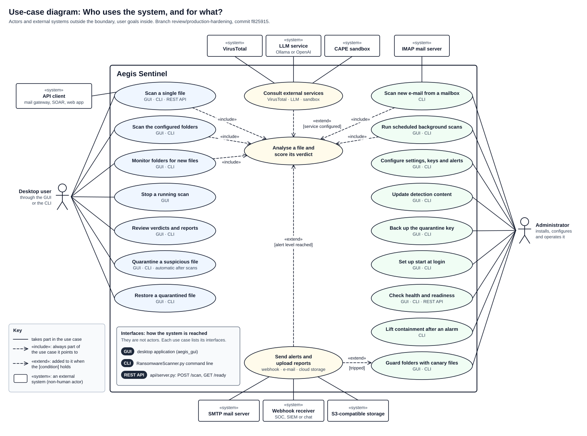
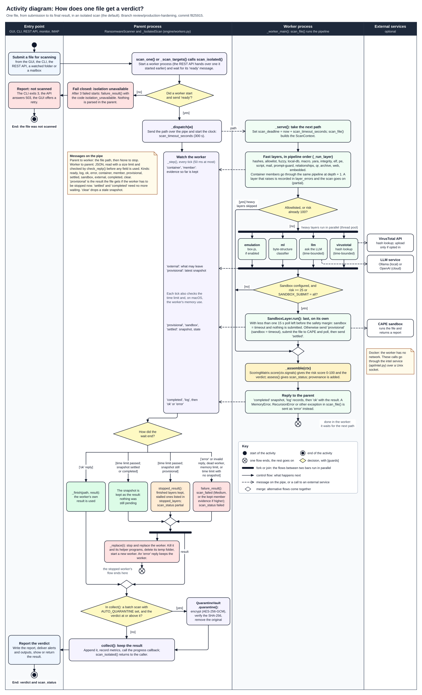
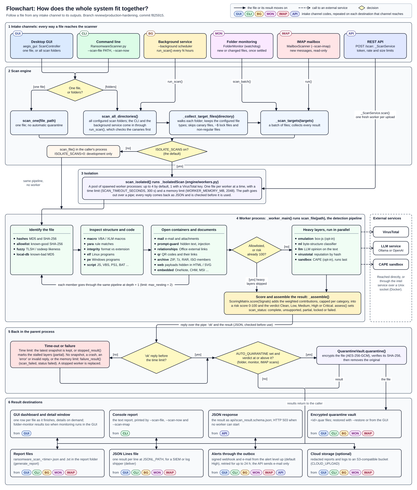

# Architecture diagrams

Four UML diagrams of Aegis Sentinel, drawn from the code and checked against it.
They describe the code at commit `72aa761` on `review/production-hardening`
(`f825915` adds documentation only). Class, method and message names are the ones
in the code. The prose tour is in [ARCHITECTURE](../ARCHITECTURE.md).

| # | Diagram | Question it answers | Drawing | Definition |
|---|---|---|---|---|
| 1 | Class diagram | What makes up the scanner? | [1-class-diagram.svg](uml-diagram-sources/1-class-diagram.svg) | [d1_class_diagram.py](uml-diagram-sources/d1_class_diagram.py) |
| 2 | Use-case diagram | Who uses the system, and for what? | [2-use-case-diagram.svg](uml-diagram-sources/2-use-case-diagram.svg) | [d2_use_case_diagram.py](uml-diagram-sources/d2_use_case_diagram.py) |
| 3 | Activity diagram | How does one file get a verdict? | [3-activity-diagram.svg](uml-diagram-sources/3-activity-diagram.svg) | [d3_activity_diagram.py](uml-diagram-sources/d3_activity_diagram.py) |
| 4 | Flowchart | How does the whole system fit together? | [4-system-flowchart.svg](uml-diagram-sources/4-system-flowchart.svg) | [d4_system_flowchart.py](uml-diagram-sources/d4_system_flowchart.py) |

All four on one page, with zoom and the checked facts under each diagram:
[ARCHITECTURE_UML_DIAGRAMS.html](ARCHITECTURE_UML_DIAGRAMS.html). Open it in a
browser; it is self-contained and loads nothing from the network.

## What the diagrams say, in text

For readers and agents who cannot open the drawings. Every statement below was
read in the files named.

### 1. Classes (`engine/`, `detectors/`, `core/`)

- `RansomwareScanner` (`engine/scanner.py`) is the facade every entry point uses.
  It inherits, in this order, from `StagedPipelineMixin` (`scan_file`, the layer
  runner, `_assemble`), `ProtectionMixin` (quarantine, canaries), `ReportMixin`
  (`generate_report`), `ExternalLookupsMixin` (LLM, VirusTotal) and
  `TextExtractionMixin`.
- It owns (creates and keeps): `pipeline`, 22 `Layer` objects built by
  `default_pipeline()` from 19 `Layer` subclasses; `scoring`, a `ScoringMatrix`;
  16 detection engines, one attribute each (`yara_engine`, `macro_analyzer`,
  `container_extractor`, `mail_analyzer`, ...; `qr_scanner`, `ml` and `emulator` are
  optional); `llm_backend` (an `LLMBackend`: `NullBackend`, `OllamaBackend`,
  `OpenAIBackend` or `IntelLLMBackend`); `sandbox` (a `CapeClient` or an
  `IntelSandbox`, optional); `intel` (an `IntelClient`, optional); `canaries`
  (`CanaryManager`); `quarantine_vault` (`QuarantineVault`, created on first use);
  `cache` (`ResultCache`, optional).
- `Layer.run(scanner, ctx)` adds one kind of evidence to a `ScanContext`. A layer
  never calls another layer; it reaches its engine through the scanner. Five layers
  have `heavy = True`: `EmulationLayer`, `MLLayer`, `LLMLayer`, `VirusTotalLayer`,
  `SandboxLayer`. `ContainerLayer` is created four times, each owning one
  `ContainerHandler` (`MailHandler`, `ArchiveHandler`, `WebHandler`,
  `EmbeddedHandler`).
- `ScanContext` owns a `Signals` object: 19 typed signals, one for each layer
  except the hash, allowlist and local-db layers (the last two set the flags
  `allowlisted` and `local_db_hit`; the hash layer sets no signal).
  `ScoringMatrix.score(signals)` returns a `ScoreResult` that owns its
  `Contribution` list.
- Isolation (`engine/workers.py`): `scan_isolated()` creates an `_IsolatedScan`,
  which owns a pool of `_Worker` objects. Each `_Worker` owns an `Evidence` and, on
  macOS, a `Descendants` tracker. `_IsolatedScan` keeps a reference to the caller's
  scanner; each worker process builds its own `RansomwareScanner`.
- Callers: `ScanController` (GUI), `_ScanService` (REST API, owns a scanner),
  `FolderMonitor` and `MailboxScanner` (keep a reference to one).

### 2. Actors and use cases

- Primary actors: a desktop user, an administrator (roles, not accounts: the code
  has no user roles) and an API client. The GUI, the CLI and the REST API are
  interfaces, not actors.
- Desktop user: scan a single file (GUI, CLI, REST API); scan the configured
  folders; monitor folders for new files; stop a running scan (GUI only); review
  verdicts and reports; quarantine a suspicious file (also automatic after folder,
  monitor and mailbox scans); restore a quarantined file.
- Administrator: scan new e-mail from a mailbox (CLI only); run scheduled
  background scans; configure settings, keys and alerts; update detection content;
  back up the quarantine key; set up start at login; check health and readiness
  (GUI, CLI, REST API); lift containment after an alarm (CLI only); guard folders
  with canary files.
- Shared behaviour: every scan includes "analyse a file and score its verdict".
  "Consult external services" (VirusTotal, an LLM, a CAPE sandbox) extends it when
  a service is configured. "Send alerts and upload reports" (webhook, e-mail,
  S3-compatible storage) extends it at the alert level, and extends the canary
  use case when a canary trips.
- External systems: VirusTotal, an LLM service (Ollama or OpenAI), a CAPE sandbox,
  an IMAP mail server, an SMTP mail server, a webhook receiver, S3-compatible
  storage.

### 3. One file, step by step (isolated scan, the default)

1. The entry point submits the file; `scan_one()` or `_scan_targets()` (the REST
   API: `_ScanService.scan()`) calls `scan_isolated()`.
2. The parent starts a worker process and waits for `ready`. After three failed
   starts it fails closed: an `isolation_unavailable` result, nothing parsed in the
   parent; the CLI exits 3, the API answers 503, the GUI offers a retry.
3. `_dispatch()` sends the path over a pipe and starts the clock
   (`scan_timeout_seconds`, 300 s).
4. The worker runs the fast layers in order: hashes, allowlist, fuzzy, local-db,
   macro, yara, integrity, elf, pe, script, mail, prompt-guard, relationships, qr,
   archive, web, embedded. Container members go through the same pipeline at
   depth + 1. A layer that raises is recorded in `layer_errors` and the scan goes on.
5. If the file is allowlisted (and not in the hash database) or already at risk
   100, the heavy layers are skipped. Otherwise emulation, ml, llm and virustotal
   run in parallel on a thread pool; in a worker with a sandbox configured, the
   sandbox layer runs last, on its own.
6. `_assemble()` scores the signals (`ScoringMatrix`), sets the verdict and
   `scan_status`, and adds provenance. The worker replies `completed`, `log`, `ok`.
7. Meanwhile the parent's `_step()` reads each reply (JSON, checked by
   `check_reply()`), keeps member evidence and the latest snapshot, and checks the
   time limit and, on macOS, the worker's memory.
8. How the wait ends: an `ok` reply gives the worker's result. At the time limit a
   `settled` or `completed` snapshot is kept as the result, a `provisional` one
   becomes a partial result through `stopped_result()`, and no snapshot gives
   `failure_result()`. An `error` or invalid reply, a dead worker or the memory
   limit also give `failure_result()` (`scan_failed`, status `failed`). A stopped
   worker is killed with its helper programs and replaced.
9. `collect()`, the callback of `_scan_targets()`, quarantines the file when
   `AUTO_QUARANTINE` is set and the verdict reaches it, then keeps the result. The
   entry point writes the report and delivers the outputs.

Pipe messages, worker to parent: `ready`, `log`, `ok`, `error`, `container`,
`member`, `provisional`, `settled`, `sandbox`, `external`, `completed`, `clear`.
Parent to worker: the file path, then `None` to stop.

### 4. System flow

| Intake | Enters the engine through | Destinations |
|---|---|---|
| GUI (`ScanController`) | `scan_one()` or `scan_all_directories()` | dashboard, report files, JSON Lines, alerts, cloud; vault after folder scans |
| CLI | `scan_one()` (`--scan-file`) or `run_scan()` (`--scan-now`) | console report, report files, JSON Lines, alerts, cloud; vault after folder scans |
| Background service | `run_scan()` on a schedule | report files, JSON Lines, alerts, cloud, vault |
| Folder monitoring (`FolderMonitor`) | `_scan_targets()` | report files, JSON Lines, alerts, cloud, vault |
| IMAP mailbox (`MailboxScanner`) | `_scan_targets()` | report files, JSON Lines, alerts, cloud, vault |
| REST API (`_ScanService`) | `scan_isolated()` | JSON response, e-mail alerts |

Every channel ends in the same place: `scan_isolated()`, a worker process, the
detection pipeline, `ScoringMatrix`, and back to the parent. With
`ISOLATE_SCANS=0` (development only) `scan_file()` runs in the caller's process.

## Rebuilding and keeping them true

```sh
cd docs/architecture/uml-diagram-sources
python3 build_diagrams.py
```

Python 3.9 or later, standard library only. The script writes the four SVG files
and the HTML page, and stops when a label no longer fits its box, two nodes
overlap or a connector runs through an unrelated node.

When the scan path changes (a layer, a worker message, an entry point, an output),
change the definition file, rebuild, and update this text and the baseline in
`build_diagrams.py`. The diagrams started from a Graphify code graph of the
repository.

## Graphify code graph

[`graphify-code-graph.html`](graphify-code-graph.html) is the interactive code
graph the diagrams were drawn from: 6,366 nodes covering all 253 Python files at
commit `72aa761`, grouped into named communities. It is a single page; it loads
the `vis-network` 9.1.6 library from unpkg, so it needs an internet connection.
It is a generated snapshot: the raw `graph.json` and Graphify cache are not kept
in the repository. After the code changes, rebuild the graph with Graphify and
replace this file, or the page will describe older code.

## The drawings







