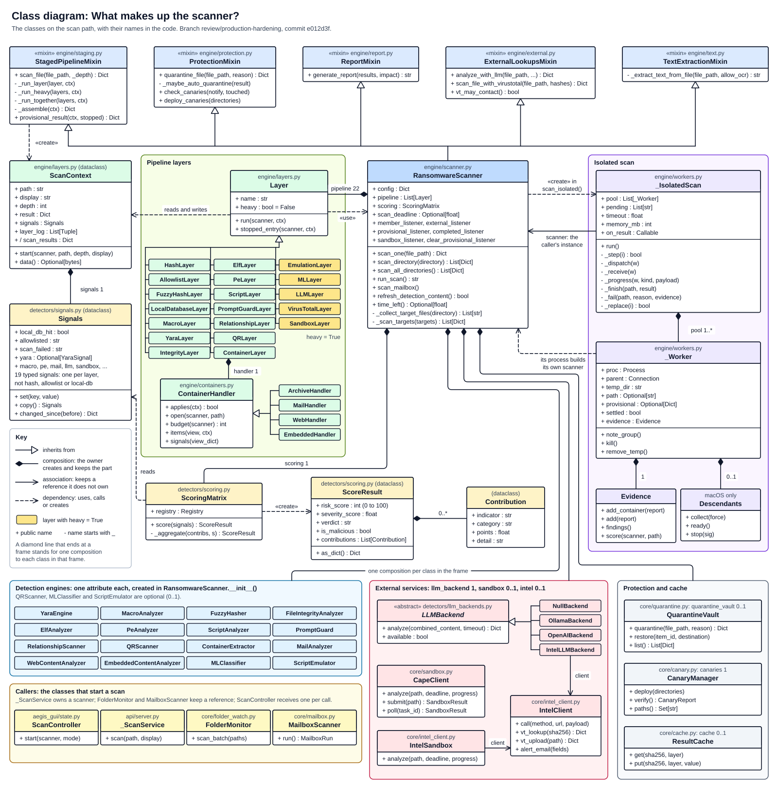
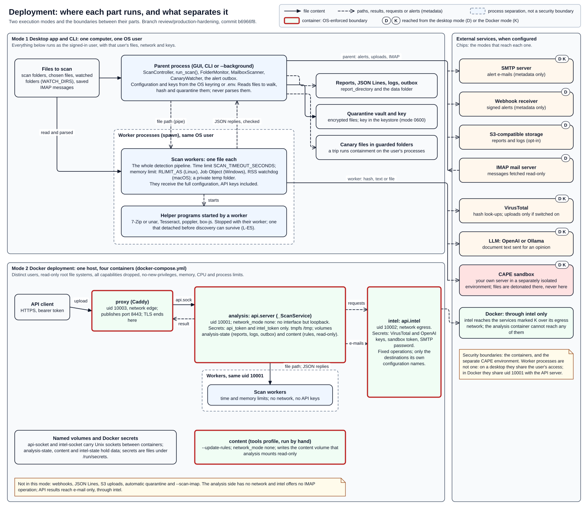
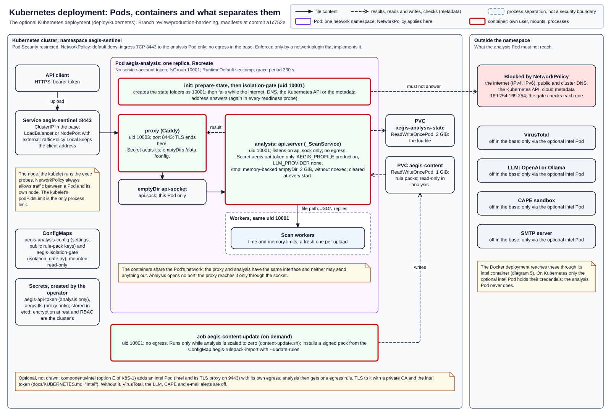
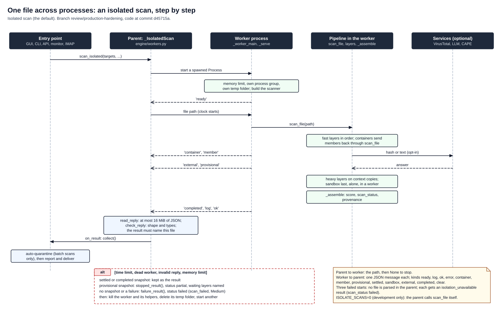
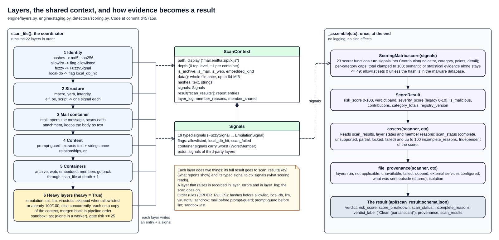
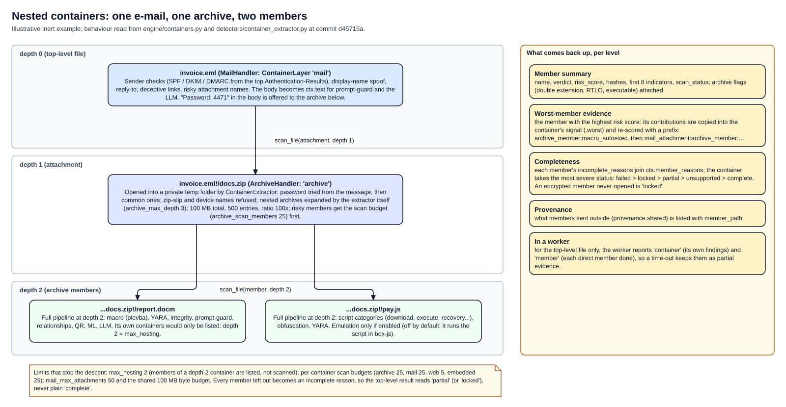
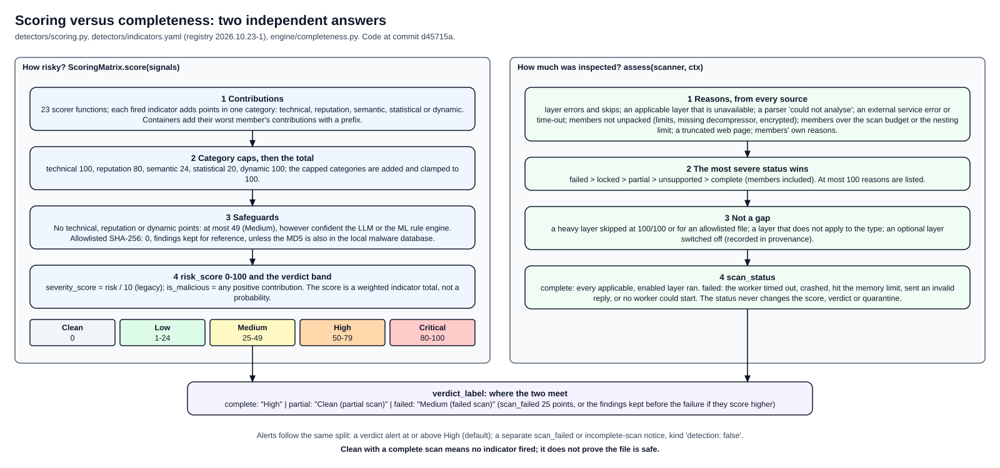
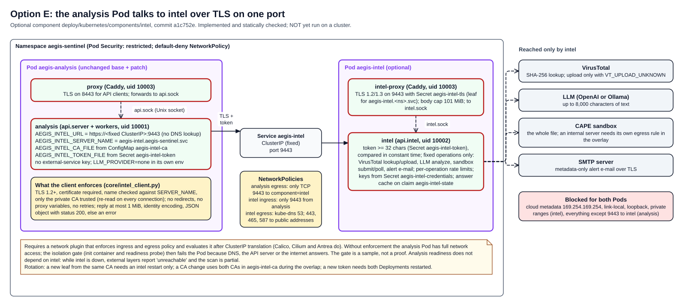

# Architecture diagrams

Eleven diagrams of Aegis Sentinel (UML views, focused data-flow views and deployment
views), drawn from the code and checked against it. All of them were reviewed on
2026-11-19 against commit `e012d3f` on `review/production-hardening` (application code
last changed in `d45715a`; `deploy/kubernetes/` in `a1c752e`); the review record is
[DIAGRAM_REVIEW](../security-overview/DIAGRAM_REVIEW.md). Class, method and message names
are the ones in the code. Rechecked on 2026-11-27 against the code changes of pull request #49
(up to `648a80b`): no drawing changed; the background-service rows in section 4 now
say that canary checks have their own thread (RV-C1). The prose tour is in [ARCHITECTURE](../ARCHITECTURE.md); the full
technical overview (PDF) is in [security-overview](../security-overview/README.md).

| # | Diagram | Question it answers | Drawing | Definition |
|---|---|---|---|---|
| 1 | Class diagram | What makes up the scanner? | [1-class-diagram.svg](uml-diagram-sources/1-class-diagram.svg) | [d1_class_diagram.py](uml-diagram-sources/d1_class_diagram.py) |
| 2 | Use-case diagram | Who uses the system, and for what? | [2-use-case-diagram.svg](uml-diagram-sources/2-use-case-diagram.svg) | [d2_use_case_diagram.py](uml-diagram-sources/d2_use_case_diagram.py) |
| 3 | Activity diagram | How does one file get a verdict? | [3-activity-diagram.svg](uml-diagram-sources/3-activity-diagram.svg) | [d3_activity_diagram.py](uml-diagram-sources/d3_activity_diagram.py) |
| 4 | Flowchart | How does the whole system fit together? | [4-system-flowchart.svg](uml-diagram-sources/4-system-flowchart.svg) | [d4_system_flowchart.py](uml-diagram-sources/d4_system_flowchart.py) |
| 5 | Deployment and trust boundaries | Where does each part run, and what separates it? | [5-deployment-trust-boundaries.svg](uml-diagram-sources/5-deployment-trust-boundaries.svg) | [d5_deployment_trust_boundaries.py](uml-diagram-sources/d5_deployment_trust_boundaries.py) |
| 6 | Kubernetes deployment and trust boundaries (optional) | What separates the parts in a cluster? | [6-kubernetes-trust-boundaries.svg](uml-diagram-sources/6-kubernetes-trust-boundaries.svg) | [d6_kubernetes_trust_boundaries.py](uml-diagram-sources/d6_kubernetes_trust_boundaries.py) |
| 7 | Sequence: one file across processes | Which process does what, and what crosses the pipe? | [7-one-file-sequence.svg](uml-diagram-sources/7-one-file-sequence.svg) | [d7_one_file_sequence.py](uml-diagram-sources/d7_one_file_sequence.py) |
| 8 | Layers, context and evidence | How do layers share data without calling each other? | [8-layer-context-evidence.svg](uml-diagram-sources/8-layer-context-evidence.svg) | [d8_layer_context_evidence.py](uml-diagram-sources/d8_layer_context_evidence.py) |
| 9 | Nested containers | What goes down and comes back up through e-mail, archive and members? | [9-nested-containers.svg](uml-diagram-sources/9-nested-containers.svg) | [d9_nested_containers.py](uml-diagram-sources/d9_nested_containers.py) |
| 10 | Scoring versus completeness | How do the risk score and the scan status relate? | [10-scoring-vs-completeness.svg](uml-diagram-sources/10-scoring-vs-completeness.svg) | [d10_scoring_vs_completeness.py](uml-diagram-sources/d10_scoring_vs_completeness.py) |
| 11 | Kubernetes option E | How does analysis reach intel in a cluster? | [11-option-e-intel.svg](uml-diagram-sources/11-option-e-intel.svg) | [d11_option_e_intel.py](uml-diagram-sources/d11_option_e_intel.py) |

All eleven on one page, with zoom and the checked facts under each diagram:
[ARCHITECTURE_UML_DIAGRAMS.html](ARCHITECTURE_UML_DIAGRAMS.html). Open it in a
browser; it is self-contained and loads nothing from the network.

## What the diagrams say, in text

For readers and agents who cannot open the drawings. Every statement below was
read in the files named.

### 1. Classes (`engine/`, `detectors/`, `core/`)

- `RansomwareScanner` (`engine/scanner.py`) is the facade every entry point uses.
  It inherits, in this order, from `StagedPipelineMixin` (`scan_file`, the layer
  runner, `_assemble`), `ProtectionMixin` (quarantine, canaries), `ReportMixin`
  (`generate_report`), `ExternalLookupsMixin` (LLM, VirusTotal) and
  `TextExtractionMixin`.
- It owns (creates and keeps): `pipeline`, 22 `Layer` objects built by
  `default_pipeline()` from 19 `Layer` subclasses; `scoring`, a `ScoringMatrix`;
  16 detection engines, one attribute each (`yara_engine`, `macro_analyzer`,
  `container_extractor`, `mail_analyzer`, ...; `qr_scanner`, `ml` and `emulator` are
  optional); `llm_backend` (an `LLMBackend`: `NullBackend`, `OllamaBackend`,
  `OpenAIBackend` or `IntelLLMBackend`); `sandbox` (a `CapeClient` or an
  `IntelSandbox`, optional); `intel` (an `IntelClient`, optional); `canaries`
  (`CanaryManager`); `quarantine_vault` (`QuarantineVault`, created on first use);
  `cache` (`ResultCache`, optional).
- `Layer.run(scanner, ctx)` adds one kind of evidence to a `ScanContext`. A layer
  never calls another layer; it reaches its engine through the scanner. Five layers
  have `heavy = True`: `EmulationLayer`, `MLLayer`, `LLMLayer`, `VirusTotalLayer`,
  `SandboxLayer`. `ContainerLayer` is created four times, each owning one
  `ContainerHandler` (`MailHandler`, `ArchiveHandler`, `WebHandler`,
  `EmbeddedHandler`).
- `ScanContext` owns a `Signals` object: 19 typed signals, one for each layer
  except the hash, allowlist and local-db layers (the last two set the flags
  `allowlisted` and `local_db_hit`; the hash layer sets no signal).
  `ScoringMatrix.score(signals)` returns a `ScoreResult` that owns its
  `Contribution` list.
- Isolation (`engine/workers.py`): `scan_isolated()` creates an `_IsolatedScan`,
  which owns a pool of `_Worker` objects. Each `_Worker` owns an `Evidence` and, on
  macOS, a `Descendants` tracker. `_IsolatedScan` keeps a reference to the caller's
  scanner; each worker process builds its own `RansomwareScanner`.
- Callers: `ScanController` (GUI), `_ScanService` (REST API, owns a scanner),
  `FolderMonitor` and `MailboxScanner` (keep a reference to one).

### 2. Actors and use cases

- Primary actors: a desktop user, an administrator (roles, not accounts: the code
  has no user roles) and an API client. The GUI, the CLI and the REST API are
  interfaces, not actors.
- Desktop user: scan a single file (GUI, CLI, REST API); scan the configured
  folders; monitor folders for new files; stop a running scan (GUI only); review
  verdicts and reports; quarantine a suspicious file (also automatic after folder,
  monitor and mailbox scans); restore a quarantined file.
- Administrator: scan new e-mail from a mailbox (CLI only); run scheduled
  background scans; configure settings, keys and alerts; update detection content;
  back up the quarantine key; set up start at login; check health and readiness
  (GUI, CLI, REST API); lift containment after an alarm (CLI only); guard folders
  with canary files.
- Shared behaviour: every scan includes "analyse a file and score its verdict".
  "Consult external services" (VirusTotal, an LLM, a CAPE sandbox) extends it when
  a service is configured. "Send alerts and upload reports" (webhook, e-mail,
  S3-compatible storage) extends it at the alert level, and extends the canary
  use case when a canary trips.
- External systems: VirusTotal, an LLM service (Ollama or OpenAI), a CAPE sandbox,
  an IMAP mail server, an SMTP mail server, a webhook receiver, S3-compatible
  storage.

### 3. One file, step by step (isolated scan, the default)

1. The entry point submits the file; `scan_one()` or `_scan_targets()` (the REST
   API: `_ScanService.scan()`) calls `scan_isolated()`.
2. The parent starts a worker process and waits for `ready`. After three failed
   starts it fails closed: an `isolation_unavailable` result, nothing parsed in the
   parent; the CLI exits 3, the API answers 503, the GUI offers a retry.
3. `_dispatch()` sends the path over a pipe and starts the clock
   (`scan_timeout_seconds`, 300 s).
4. The worker runs the fast layers in order: hashes, allowlist, fuzzy, local-db,
   macro, yara, integrity, elf, pe, script, mail, prompt-guard, relationships, qr,
   archive, web, embedded. Container members go through the same pipeline at
   depth + 1. A layer that raises is recorded in `layer_errors` and the scan goes on.
5. If the file is allowlisted (and not in the hash database) or already at risk
   100, the heavy layers are skipped. Otherwise emulation, ml, llm and virustotal
   run in parallel on a thread pool; in a worker with a sandbox configured, the
   sandbox layer runs last, on its own.
6. `_assemble()` scores the signals (`ScoringMatrix`), sets the verdict and
   `scan_status`, and adds provenance. The worker replies `completed`, `log`, `ok`.
7. Meanwhile the parent's `_step()` reads each reply (JSON, checked by
   `check_reply()`), keeps member evidence and the latest snapshot, and checks the
   time limit and, on macOS, the worker's memory.
8. How the wait ends: an `ok` reply gives the worker's result, provided it names the file
   that was sent (RV-S2: a result or snapshot for another file is refused and the file gets
   `failure_result()`). At the time limit a
   `settled` or `completed` snapshot is kept as the result, a `provisional` one
   becomes a partial result through `stopped_result()`, and no snapshot gives
   `failure_result()`. An `error` or invalid reply, a dead worker or the memory
   limit also give `failure_result()` (`scan_failed`, status `failed`). A stopped
   worker is killed with its helper programs and replaced.
9. `collect()`, the callback of `_scan_targets()`, quarantines the file when
   `AUTO_QUARANTINE` is set and the verdict reaches it, then keeps the result. The
   entry point writes the report and delivers the outputs.

Ordering requirements between layers (declared as `ORDER_RULES`,
`FAST_BEFORE_HEAVY` and `SANDBOX_LAST` in `engine/layers.py`, checked by
`pipeline_order_problems()` and `tests/test_pipeline.py`):

| Earlier | Later | Why |
|---|---|---|
| hashes | allowlist, local-db, llm, virustotal, sandbox | they look up or cache by SHA-256 or MD5 |
| mail (container) | prompt-guard | the guard reads the e-mail body the container sets |
| prompt-guard | llm | the LLM reads the text and strings the guard extracts |
| hashes, allowlist, local-db (fast) | every heavy layer | the heavy-layer skip reads `allowlisted` and `local_db_hit` |
| every other layer | sandbox (last) | its `suspicious` gate scores the earlier signals |

Other layers do not read each other: each adds its own signal, and scoring runs once
in `_assemble()`. Heavy layers run concurrently on copies of the context and are
merged back in pipeline order.

Pipe messages, worker to parent: `ready`, `log`, `ok`, `error`, `container`,
`member`, `provisional`, `settled`, `sandbox`, `external`, `completed`, `clear`.
Parent to worker: the file path, then `None` to stop.

### 4. System flow

| Intake | Enters the engine through | Destinations |
|---|---|---|
| GUI (`ScanController`) | `scan_one()`, `scan_directory()` or `scan_all_directories()` | dashboard, report files, JSON Lines, alerts, cloud; vault after folder scans |
| CLI | `scan_one()` (`--scan-file`) or `run_scan()` (`--scan-now`) | console report, report files, JSON Lines, alerts, cloud; vault after folder scans |
| Background service | `run_scan()` on a schedule (main loop; canary checks on one thread, alert retries and cloud uploads on another) | report files, JSON Lines, alerts, cloud, vault |
| Folder monitoring (`FolderMonitor`) | `_scan_targets()` | report files, JSON Lines, alerts, cloud, vault |
| IMAP mailbox (`MailboxScanner`) | `_scan_targets()` | report files, JSON Lines, alerts, cloud, vault |
| REST API (`_ScanService`) | `scan_isolated()` | JSON response, e-mail alerts |

Every channel ends in the same place: `scan_isolated()`, a worker process, the
detection pipeline, `ScoringMatrix`, and back to the parent. With
`ISOLATE_SCANS=0` (development only) `scan_file()` runs in the caller's process.

Output behaviour that differs by entry point, and why:

| Behaviour | Where it applies | Intentional? |
|---|---|---|
| No automatic quarantine | `scan_one()` (GUI and CLI single file), the API | Yes: a single-file scan is an inspection; the API never holds the user's file |
| Automatic quarantine | `_scan_targets()`: folder scans, the monitor, IMAP (a temporary `.eml` copy) | Yes |
| Canary check before the scan | `run_scan()` only (CLI `--scan-now`, background service); the GUI and the service also check on a timer | Yes |
| No report file for a cancelled GUI scan; alerts and JSON Lines still go out | GUI | Yes: what was found is still delivered |
| E-mail alerts only; no webhook, JSON Lines, report file or cloud upload | REST API (`_Alerts` clears `webhook_url`) | Yes: the Docker analysis side has no network |
| Partly unscanned monitor batch: the scanned files get their outputs, only the unscanned ones are retried | Folder monitor | Fixed in this review: the whole batch was held back before |
| Scheduled short jobs (canary checks, alert retries, cloud uploads) run beside a long scan; a slow alert flush or upload does not delay the canary check | Background service | Fixed in reviews (I-4; RV-C1) |

### 5. Deployment and trust boundaries

- **Desktop app and CLI:** one parent process (GUI, CLI or `--background`) and
  its scan workers, all as the signed-in user. Workers get the full configuration,
  API keys included, and make the VirusTotal, LLM and CAPE requests themselves;
  the parent sends webhook and e-mail alerts, uploads to S3 and fetches IMAP. The
  parent reads files to walk, hash and quarantine them; only workers parse them.
  Worker and helper processes are separated for time, memory and crash
  containment: this is not a security boundary.
- **Docker (`docker-compose.yml`):** four containers with distinct users,
  read-only root file systems, `cap_drop: [ALL]` and `no-new-privileges`. `proxy`
  (uid 10003, network `edge`, TLS on 8443) reaches `analysis` through the
  `api.sock` Unix socket. `analysis` (uid 10001, `network_mode: none`; secrets
  `api_token` and `intel_token` only) runs the API server and its workers, which
  share its uid. It reaches `intel` (uid 10002, network `egress`, the service keys
  and SMTP password) through `intel.sock`; intel alone calls VirusTotal, the LLM,
  CAPE and SMTP. `content` (`network_mode: none`) installs rule packs into the
  volume analysis mounts read-only. Webhooks, JSON Lines, S3, automatic
  quarantine and `--scan-imap` are not available in this mode.
- **CAPE:** the operator's own server, in its own isolated environment: submitted
  files are executed there.

### 6. Kubernetes (optional; `deploy/kubernetes/`, [KUBERNETES](../KUBERNETES.md))

- One Pod `aegis-analysis` (one replica, `Recreate`) with two containers:
  `analysis` (`python -m api.server`, uid 10001) and `proxy` (Caddy with
  `deploy/Caddyfile`, uid 10003, port 8443), joined by `api.sock` in a
  memory-backed emptyDir, as in Docker. Two init containers run before them:
  `prepare-state` creates the state folders as uid 10001, and `isolation-gate`
  runs `isolation_gate.py` (ConfigMap `aegis-isolation-gate`); the analysis
  readiness probe runs the gate again.
- The containers share the Pod's network namespace; NetworkPolicy applies to the
  Pod: default deny, ingress TCP 8443 to this Pod only, no egress. It needs an
  enforcing network plugin and cannot block the Pod's own node. Docker's
  `network_mode: none` has no equivalent here; the gate fails the Pod while the
  internet, DNS, the Kubernetes API or the metadata address answers.
- Secrets `aegis-api-token` (analysis only) and `aegis-tls` (proxy only), created
  by the operator; no service-account token, no Role. Claims
  `aegis-analysis-state` and `aegis-content` are `ReadWriteOncePod`; content is
  read-only in analysis and written only by the Job `aegis-content-update` while
  analysis is scaled to zero. `/tmp` is a 2 GiB memory-backed emptyDir without
  `noexec`, cleared when the container starts.
- Intel is optional (`components/intel`, option E of K8S-1): intel in its own Pod
  behind a TLS proxy on 9443; analysis gets one egress rule to it and verifies its
  certificate by name with a private CA. Without the component there are no
  external services. Not yet run on a cluster. Drawn as diagram 11.

### 7 to 11. Focused views (added 2026-11-19)

- **7, sequence:** entry point, `_IsolatedScan`, worker process, pipeline, services. The
  parent sends the path and `None`; the worker sends size-limited JSON messages checked by
  `check_reply()`; at the time limit a settled or completed snapshot is kept, a provisional
  one becomes `stopped_result()`, none gives `failure_result()`.
- **8, layer flow:** `scan_file()` runs the 22 layers on one `ScanContext`; each writes a
  `scan_results` entry and a typed signal; heavy layers run on copies merged back in pipeline
  order; `_assemble()` scores, assesses and records provenance once.
- **9, nested containers:** an illustrative e-mail with an encrypted archive: passwords from
  the body, `max_nesting` 2, per-container budgets; member summaries, the worst member's
  prefixed contributions and members' incomplete reasons come back up.
- **10, scoring versus completeness:** contributions, category caps, the semantic-only clamp
  and the allowlist give the risk score and band; `assess()` gives `scan_status`
  independently; they meet only in `verdict_label`.
- **11, option E:** fixed ClusterIP on 9443, server-name check against a private CA, bearer
  token, 1 MiB replies, NetworkPolicies allowing only that path; intel alone reaches
  VirusTotal, the LLM, CAPE and SMTP.

## Rebuilding and keeping them true

```sh
cd docs/architecture/uml-diagram-sources
python3 build_diagrams.py
```

Python 3.9 or later, standard library only. The script writes the eleven SVG files
and the HTML page, and stops when a label no longer fits its box, two nodes
overlap or a connector runs through an unrelated node.

When the scan path changes (a layer, a worker message, an entry point, an output),
change the definition file, rebuild, and update this text and the baseline in
`build_diagrams.py`. The diagrams started from a Graphify code graph of the
repository.

## Graphify code graph

[`graphify-code-graph.html`](graphify-code-graph.html) is the interactive code
graph diagrams 1 to 5 were first drawn from: 6,366 nodes covering all 253 Python files at
commit `72aa761`, grouped into named communities. It is a **snapshot of
`72aa761`** and the page says so; it does not include the later code changes
recorded in the [findings register](../FINDINGS_REGISTER.md) (the background scheduler, the folder monitor's
partial batches, the evaluation summary, the layer-order check and a GUI label), nor
the optional Kubernetes deployment in `deploy/kubernetes/`. It is a single page; it loads
the `vis-network` 9.1.6 library from unpkg, so it needs an internet connection.
It is a generated snapshot: the raw `graph.json` and Graphify cache are not kept
in the repository. A code-only rebuild of `e012d3f` on 2026-11-19 (8,038 nodes over 334
files, including tests, docs and manifests) found the same hubs; it was used to navigate
and not committed, because its communities are unlabelled without the LLM step
([DIAGRAM_REVIEW](../security-overview/DIAGRAM_REVIEW.md)). After the code changes, rebuild the graph with Graphify and
replace this file, or the page will describe older code.

## The drawings

















